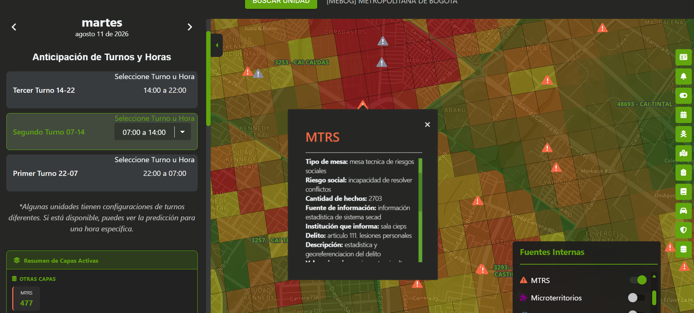
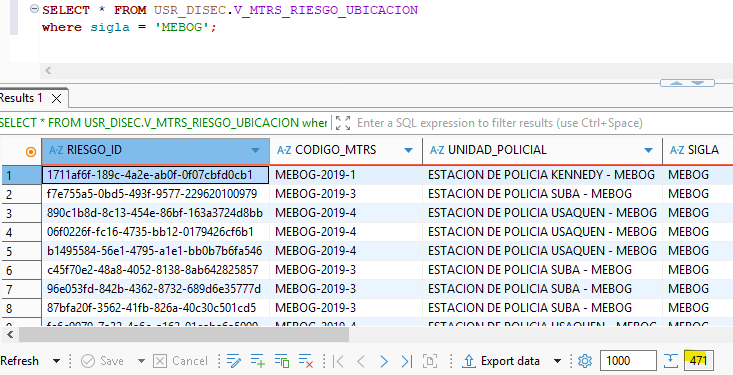
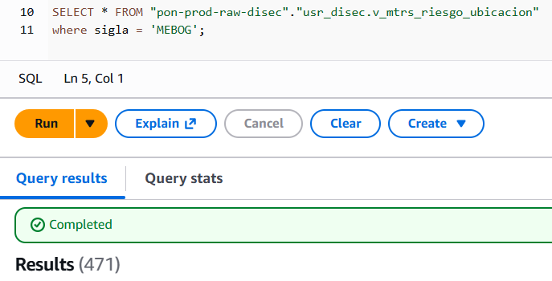

# MTRS

## 1. Identificación

<p align="center">

| Campo | Valor |
|---|---|
| ID | POL-MAPA-001 |
| Módulo | Fuentes Internas |
| Capa | Capa MTRS |
| Frecuencia de actualización | Diaria |
| Hora de carga del Data Lake | 04:00 a. m. |
| Última actualización del caso | AAAA-MM-DD |

</p>

## 2. Descripción

Esta capa hace referencia a la Mesa Técnica de Riesgos Sociales, que ofrece datos georreferenciados correspondientes al último año.  

## 3. Ruta de acceso

1. Ingresar al aplicativo `IAPOL`.
2. Abrir el módulo `Anticipación a Fenómenos de Seguridad`.
3. Seleccionar el submódulo `Mapa de Anticipación a Fenómenos de Seguridad`.
4. Ingresar a `Mapa`.

- Ruta resumida:

`Menú principal > Anticipación a Fenómenos de Seguridad > Mapa de Anticipación a Fenómenos de Seguridad`

## 4. Activación de la capa

1. Seleccionar `Sigla y/o unidad hija`
2. Abrir el modulo de `fuentes internas`.
3. Activar la capa `MTRS`.
4. Aplicar los filtros requeridos.

<p align="center">
  
</p>

## 5. Parámetros y filtros de prueba

<p align="center">

| Parámetro | Valor utilizado | Obligatorio |
|---|---|---|
| Sigla | Todos | Si |
| Unidades hijas | Todos | No |
</p>

## 6. Fuente de datos

### Base de datos de la Policía

- Sistema o base de datos: DISEC
- Esquema: USR_DISEC
- Tabla o vista: V_MTRS_RIESGO_UBICACION
- Consulta a DB Policia: [Oracle.sql](sql/2.Oracle.sql)
- Query Oracle: 

``` sql
SELECT * FROM USR_DISEC.V_MTRS_RIESGO_UBICACION WHERE sigla = 'MEBOG';
```

<p align="center">



### Data Lake en Athena

- DataSource: AwsDataCatalog
- DataBase: pon-prod-raw-disec
- Table: usr_disec.v_mtrs_riesgo_ubicacion
- Consulta Athena: [athena.sql](sql/1.Athena.sql)
- Query: 

``` sql
SELECT * FROM "pon-prod-raw-disec"."usr_disec.v_mtrs_riesgo_ubicacion"
where sigla = 'MEBOG';
```

<p align="center">

</p>                                     

## 7. Validaciones funcionales

- [ ] La capa puede activarse y desactivarse.
- [ ] El detalle del punto muestra los campos definidos.
- [ ] El nombre y la descripción son correctos.
- [ ] Los filtros modifican la información mostrada.
- [ ] Los puntos aparecen en el área geográfica esperada.
- [ ] La leyenda y los colores corresponden a la capa.
- [ ] No se presentan errores al cargar la información.

## 8. Validaciones de datos

- [ ] La fecha de actualización de Athena es la esperada.
- [ ] Los filtros de negocio son equivalentes.
- [ ] La cantidad total coincide.
- [ ] No existen identificadores duplicados.
- [ ] Una muestra de registros coincide entre ambas fuentes.
- [ ] La cantidad mostrada en el mapa coincide con Athena.

## 9. Criterios de aceptación

La prueba es exitosa cuando:

1. La capa carga sin errores.
2. La información corresponde al periodo seleccionado.
3. Athena y la fuente de Policía coinciden después de aplicar las reglas
   de transformación.
4. La cantidad del mapa coincide con el resultado esperado en Athena.
5. No existen diferencias sin justificación documentada.


## 10. Conclusión
La capa tiene una diferencia de 6 registros entre el contador de mapas (477) y la consulta en athena (471). La consulta en Oracle arroja (471) registros coincidiendo con la consulta en athena.