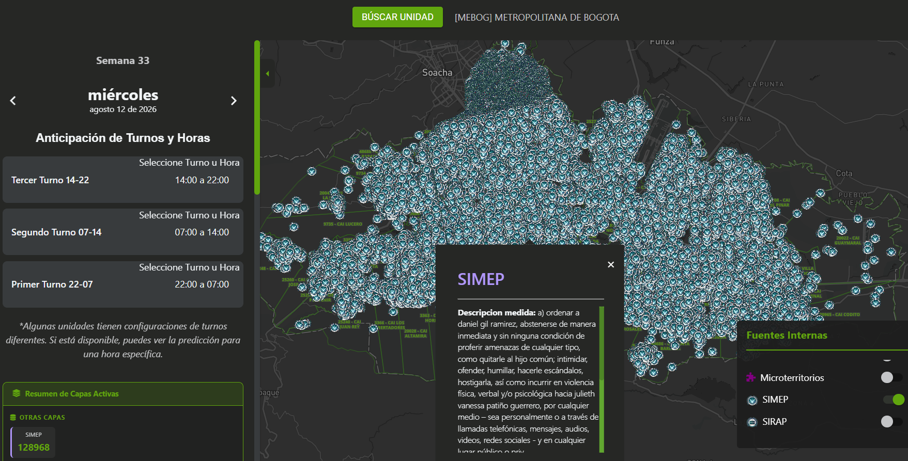
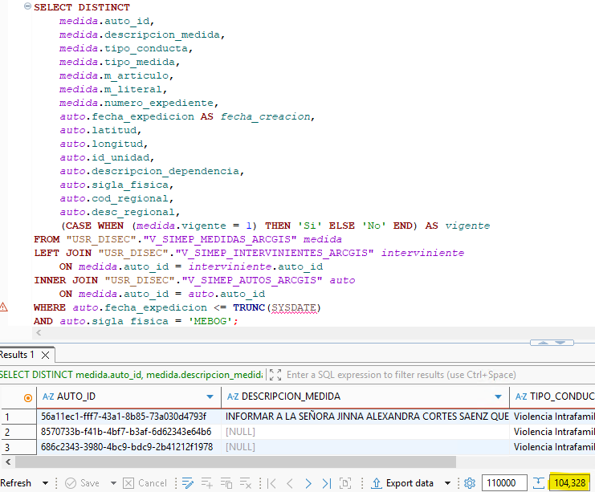
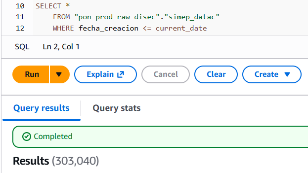
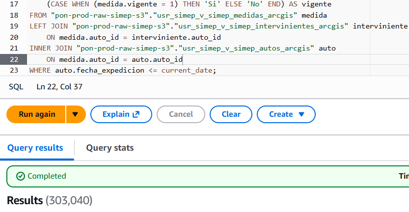
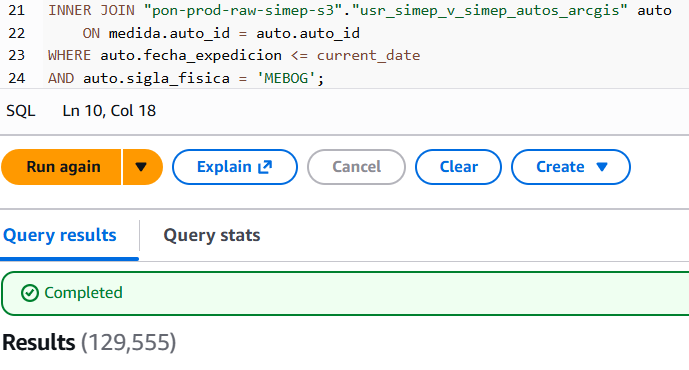

# SIMEP

## 1. Identificación

<p align="center">

| Campo | Valor |
|---|---|
| ID | POL-MAPA-001 |
| Módulo | Fuentes Internas |
| Capa | Capa SIMEP |
| Frecuencia de actualización | Diaria |
| Hora de carga del Data Lake | 04:00 a. m. |
| Última actualización del caso | AAAA-MM-DD |

</p>

## 2. Descripción

La capa del Sistema de Medidas de Protección de Mujer, Familia y Género muestra información georreferenciada de los últimos 6 meses. 

## 3. Ruta de acceso

1. Ingresar al aplicativo `IAPOL`.
2. Abrir el módulo `Anticipación a Fenómenos de Seguridad`.
3. Seleccionar el submódulo `Mapa de Anticipación a Fenómenos de Seguridad`.
4. Ingresar a `Mapa`.

- Ruta resumida:

`Menú principal > Anticipación a Fenómenos de Seguridad > Mapa de Anticipación a Fenómenos de Seguridad`

## 4. Activación de la capa

1. Seleccionar `Sigla y/o unidad hija`
2. Abrir el modulo de `fuentes internas`.
3. Activar la capa `SIMEP`.
4. Aplicar los filtros requeridos.

<p align="center">
  
</p>

## 5. Parámetros y filtros de prueba

<p align="center">

| Parámetro | Valor utilizado | Obligatorio |
|---|---|---|
| Sigla | Todos | Si |
| Unidades hijas | Todos | No |
</p>

## 6. Fuente de datos

### Base de datos de la Policía

- Sistema o base de datos: DISEC
- Esquema: USR_DISEC
- Tabla o vista: "V_SIMEP_MEDIDAS_ARCGIS", "V_SIMEP_AUTOS_ARCGIS" y "V_SIMEP_INTERVINIENTES_ARCGIS"
- Consulta a DB Policia: [Oracle.sql](sql/2.Oracle.sql)
- Query Oracle: 

``` sql
SELECT DISTINCT
    medida.auto_id,
    medida.descripcion_medida,
    medida.tipo_conducta,
    medida.tipo_medida,
    medida.m_articulo,
    medida.m_literal,
    medida.numero_expediente,
    auto.fecha_expedicion AS fecha_creacion,
    auto.latitud,
    auto.longitud,
    auto.id_unidad,
    auto.descripcion_dependencia,
    auto.sigla_fisica,
    auto.cod_regional,
    auto.desc_regional,
    (CASE WHEN (medida.vigente = 1) THEN 'Si' ELSE 'No' END) AS vigente
FROM "USR_DISEC"."V_SIMEP_MEDIDAS_ARCGIS" medida
LEFT JOIN "USR_DISEC"."V_SIMEP_INTERVINIENTES_ARCGIS" interviniente 
    ON medida.auto_id = interviniente.auto_id
INNER JOIN "USR_DISEC"."V_SIMEP_AUTOS_ARCGIS" auto 
    ON medida.auto_id = auto.auto_id
WHERE auto.fecha_expedicion <= TRUNC(SYSDATE)
AND auto.sigla_fisica = 'MEBOG';
```

<p align="center">



### Data Lake en Athena

- DataSource: AwsDataCatalog
- DataBase: pon-prod-raw-disec
- Table: simep_datac
- Consulta Athena: [athena.sql](sql/1.Athena.sql)
- Query: 

``` sql
SELECT *
    FROM "pon-prod-raw-disec"."simep_datac"
    WHERE fecha_creacion <= current_date
```

<p align="center">

</p>

<p align="center">

</p>

Este query apunta a una vista que no contiene una columna para hacer un filtrado por unidad o sigla lo que genera un conteo unico general por lo cual debemos ejecutar el siguiente query para validar el numero de registros por unidad, para comprar con el query inicial se omite la ultima linea de filtrado por sigla.

``` sql
SELECT DISTINCT
    medida.auto_id,
    medida.descripcion_medida,
    medida.tipo_conducta,
    medida.tipo_medida,
    medida.m_articulo,
    medida.m_literal,
    medida.numero_expediente,
    auto.fecha_expedicion AS fecha_creacion,
    auto.latitud,
    auto.longitud,
    auto.id_unidad,
    auto.descripcion_dependencia,
    auto.sigla_fisica,
    auto.cod_regional,
    auto.desc_regional,
    (CASE WHEN (medida.vigente = 1) THEN 'Si' ELSE 'No' END) AS vigente
FROM "pon-prod-raw-simep-s3"."usr_simep_v_simep_medidas_arcgis" medida
LEFT JOIN "pon-prod-raw-simep-s3"."usr_simep_v_simep_intervinientes_arcgis" interviniente 
    ON medida.auto_id = interviniente.auto_id
INNER JOIN "pon-prod-raw-simep-s3"."usr_simep_v_simep_autos_arcgis" auto 
    ON medida.auto_id = auto.auto_id
WHERE auto.fecha_expedicion <= current_date
AND auto.sigla_fisica = 'MEBOG';
```
<p align="center">

</p>

## 7. Validaciones funcionales

- [ ] La capa puede activarse y desactivarse.
- [ ] El detalle del punto muestra los campos definidos.
- [ ] El nombre y la descripción son correctos.
- [ ] Los filtros modifican la información mostrada.
- [ ] Los puntos aparecen en el área geográfica esperada.
- [ ] La leyenda y los colores corresponden a la capa.
- [ ] No se presentan errores al cargar la información.

## 8. Validaciones de datos

- [ ] La fecha de actualización de Athena es la esperada.
- [ ] Los filtros de negocio son equivalentes.
- [ ] La cantidad total coincide.
- [ ] No existen identificadores duplicados.
- [ ] Una muestra de registros coincide entre ambas fuentes.
- [ ] La cantidad mostrada en el mapa coincide con Athena.

## 9. Criterios de aceptación

La prueba es exitosa cuando:

1. La capa carga sin errores.
2. La información corresponde al periodo seleccionado.
3. Athena y la fuente de Policía coinciden después de aplicar las reglas
   de transformación.
4. La cantidad del mapa coincide con el resultado esperado en Athena.
5. No existen diferencias sin justificación documentada.


## 10. Conclusión
La capa tiene una diferencia de 587 registros entre el contador de mapas (128968) y la consulta en athena (129555). La consulta en oracle arroja (104328).