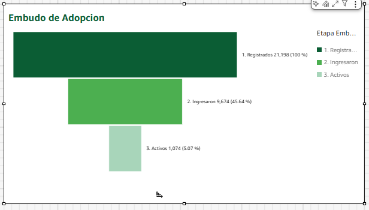
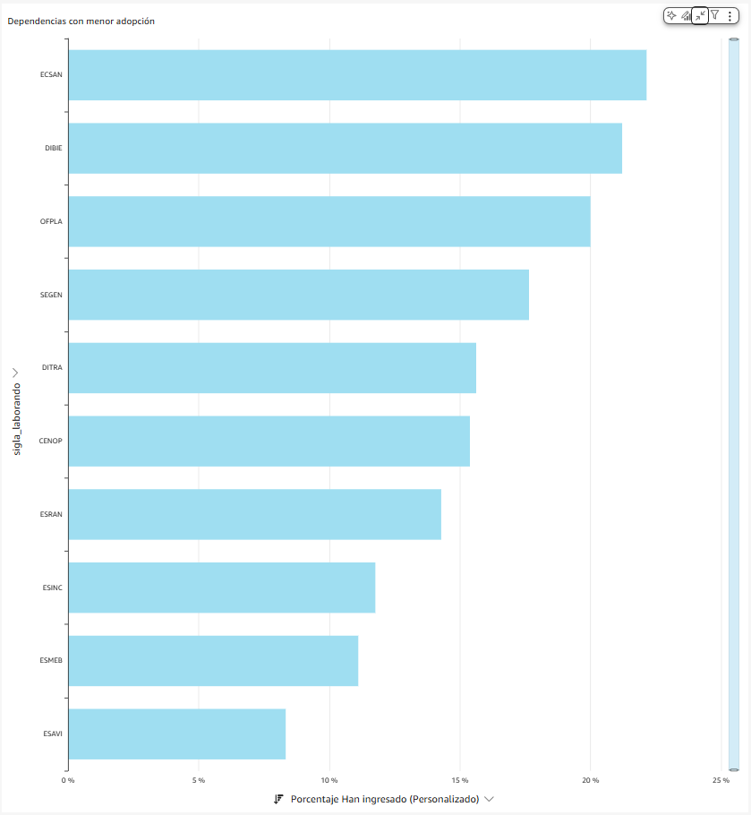
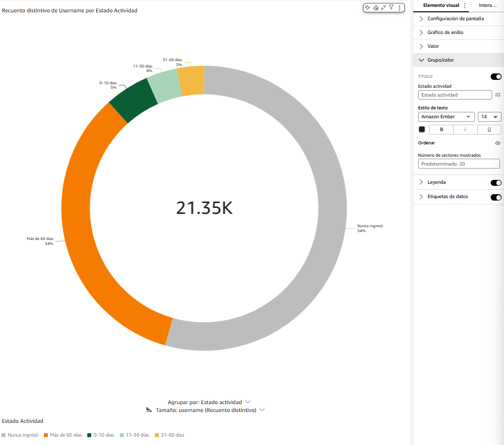
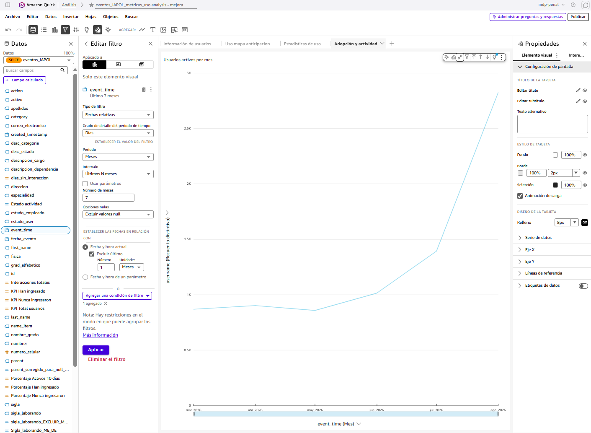

# Lógica de los visuales

## Embudo de Adopción

El embudo muestra valores acumulados y relacionados:

```text
1. Registrados >= 2. Ingresaron >= 3. Activos
```



### Dimensión `Etapa embudo`

```text
ifelse(
    dateDiff({fecha_evento}, now(), 'DD') <= 10, '3. Activos',
    {estado_user} = 'Sin ingreso', '1. Registrados',
    '2. Ingresaron'
)
```

Los prefijos numéricos forman parte de la dimensión y conservan el orden Registrados, Ingresaron y Activos.

### Totales utilizados

Registrados:

```text
distinctCountOver({username}, [], PRE_AGG)
```

Ingresaron:

```text
distinctCountOver(
    ifelse({estado_user} = 'Con ingreso', {username}, NULL),
    [],
    PRE_AGG
)
```

Activos:

```text
distinctCountOver(
    ifelse(
        dateDiff({fecha_evento}, now(), 'DD') <= 10,
        {username},
        NULL
    ),
    [],
    PRE_AGG
)
```

### Medida `Valor embudo`

```text
ifelse(
    {Etapa embudo} = '1. Registrados', {Total embudo registrados},
    {Etapa embudo} = '2. Ingresaron', {Total embudo ingresaron},
    {Etapa embudo} = '3. Activos', {Total embudo activos},
    0
)
```

### Pozos del visual

| Pozo | Campo | Agregación |
|---|---|---|
| Agrupar por | `Etapa embudo` | Dimensión, orden ascendente. |
| Valor | `Valor embudo` | Máximo. |

Se utiliza **Máximo** porque cada etapa contiene un total calculado a nivel global. Sumarlo repetiría el valor por cada fila de la etapa.

Las etiquetas muestran el valor y su proporción sobre Registrados. Por ejemplo, `Ingresaron 45,64 %` significa `9.674 / 21.198`; no es la comparación con el mes anterior.

## Dependencias con menor adopción

La gráfica muestra las diez siglas con menor proporción de usuarios que han ingresado.

```text
Usuarios únicos con ingreso de la sigla
/
Usuarios únicos registrados de la sigla
```



| Elemento | Configuración |
|---|---|
| Tipo de visual | Barras horizontales. |
| Categoría | `sigla_laborando`. |
| Valor | `Porcentaje Han ingresado`. |
| Límite | Inferior 10. |
| Orden | Ascendente por porcentaje. |
| Formato | Porcentaje. |

La primera barra corresponde a la sigla con menor adopción dentro del contexto seleccionado.

## Estado de actividad

La clasificación se obtiene de `estado_user` y de los días transcurridos desde la última interacción.

```text
ifelse(
    {estado_user} = 'Sin ingreso', 'Nunca ingresó',
    {dias_sin_interaccion} <= 10, '0-10 días',
    {dias_sin_interaccion} <= 30, '11-30 días',
    {dias_sin_interaccion} <= 60, '31-60 días',
    'Más de 60 días'
)
```

La condición `Sin ingreso` se evalúa primero para que esos usuarios no sean asignados a un rango de días.



### Pozos y colores

| Estado | Color | Código |
|---|---|---|
| 0-10 días | Verde oscuro | `#0B5D34` |
| 11-30 días | Verde claro | `#A8D5BA` |
| 31-60 días | Amarillo | `#F4B942` |
| Más de 60 días | Naranja | `#F57C00` |
| Nunca ingresó | Gris | `#BDBDBD` |

| Pozo | Campo |
|---|---|
| Grupo/color | `Estado actividad`. |
| Valor | `username`, recuento distinto. |

Las etiquetas representan la participación de cada estado sobre el total de usuarios del contexto seleccionado.

## Usuarios activos por mes

La gráfica cuenta cuántos usuarios únicos tuvieron eventos en cada mes.



| Elemento | Configuración |
|---|---|
| Tipo | Línea. |
| Eje X | `event_time`, agregado por mes. |
| Valor | `username`, recuento distinto. |
| Periodo visible | Últimos 7 meses. |
| Orden | Cronológico ascendente. |

Un mismo usuario se cuenta una sola vez dentro de cada mes, aunque tenga varios eventos. Puede aparecer en meses diferentes si tuvo actividad en cada uno de ellos.

El control temporal se aplica únicamente a esta gráfica. De esta forma, seleccionar los últimos siete meses no elimina de los KPI a quienes nunca han ingresado.

## Tabla Usuarios que requieren seguimiento

La tabla consolida la información por usuario y se orienta a quienes no tienen actividad reciente.

| Columna visible | Campo o lógica |
|---|---|
| Grad... | `grad_alfabetico`. |
| Nombres | `nombres`. |
| Apellidos | `apellidos`. |
| Usuario | `username`. |
| Sigla | `sigla_laborando`. |
| Dependencia | `descripcion_dependencia`. |
| Estado | `Estado actividad`. |
| Inicio interacción | Fecha mínima de interacción del usuario. |
| Último ingreso | Fecha máxima de interacción del usuario. |
| Días sin | `dias_sin_interaccion`. |
| Interacciones | Total de eventos o campo consolidado de interacciones. |

El filtro propio de la tabla excluye el estado de actividad reciente:

```text
{Estado actividad} <> '0-10 días'
```

Por ello, el detalle se concentra en usuarios de 11-30 días, 31-60 días, más de 60 días y quienes nunca ingresaron.

El formato condicional de `Estado` utiliza la misma paleta del gráfico para mantener una lectura consistente.
