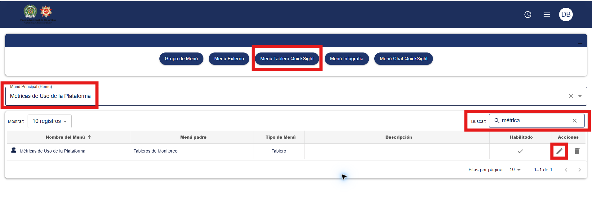
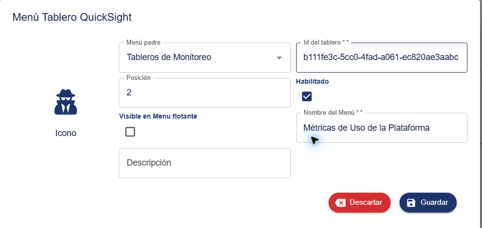

# Publicación en Amazon Quick y Houndoc

## Identificadores del dashboard

| Elemento | Valor |
|---|---|
| Región | `us-east-1` |
| Cuenta/namespace observado | `mdp-ponal` |
| Dashboard ID | `b111fe3c-5cc0-4fad-a061-ec820ae3aabc` |
| Sheet ID | `b111fe3c-5cc0-4fad-a061-ec820ae3aabc_933f38ed-db51-49a8-9c8b-7eab2d59905c` |

URL de referencia en Amazon Quick:

```text
https://us-east-1.quicksight.aws.amazon.com/sn/account/mdp-ponal/
dashboards/b111fe3c-5cc0-4fad-a061-ec820ae3aabc/
sheets/b111fe3c-5cc0-4fad-a061-ec820ae3aabc_933f38ed-db51-49a8-9c8b-7eab2d59905c
```

## Valor registrado en Houndoc

El campo **Id del tablero** contiene exclusivamente:

```text
b111fe3c-5cc0-4fad-a061-ec820ae3aabc
```

No contiene la URL completa ni el `Sheet ID`.

## Ubicación del registro

```text
Administración
  > Control Menús
  > Menú Tablero QuickSight
  > Buscar “Métricas de Uso de la Plataforma”
  > Editar
  > Id del tablero
```





## Relación entre los identificadores

```text
Amazon Quick publica el dashboard
        ↓
Dashboard ID: b111fe3c-5cc0-4fad-a061-ec820ae3aabc
        ↓
Houndoc guarda ese Dashboard ID en Control Menús
        ↓
El menú abre el tablero embebido para los usuarios autorizados
```

El identificador `2013641f-ae5a-4707-86a7-a8afaa206b2c`, usado previamente durante la revisión, no correspondía al dashboard publicado y fue reemplazado por el Dashboard ID correcto.
