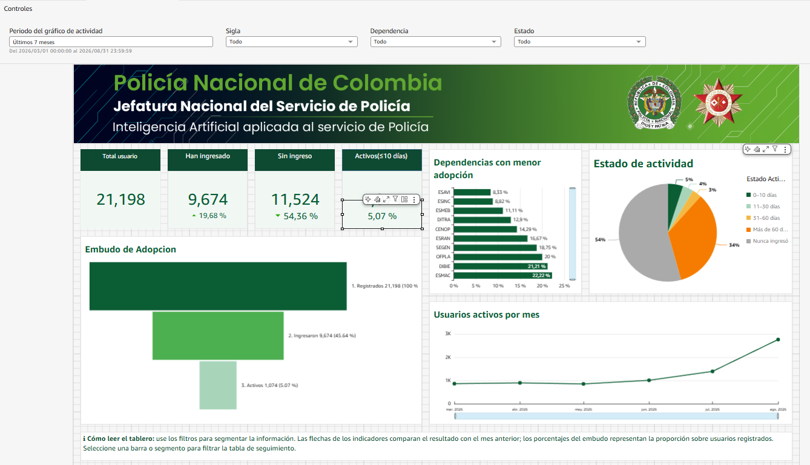

# Documentación técnica — Información de usuarios

Esta carpeta contiene la lógica implementada en la hoja **Información de usuarios** del dashboard **Métricas de Uso de la Plataforma**. Su propósito es permitir que otra persona entienda de dónde sale cada indicador, cómo se construye cada visual y qué campos intervienen.



## Contenido

| Documento | Contenido |
|---|---|
| [01_logica_kpis.md](01_logica_kpis.md) | Fórmulas de Total usuario, Han ingresado, Sin ingreso, Activos y comparación mensual. |
| [02_logica_visuales.md](02_logica_visuales.md) | Construcción del embudo, menor adopción, estado de actividad, tendencia y tabla. |
| [03_filtros_e_interacciones.md](03_filtros_e_interacciones.md) | Población, controles, alcance de filtros y selecciones entre visuales. |
| [04_publicacion.md](04_publicacion.md) | Identificadores de Amazon Quick y vinculación del tablero en Houndoc. |
| [imagenes/](imagenes/) | Evidencias visuales incluidas en la documentación. |

## Propósito de la hoja

La hoja mide tres niveles relacionados:

```text
Usuarios registrados
        └── Usuarios que han ingresado alguna vez
                └── Usuarios activos en los últimos 10 días
```

También identifica:

- Usuarios que nunca han ingresado.
- Dependencias con menor adopción.
- Distribución por tiempo desde la última interacción.
- Evolución mensual de usuarios activos.
- Usuarios que requieren seguimiento.

## Población base

Los visuales parten de usuarios válidos de la Policía que se encuentran activos laboralmente:

```text
usuarios_policia = 1
estado_empleado = 'AC'
```

La unidad de análisis es el usuario. Por eso, los KPI utilizan `username` con recuento distinto y no el número de filas o eventos.

## Campos fuente principales

| Campo | Uso técnico |
|---|---|
| `username` | Identificador único empleado en los conteos distintos. |
| `estado_user` | Separa usuarios con ingreso y sin ingreso. |
| `fecha_evento` | Determina primera fecha, última actividad y actividad reciente. |
| `event_time` | Eje temporal de la gráfica mensual. |
| `dias_sin_interaccion` | Clasifica al usuario por rango de inactividad. |
| `sigla_laborando` | Agrupa y filtra por sigla. |
| `descripcion_dependencia` | Filtra y muestra la dependencia. |
| `usuarios_policia` | Delimita la población policial. |
| `estado_empleado` | Delimita empleados activos (`AC`). |
| `grad_alfabetico`, `nombres`, `apellidos` | Identificación en la tabla de seguimiento. |

## Resultados de referencia

Los siguientes valores corresponden a la captura final usada durante la construcción:

| Indicador | Resultado |
|---|---:|
| Total usuario | 21.198 |
| Han ingresado | 9.674 |
| Sin ingreso | 11.524 |
| Activos en los últimos 10 días | 1.074 |
| Porcentaje Han ingresado | 45,64 % |
| Porcentaje Sin ingreso | 54,36 % |
| Porcentaje Activos | 5,07 % |

Estos valores son una referencia histórica y cambian al actualizar los datos o seleccionar filtros.

## Relación matemática central

```text
Total usuario = Han ingresado + Sin ingreso

Porcentaje Han ingresado + Porcentaje Sin ingreso = 100 %

Activos últimos 10 días ⊆ Han ingresado ⊆ Total usuario
```

## Identificador publicado

```text
Dashboard ID: b111fe3c-5cc0-4fad-a061-ec820ae3aabc
```

El procedimiento de publicación se encuentra en [04_publicacion.md](04_publicacion.md).
