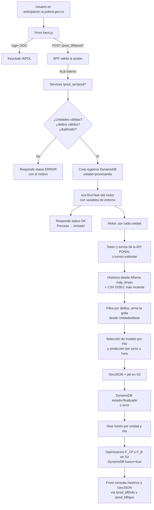
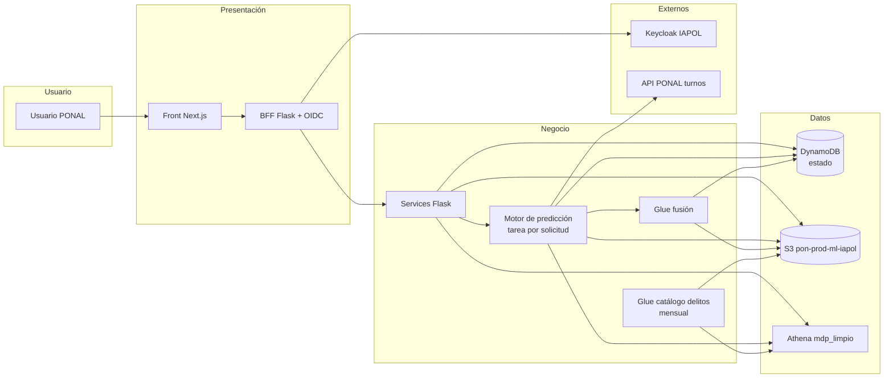
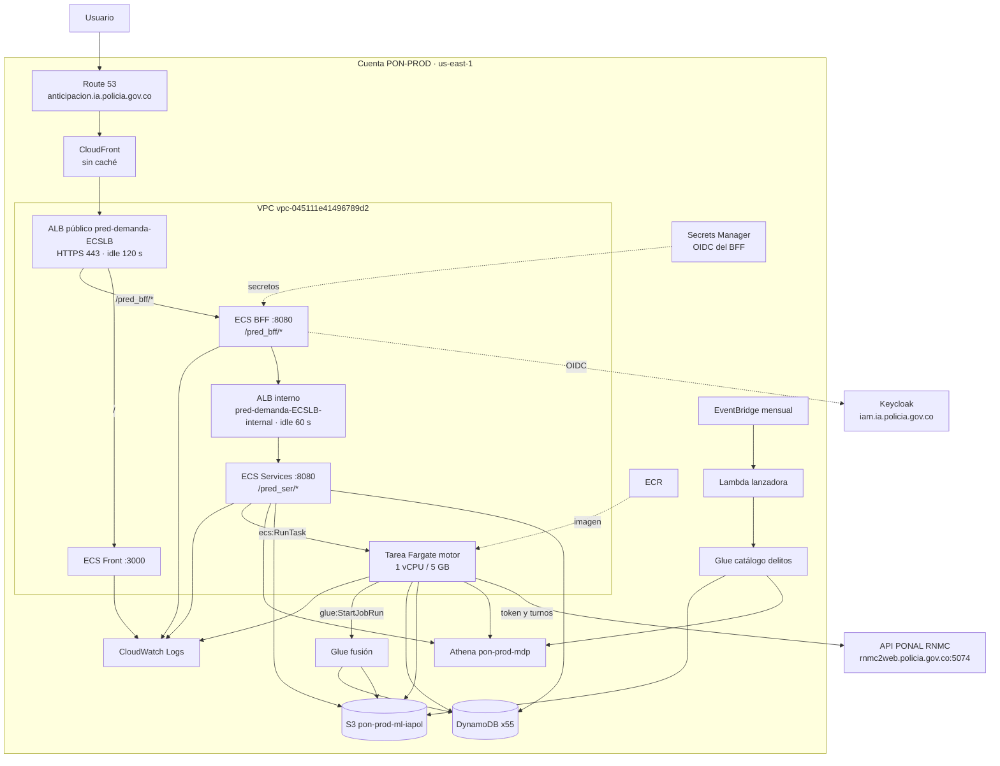
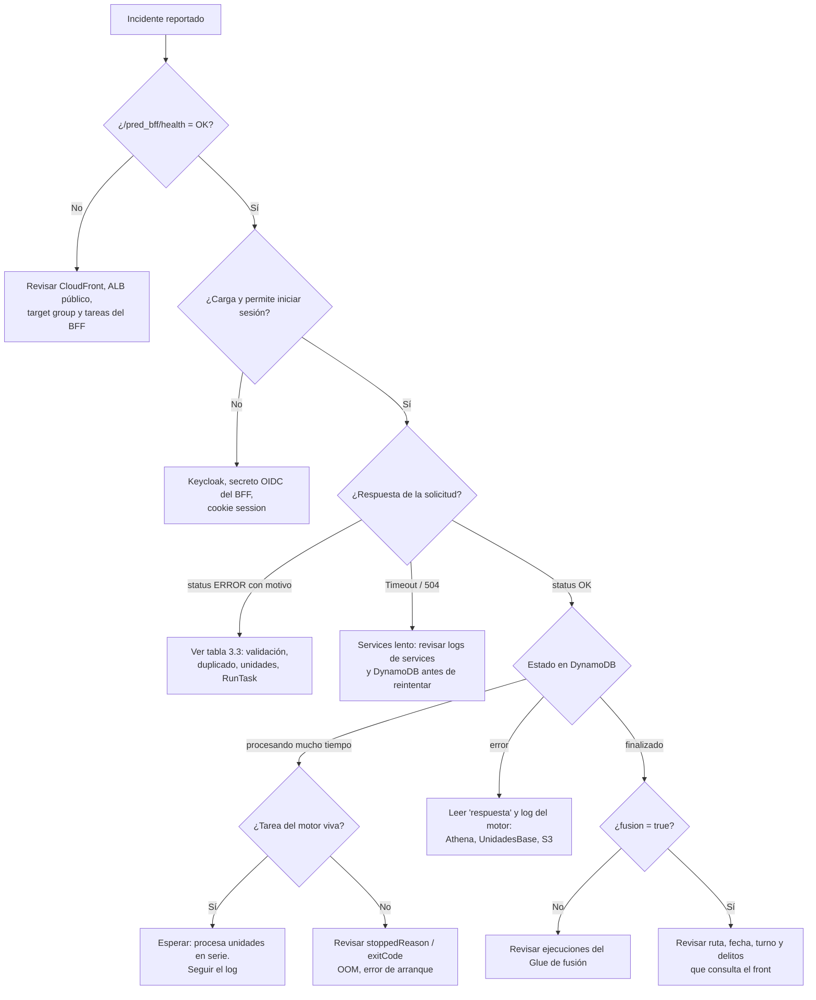

# Anticipación por Demanda — documentación funcional y guía de soporte

> **Región AWS:** `us-east-1`
> **Stacks CDK:** `Prediccion-Demanda-Cdk` (motor, DynamoDB, Glue, Lambda) y `pred-demanda-Pipeline`, `pred-demanda-bff-Pipeline`, `pred-demanda-ser-Pipeline` (front, BFF y services)
> **Última revisión del documento:** 2026-11-09

## Para qué sirve este documento

Aquí se explica cómo funciona el submódulo **Anticipación por Demanda** de punta a punta: desde que un usuario pide una anticipación en `https://anticipacion.ia.policia.gov.co` hasta que el motor de predicción publica los GeoJSON de cuadrículas, cuadrantes optimizados y puntos de apoyo que el mapa vuelve a consultar. El foco está en que soporte, operación y desarrollo puedan:

- entender qué hace cada componente y cómo se conectan;
- diagnosticar un incidente con los pasos y comandos necesarios;
- recuperar el servicio cuando algo falla;
- desplegar cambios y hacer rollback de forma segura;
- ejecutar los componentes localmente para pruebas.

> **Diagrama editable:** junto a este archivo está [`arquitectura_aws.drawio`](arquitectura_aws.drawio), con los iconos de cada servicio AWS, las integraciones externas (Keycloak y API PONAL) y el flujo numerado de una solicitud. Se abre en [draw.io](https://app.diagrams.net) o con la extensión de VS Code.

## Referencia rápida para soporte

| Elemento | Valor |
|---|---|
| URL pública | `https://anticipacion.ia.policia.gov.co` |
| Health check BFF (público) | `GET https://anticipacion.ia.policia.gov.co/pred_bff/health` → `OK` |
| Health check services (interno) | `GET /pred_ser/health` en el ALB interno `pred-demanda-ECSLB-internal` |
| Swagger | `/swagger` en BFF y en services |
| Solicitar anticipación | `POST /pred_bff/pred/completo`, `/pred_bff/pred/parcial`, `/pred_bff/pred/hora` (requiere sesión Keycloak) |
| Servicio front | `pred-demanda-ECSCluster / pred-demanda-ECSService` |
| Servicio BFF | `pred-demanda-bff-ECSCluster / pred-demanda-bff-ECSService` |
| Servicio services | `pred-demanda-ser-ECSCluster / pred-demanda-ser-ECSService` |
| Motor (tareas bajo demanda) | cluster `pon-prod-xcrime-prediccion-demanda-cluster`, familia `pon-prod-xcrime-prediccion-demanda-definition` |
| Imagen del motor | ECR `pon-prod-xcrime-predicciones-repository`, tags `demanda_v4.0.x` (en producción: `demanda_v4.0.5`, revisión 16) |
| Glue de optimización | `pon-prod-xcrime-ejecucion-fusion-demanda-job` |
| Glue de catálogo de delitos | `pon-prod-xcrime-prediccion-demanda-update-delitos-unidad-job` |
| Programación mensual | regla `pon-prod-xcrime-prediccion-demanda-update-delitos-unidad-rule`, `cron(15 2 1 * ? *)` |
| Estado de solicitudes | DynamoDB `pon-prod-prediccion-demanda-{SIGLA}` (55 tablas) |
| Bucket de trabajo | `pon-prod-ml-iapol` |
| Fuente histórica | Athena `"pon-prod-mdp"."mdp_limpio"` |
| Resultado de predicción | `PrediccionMdP/{AAAA}/{AAAAMMDD-lunes}/{SIGLA}/{UNIDAD}/Demanda/{TIMEFRAME}/{DELITOS}/Prediccion/` |
| Resultado de optimización | mismo prefijo + `Optimizacion/Optimizacion_*_F_CP{NN}.geojson` y `_F_B{NN}.geojson` |
| Log de ejecución del motor | `informacion_predicciones/{AAAAMMDD}/{SIGLA}/DEMANDA/{TIMEFRAME}/{DELITOS}/{UNIDAD}/*.json` |
| Logs del motor | grupo `Prediccion-Demanda-Cdk-...ContainerLogGroup0E18B9AF-hnHBC4q08SKq`, prefijo `pon-prod-xcrime-prediccion-demanda` |

### Criterio de éxito

Que la API responda `status: OK` **solo confirma que la tarea del motor se lanzó**. No confirma que la predicción terminó. Para una solicitud completa, el criterio es:

1. en DynamoDB, cada registro `unidad_base_fecha` de la solicitud (`id_process`) pasa de `estado=procesando` a `estado=finalizado`;
2. existen los GeoJSON `Prediccion_{UNIDAD}_{AAAAMMDD}_{TURNO|HHMM}.geojson` bajo la ruta guardada en el campo `ruta`;
3. el registro tiene `fusion=true` y existen los archivos `Optimizacion/..._F_CP{NN}.geojson` y `..._F_B{NN}.geojson` (cuadrantes y puntos de apoyo);
4. el JSON de log del motor en `informacion_predicciones/...` tiene `status.codigo = OK`;
5. el campo `info` del archivo `turnos_dinamicos/.../TurnoGenerado_*.json` dice `Consulta en servicio de ponal OK`. Si dice "formato estándar", la predicción salió con los turnos por defecto (ver 3.3).

---

## 1. Descripción y lógica del componente

### 1.1 Qué hace

Anticipación por Demanda permite que un usuario autorizado genere, **a solicitud**, una predicción espacial de la demanda de servicio de policía para una o varias unidades (CAI, subestación o estación) de una sigla (metropolitana o departamento). El usuario elige:

- la sigla (`CAD`) y las unidades (si no envía unidades, se procesan todas las de la sigla);
- el periodo histórico de entrenamiento (`startDayTrain` – `endDayTrain`);
- el día inicial a predecir y cuántos días (`daysToPredict`);
- la granularidad: por turno, por hora, turno parcial u horas específicas;
- opcionalmente, uno o varios delitos (texto de `descripcion`, por ejemplo `artículo 239. hurto personas`).

El motor entrena varios modelos de predicción espacio-temporal sobre el histórico de `mdp_limpio` (sin SECAD ni RNMC), escoge el de mejor desempeño (métrica PAI) para cada día y turno u hora, y publica una cuadrícula de 200 × 200 m con la intensidad esperada. Después, un job de Glue fusiona la cuadrícula con los cuadrantes de la unidad y genera alternativas con menos cuadrantes (de N hasta el mínimo de patrullas) con puntos de apoyo ubicados sobre la malla vial.

**Aclaraciones importantes para soporte:**

- La intensidad es una **estimación estadística** de demanda, no una certeza ni una orden operativa.
- Si los modelos no logran predecir (por ejemplo, por pocos datos), el motor usa un modelo **uniforme**: todo el polígono con la misma intensidad. No es un error, pero hay que explicarlo si el mapa sale "plano".
- Si la API de turnos de PONAL falla, la predicción **no se detiene**: se usan los turnos estándar 22–07, 07–14 y 14–22.

### 1.2 Componentes de aplicación

| Componente | Repositorio | Responsabilidad |
|---|---|---|
| Front | `ai-scm/pon-xcrimePredictionDemanda-front` | Aplicación Next.js 14 (puerto 3000). Inicia sesión con Keycloak, muestra el formulario de solicitud, el histórico y el mapa. Consume solo el BFF. |
| BFF (gateway) | `ai-scm/pon-xcrimePredictionDemanda-gateway` | Flask + `flask_oidc` + `python-keycloak` (puerto 8080, prefijo `/pred_bff`). Maneja login/logout, valida la sesión en cada endpoint y reenvía la petición a services por el ALB interno. |
| Services | `ai-scm/pon-xcrimePredictionDemanda-services` | Flask (puerto 8080, prefijo `/pred_ser`). Valida la solicitud, revisa duplicados, crea los registros en DynamoDB, lanza la tarea del motor (`ecs:RunTask`) y expone las consultas de información y GeoJSON. |
| Motor de predicción | `XCrimePrediction` (este repositorio, rama `ecs_demanda`, carpeta `Sci-XCrimeGeneradorCuadrantes/`) | Contenedor Python 3.6 que corre una vez por solicitud. Consulta turnos en la API PONAL, lee el histórico en Athena, entrena y selecciona modelos, escribe resultados en S3, actualiza DynamoDB y lanza la fusión. |
| Glue fusión | este repositorio, `cdk_demanda/components/glue_scripts/pon-prod-xcrime-fusion_demanda.py` | Cruza la predicción con los cuadrantes, fusiona cuadrantes vecinos de menor intensidad y calcula puntos de apoyo sobre calles. |
| Glue catálogo de delitos | `.../pon-prod-xcrime-update-delitos.py` | Cada mes publica la lista de delitos distintos por sigla (`unidad_delitos/{SIGLA}_delitos.json`), que alimenta el selector del front. |
| Infraestructura | este repositorio: `cdk_demanda/` y `cdk_pipelines/` | CDK TypeScript del motor, DynamoDB, Glue, Lambda y de los tres pipelines de ECS. |

> En la configuración de pipelines aparece también `pon-prod-xcAppServ` (XCrimeAppServicios). Su servicio ECS está en **0 tareas deseadas** y no participa en el flujo de Anticipación por Demanda.

### 1.3 Modos de predicción (`timeFrame`)

| Endpoint BFF | `timeFrame` | `type_process` del motor | Qué genera |
|---|---|---|---|
| `/pred/completo` | `TURNO` (por defecto) | `completo` | Un GeoJSON por día y turno. `daysToPredict` por defecto 7. |
| `/pred/completo` | `HORA` | `completo` | Un GeoJSON por cada hora (24 por día). |
| `/pred/parcial` | `PARC` | `parcial` | Un turno personalizado de `horasPrediccion` horas (de 1 a 22) desde `horaInicial`. Un solo día. |
| `/pred/hora` | `JSHORA` | `horas` | Solo las horas listadas en `horasPredecir` del día inicial. Se guarda bajo la carpeta `HORA`. |

### 1.4 Turnos

El motor pide los turnos de cada unidad a la API PONAL (`GetTurnosEstacion`). Si la API falla o responde `null`, usa los turnos estándar:

| `idTurno` | Turno | Ventana |
|---|---|---|
| `91` | Primer turno | 22:00 del día anterior – 07:00 |
| `89` | Segundo turno | 07:00 – 14:00 |
| `90` | Tercer turno | 14:00 – 22:00 |

El nombre de cada archivo de turno lleva el `idTurno` (`Prediccion_9707_20241105_91.geojson`). Los turnos usados quedan guardados en `s3://pon-prod-ml-iapol/turnos_dinamicos/{AAAAMMDD}/{SIGLA}/{UNIDAD}/TurnoGenerado_{UNIDAD}_{AAAAMMDD}.json`, y services los lee después para ordenar las capas del mapa.

**Tip de soporte:** el primer turno cruza medianoche. Un hecho de las 23:00 del 4 de noviembre pertenece al primer turno del **5 de noviembre**.

### 1.5 Flujo funcional



### 1.6 Secuencia paso a paso

1. **El front** redirige al usuario a `/pred_bff/auth/login`. El BFF hace el flujo OIDC contra Keycloak (`realm IAPOL`, cliente `pon-prod-prediccion-xcrime`) y deja una cookie `session`. `/pred_bff/auth/is_logged` hace introspección del token en cada carga.
2. **El front** envía la solicitud a `/pred_bff/pred/completo|parcial|hora`. El BFF comprueba `oidc.user_loggedin` (si no hay sesión redirige a login) y la reenvía a `services` con timeout de conexión 5 s y lectura 60 s.
3. **Services** completa valores por defecto y calcula `id_proceso = hash(parámetros + hora de la solicitud)`. Ejecuta la lógica en un proceso hijo y responde como máximo en **50 s** (el ALB interno corta a los 60 s).
4. **Resolución de unidades.** Con `EstructuraNacionaOperativalPONAL.csv` (en `pon-prod-ml-iapol`):
   - sin unidades → todas las unidades de la sigla (`SIGLA_PAPA`);
   - una sola unidad que no tiene cuadrantes propios (por ejemplo, una estación) → se convierte en sus **unidades hijas** con cuadrantes y se marca `estacion=True`;
   - varias unidades donde alguna es una estación → error (solo se acepta la estación sola).
5. **Validaciones** (si viene `validacion.validar=true`): cada delito pedido debe estar en el top de delitos de la unidad para el periodo (consulta a Athena). **Duplicados:** si ya existe en DynamoDB una predicción con los mismos parámetros, delitos, unidad y día, se rechaza.
6. **Registro:** se crea un ítem por unidad y por día en `pon-prod-prediccion-demanda-{SIGLA}` con `estado=procesando`. Si es estación, también se crea el ítem de la estación con el atributo `estacion` (lista de hijas).
7. **Lanzamiento:** `ecs:RunTask` sobre `pon-prod-xcrime-prediccion-demanda-cluster` con la familia `pon-prod-xcrime-prediccion-demanda-definition` **sin número de revisión** (ECS usa la última revisión ACTIVE), capacidad `FARGATE` (no Spot), IP pública y los parámetros como variables de entorno. Hasta 3 intentos con 10 s de espera. Si falla, marca `estado=error` en todos los ítems.
8. **El motor** (`main.py` → `Prediccion.run_process()`), por cada unidad **en serie**:
   1. obtiene un token de la API PONAL (`POST /bff/Login/Autenticacion`) y los turnos (`GET /bff/reg/IAPONAL/GetTurnosEstacion`). Si falla, sigue con los turnos estándar;
   2. consulta Athena: `"pon-prod-mdp"."mdp_limpio"` filtrado por sigla, código de unidad y fechas de entrenamiento, excluyendo `bd = 'SECAD'` y `bd = 'RNMC'` (5 intentos, 2 min entre intentos). Añade el CSV más reciente de `utilidades/temporal_queries_/{SIGLA}/{UNIDAD}_*`;
   3. filtra por delitos (`descripcion` contiene el texto, sin distinguir mayúsculas);
   4. carga el polígono de la unidad desde `UnidadesBase/{SIGLA}-UnidadesBase` y arma la grilla 200 × 200;
   5. para cada día y turno u hora selecciona el mejor modelo (20 particiones, cobertura PAI del 10 al 100 %), con un límite de 30 s por modelo antes de pasar al siguiente. Si la intensidad máxima es 0, usa el modelo uniforme;
   6. escribe `MatricesPrediccion/*.pkl` y `Prediccion/*.geojson` en S3;
   7. por cada día marca `estado=finalizado` y `ruta` en DynamoDB y lanza el Glue de fusión. Si algo falla, marca `estado=error` con el mensaje.
9. Al terminar todas las unidades, si fue una **estación**, compara las unidades con `status OK` contra las esperadas: si coinciden marca la estación `finalizado` con la ruta (la unidad aparece como `xxxxx` en la ruta); si no, `error` con la lista de unidades faltantes.
10. **Glue fusión** (una ejecución por unidad y día): lee la predicción, los cuadrantes (`UnidadesBase/{SIGLA}-Cuadrantes.geojson`), `NumPatrullas.csv` y las calles (`utilidades/calles/unidades/{SIGLA}-{UNIDAD}-streets.geojson`). Calcula la intensidad promedio de cada cuadrante y, mientras haya más cuadrantes que el mínimo de patrullas, guarda la configuración actual (`F_CP{NN}` cuadrantes y `F_B{NN}` puntos de apoyo) y fusiona el par de cuadrantes vecinos con menor intensidad. Al final marca `fusion=true`.
11. **Consulta:** el front lista el histórico (`/info/unidad_fecha`, `/info/solicitante_fecha`, `/info/historico_mes`) desde DynamoDB y descarga los GeoJSON (`/geo/*`) desde S3.

### 1.7 Contrato principal de la API

Solicitud de predicción por turnos:

```http
POST /pred_bff/pred/completo
Content-Type: application/json
Cookie: session=<cookie de sesión del BFF>
```

```json
{
  "CAD": "MEBOG",
  "unidades_base": ["9707"],
  "diaInicialPred": "2026-11-10",
  "startDayTrain": "2026-05-01",
  "endDayTrain": "2026-11-08",
  "daysToPredict": 7,
  "timeFrame": "TURNO",
  "delito": ["artículo 239. hurto personas"],
  "solicitante": "nombre.usuario",
  "validacion": { "validar": true, "fecha_init": "2026-05-01", "fecha_fin": "2026-11-08", "top": 10 }
}
```

| Campo | Obligatorio | Notas |
|---|---|---|
| `CAD` | Sí | Sigla. Debe existir la tabla `pon-prod-prediccion-demanda-{CAD}`. |
| `diaInicialPred`, `startDayTrain`, `endDayTrain` | Sí | `AAAA-MM-DD`. |
| `solicitante` | Sí | Se guarda en DynamoDB (índice `usuario_global_index`). |
| `unidades_base` | No | Lista de códigos. Vacía = todas las unidades de la sigla. |
| `delito` | No | Lista de textos de `descripcion`. Vacía = todos los delitos (carpeta `ALL`). |
| `daysToPredict`, `timeFrame` | No | Por defecto `7` y `TURNO`. |
| `horaInicial`, `horasPrediccion` | Solo `/parcial` | `horasPrediccion` entre 1 y 22. |
| `horasPredecir` | Solo `/hora` | Lista de horas (0–23). |
| `validacion` | No | Si se envía con `validar: true`, los delitos deben estar en el top de la unidad. |

Respuestas (el HTTP es `200` en casi todos los casos; el resultado está en `status`):

| Respuesta | Significado |
|---|---|
| `{"status":"OK","message":"Proceso de predicción de cuadrantes iniciado ...","id_proceso":...}` | Tarea del motor lanzada. Seguir el avance en DynamoDB. |
| `{"status":"ERROR","message":"..."}` | Solicitud rechazada o fallo controlado. Ver tabla 3.3. |
| Redirección 302 a `/pred_bff/auth/login` | No hay sesión válida. |
| `502` / `503` | El servicio detrás del ALB no está sano. |

Endpoints de consulta del BFF (todos con sesión): `/pred_bff/info/{unidad_fecha, unidad_fecha_multiple, unidades_cad, delitos_cad, delitos_top, solicitante_fecha, unidades_hijas, unidad_padre, historico_mes, siglas, estructura_cad, cais_estacion, estaciones}` y `/pred_bff/geo/{all_path, all_path_puntos, disponibles_unidad_fecha, disponibles_unidad_fecha_puntos, one_path, one_path_optimization_bases, one_path_optimization_cuads}`. Services expone además `POST /pred_ser/validar`, que solo dice si una consulta tiene datos.

### 1.8 Modelo de datos en DynamoDB

Una tabla por sigla: `pon-prod-prediccion-demanda-{SIGLA}` (55 tablas, pago por demanda).

| Atributo | Descripción |
|---|---|
| `id_process` (PK) | Identificador de la solicitud. |
| `unidad_base_fecha` (SK) | `{UNIDAD}_{AAAAMMDD}`. Un ítem por unidad y día. |
| `unidad_base`, `fecha` | Índice `fecha_unidad_global_index`. |
| `solicitante`, `fecha` | Índice `usuario_global_index`. |
| `proceso` | `completo`, `parcial` u `horas`. |
| `delitos`, `date_params` | Parámetros de la solicitud (se usan para detectar duplicados). |
| `estado` | `procesando` → `finalizado` o `error`. |
| `respuesta` | `Correctamente ejecutado` o el mensaje de error. |
| `ruta` | Prefijo S3 de los resultados. |
| `hora_inicio`, `hora_fin` | Hora de Colombia (UTC−5). |
| `fusion` | `true` cuando terminó el Glue de optimización. |
| `estacion` | Solo en el ítem de la estación: lista de unidades hijas. |

### 1.9 Estructura de resultados en S3

```text
s3://pon-prod-ml-iapol/
├── PrediccionMdP/{AAAA}/{AAAAMMDD del lunes de la semana}/{SIGLA}/{UNIDAD}/Demanda/{TURNO|HORA|PARC}/{DELITOS|ALL}/
│   ├── Prediccion/Prediccion_{UNIDAD}_{AAAAMMDD}_{idTurno|HHMM}.geojson
│   ├── MatricesPrediccion/Prediccion_{UNIDAD}_{AAAAMMDD}_{idTurno|HHMM}.pkl (+ _var.pkl)
│   ├── Entrenamiento/...                           (resultados de la selección de modelos)
│   └── Optimizacion/Optimizacion_{UNIDAD}_{AAAAMMDD}_{idTurno}_F_CP{NN}.geojson / _F_B{NN}.geojson
├── informacion_predicciones/{AAAAMMDD}/{SIGLA}/DEMANDA/{TIMEFRAME}/{DELITOS}/{UNIDAD}/{...}.json
├── turnos_dinamicos/{AAAAMMDD}/{SIGLA}/{UNIDAD}/TurnoGenerado_{UNIDAD}_{AAAAMMDD}.json
├── unidad_delitos/{SIGLA}_delitos.json   y   unidad_delitos/scripts/*.py
├── UnidadesBase/{SIGLA}-UnidadesBase*  y  UnidadesBase/{SIGLA}-Cuadrantes.geojson
├── utilidades/siglas_fisicas.json, utilidades/calles/unidades/, utilidades/temporal_queries_/
├── EstructuraNacionaOperativalPONAL.csv, NumPatrullas.csv
└── athena-results/                        (salida temporal de Athena; el motor borra cada CSV tras leerlo)
```

`{DELITOS}` es la lista de delitos unida con `_` o `ALL`. La carpeta de la semana se calcula con el **lunes** de la semana del día inicial.

---

## 2. Diagramas de arquitectura

### 2.1 Arquitectura lógica



### 2.2 Arquitectura AWS

> **Diagrama editable:** abrir [`arquitectura_aws.drawio`](arquitectura_aws.drawio) en [draw.io](https://app.diagrams.net). Para generar la imagen, exportar como `arquitectura_aws.png` en esta misma carpeta.



### 2.3 Detalles relevantes de infraestructura

| Recurso | Configuración actual |
|---|---|
| Front (`pred-demanda`) | 0.25 vCPU, 512 MiB, 1 tarea (mín. 1, máx. 3). Auto scaling por CPU 100 % y memoria 90 %. Health check `/`. |
| BFF (`pred-demanda-bff`) | 0.25 vCPU, 512 MiB, 1 tarea (mín. 1, máx. 3). CPU 40 % y memoria 90 %. Health check `/pred_bff/health`. Regla del ALB público `/pred_bff/*`. Waitress con 100 hilos. |
| Services (`pred-demanda-ser`) | 2 vCPU, 4 GiB, 1 tarea (mín. 1, máx. 3). CPU 50 % y memoria 70 %. Health check `/pred_ser/health`. Regla del ALB interno `/pred_ser/*`. |
| Capacidad de servicios | Base en `FARGATE` y el excedente en `FARGATE_SPOT`. |
| Motor | Tarea Fargate 1 vCPU, 5 GiB, x86_64, capacidad `FARGATE` (no Spot), IP pública, security group `sg-0fc8ba630cdd259aa`, 4 subredes. Rol de tarea `pon-prod-xcrime-prediccion-demanda-task-execution-role` (sesión de hasta 8 h). |
| Glue fusión | Python Shell 3.9, 1 DPU, hasta 150 ejecuciones simultáneas, 1 reintento, timeout 2880 min (48 h). |
| Glue catálogo delitos | Python Shell 3.9, 0.0625 DPU, hasta 60 simultáneas, 1 reintento, timeout 2880 min. |
| Lambda lanzadora | Python 3.11, 128 MB, timeout 5 min. |
| ALB público | HTTPS 443, idle timeout 120 s. Detrás de CloudFront sin caché (`CACHING_DISABLED`, `ALL_VIEWER`). |
| ALB interno | idle timeout 60 s. |
| DynamoDB | Pago por demanda, **sin PITR**, `RemovalPolicy.DESTROY`. |
| Logs | Motor 30 días. Front, BFF y services sin expiración. Container Insights 1 día. |

**Dato relevante para soporte:** cada solicitud lanza **una sola tarea** del motor, que procesa las unidades una tras otra. Una sigla completa (cientos de unidades) puede tardar horas. Varias solicitudes simultáneas lanzan varias tareas en paralelo, sin límite propio más allá de las cuotas de Fargate de la cuenta.

---

## 3. Diagnóstico de incidentes

### 3.1 Triage inicial — por dónde empezar

Antes de reintentar nada, junte estos datos:

- **Sigla, unidad(es), día inicial, `timeFrame` y delitos** de la solicitud.
- **`id_proceso`** (lo devuelve la API y queda en DynamoDB) y el **solicitante**.
- **Dónde duele:** ¿no carga la página?, ¿la solicitud se rechaza?, ¿queda "procesando" para siempre?, ¿termina pero no se ve en el mapa?, ¿falta la optimización?
- **Hora** de la solicitud (para buscar en los logs).

Orden recomendado:

1. **Disponibilidad:** `curl https://anticipacion.ia.policia.gov.co/pred_bff/health` debe responder `OK`.
2. **Estado de la solicitud:** buscar los ítems en DynamoDB por `id_process` o por unidad y fecha.
3. **Motor:** si sigue `procesando`, buscar la tarea en ECS y su log.
4. **Resultados:** listar la `ruta` en S3.
5. **Optimización:** revisar `fusion` y las ejecuciones del Glue de fusión.
6. **Dependencias:** Athena, API PONAL, Keycloak.

Comandos base:

```bash
# Ajuste AWS_PROFILE al nombre de perfil configurado en su máquina
export AWS_PROFILE=<su-perfil-aws>
export AWS_DEFAULT_REGION=us-east-1

curl -fsS https://anticipacion.ia.policia.gov.co/pred_bff/health

# Estado de los servicios
for s in pred-demanda pred-demanda-bff pred-demanda-ser; do
  aws ecs describe-services --cluster ${s}-ECSCluster --services ${s}-ECSService \
    --query "services[0].{svc:serviceName,deseadas:desiredCount,corriendo:runningCount}"
done

# Tareas del motor en curso
aws ecs list-tasks --cluster pon-prod-xcrime-prediccion-demanda-cluster

# Tareas del motor detenidas (ECS las muestra ~1 hora después de parar)
aws ecs list-tasks --cluster pon-prod-xcrime-prediccion-demanda-cluster --desired-status STOPPED
aws ecs describe-tasks --cluster pon-prod-xcrime-prediccion-demanda-cluster --tasks <task-id> \
  --query "tasks[0].{razon:stoppedReason,exit:containers[0].exitCode,env:overrides.containerOverrides[0].environment}"
```

Estado de una unidad en una fecha:

```bash
aws dynamodb query --table-name pon-prod-prediccion-demanda-MEBOG \
  --index-name fecha_unidad_global_index \
  --key-condition-expression "unidad_base = :u AND fecha = :f" \
  --expression-attribute-values '{":u":{"S":"9707"},":f":{"S":"20261110"}}' \
  --query "Items[].{id:id_process.S,estado:estado.S,resp:respuesta.S,fusion:fusion.BOOL,ruta:ruta.S,ini:hora_inicio.S,fin:hora_fin.S}"
```

Logs del motor (el `task-id` es el final del nombre del stream):

```bash
G=$(aws ecs describe-task-definition --task-definition pon-prod-xcrime-prediccion-demanda-definition \
  --query "taskDefinition.containerDefinitions[0].logConfiguration.options.\"awslogs-group\"" --output text)
aws logs tail "$G" --since 3h --follow
aws logs filter-log-events --log-group-name "$G" --filter-pattern '"El proceso falló"' --start-time $(($(date +%s) - 86400))000
```

Logs de BFF y services:

```bash
aws logs describe-log-groups --log-group-name-prefix pred-demanda-bff-FargateECS --query "logGroups[].logGroupName"
aws logs describe-log-groups --log-group-name-prefix pred-demanda-ser-FargateECS --query "logGroups[].logGroupName"
aws logs tail <grupo> --since 1h
```

### 3.2 Árbol de diagnóstico



### 3.3 Errores frecuentes y qué hacer

#### Acceso y API (front, BFF, services)

| Síntoma | ¿Qué pasó? | Cómo verificar | Qué hacer |
|---|---|---|---|
| La página no carga o da `502`/`503` | La tarea del front o del BFF se cayó, o el target está fuera de servicio | Target groups `pred-demanda-*-TargetGroup` y eventos del servicio ECS | Forzar un nuevo despliegue del servicio (ver 8.4). Si coincide con un despliegue, rollback (ver 6.5). |
| Bucle de login o sesión que se pierde | Secreto OIDC incorrecto, Keycloak caído o cookie `session` inválida | Logs del BFF; `GET /pred_bff/auth/is_logged` devuelve `false`; revisar que `iam.ia.policia.gov.co` responda | Borrar cookies, volver a entrar. Si persiste, validar el secreto `pon-prod-iapol-prediccion-demanda-iam` y el cliente en Keycloak; reiniciar el BFF. |
| `status ERROR`: "no se pudo conectar con el servicio de predicción" | El BFF no llega al ALB interno o services está caído | Estado de `pred-demanda-ser-ECSService` y su target group | Recuperar services (ver 8.4). Es seguro reintentar. |
| `status ERROR`: "tardó demasiado en responder" o "tardó más de 50 segundos" | Services no terminó a tiempo (muchas unidades, DynamoDB o Athena lentos). **El proceso hijo puede seguir y lanzar la tarea igual** | Buscar en DynamoDB si se crearon ítems para esa unidad y fecha | **Revisar el histórico antes de reintentar.** Si hay ítems `procesando`, no reintentar: se rechazará como duplicado o duplicará trabajo. |
| `status ERROR`: "La prediccion solicitada ya fue realizada anteriormente..." | Ya existe una predicción con los mismos parámetros, delitos, unidad y día. **También pasa si la anterior quedó en `error` o `procesando`** | Consulta DynamoDB por unidad y fecha y revisar `estado` | Si está `finalizado`, usar la existente. Si falló o está atascada, ver 8.3. |
| `status ERROR`: "Error en la validación de los delitos para la unidad X" | Algún delito pedido no está en el top de la unidad para ese periodo | El campo `delitos_top` de la respuesta trae los delitos válidos | Pedir un delito de la lista o enviar sin `validacion`. |
| `status ERROR`: "la unidad seleccionada no tiene unidades con cuadrantes..." | La unidad no tiene cuadrantes ni hijas con cuadrantes en `EstructuraNacionaOperativalPONAL.csv` | Revisar el CSV en `pon-prod-ml-iapol` | Seleccionar otra unidad o corregir el CSV de estructura. |
| `status ERROR`: "La generación ... para una unidad con unidades hijas ... se realiza unicamente para esa unidad" | Se mezcló una estación con otras unidades | Payload de la solicitud | Enviar la estación sola. |
| `status ERROR`: "Error al ejecutar el proceso en fargate" | `ecs:RunTask` falló 3 veces: falta de capacidad, subred o security group inválido, permisos o task definition inactiva | Logs de services (`Error en el intento ... fargate`) | Corregir la causa. Los ítems quedan en `error` y bloquean repetir la misma solicitud: ver 8.3. |
| `status ERROR`: "Error al crear la solicitud en la base de datos" | No existe la tabla de la sigla o DynamoDB rechazó la escritura | Logs de services; `aws dynamodb describe-table --table-name pon-prod-prediccion-demanda-<SIGLA>` | Si la sigla es nueva, agregarla a `cadList` en `cdk_demanda/lib/dynamo_stack.ts` y desplegar. |
| El selector de delitos está vacío | No existe o está viejo `unidad_delitos/{SIGLA}_delitos.json` | `aws s3 ls s3://pon-prod-ml-iapol/unidad_delitos/` | Ejecutar el catálogo para esa sigla (ver 8.5). |

#### Motor de predicción

| Síntoma | ¿Qué pasó? | Cómo verificar | Qué hacer |
|---|---|---|---|
| Ítems en `procesando` por horas y la tarea sigue viva | Normal en solicitudes grandes: las unidades se procesan en serie y cada día/turno entrena modelos | Log del motor: avanza por `Run the prediction for ...` | Esperar. Para siglas completas, planear en horario de baja carga. |
| Ítems en `procesando` y no hay tarea viva | La tarea murió sin actualizar DynamoDB: memoria agotada (5 GiB, exit `137`), error al arrancar o la unidad falló antes del bloque que marca error | `stoppedReason` y `exitCode` de la tarea; final del log | Corregir la causa (por ejemplo, partir la solicitud en menos unidades o días). Los ítems quedan en `procesando` y bloquean el duplicado: ver 8.3. |
| `respuesta`: "El proceso falló en query..." | Athena falló 5 veces (tabla, partición, permisos o `athena-results/`) | `QueryExecutionId` en el log; `aws athena get-query-execution` | Resolver Athena y volver a pedir (ver 8.3). |
| `respuesta`: "...carga de geojson de unidad base ... NO EXISTE REGIÓN" | No hay polígono de la unidad en `UnidadesBase/` | `aws s3 ls s3://pon-prod-ml-iapol/UnidadesBase/ \| grep <SIGLA>` | Publicar el GeoJSON de la unidad. |
| Log JSON con `Fallo en interpolacion, no hay predicciones (Causa probable: datos insuficientes)` o mapa uniforme | Muy pocos registros para la unidad, el periodo o el delito | `datosOriginalesEntrenamiento` en el log JSON | Ampliar el periodo de entrenamiento o quitar el filtro de delito. |
| `TurnoGenerado_*.json` con `info` = "formato estándar ... servicio de PONAL responde null ... revisar usuario RNMC" | La API PONAL respondió sin turnos para la unidad o el usuario de servicio no tiene permisos | Log: `respuesta servicio ...` | Validar el usuario de servicio con PONAL. La predicción es válida con turnos estándar. |
| `info` = "formato estándar porque fallo la consulta al servicio de PONAL" | La API PONAL no respondió o rechazó el login (por ejemplo, contraseña cambiada) | Log: `El servicio de autenticacion de PONAL fallo` | Validar conectividad a `rnmc2web.policia.gov.co:5074` y las credenciales del usuario de servicio. |
| `estacion` en `error` con "Unidades faltantes: [...]" | Alguna hija de la estación no terminó en `OK` | Ítems de cada hija en DynamoDB | Revisar el motivo de cada hija. La estación queda incompleta. |
| `NameError: name 'log_secad' is not defined` | Falla al subir un pkl en la interpolación por hora (código heredado) | Log del motor | Reintentar; si se repite, revisar S3. Ver Anexo C. |

#### Optimización (Glue de fusión)

| Síntoma | ¿Qué pasó? | Cómo verificar | Qué hacer |
|---|---|---|---|
| `estado=finalizado` pero `fusion` vacío y sin carpeta `Optimizacion/` | El Glue no se lanzó (excepción justo después de `update_success`) o falló | `aws glue get-job-runs --job-name pon-prod-xcrime-ejecucion-fusion-demanda-job` y buscar los argumentos `--unidad_base_fecha` | Relanzar el Glue para esa unidad y día (ver 8.2). |
| Ejecución de Glue `RUNNING` por horas | Si una unidad tiene **más cuadrantes que el máximo** de `NumPatrullas.csv`, el ciclo de fusión no avanza y el job corre hasta su timeout de 48 h | Duración del run; `CUADRANTES` de la unidad vs. `Max` en `NumPatrullas.csv` | Detener el run (`aws glue batch-stop-job-run`), corregir `NumPatrullas.csv` y relanzar. Ver Anexo C. |
| `There is no prediccion for ...` o `No cuadrantes found` | No existe el GeoJSON de predicción o los cuadrantes no se cruzan con la predicción | Log del Glue en `/aws-glue/python-jobs/output` y `/error` | Validar la predicción y `UnidadesBase/{SIGLA}-Cuadrantes.geojson`. |
| Puntos de apoyo fuera de las calles | No hay archivo de calles para la unidad | `No se encontraron las calles para la unidad ...` en el log | Publicar `utilidades/calles/unidades/{SIGLA}-{UNIDAD}-streets.geojson`. |

### 3.4 Ejecuciones de Glue de una unidad

```bash
aws glue get-job-runs --job-name pon-prod-xcrime-ejecucion-fusion-demanda-job --max-items 50 \
  --query "JobRuns[?Arguments.\"--unidad_base_fecha\"=='9707_20261110'].{id:Id,estado:JobRunState,inicio:StartedOn,seg:ExecutionTime,err:ErrorMessage}"

aws logs tail /aws-glue/python-jobs/output --since 6h --log-stream-name-prefix <JobRunId>
aws logs tail /aws-glue/python-jobs/error  --since 6h --log-stream-name-prefix <JobRunId>
```

---

## 4. Configuración y variables

### 4.1 Motor de predicción (variables de entorno de la tarea)

Services las envía como `containerOverrides`. Los valores de la task definition (`MEBOG`, `9707,9706`, etc.) son solo de ejemplo.

| Variable | Obligatoria | Uso |
|---|---|---|
| `CAD` | Sí | Sigla. |
| `unidades_base` | No | Lista separada por coma. En estaciones, el primer valor es la estación y el resto sus hijas. Sin valor: todas las de la sigla. |
| `diaInicialPrediccion`, `startDayTrain`, `endDayTrain` | Sí | `AAAA-MM-DD`. |
| `type_process` | Sí | `completo`, `parcial` u `horas`. Otro valor imprime `ERROR KEY` y termina. |
| `timeFrame` | Sí | `TURNO`, `HORA`, `PARC` o `JSHORA`. |
| `daysToPredict` | Solo `completo` | Días a predecir. |
| `horaInicial`, `horasPrediccion` | Solo `parcial` | Turno personalizado. |
| `horasPredecir` | Solo `horas` | Lista separada por coma. |
| `id_proceso` | Sí | Debe coincidir con los ítems creados en DynamoDB. |
| `delito` | No | Delitos separados por `\|`. |
| `solicitante` | Sí | Se guarda en el log. |
| `estacion` | **Sí** | `True` o `False`. El código hace `eval()` de este valor: si falta, el contenedor falla al arrancar. |
| `estacion_code` | Si `estacion=True` | Código de la estación. |
| `timeout` | No | Lo envía services; el motor no lo usa. |

Constantes en código (requieren cambio de código e imagen nueva):

| Configuración | Valor | Archivo |
|---|---|---|
| Bucket | `pon-prod-ml-iapol` | `prediccion_process.py`, `main.py` |
| Tabla histórica | `"pon-prod-mdp"."mdp_limpio"` (base de contexto `test`, salida `athena-results/`) | `prediccion_process.py` |
| Tablas de estado | `pon-prod-prediccion-demanda-{CAD}` | `dynamoHelper.py` |
| Glue de fusión | `pon-prod-xcrime-ejecucion-fusion-demanda-job` | `fusion_call.py` |
| API PONAL | `https://rnmc2web.policia.gov.co:5074` | `prediccion_process.py` |
| Usuario de servicio PONAL | **en el código** | `prediccion_process.py` (ver Anexo C) |
| Grilla | 200 × 200, cobertura PAI 10–100 % | `prediccion_process.py` |
| Versión | `vCodigo = 'v4.0.0'` | `prediccion_process.py` |

### 4.2 Services (task definition `pred-demanda-ser`)

| Variable / constante | Valor | Uso |
|---|---|---|
| `PORT` | `8080` | Puerto de Waitress. |
| Task definition del motor | `pon-prod-xcrime-prediccion-demanda-definition` (sin revisión) | `app/utils/execute_fargate.py` |
| Cluster del motor | `pon-prod-xcrime-prediccion-demanda-cluster` | `execute_fargate.py` |
| Subredes y security group del motor | 4 subredes + `sg-0fc8ba630cdd259aa`, IP pública | `execute_fargate.py` |
| Timeout de respuesta | `RESULT_TIMEOUT = 50` s | `app/utils/man_queue.py` |
| Base Athena | `pon-prod-mdp` | `delitos_service.py`, `validation_service.py` |
| Rol de tarea | `pon-prod-xcrime-prediccion-demanda-gateway-role` | `ecs:RunTask`, `iam:PassRole`, DynamoDB, S3 lectura, Athena |

### 4.3 BFF (task definition `pred-demanda-bff`)

| Variable | Origen | Uso |
|---|---|---|
| `PORT` | env | `8080`. |
| `uri_servicios` | env | `http://internal-pred-demanda-ECSLB-internal-...elb.amazonaws.com/pred_ser/` |
| `ISSUER`, `CLIENT_ID`, `CLIENT_SECRET`, `AUTH_URI`, `TOKEN_URI`, `USERINFO_URI`, `REDIRECT_URI`, `INTROSPECTION_URI`, `SECRET_KEY` | Secrets Manager `pon-prod-iapol-prediccion-demanda-iam` (una clave JSON por variable) | Configuración OIDC y firma de la cookie de sesión. Si falta alguna, el BFF no arranca (`One or more environment variables are missing`). |

### 4.4 Front (build)

| Variable | Valor |
|---|---|
| `NEXT_PUBLIC_KEYCLOAK_URL` | `https://iam.ia.policia.gov.co` |
| `NEXT_PUBLIC_KEYCLOAK_REALM` | `IAPOL` |
| `NEXT_PUBLIC_KEYCLOAK_ID` | `pon-prod-prediccion-xcrime` |
| `NEXT_PUBLIC_HOST_ENDPOINT` | `https://anticipacion.ia.policia.gov.co/pred_bff` |

Son variables de **build** (CodeBuild): cambiarlas exige reconstruir la imagen. Existe además el secreto `pon-prod-env-iapol-prediccion-demanda`; su consumidor está **pendiente por confirmar**.

### 4.5 Configuración de infraestructura

| Archivo | Controla |
|---|---|
| `config/pipeStackConfig.json` | Un bloque por componente ECS (`pred-demanda`, `pred-demanda-bff`, `pon-prod-xcAppServ`, `pred-demanda-ser`): repositorio, VPC y subredes, CPU, memoria, auto scaling, health check, variables, secretos, listener y `pathPattern`. |
| `config/accountConfig.json`, `config/tagsConfig.json` | Cuenta, región y tags (`ENV=PROD`, `Client=PON`, `ProjectId=P0282`). |
| `cdk_demanda/lib/cdk_demanda-stack.ts` | Cluster, task definition e imagen del motor, roles, Glue de fusión. |
| `cdk_demanda/lib/dynamo_stack.ts` | Lista de siglas (`cadList`) y tablas DynamoDB. |
| `cdk_demanda/lib/update_delitos_cad.ts` | Subida de scripts Glue, Glue de catálogo, Lambda y regla mensual. |

No copie valores secretos a estos archivos: solo nombres o ARN.

### 4.6 Autenticación y seguridad

- Todo `/pred_bff/info/*`, `/geo/*`, `/pred/*` y `/auth/info_user` exige sesión OIDC. `/pred_bff/health`, `/auth/login`, `/auth/logout`, `/auth/is_logged` y `/swagger` no.
- Services **no tiene autenticación propia**: su protección es que solo es accesible por el ALB interno.
- CORS está abierto (`CORS(app)`) en BFF y services.
- Las cookies OIDC se configuran con `OIDC_COOKIE_SECURE=False`; el tráfico externo va por HTTPS a través de CloudFront.

---

## 5. Dependencias e integraciones

### 5.1 APIs e integraciones externas

| Integración | Consumidor | Endpoint | Propósito | Si falla |
|---|---|---|---|---|
| Keycloak IAPOL (OIDC) | BFF y front | `https://iam.ia.policia.gov.co/realms/IAPOL` (auth, token, userinfo, introspect, logout) | Inicio de sesión y validación del token. | Nadie puede entrar ni pedir predicciones. Las tareas del motor ya lanzadas siguen. |
| API PONAL — autenticación | Motor | `POST https://rnmc2web.policia.gov.co:5074/bff/Login/Autenticacion` | Token (`respuesta.accessToken`) para consultar turnos. | Se sigue sin token y con turnos estándar. |
| API PONAL — turnos de estación | Motor | `GET https://rnmc2web.policia.gov.co:5074/bff/reg/IAPONAL/GetTurnosEstacion` con cuerpo `{"Identificador": <UNIDAD_ID>}` y `Authorization: Bearer` | Turnos reales de la unidad (`descripcion`, `horaInicio`, `horaFin`, `idTurno`). | Se usan los turnos estándar; queda anotado en `TurnoGenerado_*.json`. |

Timeout de ambas llamadas: 30 s. El `Identificador` sale de la columna `UNIDAD_ID` de `EstructuraNacionaOperativalPONAL.csv`.

### 5.2 APIs internas del submódulo

| API | Base | Consumidor |
|---|---|---|
| BFF | `https://anticipacion.ia.policia.gov.co/pred_bff/` | Front |
| Services | `http://internal-pred-demanda-ECSLB-internal-...elb.amazonaws.com/pred_ser/` | BFF |

Swagger de ambas: `/swagger` (`static/swagger.yml` en cada repositorio).

### 5.3 Servicios AWS

| Servicio | Consumidor | Propósito |
|---|---|---|
| Route 53 + CloudFront + ACM | Front/BFF | Dominio `anticipacion.ia.policia.gov.co`, TLS, origen hacia el ALB público. |
| ALB público e interno | Front, BFF, services | Enrutamiento por ruta y health checks. |
| ECS Fargate | Todos | Servicios web y tareas del motor. |
| ECR | Pipelines y motor | Imágenes. |
| DynamoDB | Services, motor, Glue | Estado de solicitudes. |
| S3 `pon-prod-ml-iapol` | Services, motor, Glue, Lambda | Insumos, resultados, logs y scripts. |
| S3 `pon-prod-xcrime-mdp-ponal`, `pon-prod-raw-disec`, `disec-bp-iris` | Motor / Glue / services (permisos IAM) | Permisos concedidos; el código actual lee principalmente `pon-prod-ml-iapol`. |
| Athena + Glue Catalog | Services, motor, Glue catálogo | Histórico `pon-prod-mdp.mdp_limpio`. |
| Glue (Python Shell) | Motor, Lambda | Optimización y catálogo de delitos. |
| Lambda + EventBridge | — | Disparo mensual del catálogo. |
| Secrets Manager | BFF | Configuración OIDC. |
| CodePipeline, CodeBuild, CodeConnections | CI/CD | Despliegue de front, BFF y services desde GitHub. |
| CloudWatch | Todos | Logs, métricas y alarmas de auto scaling. |

### 5.4 Fuentes de datos

| Fuente | Ubicación | Observación |
|---|---|---|
| Histórico de demanda | Athena `"pon-prod-mdp"."mdp_limpio"` | Columnas usadas: `fecha_hora`, `longitud`, `latitud`, `peso`, `cuadrante`, `unidad_base`, `codigo`, `descripcion`, `sigla`, `bd`. Se excluyen `SECAD` y `RNMC`. |
| Complemento DISEC | `utilidades/temporal_queries_/{SIGLA}/{UNIDAD}_*.csv` | Se toma el archivo más reciente. Si no existe, se sigue sin él. |
| Estructura operativa | `EstructuraNacionaOperativalPONAL.csv` | Jerarquía (`CONSECUTIVO`, `UNDE_CONSECUTIVO`, `SIGLA_PAPA`, `UNIDAD_ID`), nombre y número de cuadrantes. |
| Patrullas por cuadrantes | `NumPatrullas.csv` | `CUADRANTES`, `Min`, `Max`. Define cuántas alternativas genera la fusión. |
| Geometrías | `UnidadesBase/` | Polígono de unidad y cuadrantes por sigla. |
| Calles | `utilidades/calles/unidades/` | Para ubicar los puntos de apoyo. |
| Siglas | `utilidades/siglas_fisicas.json` | Lista que recorre el catálogo mensual. |

### 5.5 Dependencias de software

| Componente | Runtime | Librerías principales |
|---|---|---|
| Motor | Python 3.6.10 (Debian Buster, repos de archive) | `open_cp` (QuantCrimAtLeeds/PredictCode), `SEPP`, geopandas 0.8.1, shapely 1.7.1, pandas 1.1.3, numpy 1.19.2, statsmodels, joblib, boto3 1.16, libspatialindex 1.8.5 |
| Services | Python + Flask/Waitress | awswrangler, boto3, pandas |
| BFF | Python 3.11.9 + Flask/Waitress | flask_oidc, python-keycloak, flask-cors, requests |
| Front | Node 18 + Next.js 14.2 / React 18 | keycloak-js 25 |
| Glue | Python Shell 3.9 | geopandas, shapely, numpy (fusión); pandas, awswrangler (catálogo) |
| Infraestructura | Node.js + CDK 2.130 (TypeScript) | Docker para el motor |

---

## 6. Despliegue y actualización

Hay **tres caminos** distintos según lo que se cambie:

| Qué cambia | Cómo se despliega |
|---|---|
| Front, BFF o services | Automático: push a `master` del repositorio en GitHub → CodePipeline. |
| Motor de predicción | Manual: imagen nueva en ECR + nueva revisión de la task definition. |
| Glue, Lambda, DynamoDB, roles | Manual: `cdk deploy` del stack `Prediccion-Demanda-Cdk`. |

### 6.1 Prerrequisitos

- Acceso autorizado a la cuenta de producción con un perfil AWS CLI.
- Node.js y npm; Docker activo (para el motor).
- Permisos de CloudFormation, IAM, ECS, ECR, Glue, Lambda, S3, DynamoDB y Events.

### 6.2 Front, BFF y services (CodePipeline)

Cada componente tiene su pipeline: `pred-demanda-Pipeline`, `pred-demanda-bff-Pipeline`, `pred-demanda-ser-Pipeline`.

1. **Source:** detecta cambios en GitHub (`ai-scm/<repositorio>`, rama `master`) por CodeConnections. También descarga la infraestructura de `ai-scm/pon-xcrimePrediction-infra` (rama `ecs_demanda`).
2. **Build** (`{ns}-DockerBuild`): ejecuta el `buildspec.yml` del repositorio, construye la imagen y la sube a `{ns}-repository` con el tag del commit (7 caracteres) y `latest`.
3. **Deploy** (`{ns}-CdkDeploy`): `copy.py` toma el bloque del componente de `config/pipeStackConfig.json` y ejecuta `cdk deploy --parameters UriImage=<imagen>` sobre `cdk_pipelines/components/ecsStack` (stack `{ns}-FargateECS`). ECS hace un despliegue progresivo.

Seguimiento:

```bash
aws codepipeline get-pipeline-state --name pred-demanda-ser-Pipeline \
  --query "stageStates[].{etapa:stageName,estado:latestExecution.status}"
aws logs tail /aws/codebuild/pred-demanda-ser-DockerBuild --since 1h
aws logs tail /aws/codebuild/pred-demanda-ser-CdkDeploy --since 1h
```

> **Ojo:** `config/pipeStackConfig.json` todavía apunta a repositorios CodeCommit, pero los pipelines en producción leen de GitHub. Los pipelines vivos se modificaron fuera de este archivo. No redespliegue `cdk_pipelines` sin conciliar antes ese cambio, o los pipelines volverán a CodeCommit.

### 6.3 Motor de predicción (manual)

Desde la raíz de este repositorio:

```bash
export AWS_PROFILE=<su-perfil-aws> AWS_DEFAULT_REGION=us-east-1
ACCOUNT=$(aws sts get-caller-identity --query Account --output text)
REPO=$ACCOUNT.dkr.ecr.us-east-1.amazonaws.com/pon-prod-xcrime-predicciones-repository
TAG=demanda_v4.0.6        # siguiente versión; no reutilizar tags

docker build . -t py_pred_demanda_img
aws ecr get-login-password | docker login --username AWS --password-stdin ${REPO%%/*}
docker tag py_pred_demanda_img $REPO:$TAG
docker push $REPO:$TAG

# Nueva revisión de la task definition copiando la actual y cambiando solo la imagen
aws ecs describe-task-definition --task-definition pon-prod-xcrime-prediccion-demanda-definition \
  --query taskDefinition > td.json
python - "$REPO:$TAG" <<'EOF'
import json, sys
td = json.load(open('td.json'))
td['containerDefinitions'][0]['image'] = sys.argv[1]
for k in ['taskDefinitionArn','revision','status','requiresAttributes','compatibilities',
          'registeredAt','registeredBy','deregisteredAt']:
    td.pop(k, None)
json.dump(td, open('td-new.json', 'w'))
EOF
aws ecs register-task-definition --cli-input-json file://td-new.json \
  --query "taskDefinition.{rev:revision,img:containerDefinitions[0].image}"
```

Services siempre lanza la **última revisión ACTIVE**, así que la siguiente solicitud ya usa la imagen nueva. No hay que reiniciar nada.

> **Advertencia:** `cdk_demanda/lib/cdk_demanda-stack.ts` fija la imagen en `demanda_v4.0.0`. Un `cdk deploy` de `Prediccion-Demanda-Cdk` crea una revisión nueva con **v4.0.0** y el motor retrocede de versión. Antes de desplegar ese stack, actualice el tag en el código al que está en producción.

### 6.4 Glue, Lambda y DynamoDB (`Prediccion-Demanda-Cdk`)

```bash
cd cdk_demanda
npm ci
npx cdk diff  Prediccion-Demanda-Cdk --profile "$AWS_PROFILE"
npx cdk deploy Prediccion-Demanda-Cdk --profile "$AWS_PROFILE"
```

- Los scripts de Glue en `components/glue_scripts/` se suben a `s3://pon-prod-ml-iapol/unidad_delitos/scripts/` (BucketDeployment). Glue toma el script nuevo en la siguiente ejecución.
- Para una sigla nueva, agréguela a `cadList` en `dynamo_stack.ts`.
- Revise en el `diff` que no haya reemplazo de tablas DynamoDB: tienen `RemovalPolicy.DESTROY` y **sin PITR**, así que un reemplazo borra el histórico de solicitudes.

### 6.5 Validación posterior

1. `curl https://anticipacion.ia.policia.gov.co/pred_bff/health` → `OK`.
2. Servicios ECS con tareas deseadas = corriendo y targets sanos.
3. Iniciar sesión en el front y abrir el histórico.
4. Si cambió el motor o services: una solicitud de prueba pequeña (una unidad, 1 día, `TURNO`) y seguirla hasta `finalizado` y `fusion=true`.
5. Revisar los logs de la primera tarea del motor con la imagen nueva.

### 6.6 Rollback — no improvisar

**Front, BFF o services:**

- Lo reproducible es revertir el commit en GitHub (`git revert`) y hacer push: el pipeline vuelve a construir y desplegar.
- Para volver rápido a la imagen anterior sin rebuild, ejecutar el CodeBuild `{ns}-CdkDeploy` con `UriImage` apuntando al tag anterior. Los repositorios ECR guardan solo **3 imágenes** (`maxImageCount: 3`).
- Si un despliegue de CloudFormation falla, esperar a `UPDATE_ROLLBACK_COMPLETE` antes de intentar otro.

**Motor:**

```bash
# Desactivar la revisión defectuosa: ECS vuelve a usar la anterior ACTIVE
aws ecs deregister-task-definition --task-definition pon-prod-xcrime-prediccion-demanda-definition:<REV_MALA>
aws ecs describe-task-definition --task-definition pon-prod-xcrime-prediccion-demanda-definition \
  --query "taskDefinition.{rev:revision,img:containerDefinitions[0].image}"
```

Las tareas ya lanzadas con la revisión mala siguen hasta terminar; detenerlas con `aws ecs stop-task` si es necesario y tratar sus ítems como en 8.3.

**Nunca usar `cdk destroy` como rollback:** el stack `Prediccion-Demanda-Cdk` elimina las 55 tablas DynamoDB. Tampoco borre resultados en S3 durante un rollback de código.

---

## 7. Monitoreo y alertas

### 7.1 Estado actual — qué hay y qué falta

- Existen solo las **alarmas de auto scaling** (`TargetTracking-...AlarmHigh/AlarmLow`) de front, BFF y services. No notifican a nadie.
- **No hay** alarmas sobre fallas del motor, ítems atascados en `procesando`, errores del Glue, ni la API PONAL.
- La Lambda lanzadora del catálogo **no escribe logs**: su rol no incluye permisos de CloudWatch Logs.
- Retención: motor 30 días; front, BFF y services sin expiración; Container Insights 1 día. El estado de cada solicitud persiste en DynamoDB y los logs JSON del motor en `informacion_predicciones/`.

**Monitoreo mínimo diario recomendado:**

1. `curl -fsS https://anticipacion.ia.policia.gov.co/pred_bff/health`.
2. Revisar que los tres servicios ECS tengan sus tareas corriendo.
3. Buscar ítems en `procesando` con `hora_inicio` de más de 12 horas sin tarea viva en el cluster del motor.
4. Revisar ejecuciones del Glue de fusión en `FAILED` o `RUNNING` de más de 1 hora.
5. El día 1 de cada mes, confirmar que el catálogo de delitos se actualizó (fecha de `unidad_delitos/*_delitos.json`).

### 7.2 Señales que se deben vigilar

| Componente | Señales |
|---|---|
| CloudFront / ALB público | `5xxErrorRate`, `HTTPCode_Target_5XX_Count`, `UnHealthyHostCount`, `TargetResponseTime`. |
| ALB interno | `HTTPCode_ELB_504_Count` (respuestas de services de más de 60 s). |
| ECS front/BFF/services | Tareas corriendo vs. deseadas, CPU, memoria, reinicios. |
| Motor | Tareas detenidas con `exitCode != 0`, `OutOfMemory`, duración, número de tareas simultáneas. |
| DynamoDB | Ítems en `error` o en `procesando` viejos, por sigla. |
| Glue | Runs `FAILED`, `TIMEOUT` o con duración anormal. |
| API PONAL | Proporción de `TurnoGenerado_*.json` con turnos estándar. |
| Catálogo mensual | Fecha de modificación de `unidad_delitos/*_delitos.json`. |

### 7.3 Alarmas recomendadas (no implementadas)

1. Target group del BFF o services sin targets sanos durante 5 minutos.
2. Errores 5xx del ALB público por encima del umbral acordado.
3. `HTTPCode_ELB_504_Count` > 0 en el ALB interno durante 15 minutos.
4. Regla de EventBridge sobre `ECS Task State Change` del cluster del motor con `exitCode != 0` → SNS.
5. Regla de EventBridge sobre `Glue Job State Change` (`FAILED`, `TIMEOUT`) de los dos jobs → SNS.
6. Glue de fusión con duración mayor a 1 hora.
7. Tarea programada que cuente ítems `procesando` con más de 12 horas.
8. Permisos de logs para la Lambda lanzadora y alarma si no se ejecuta el día 1.

### 7.4 Consultas operativas útiles

```bash
# Imagen y revisión que usará la próxima solicitud
aws ecs describe-task-definition --task-definition pon-prod-xcrime-prediccion-demanda-definition \
  --query "taskDefinition.{rev:revision,img:containerDefinitions[0].image}"

# Salud de los targets
for tg in pred-demanda-bff-TargetGroup pred-demanda-ser-TargetGroup; do
  ARN=$(aws elbv2 describe-target-groups --names $tg --query "TargetGroups[0].TargetGroupArn" --output text)
  aws elbv2 describe-target-health --target-group-arn $ARN --query "TargetHealthDescriptions[].TargetHealth.State"
done

# Últimas ejecuciones del Glue de fusión con error
aws glue get-job-runs --job-name pon-prod-xcrime-ejecucion-fusion-demanda-job --max-items 100 \
  --query "JobRuns[?JobRunState!='SUCCEEDED'].{id:Id,estado:JobRunState,args:Arguments.\"--unidad_base_fecha\",err:ErrorMessage}"

# Solicitudes de un usuario en una fecha
aws dynamodb query --table-name pon-prod-prediccion-demanda-MEBOG --index-name usuario_global_index \
  --key-condition-expression "solicitante = :s AND fecha = :f" \
  --expression-attribute-values '{":s":{"S":"nombre.usuario"},":f":{"S":"20261110"}}' \
  --query "Items[].{u:unidad_base.S,estado:estado.S,fusion:fusion.BOOL}"

# Regla mensual
aws events describe-rule --name pon-prod-xcrime-prediccion-demanda-update-delitos-unidad-rule
```

---

## 8. Recuperación del servicio

### 8.1 Reglas de oro

1. **Aislar primero:** identifique sigla, unidad, fecha e `id_proceso` antes de actuar.
2. **No reintentar a ciegas tras un timeout:** la solicitud pudo haberse lanzado. Revise DynamoDB.
3. **Resolver la causa:** si falta un GeoJSON, Athena falla o la API PONAL está caída, arréglelo antes de volver a pedir.
4. **No lanzar siglas completas en horario pico:** una sola tarea procesa todas las unidades en serie y consume Athena durante horas.
5. **Los modelos son deterministas solo en parte:** volver a pedir la misma predicción puede dar diferencias menores por la selección de modelos.

### 8.2 Relanzar solo la optimización (Glue de fusión)

Si la predicción está `finalizado` pero falta la optimización:

```bash
aws glue start-job-run --job-name pon-prod-xcrime-ejecucion-fusion-demanda-job --arguments '{
  "--cad": "MEBOG",
  "--ruta": "<valor del campo ruta del ítem en DynamoDB>",
  "--id_unidad": "9707",
  "--id_process": "<id_process>",
  "--unidad_base_fecha": "9707_20261110"
}'
```

### 8.3 Regenerar una predicción fallida o atascada

**Cómo funciona el control de duplicados** (`verify_duplicate_prediccion` en services): para cada unidad y día busca ítems con los mismos `delitos` y los mismos `date_params` (día inicial, fechas de entrenamiento, días, `timeFrame` y, según el modo, horas). Si encuentra alguno cuyo `estado` sea distinto de `Error` **con mayúscula**, rechaza la solicitud.

Como el motor y services escriben `error` en minúscula, **una predicción fallida o atascada también bloquea que se vuelva a pedir con los mismos parámetros** (ver Anexo C). Para regenerar:

1. Confirmar que no hay tarea viva del motor para esa solicitud (`list-tasks` y `describe-tasks` → `overrides`).
2. Elegir una de estas opciones:
   - **Sin tocar datos (recomendada):** pedir de nuevo cambiando algún parámetro de `date_params`, por ejemplo `endDayTrain` un día antes. Es una solicitud distinta y no se bloquea.
   - **Liberar el ítem:** si el usuario necesita exactamente los mismos parámetros, cambiar el estado a `Error` (con mayúscula) y dejar el motivo:

     ```bash
     aws dynamodb update-item --table-name pon-prod-prediccion-demanda-MEBOG \
       --key '{"id_process":{"S":"<id_process>"},"unidad_base_fecha":{"S":"9707_20261110"}}' \
       --update-expression "SET estado = :e, respuesta = :r" \
       --expression-attribute-values '{":e":{"S":"Error"},":r":{"S":"Cerrado manualmente por soporte: <ticket>"}}'
     ```

     Hágalo para cada unidad y día de la solicitud, y confirme antes con desarrollo cómo muestra el front ese estado.
3. Pedir de nuevo la predicción desde el front.

No borre ítems de DynamoDB: la tabla no tiene PITR.

### 8.4 Recuperar front, BFF o services

1. Revisar la salud de los targets y los eventos del servicio ECS.
2. Forzar un despliegue nuevo con la misma task definition:

   ```bash
   aws ecs update-service --cluster pred-demanda-ser-ECSCluster --service pred-demanda-ser-ECSService --force-new-deployment
   ```

3. Si el problema empezó con un despliegue, hacer rollback (6.6).
4. Si es el BFF y fallan los logins, validar Keycloak y el secreto `pon-prod-iapol-prediccion-demanda-iam`; reiniciar el BFF para que tome el secreto actualizado (ECS inyecta los secretos al arrancar la tarea).
5. Validar `/pred_bff/health`, iniciar sesión y abrir el histórico.

### 8.5 Recuperar el catálogo de delitos

```bash
# Una o varias siglas
aws lambda invoke --function-name pon-prod-xcrime-prediccion-demanda-update-delitos-unidad-lambda \
  --cli-binary-format raw-in-base64-out --payload '{"cads":["MEBOG"]}' /tmp/resp.json

# Todas las siglas de utilidades/siglas_fisicas.json
aws lambda invoke --function-name pon-prod-xcrime-prediccion-demanda-update-delitos-unidad-lambda \
  --cli-binary-format raw-in-base64-out --payload '{}' /tmp/resp.json
```

Luego verificar la fecha de `s3://pon-prod-ml-iapol/unidad_delitos/MEBOG_delitos.json`.

### 8.6 Cuando falla la API PONAL o Keycloak

- **API PONAL:** no hay que detener nada; las predicciones salen con turnos estándar. Una vez restablecida, las predicciones que necesiten los turnos reales de la unidad se deben regenerar (8.3).
- **Keycloak:** el front no permite entrar. Escalar al equipo de IAM. Las tareas del motor ya lanzadas terminan normalmente.

### 8.7 Criterios de cierre del incidente

- Causa identificada y registrada.
- `/pred_bff/health` en `OK` e inicio de sesión funcionando.
- Solicitudes afectadas en `finalizado` con `fusion=true`, o cerradas como `error` con explicación.
- Sin tareas del motor huérfanas ni runs de Glue colgados.
- Ticket con sigla, unidades, fechas, `id_process` y evidencia, sin credenciales ni datos personales.

---

## 9. Configuración y ejecución local

### 9.1 Requisitos

- Docker (el motor depende de Python 3.6 y librerías nativas; la forma práctica es la imagen).
- Credenciales AWS de la cuenta de producción con permisos de lectura en S3 y Athena.
- Python 3.11 para BFF y services; Node 18 y Yarn para el front.

> **Importante:** no existe un modo "solo local". Todo lo que corre en local **lee y escribe en recursos reales de producción** (S3, DynamoDB, Glue). Use unidades y fechas de prueba acordadas.

### 9.2 Motor de predicción

Construir la imagen (desde la raíz del repositorio):

```bash
docker build . -t py_pred_demanda_img
```

Ejecutar con credenciales montadas (no las copie a la imagen ni al archivo `credentials` del repositorio):

```bash
docker run --name py_pred_container --rm \
  -v "$HOME/.aws:/root/.aws:ro" -e AWS_PROFILE=<su-perfil-aws> -e AWS_DEFAULT_REGION=us-east-1 \
  -e CAD="MEBOG" -e unidades_base="9707" \
  -e diaInicialPrediccion="2026-11-10" -e startDayTrain="2026-05-01" -e endDayTrain="2026-11-08" \
  -e type_process="completo" -e timeFrame="TURNO" -e daysToPredict="1" \
  -e id_proceso="prueba-local-001" -e delito="hurto" -e solicitante="soporte.local" \
  -e estacion="False" \
  py_pred_demanda_img
```

Otros modos (mismos parámetros base):

```bash
# Turno parcial: 6 horas desde las 12:00
-e type_process="parcial" -e timeFrame="PARC" -e horaInicial="12" -e horasPrediccion="6"

# Horas específicas
-e type_process="horas" -e timeFrame="JSHORA" -e horasPredecir="2,3"

# Estación (la primera unidad es la estación, luego sus hijas)
-e unidades_base="<ESTACION>,<HIJA1>,<HIJA2>" -e estacion="True" -e estacion_code="<ESTACION>"
```

Qué esperar:

- Los resultados se escriben en la ruta real de `PrediccionMdP/...` de `pon-prod-ml-iapol`.
- Si el `id_proceso` no existe en DynamoDB, la actualización de estado falla (la condición `fecha = :fecha` no se cumple), queda `FAIL` en el log y **no se lanza la fusión**. Para una prueba completa, cree la solicitud desde el front o services y use ese `id_proceso`.
- `estacion` es obligatoria aunque sea `False`.

### 9.3 Services

```bash
cd pon-xcrimePredictionDemanda-services
docker build . -t pred_services
docker run --rm -p 8081:8080 -v "$HOME/.aws:/root/.aws:ro" -e AWS_PROFILE=<su-perfil-aws> -e AWS_DEFAULT_REGION=us-east-1 pred_services

curl http://localhost:8081/pred_ser/health
curl "http://localhost:8081/pred_ser/info/siglas"
```

> `POST /pred_ser/pred/*` en local **lanza tareas reales del motor** en el cluster de producción.

### 9.4 BFF

```bash
cd pon-xcrimePredictionDemanda-gateway
docker build . -t pred_gate
docker run --rm -p 8080:8080 --env-file bff.env pred_gate
curl http://localhost:8080/pred_bff/health
```

`bff.env` (no versionar) debe tener `ISSUER`, `CLIENT_ID`, `CLIENT_SECRET`, `AUTH_URI`, `TOKEN_URI`, `USERINFO_URI`, `REDIRECT_URI`, `INTROSPECTION_URI`, `SECRET_KEY` (los valores están en el secreto `pon-prod-iapol-prediccion-demanda-iam`) y `uri_servicios=http://host.docker.internal:8081/pred_ser/` para apuntar a services local. El `REDIRECT_URI` debe estar autorizado en el cliente de Keycloak.

### 9.5 Front

```bash
cd pon-xcrimePredictionDemanda-front
yarn install
NEXT_PUBLIC_KEYCLOAK_URL=https://iam.ia.policia.gov.co \
NEXT_PUBLIC_KEYCLOAK_REALM=IAPOL \
NEXT_PUBLIC_KEYCLOAK_ID=pon-prod-prediccion-xcrime \
NEXT_PUBLIC_HOST_ENDPOINT=http://localhost:8080/pred_bff \
yarn dev
```

### 9.6 Glue de fusión

El script depende de `awsglue.utils.getResolvedOptions`. Para probarlo, lo más simple es lanzarlo en Glue con argumentos de prueba (8.2). Al final del script hay llamadas comentadas de ejemplo con rutas reales.

---

## 10. Preguntas frecuentes de soporte

**¿Por qué la API dice OK pero no veo nada en el mapa?**
`OK` significa que se lanzó la tarea del motor. La predicción tarda de minutos (una unidad, un día) a horas (sigla completa). Revise el estado en DynamoDB.

**¿Por qué me dice que la predicción ya existe?**
Services no permite repetir la misma predicción (mismos parámetros, delitos, unidad y día), aunque la anterior haya fallado. Si terminó bien, úsela desde el histórico; si falló, siga 8.3.

**¿Qué pasa si la API de turnos de PONAL está caída?**
La predicción se genera con los turnos estándar 22–07, 07–14 y 14–22, y queda anotado en `TurnoGenerado_*.json`.

**¿Por qué el mapa sale con la misma intensidad en toda la unidad?**
Ningún modelo logró una predicción útil con los datos disponibles y se usó el modelo uniforme. Amplíe el periodo de entrenamiento o quite el filtro de delito.

**¿Qué son los archivos `F_CP` y `F_B`?**
`F_CP{NN}` es la configuración con `NN` cuadrantes (fusionados por baja intensidad) y `F_B{NN}` los puntos de apoyo de esa configuración. Hay uno por cada número de cuadrantes entre el actual y el mínimo de patrullas de `NumPatrullas.csv`.

**¿Por qué la carpeta de resultados tiene una fecha distinta al día que pedí?**
Los resultados se agrupan por semana: la carpeta lleva la fecha del **lunes** de la semana del día inicial.

**¿Cuánto tarda una predicción?**
Depende del número de unidades, días y del `timeFrame`. Por hora genera 24 predicciones por día, por eso tarda mucho más que por turno.

**¿Cuándo se actualiza la lista de delitos?**
El día 1 de cada mes a las 02:15 UTC (21:15 del último día del mes anterior en Colombia).

---

## Anexo A. Payloads operativos

### Predicción por turnos, una unidad, 7 días

```json
{"CAD":"MEBOG","unidades_base":["9707"],"diaInicialPred":"2026-11-10","startDayTrain":"2026-05-01","endDayTrain":"2026-11-08","daysToPredict":7,"timeFrame":"TURNO","delito":[],"solicitante":"nombre.usuario"}
```

### Predicción por horas

```json
{"CAD":"MEBOG","unidades_base":["9707"],"diaInicialPred":"2026-11-10","startDayTrain":"2026-05-01","endDayTrain":"2026-11-08","daysToPredict":1,"timeFrame":"HORA","delito":["hurto"],"solicitante":"nombre.usuario"}
```

### Turno parcial (`/pred/parcial`)

```json
{"CAD":"MEBOG","unidades_base":["9707"],"diaInicialPred":"2026-11-10","startDayTrain":"2026-05-01","endDayTrain":"2026-11-08","horaInicial":12,"horasPrediccion":6,"delito":[],"solicitante":"nombre.usuario"}
```

### Horas específicas (`/pred/hora`)

```json
{"CAD":"MEBOG","unidades_base":["9707"],"diaInicialPred":"2026-11-10","startDayTrain":"2026-05-01","endDayTrain":"2026-11-08","horasPredecir":[2,3],"delito":[],"solicitante":"nombre.usuario"}
```

## Anexo B. Ubicación del código

| Área | Ruta |
|---|---|
| Motor — entrada | `XCrimePrediction` (este repositorio): `Sci-XCrimeGeneradorCuadrantes/main.py` |
| Motor — lógica | `Sci-XCrimeGeneradorCuadrantes/prediccion_process.py` |
| Motor — modelos | `Sci-XCrimeGeneradorCuadrantes/scripts/prediction/` (turnos) y `scripts/prediction2/` (horas) |
| Motor — DynamoDB y Glue | `Sci-XCrimeGeneradorCuadrantes/dynamoHelper.py`, `fusion_call.py` |
| Imagen del motor | `Dockerfile`, `requirements.txt` |
| Glue | `cdk_demanda/components/glue_scripts/` |
| Lambda | `cdk_demanda/components/lambda_scripts/pon_prod_xcrime_launch_update_delitos/` |
| Stack del motor | `cdk_demanda/lib/` |
| Pipelines y stacks ECS | `cdk_pipelines/`, `config/` |
| Services | `ai-scm/pon-xcrimePredictionDemanda-services`: `app/services/prediccion_service.py`, `app/utils/execute_fargate.py`, `app/utils/dynamo_helper.py` |
| BFF | `ai-scm/pon-xcrimePredictionDemanda-gateway`: `main.py`, `app/controllers/`, `app/services/` |
| Front | `ai-scm/pon-xcrimePredictionDemanda-front` |

## Anexo C. Limitaciones conocidas y mejoras pendientes

| Área | Limitación | Impacto |
|---|---|---|
| Seguridad | El usuario y la contraseña del servicio PONAL están escritos en `prediccion_process.py`, y hay credenciales de ejemplo en el README del gateway y archivos `credentials` versionados | Exposición de credenciales. Rotarlas y moverlas a Secrets Manager. |
| Seguridad | Services no tiene autenticación; CORS abierto en BFF y services | Depende solo del aislamiento de red del ALB interno. |
| Observabilidad | Sin alarmas funcionales; la Lambda del catálogo no tiene permisos de logs | Las fallas se detectan cuando un usuario las reporta. |
| Datos | DynamoDB sin PITR y con `RemovalPolicy.DESTROY` | Un borrado o reemplazo pierde el histórico de solicitudes. |
| Despliegue | `cdk_demanda` fija la imagen `demanda_v4.0.0`; producción usa `demanda_v4.0.5` | Un `cdk deploy` regresa el motor a una versión vieja. |
| Despliegue | `config/pipeStackConfig.json` apunta a CodeCommit; los pipelines vivos usan GitHub. El repositorio local tiene `origin` en CodeCommit | Riesgo de revertir los pipelines y confusión sobre la fuente de verdad. |
| Despliegue | El motor se publica a mano (sin pipeline) | Sin trazabilidad automática entre commit e imagen. |
| Glue fusión | Si `cantidad de cuadrantes > Max` de `NumPatrullas.csv`, el ciclo `while` no avanza | El run queda corriendo hasta el timeout de 48 h y consume DPU. |
| Services | El control de duplicados excluye `estado == 'Error'`, pero el motor y services escriben `error` en minúscula | Una predicción fallida bloquea volver a pedirla con los mismos parámetros. Corregir la comparación (sin distinguir mayúsculas) en `verify_duplicate_prediccion`. |
| Motor | Si la tarea muere (por ejemplo, por memoria), los ítems quedan en `procesando` sin cierre automático | Bloquean el control de duplicados hasta intervención manual. |
| Motor | `computePredictionsHour` referencia `log_secad`, que no existe | Error enmascarado si falla la subida de un pkl en ese camino. |
| Motor | Python 3.6 y Debian Buster, ambos fuera de soporte | Builds frágiles (repos de archive) y sin parches de seguridad. |
| Motor | `estacion` se evalúa con `eval()` | Falla si falta la variable; riesgo si se aceptaran valores no controlados. |
| Services | El proceso hijo sigue corriendo tras el timeout de 50 s | El usuario ve error, pero la tarea puede lanzarse igual. |
| ECR | Repositorios de pipelines con solo 3 imágenes | Rollback por imagen limitado a las 3 últimas. |

Estas limitaciones deberían priorizarse como mejoras de endurecimiento y observabilidad del submódulo.
