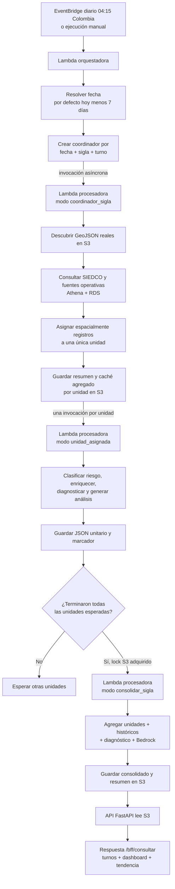
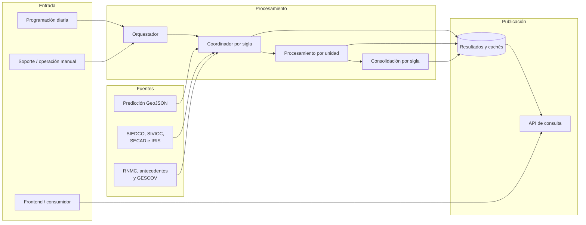
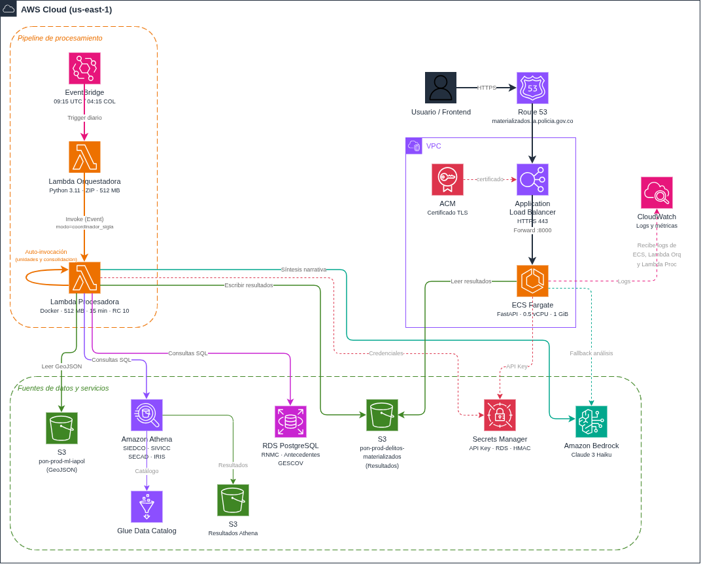
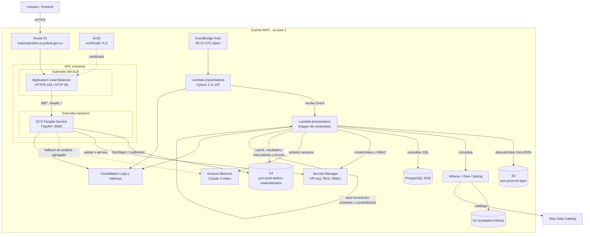
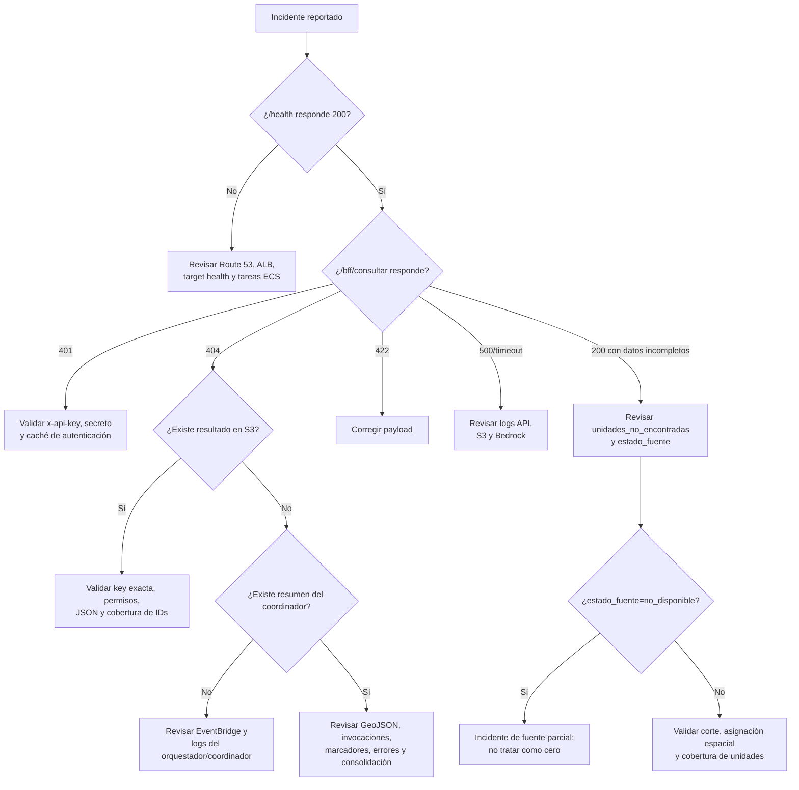

# Módulo de delitos materializados — documentación funcional y guía de soporte

> **Región AWS:** `us-east-1`  
> **Stack CDK:** `delitos-materializados-stack`  
> **Última revisión del documento:** 2026-11-03  

## Para qué sirve este documento

Aquí se explica cómo funciona el módulo de delitos materializados de punta a punta: desde que EventBridge dispara el procesamiento diario hasta que la API entrega los resultados al tablero. El foco está en que soporte, operación y desarrollo puedan:

- entender qué hace cada componente y cómo se conectan
- diagnosticar cualquier incidente con los pasos y comandos necesarios
- recuperar el servicio cuando algo falla
- desplegar cambios y hacer rollback de forma segura
- ejecutar el módulo localmente para pruebas

> **Diagrama editable:** junto a este archivo está [`arquitectura_aws.drawio`](arquitectura_aws.drawio), un diagrama interactivo con los iconos de cada servicio AWS y sus conexiones. Se puede abrir en [draw.io](https://app.diagrams.net) o en la extensión de VS Code.


## Referencia rápida para soporte

| Elemento | Valor |
|---|---|
| API pública | `https://materializados.ia.policia.gov.co` |
| Health check | `GET /health` |
| Consulta funcional | `POST /bff/consultar` con encabezado `x-api-key` |
| Lambda orquestadora | `delitos-materializados-orquestador` |
| Lambda procesadora | `delitos-materializados-procesador` |
| Regla programada | `delitos-materializados-daily-trigger` |
| Ejecución automática | 09:15 UTC / 04:15 Colombia, todos los días |
| Fecha automática procesada | Fecha de ejecución menos 7 días (`PREV_WINDOW=7`) |
| Bucket de resultados | `pon-prod-delitos-materializados` |
| Logs API | `/ecs/delitos-materializados-bff-api` |
| Logs orquestador | `/aws/lambda/delitos-materializados-orquestador` |
| Logs procesador | `/aws/lambda/delitos-materializados-procesador` |
| Resultado unitario | `YYYY/MM/DD/SIGLA/ID_UNIDAD/TURNO/delitos_materializados.json` |
| Consolidado por sigla | `YYYY/MM/DD/SIGLA/_consolidado/TURNO/delitos_materializados.json` |
| Resumen del coordinador | `utilidades/asignacion_global/YYYY/MM/DD/SIGLA/TURNO/resumen.json` |
| Error unitario | `utilidades/errores_delitos_materializados/YYYY/MM/DD/SIGLA/ID_UNIDAD/TURNO.json` |

### Criterio de éxito

La respuesta `200` del orquestador o `202` de `lambda:InvokeFunction` solo confirma el despacho. No confirma el procesamiento completo.

Para una ejecución completa por sigla, el criterio recomendado es:

1. existe el `resumen.json` del coordinador y `errores_invocacion` está vacío;
2. existen los JSON unitarios esperados o sus marcadores de terminación;
3. existe el consolidado del turno y su `resumen.json`;
4. la API responde y el campo `metadata.fecha` corresponde al corte solicitado;
5. las ramas de fuentes incluyen `estado_fuente=disponible` o `disponible_sin_registros`; `no_disponible` no debe interpretarse como cero.

---

## 1. Descripción y lógica del componente

### 1.1 Qué hace

El módulo toma los polígonos GeoJSON generados por la predicción de Mapa de Predicción, consulta los delitos y fuentes operativas correspondientes a una sigla, fecha y turno, ubica espacialmente cada registro y genera análisis por unidad y por sigla.

Los niveles de riesgo se basan en la probabilidad predictiva del modelo de Mapa de Predicción:

| Nivel | Rango de probabilidad |
|---|---|
| `critica` | mayor al 70% |
| `alta` | entre 50% y 70% |
| `media` | entre 10% y 50% |
| `baja` | menor al 10% |

**Ojo:** estos niveles son categorías estadísticas del modelo, no zonas de atención policial. No confundir con la nomenclatura operativa.

El resultado de cada unidad combina, según disponibilidad:

- delitos y capturas de SIEDCO;
- dimensión territorial, TAMIR, minutas, capacidad y personal seudonimizado de SIVICC;
- llamadas y trazabilidad SECAD;
- presencia GPS agregada ya contenida en el GeoJSON predictivo;
- contexto IRIS P1;
- planes programados GESCOV;
- incautaciones RNMC;
- antecedentes de personas, vehículos e IMEI;
- contexto histórico del mismo día de semana y turno;
- diagnóstico determinístico y síntesis narrativa con Amazon Bedrock.

**Aclaraciones importantes para soporte:**

- Que un delito aparezca en una zona no significa que la zona lo causó. La asociación es espacial, no causal.
- GESCOV muestra planes *programados*, no ejecutados. Que aparezca un plan no prueba que se hizo.
- Cuando una fuente falla, el procesador lo marca como `no_disponible` en vez de poner cero. Si ven conteos en cero, revisen el `estado_fuente` antes de reportar que "no hubo actividad".

### 1.2 Componentes de aplicación

| Componente | Responsabilidad |
|---|---|
| API FastAPI | Autentica, lee resultados de S3, agrega unidades cuando es necesario, construye el dashboard y expone los tres turnos y siete días de tendencia. |
| Lambda orquestadora | Resuelve fechas, turnos y catálogo de siglas; envía un coordinador asíncrono por combinación. No consulta las fuentes ni descubre GeoJSON. |
| Lambda procesadora — coordinador | Descubre GeoJSON, consulta fuentes una vez por sigla/fecha/turno, realiza la asignación espacial global, genera cachés agregados y despacha unidades. |
| Lambda procesadora — unidad | Clasifica polígonos, integra el subconjunto asignado, construye el diagnóstico, genera/enriquece el JSON y registra su terminación. |
| Lambda procesadora — consolidación | Cuando terminan las unidades esperadas, agrega resultados, incorpora históricos, genera el análisis consolidado y publica la ruta rápida consumida por la API. |

La Lambda procesadora implementa los tres modos en la misma función:

- `modo=coordinador_sigla`;
- evento unitario (`modo=unidad_asignada` o modo legado sin `modo`);
- `modo=consolidar_sigla`.

### 1.3 Ventanas de turno

| Turno | Ventana lógica |
|---|---|
| `1` | 22:00 del día anterior hasta antes de las 07:00 de la fecha indicada |
| `2` | 07:00 hasta antes de las 14:00 |
| `3` | 14:00 hasta antes de las 22:00 |

**Tip de soporte:** una fecha y un turno incorrectos son la causa más común de “no aparecen datos”. Especialmente el turno 1, que cruza medianoche: si alguien pregunta por algo que pasó a las 23:00 del 15 de julio, el turno es el 1 del **16 de julio**, no del 15.

### 1.4 Flujo funcional



### 1.5 Secuencia de procesamiento paso a paso

1. **EventBridge** invoca diariamente el orquestador con un evento vacío (`{}`).
2. **El orquestador** calcula la fecha como `hoy - 7 días`, carga las siglas desde el CSV empacado (`delitos_con_consecutivo.csv`) y genera tres coordinadores por sigla (uno por turno). Los despacha en lotes de 50 con 0.5s entre lotes para no saturar la concurrencia.
3. **El coordinador** (Lambda procesadora en modo `coordinador_sigla`) descubre las unidades a partir de los GeoJSON que existan en `pon-prod-ml-iapol`. El CSV no limita qué unidades se procesan; solo importa qué GeoJSON están publicados.
4. **Consulta centralizada:** el coordinador consulta SIEDCO, SIVICC, SECAD, IRIS, GESCOV, incautaciones y antecedentes *una sola vez* para toda la sigla/fecha/turno. Luego usa GeoPandas y Shapely para hacer la asignación espacial (point-in-polygon) de cada registro a su unidad. Si un punto cae en polígonos de dos unidades, se asigna solo a una para evitar doble conteo.
5. Por cada unidad válida, guarda un **caché agregado** en S3 y se auto-invoca de forma asíncrona (modo `unidad_asignada`).
6. **Cada unidad** clasifica sus polígonos por nivel de riesgo, integra los datos asignados, construye un diagnóstico determinístico y genera/enriquece el JSON final. Si algo falla, se registra en la ruta de errores (`utilidades/errores_delitos_materializados/...`).
7. Al terminar, cada unidad escribe un **marcador** en S3 (bajo el directorio `consolidacion/RUN_ID/unidades/`). Cuando todas las unidades esperadas tienen marcador, la última adquiere un *conditional put* en S3 (lock distribuido) y despacha la consolidación.
8. **El consolidador** (modo `consolidar_sigla`) agrega los resultados de todas las unidades, incorpora el contexto histórico del mismo día de semana, genera un análisis consolidado con Bedrock y publica un JSON completo más un resumen liviano.
9. **La API** prioriza el consolidado cuando cubre exactamente las unidades solicitadas. Si no existe, agrega los JSON unitarios como fallback. Para la agregación usa `ThreadPoolExecutor` con hasta 3 workers para turnos y 16 para unidades.
10. La API consulta los tres turnos de la fecha y los resúmenes de los seis días anteriores. Devuelve `turnos_detalle`, `dashboard` y la tendencia de 7 días en una sola respuesta. Las respuestas pueden superar 30 MB en JSON crudo, pero el middleware GZip las comprime (mínimo 1024 bytes, nivel 4) antes de enviarlas.

### 1.6 Análisis determinístico vs. narrativa Bedrock

El módulo genera dos tipos de análisis:

- **Determinístico** (`analysis_contract.py`): cifras, territorios, hallazgos, prioridades y limitaciones se calculan exclusivamente a partir de los datos. Este contrato normaliza además el vocabulario policial (por ejemplo, GESCOV "puntos" se muestra como "planes", "bitácora" como "minuta"). El resultado es 100% reproducible dado el mismo corte de datos.
- **Narrativa Bedrock** (Claude 3 Haiku): toma el contrato determinístico como insumo y genera una redacción más legible. Bedrock puede reformular, pero **no puede alterar cifras ni inventar datos** que no estén en el contrato. Si Bedrock falla o está deshabilitado, el análisis determinístico sigue disponible.

El procesador usa hasta 2 intentos (`BEDROCK_MAX_ATTEMPTS`) para generar la narrativa. Si ambos fallan, el JSON final se publica con el contrato determinístico como texto de respaldo.

### 1.7 Seudonimización de personal (HMAC)

Los datos de personal de turno se seudonimizados con HMAC-SHA256 antes de incluirlos en los resultados. El secreto HMAC está en Secrets Manager y genera códigos estables (el mismo funcionario siempre produce el mismo código) sin exponer la identificación real. Si el secreto HMAC no está disponible, la fuente de personal se marca como `no_disponible_configuracion` y no se incluye.

### 1.8 Contrato principal de la API

Solicitud:

```http
POST /bff/consultar
Content-Type: application/json
x-api-key: <API_KEY>
```

```json
{
  "year": 2026,
  "month": 7,
  "day": 30,
  "sigla": "MEBOG",
  "turno": 3,
  "unidades_hijas": [3237],
  "nivel_agregacion": "unidades"
}
```

`nivel_agregacion` acepta `unidades` o `sigla`. La respuesta incluye, entre otros campos:

- `metadata`, `zonas`, `delitos_detalle` y `unidades_no_encontradas`;
- `resumen_operativo`, `diagnostico_operacional` y `contexto_historico`;
- `operacion_sivicc`, `secad`, `presencia_gps`, `iris_p1` y `gescov`;
- `incautaciones`, `capturas`, `antecedentes` y agregaciones territoriales;
- `analisis`, `analisis_estructurado`, `dashboard` y `turnos_detalle`.

Respuestas HTTP esperadas:

| Código | Significado |
|---|---|
| `200` | Consulta resuelta. Puede incluir unidades faltantes. |
| `400` | `unidades_hijas` vacía. |
| `401` | Falta `x-api-key` o la clave no coincide. |
| `404` | No existe análisis para ninguna unidad solicitada en la fecha/turno. |
| `422` | El cuerpo no cumple el esquema de Pydantic. |
| `500` | Error no controlado de la API o de sus dependencias. |

---

## 2. Diagramas de arquitectura

### 2.1 Arquitectura lógica



### 2.2 Arquitectura AWS



> **Diagrama editable:** para modificar la arquitectura, abrir [`arquitectura_aws.drawio`](arquitectura_aws.drawio) en [draw.io](https://app.diagrams.net) y exportar como PNG al terminar.

<details>
<summary>Versión Mermaid (referencia rápida en texto)</summary>



</details>

### 2.3 Detalles relevantes de infraestructura

| Recurso | Configuración actual |
|---|---|
| Fargate API | 0.5 vCPU, 1 GiB, deseado 1; mínimo 1, máximo 10. |
| Capacity providers | Base 1 en Fargate; estrategia 80% Fargate Spot y 20% Fargate. |
| Auto Scaling | CPU 80%, memoria 80% y 500 solicitudes por target. |
| ALB | Público; HTTP redirige a HTTPS; idle timeout de 120 s. |
| Target health | `/health`, intervalo 60 s, timeout 30 s, 2 éxitos/5 fallos. |
| Procesador | 512 MiB, timeout 15 min, concurrencia reservada 10. |
| Orquestador | 512 MiB, timeout 15 min. |
| Logs | Retención de una semana; grupos eliminables al destruir el stack. |
| DNS/TLS | Route 53 y certificado ACM validado por DNS. |

La API (ECS Fargate) corre dentro de la VPC. Las Lambdas **no** tienen configuración VPC explícita en este stack, lo que significa que acceden a los servicios por endpoints públicos (S3, Athena, Bedrock) o por el endpoint público del RDS. Los buckets, bases Athena/Glue, base RDS y secretos son dependencias preexistentes que no crea este stack.

**Dato relevante para soporte:** la concurrencia reservada del procesador es 10. Esto significa que como máximo 10 instancias de la Lambda procesadora pueden ejecutarse simultáneamente. Si el orquestador despacha más coordinadores de los que caben, los excedentes se throttlean (error `TooManyRequestsException`). En la práctica, las siglas se procesan de forma secuencial dentro de cada lote de 50.

---

## 3. Diagnóstico de incidentes

### 3.1 Triage inicial — por dónde empezar

Lo primero es resistir la tentación de reprocesar a ciegas. Antes de disparar nada, junte estos datos:

- **Qué ambiente y región** (producción en us-east-1 siempre, pero confirmar).
- **Fecha de corte, sigla, turno e ID de unidad** afectados. Si el usuario dice "no me aparecen los datos de ayer", recuerde que el procesamiento tiene 7 días de desfase.
- **Dónde duele:** ¿es la API la que no responde, o es que no hay resultados en `pon-prod-delitos-materializados`? Son problemas distintos.
- **Desde cuándo** y cuál fue la última respuesta correcta.
- Si los tiene: `requestId` de Lambda, Query Execution ID de Athena o task ID de ECS.

Con eso claro, siga las validaciones en este orden:

1. **API:** comprobar `/health` y luego una consulta funcional.
2. **Resultado:** verificar si existe el JSON consolidado o el unitario en `pon-prod-delitos-materializados`.
3. **Coordinación:** revisar `resumen.json` de asignación global.
4. **Procesamiento:** buscar errores en CloudWatch y en el prefijo `utilidades/errores_delitos_materializados/` de `pon-prod-delitos-materializados`.
5. **Entradas:** confirmar GeoJSON y disponibilidad de fuentes.
6. **Infraestructura:** revisar throttling, timeout, concurrencia, tareas ECS y target health.

Comandos base:

```bash
# Ajuste AWS_PROFILE al nombre de perfil configurado en su máquina
export AWS_PROFILE=<su-perfil-aws>
export AWS_DEFAULT_REGION=us-east-1

curl -fsS https://materializados.ia.policia.gov.co/health

aws logs tail /aws/lambda/delitos-materializados-orquestador \
  --since 2h --profile "$AWS_PROFILE" --region "$AWS_DEFAULT_REGION"

aws logs tail /aws/lambda/delitos-materializados-procesador \
  --since 2h --profile "$AWS_PROFILE" --region "$AWS_DEFAULT_REGION"

aws logs tail /ecs/delitos-materializados-bff-api \
  --since 2h --profile "$AWS_PROFILE" --region "$AWS_DEFAULT_REGION"
```

Para una combinación concreta:

```bash
aws s3 ls \
  s3://pon-prod-delitos-materializados/utilidades/asignacion_global/2026/07/30/MEBOG/3/ \
  --profile "$AWS_PROFILE" --region "$AWS_DEFAULT_REGION"

aws s3api head-object \
  --bucket pon-prod-delitos-materializados \
  --key 2026/07/30/MEBOG/_consolidado/3/delitos_materializados.json \
  --profile "$AWS_PROFILE" --region "$AWS_DEFAULT_REGION"

aws s3 ls \
  s3://pon-prod-delitos-materializados/utilidades/errores_delitos_materializados/2026/07/30/MEBOG/ \
  --recursive --profile "$AWS_PROFILE" --region "$AWS_DEFAULT_REGION"
```

### 3.2 Árbol de diagnóstico



### 3.3 Errores frecuentes y qué hacer

#### Problemas de la API

| Síntoma | ¿Qué pasó? | Cómo verificar | Qué hacer |
|---|---|---|---|
| ALB devuelve `502`/`503` | La tarea ECS se cayó, el target no está saludable, o un despliegue quedó a medias | Revisar Target Health en la consola del ALB, eventos del servicio ECS y logs en `/ecs/...` | Forzar nuevo deployment del servicio. Si coincide con un despliegue reciente, volver al commit estable. |
| ALB devuelve `504` | La consulta se demoró más de 120s (idle timeout del ALB). Suele pasar cuando no hay consolidado y la API tiene que agregar muchos JSON unitarios | Buscar `Respuesta /bff/consultar: estado=... duracion=` en logs de la API | Verificar que existan consolidados para la sigla/turno. Si no, reprocesar. Evitar pedir muchas unidades sin consolidado. |
| `401 Unauthorized` | Falta la cabecera `x-api-key`, la clave es incorrecta, o el caché quedó desactualizado tras una rotación | Logs: buscar `Petición sin API` o `API key inválida`. Verificar que el secreto en Secrets Manager tenga la clave correcta | Si rotaron la key: `POST /auth/refresh-key` (no requiere auth) o reiniciar la tarea ECS. Si la clave es incorrecta: corregir en el cliente. |
| `404` pero los datos sí existen | Fecha/turno/sigla incorrectos en el request, o el ID de unidad no está cubierto por el procesamiento | Listar el prefijo en `pon-prod-delitos-materializados` para la combinación exacta (ver comando en 3.1). Revisar `unidades_no_encontradas` en la respuesta | Corregir el corte en el request. Si efectivamente falta, reprocesar la combinación. |
| `422` | El body del request tiene tipos incorrectos (strings en vez de ints, campo faltante) | El cuerpo de la respuesta de FastAPI muestra exactamente qué campo falló | Corregir el payload. Fecha/turno/IDs deben ser enteros; `nivel_agregacion` acepta solo `"unidades"` o `"sigla"`. |
| `500` al arrancar local | `USE_LOCAL_FILES=true` pero el directorio de `LOCAL_DATA_DIR` no existe | Log de inicialización muestra `Directorio local no existe:` | Crear el directorio o poner `USE_LOCAL_FILES=false`. |

#### Problemas del procesamiento (Lambdas)

| Síntoma | ¿Qué pasó? | Cómo verificar | Qué hacer |
|---|---|---|---|
| Orquestador responde OK pero no hay resultados | La invocación asíncrona fue aceptada (eso es lo que mide el "éxito"), pero el coordinador o las unidades fallaron por otro lado | Buscar errores en logs del procesador. Revisar `resumen.json` del coordinador. Listar prefijo `utilidades/errores_delitos_materializados/` en `pon-prod-delitos-materializados` | Identificar la causa aguas abajo primero. **No disparar otro orquestador masivo** hasta aislar una sigla/turno. |
| `unidades_descubiertas_en_s3=0` | El GeoJSON predictivo aún no se publicó para esa fecha/sigla, o el prefijo está mal | Listar `s3://pon-prod-ml-iapol/PrediccionMdP/.../SIGLA/` | Esperar a que se publique el GeoJSON. Si ya existe, verificar que la fecha y sigla coincidan. |
| `geojson_invalidos` no vacío | Algún GeoJSON está vacío, corrupto o tiene geometría que GeoPandas no puede leer | Campo del resumen del coordinador y excepción `GeoPandas` en logs | Corregir o regenerar el GeoJSON afectado. Reprocesar la sigla/turno después. |
| `total_fuera_poligonos` alto | Muchos registros tienen coordenadas que no caen dentro de ningún polígono disponible | Comparar `unidades_objetivo` contra `unidades_descubiertas_en_s3` en el resumen | Si se ejecutó filtrada por unidad, los registros fuera de esos polígonos se descartan. Para diagnóstico, ejecutar la sigla completa. |
| Query Athena `FAILED`/`CANCELLED` | Tabla o partición inexistente, SQL incompatible con el esquema, permiso IAM insuficiente, o bucket de salida inaccesible | Obtener el Query Execution ID del log y revisar `StateChangeReason` | Verificar Glue Catalog (tablas, particiones), permisos IAM y el bucket `pon-prod-athena-query-results-capas-adicionales`. |
| Fuente con `estado_fuente=no_disponible` | La consulta a esa fuente falló (timeout, error SQL, problema de red) | Revisar la metadata de la rama correspondiente en el JSON y los logs del procesador | Resolver la fuente y reprocesar. **Nunca** reportar "cero eventos" cuando el estado es `no_disponible`. |
| RDS timeout o error de conexión | Problema con el secreto, la red, las credenciales, o el RDS está al tope de conexiones | Buscar `Error de SQLAlchemy` o errores de Secrets Manager en logs | Verificar que el secreto tenga las credenciales correctas y que el RDS sea accesible. Las queries usan `NullPool` (sin pool de conexiones), así que no debería haber leaks, pero sí sensibilidad a la carga del RDS. |
| `AccessDenied` de Secrets Manager | ARN o nombre del secreto mal configurado, o el role de la Lambda no tiene permiso | Buscar en CloudWatch. Simular el permiso con IAM Policy Simulator | Verificar ARN en `cdk/config/delitos_materializados.json` y redesplegar si es necesario. |
| Bedrock `AccessDenied` / throttling / timeout | El modelo no está habilitado en la cuenta, perfil de inferencia incorrecto, o se agotó la cuota | Buscar `ERROR invocando Bedrock` o `intentos agotados` en logs | Verificar acceso al modelo en la consola de Bedrock y cuotas. Las cifras determinísticas siguen disponibles aunque Bedrock falle. |
| `Task timed out after 900` | La Lambda se demoró más de 15 minutos. Suele pasar con siglas grandes o fuentes lentas | Métrica `Duration` cercana a 900000ms y corte abrupto del log | Aislar por sigla/turno para identificar la fuente lenta. Resolver y reprocesar. |
| Lambda throttled | Las 10 ejecuciones reservadas del procesador están ocupadas | Métrica `Throttles` en CloudWatch | Esperar a que terminen las ejecuciones en curso. **No lanzar coordinadores duplicados**, empeora el throttling. |

#### Problemas de consolidación

| Síntoma | ¿Qué pasó? | Cómo verificar | Qué hacer |
|---|---|---|---|
| Hay unitarios pero no consolidado | Alguna unidad no dejó marcador, el lock de consolidación falló, o la consolidación misma falló | Revisar manifiesto y marcadores en `s3://pon-prod-delitos-materializados/utilidades/asignacion_global/.../consolidacion/.../unidades/` y logs del consolidador | Reprocesar la sigla completa. Una ejecución filtrada por unidad nunca genera consolidado. |
| Archivo de error existe pero el resultado está bien | Los errores históricos no se borran automáticamente | Comparar `LastModified` del error vs. del resultado | El objeto más reciente gana. No asumir fallo solo por la existencia del error. |
| Datos aparecen con 7 días de atraso | Comportamiento normal del modo automático (`PREV_WINDOW=7`) | Verificar que el evento del orquestador sea `{}` | Si necesitan un corte más reciente, invocar con fecha explícita **después** de confirmar que el GeoJSON existe. |

### 3.4 Diagnóstico de la consolidación — cómo funciona el lock distribuido

Entender este mecanismo es clave para diagnosticar por qué falta un consolidado. El coordinador crea un manifiesto bajo:

```text
utilidades/asignacion_global/YYYY/MM/DD/SIGLA/TURNO/consolidacion/RUN_ID/manifest.json
```

Cada unidad deja un marcador en:

```text
.../consolidacion/RUN_ID/unidades/ID_UNIDAD.json
```

Cuando todas las unidades esperadas tienen marcador, una unidad adquiere de forma condicional `consolidacion_despachada.json` y envía `modo=consolidar_sigla`.

Revise:

- `unidades_esperadas` en el manifiesto;
- cantidad y estado de los marcadores;
- presencia del lock de despacho;
- `consolidacion_metadata.unidades_con_resultado` en el consolidado;
- `unidades_no_encontradas` para fallos parciales.

**Importante:** no invocar manualmente `modo=consolidar_sigla` mientras haya un lote activo. El lock de S3 (`consolidacion_despachada.json`) puede quedar en estado inconsistente. La forma correcta de recuperar es siempre reprocesar la sigla completa desde el coordinador.

### 3.5 Consulta funcional de la API

Mantenga la clave fuera del historial del shell, por ejemplo en una variable de entorno:

```bash
curl -fsS -X POST \
  https://materializados.ia.policia.gov.co/bff/consultar \
  -H 'Content-Type: application/json' \
  -H "x-api-key: $DELITOS_API_KEY" \
  --data '{
    "year": 2026,
    "month": 7,
    "day": 30,
    "sigla": "MEBOG",
    "turno": 3,
    "unidades_hijas": [3237],
    "nivel_agregacion": "unidades"
  }'
```

No registre la API key en tickets, logs, capturas o archivos versionados.

---

## 4. Configuración y variables

### 4.1 API

| Variable | Predeterminado | Uso |
|---|---|---|
| `VERSION` | `1.0.0` | Versión publicada por `/health`. Producción configura `1.0.1`. |
| `AWS_DEFAULT_REGION` | `us-east-1` | Región para S3 y Secrets Manager. |
| `BACKEND_API_KEY_SECRET_NAME` | `delitos-materializados-bff-api-key` | Secreto JSON con la clave `API_KEY`. |
| `BEDROCK_READ_TIMEOUT_SECONDS` | `25` | Timeout de lectura del cliente Bedrock usado por la API. |
| `USE_LOCAL_FILES` | `false` | Usa archivos locales en vez de S3. Solo desarrollo. |
| `LOCAL_DATA_DIR` | `./salida_local` | Raíz de resultados locales. |
| `SKIP_AUTH` | `false` | Omite la autenticación. Nunca usar en producción. |
| `BEDROCK_ENABLED` | aparece en `.env.example` | **Ojo: la API ignora esta variable.** El cliente Bedrock de `central_service.py` se inicializa siempre al importar el módulo, con timeout de `BEDROCK_READ_TIMEOUT_SECONDS` (25s) y sin reintentos. No hay forma de deshabilitarlo por variable de entorno en la API; solo sirve en el procesador (Lambda). |

El bucket de resultados de la API está fijado en código como `pon-prod-delitos-materializados`. Para cambiarlo habría que modificar `s3_service.py` y redesplegar.

### 4.2 Lambda procesadora

| Variable | Predeterminado/producción | Uso |
|---|---|---|
| `AWS_DEFAULT_REGION` | región del runtime / `us-east-1` | Clientes AWS. |
| `RDS_DB_CREDENTIALS_SECRET_NAME` | nombre del secreto RDS incorporado en código | Override local del secreto de PostgreSQL. En CDK el role recibe permiso sobre el ARN configurado. |
| `S3_ATHENA_OUTPUT_BUCKET` | `pon-prod-athena-query-results-capas-adicionales` | Salida usada por el adaptador genérico de Athena. |
| `BEDROCK_ENABLED` | `true` | Habilita o deshabilita Bedrock en el procesador. Útil en pruebas locales. |
| `BEDROCK_REGION` | `us-east-1` | Región de Bedrock. |
| `BEDROCK_MODEL_ID` | `anthropic.claude-3-haiku-20240307-v1:0` | Modelo base; el código puede anteponer `us.` para inferencia cross-region. |
| `BEDROCK_INFERENCE_PROFILE_ID` | vacío | ID/ARN explícito del perfil de inferencia. |
| `BEDROCK_MAX_TOKENS` | CDK: `4096` | Máximo de tokens de salida. |
| `BEDROCK_MAX_ATTEMPTS` | CDK: `2` | Intentos de generación/validación. |
| `PERSONAL_TURNO_HMAC_SECRET_ARN` | secreto configurado por CDK | Clave estable para seudonimizar personal. |
| `PERSONAL_TURNO_HMAC_KEY` | vacío | Alternativa directa únicamente para desarrollo controlado; no debe persistirse. |

Constantes hardcodeadas (requieren cambio de código y despliegue):

| Configuración | Valor |
|---|---|
| Bucket de predicción | `pon-prod-ml-iapol` |
| Bucket de SIEDCO/mapeo | `pon-prod-raw-siedco-delitos-temporal` |
| Bucket de resultados | `pon-prod-delitos-materializados` |
| Base/tabla SIEDCO | `pon_prod_raw_siedco_delitos_temporal.raw_data_siedco_full_delitos` |
| Salida Athena principal | `s3://pon-prod-athena-query-results-capas-adicionales/delitos-materializados/` |
| Lambda procesadora | `delitos-materializados-procesador` |

**Todos los buckets S3 que toca el procesador** (configurados en CDK):

| Bucket | Para qué lo usa |
|---|---|
| `pon-prod-ml-iapol` | Leer GeoJSON predictivos |
| `pon-prod-raw-siedco-delitos-temporal` | Mapeo SIEDCO y datos temporales |
| `pon-prod-raw-siedco` | Datos SIEDCO adicionales |
| `pon-prod-raw-sivicc` | Datos SIVICC (territorio, operación, personal) |
| `pon-prod-raw-llamadas-cdc` | Datos SECAD / llamadas |
| `pon-prod-llamadas` | Datos SECAD complementarios |
| `pon-prod-raw-disec` | Datos IRIS P1 |
| `pon-prod-delitos-materializados` | Escribir resultados, cachés, marcadores, errores |
| `pon-prod-athena-query-results-capas-adicionales` | Resultados de queries Athena |

### 4.3 Lambda orquestadora

No recibe variables de entorno propias en CDK. Sus valores operativos están en código:

| Constante | Valor |
|---|---|
| `LAMBDA_PROCESADOR` | `delitos-materializados-procesador` |
| `TAMANO_LOTE` | `50` |
| `PREV_WINDOW` | `7` días |
| CSV local | `delitos_con_consecutivo.csv` empacado con la Lambda |

### 4.4 Configuración de infraestructura

La configuración está en `cdk/config/delitos_materializados.json` y controla:

- cuenta, región, tags, VPC y subredes;
- dominio y subdominio;
- CPU, memoria, capacidad y variables de la API;
- memoria, timeout y concurrencia de Lambdas;
- buckets permitidos y secretos autorizados;
- límites de Bedrock.

No copie valores secretos al JSON. Solo se configuran nombres o ARN; el contenido permanece en Secrets Manager.

### 4.5 Autenticación y seguridad

- `/bff/*` requiere `x-api-key`.
- `/`, `/health`, `/docs`, `/redoc`, `/openapi.json` y `/auth/refresh-key` están excluidos del middleware de autenticación en la implementación actual.
- La API key se obtiene de Secrets Manager y queda en caché en cada proceso.
- El procesador no debe persistir filas crudas con datos personales en el caché por unidad; guarda agregados y usa HMAC para códigos estables de personal.
- Los roles IAM permiten solo los servicios necesarios, aunque Bedrock, Glue, Athena y KMS contienen permisos con recurso `*` por limitaciones/configuración actual.
- `SKIP_AUTH=true` y `PERSONAL_TURNO_HMAC_KEY` son opciones locales y no deben desplegarse.

---

## 5. Dependencias e integraciones

### 5.1 Servicios AWS

| Servicio | Consumidor | Propósito |
|---|---|---|
| EventBridge | Orquestador | Disparo diario. |
| Lambda | Orquestador/procesador | Coordinación asíncrona, procesamiento unitario y consolidación. |
| S3 | API y procesador | Predicciones, mapeo, resultados Athena, cachés, resultados, marcadores y errores. |
| Athena | Procesador | Consultas analíticas a SIEDCO, SIVICC, SECAD e IRIS. |
| Glue Data Catalog | Athena/procesador | Metadatos de bases, tablas y particiones. |
| RDS PostgreSQL | Procesador | RNMC, antecedentes y GESCOV. |
| Secrets Manager | API/procesador | API key, credenciales RDS y HMAC. |
| Bedrock Runtime | API/procesador | Síntesis narrativa controlada. |
| ECS Fargate | API | Ejecución de FastAPI. |
| ALB, Route 53 y ACM | API | Exposición HTTPS, enrutamiento y certificado. |
| CloudWatch | Todos | Logs y métricas nativas. |

### 5.2 Fuentes de datos

| Fuente lógica | Ubicación principal | Observación |
|---|---|---|
| Predicción MdP | S3 `pon-prod-ml-iapol/PrediccionMdP/...` | GeoJSON por unidad, fecha y turno. |
| SIEDCO delitos/capturas | Athena `pon_prod_raw_siedco_delitos_temporal.raw_data_siedco_full_delitos` | Fuente de hechos y respaldo territorial. |
| SIVICC territorial | Athena `pon-prod-raw-sivicc` | Cuadrantes, jerarquía y polígonos. |
| SIVICC operativo | Athena `pon-prod-raw-sivicc` | TAMIR, minutas, personal y capacidad. |
| SECAD nacional | Athena `pon-prod-raw-secad.v_pedido_atendido_consolidada` | Llamadas e hitos de atención. |
| SECAD Bogotá | Athena `raw_mebog.llamadas_mebog_vista` | No publica todos los hitos de despacho. |
| IRIS P1 | Athena `pon-prod-raw-disec."usr_disec.vm_general_irisp"` | Contexto de corte; no representa eventos del turno. |
| RNMC incautaciones | RDS `public.hechos_z1_v2` | Solo `incautacion = '1'`. |
| Antecedentes persona | RDS `public.auditoria_cons_persona_v2` | Se agregan sin persistir identificadores. |
| Antecedentes vehículo | RDS `public.auditoria_cons_vehiculo_v2` | Se agregan sin persistir identificadores. |
| Antecedentes IMEI | RDS `public.auditoria_cons_imei_v2` | Se agregan sin persistir identificadores. |
| GESCOV | RDS `public.v_planes_programados_historico` | Programación y estado administrativo; no acredita ejecución. |

### 5.3 Dependencias de software

| Componente | Runtime | Librerías principales |
|---|---|---|
| API | Python 3.12, contenedor Docker | FastAPI 0.104.1, Uvicorn 0.24.0, Pydantic 2.5.0, boto3 1.40.34 |
| Orquestador | Python 3.11, ZIP Lambda | `python-dateutil`, boto3 (del runtime) |
| Procesador | Python 3.11, imagen Docker Lambda | GeoPandas, Shapely, Pandas, NumPy, SciPy, scikit-learn, PyArrow, PyAthena, SQLAlchemy, psycopg2 |
| Infraestructura | Node.js, CDK TypeScript | Docker para build de imágenes |

### 5.4 Semántica de disponibilidad

| Estado | Interpretación de soporte |
|---|---|
| `disponible` | La consulta funcionó y retornó registros. |
| `disponible_sin_registros` | La consulta funcionó y el corte tuvo cero filas. Es un cero válido. |
| `no_disponible` | La consulta falló o no pudo completarse. No equivale a cero. |
| `no_disponible_configuracion` | Falta configuración necesaria, por ejemplo HMAC. |

---

## 6. Despliegue y actualización

### 6.1 Prerrequisitos

- acceso autorizado a la cuenta y región de producción;
- AWS CLI con un perfil configurado para la cuenta de producción (ver `AWS_PROFILE` en la sección 3.1);
- Node.js/npm;
- Docker activo, porque CDK construye la API y el procesador como imágenes;
- CDK bootstrap existente en la cuenta/región;
- permisos para CloudFormation, IAM, ECS/ECR, Lambda, EC2/ALB, Route 53, ACM, Logs y assets S3.

### 6.2 Validaciones previas

Desde la raíz del repositorio:

```bash
cd delitos_materializados/api
AWS_EC2_METADATA_DISABLED=true .venv/bin/pytest tests -q

cd ../lambdas/procesador
AWS_EC2_METADATA_DISABLED=true .venv/bin/pytest tests -q

cd ../orquestador
../procesador/.venv/bin/python -m pytest tests -q

cd ../../../cdk
npm ci
npm run build
npx cdk synth delitos-materializados-stack \
  --profile "$AWS_PROFILE" --region us-east-1
npx cdk diff delitos-materializados-stack \
  --profile "$AWS_PROFILE" --region us-east-1
```

Revise de forma especial el reemplazo o eliminación de recursos, cambios IAM, nombres de secretos, variables de entorno, concurrencia y assets de contenedor.

### 6.3 Despliegue

```bash
cd cdk
npx cdk deploy delitos-materializados-stack \
  --profile "$AWS_PROFILE" \
  --region us-east-1 \
  --require-approval never
```

Use `--require-approval never` solo después de revisar el `diff` y dentro del proceso de cambio autorizado.

CDK realiza, según los archivos modificados:

- build y publicación del asset de la API;
- nueva task definition y actualización progresiva del servicio ECS;
- build y publicación de la imagen Lambda del procesador;
- actualización ZIP de la Lambda orquestadora;
- cambios de configuración, IAM, ALB, DNS o programación.

### 6.4 Validación posterior

1. Confirmar `UPDATE_COMPLETE` del stack.
2. Validar que el servicio ECS mantenga al menos una tarea estable y targets saludables.
3. Consultar `/health` y verificar `version`.
4. Ejecutar una consulta conocida contra `/bff/consultar`.
5. Ejecutar un dry-run del orquestador.
6. Si el cambio afecta procesamiento, invocar una sigla/turno de prueba y verificar resumen, unitarios y consolidado.
7. Revisar errores, throttles, duración y memoria en CloudWatch.

### 6.5 Rollback — no improvisar

#### Despliegue fallido

CloudFormation intenta volver solo al último estado estable. **No forzar otro despliegue** mientras el stack esté en `UPDATE_ROLLBACK_IN_PROGRESS` — va a fallar y complicar todo. Esperar a que llegue a `UPDATE_ROLLBACK_COMPLETE` y luego investigar qué pasó.

```bash
aws cloudformation describe-stack-events \
  --stack-name delitos-materializados-stack \
  --profile "$AWS_PROFILE" --region us-east-1
```

#### Despliegue completado pero defectuoso

El rollback reproducible es desplegar el último commit/tag conocido como estable:

1. identificar el commit estable y registrar el commit defectuoso;
2. preparar ese commit en una rama o worktree separado, sin eliminar cambios locales;
3. ejecutar pruebas, `cdk diff` y `cdk deploy` desde esa revisión;
4. validar API y procesamiento;
5. corregir posteriormente la rama principal mediante el flujo normal de Git.

**Nunca usar `cdk destroy` como rollback.** El stack define grupos de logs con política de eliminación; un destroy los borra y se pierde la trazabilidad. Tampoco borrar resultados de S3 durante un rollback de aplicación — los datos procesados son independientes del código.

Los buckets de datos no son creados por este stack. Si necesitan recuperar un objeto sobrescrito, primero verificar si el bucket tiene versionado habilitado (actualmente no lo garantiza el código).

---

## 7. Monitoreo y alertas

### 7.1 Estado actual — qué hay y qué falta

El stack crea grupos de CloudWatch Logs y aprovecha las métricas que ECS, ALB y Lambda generan por defecto, pero **no define alarmas, dashboards, DLQ ni destinos de fallo asíncrono**. Esto quiere decir que hoy nadie recibe notificación automática si el procesamiento falla — hay que ir a mirar los logs.

La retención de logs es de **7 días**. Después de ese plazo, los logs se pierden. Si necesitan investigar algo más viejo, los resúmenes y errores persisten en `pon-prod-delitos-materializados` (no tienen expiración configurada). Para cambiar la retención, modificar el stack CDK.

**En la práctica**, el monitoreo mínimo que debería hacer soporte todos los días es:

1. Verificar que el orquestador se ejecutó: buscar la invocación de las 09:15 UTC en CloudWatch.
2. Revisar que existan consolidados frescos en `pon-prod-delitos-materializados` para las siglas principales (MEBOG, etc.).
3. Hacer un health check rápido: `curl -fsS https://materializados.ia.policia.gov.co/health`.

### 7.2 Señales que se deben vigilar

| Componente | Señales mínimas |
|---|---|
| ALB | `HTTPCode_ELB_5XX_Count`, `HTTPCode_Target_5XX_Count`, `TargetResponseTime`, `UnHealthyHostCount`. |
| ECS API | tareas deseadas vs. activas, reinicios, CPU, memoria y eventos de deployment. |
| Lambda orquestadora | `Errors`, `Duration`, `Throttles` e invocación diaria. |
| Lambda procesadora | `Errors`, `Duration`, `Throttles`, `ConcurrentExecutions` y proximidad a 900 s. |
| S3 (`pon-prod-delitos-materializados`) | aparición diaria de resúmenes y consolidados para la fecha esperada. |
| Fuentes | proporción de ramas con `estado_fuente=no_disponible`. |
| Bedrock | errores de invocación, throttling, validación de JSON e intentos agotados. |
| Datos | `geojson_invalidos`, `errores_invocacion`, `total_sin_coordenadas`, `total_fuera_poligonos` y unidades faltantes. |

### 7.3 Alarmas recomendadas

Estas alarmas son una mejora pendiente; no están implementadas en el stack actual:

1. ALB sin targets saludables durante 5 minutos.
2. Tasa de 5xx de la API superior al umbral acordado durante 5 minutos.
3. Cualquier error del orquestador en una ventana diaria.
4. Errores o throttles del procesador durante dos periodos consecutivos.
5. Duración p95 del procesador por encima de 12 minutos.
6. Concurrencia del procesador cercana a la reservada de 10.
7. Ausencia del `resumen.json` esperado después de la hora límite operativa.
8. Ausencia de consolidados para la fecha `hoy - 7 días` y siglas críticas.
9. Presencia de `errores_invocacion` o `geojson_invalidos` en resúmenes.
10. Crecimiento anormal de `estado_fuente=no_disponible`.

### 7.4 Consultas operativas útiles

Regla programada:

```bash
aws events describe-rule \
  --name delitos-materializados-daily-trigger \
  --profile "$AWS_PROFILE" --region us-east-1
```

Estado y configuración de Lambdas:

```bash
aws lambda get-function-configuration \
  --function-name delitos-materializados-orquestador \
  --profile "$AWS_PROFILE" --region us-east-1

aws lambda get-function-configuration \
  --function-name delitos-materializados-procesador \
  --profile "$AWS_PROFILE" --region us-east-1
```

Servicios y tareas de la API:

```bash
aws ecs list-services \
  --cluster delitos-materializados-bff-api-cluster \
  --profile "$AWS_PROFILE" --region us-east-1

aws ecs list-tasks \
  --cluster delitos-materializados-bff-api-cluster \
  --profile "$AWS_PROFILE" --region us-east-1
```

Para correlacionar un caso, filtre los logs por `SIGLA`, fecha, turno, ID de unidad, `run_id`, `Query Execution ID` o `requestId`.

---

## 8. Recuperación del servicio

### 8.1 Reglas de oro para reprocesar

1. **Aislar primero.** Antes de reprocesar, identificar exactamente la sigla, fecha y turno afectados. No disparar un reprocesamiento masivo de todas las siglas porque una falló.
2. **No duplicar coordinadores.** Nunca ejecutar dos coordinadores simultáneos para la misma sigla/fecha/turno. Escriben las mismas claves en S3 y pueden corromperse mutuamente.
3. **Resolver la causa, no el síntoma.** Si el fallo viene de GeoJSON ausente, Athena caída, RDS inaccesible o secretos incorrectos, arreglar eso primero. Reprocesar sin resolver la causa produce el mismo error.
4. **Las ejecuciones filtradas no consolidan.** Si reprocesaron una sola unidad para diagnóstico, el consolidado de la sigla no se actualiza. Para que la API tenga datos completos, hay que reprocesar la sigla entera.
5. **Determinismo con variación en la narrativa.** Los datos y diagnósticos son deterministas (mismos datos = mismo resultado). La redacción de Bedrock puede variar ligeramente entre ejecuciones, pero las cifras no.

### 8.2 Recuperar el procesamiento de una sigla/turno

Payload recomendado al orquestador:

```json
{
  "fecha": "2026-07-30",
  "sigla": "MEBOG",
  "turnos": [3]
}
```

Invocación:

```bash
aws lambda invoke \
  --function-name delitos-materializados-orquestador \
  --cli-binary-format raw-in-base64-out \
  --payload '{"fecha":"2026-07-30","sigla":"MEBOG","turnos":[3]}' \
  --profile "$AWS_PROFILE" --region us-east-1 \
  /tmp/respuesta-orquestador.json
```

Después:

1. revisar la respuesta de despacho;
2. seguir logs del procesador;
3. validar `resumen.json` del coordinador;
4. comprobar los unitarios y errores;
5. confirmar el consolidado y su resumen;
6. probar la API.

### 8.3 Recuperar una unidad para diagnóstico

Use el coordinador con filtro, no el evento unitario manual, salvo que se esté depurando el contrato interno:

```json
{
  "modo": "coordinador_sigla",
  "sigla": "MEBOG",
  "fecha": "2026-07-30",
  "turno": 3,
  "ids_unidades_objetivo": [3237]
}
```

Este modo genera el resultado unitario, pero deliberadamente no crea ni sobrescribe el consolidado de toda la sigla.

### 8.4 Recuperar la API

1. Validar Route 53 y certificado solo si el nombre no resuelve o falla TLS.
2. Revisar target health y eventos del servicio ECS.
3. Si una tarea quedó defectuosa, forzar un nuevo deployment del servicio o desplegar la revisión estable mediante CDK.
4. Si hubo rotación de API key, limpiar el caché con `POST /auth/refresh-key` o reiniciar las tareas.
5. Validar `/health` y luego `/bff/consultar`.

El endpoint de refresh está excluido de autenticación en el código actual; úselo únicamente a través de los controles de red y operación autorizados y considere protegerlo en una mejora posterior.

### 8.5 Recuperar después de una fuente parcial

Si el JSON fue generado con una o más fuentes `no_disponible`:

1. corregir la fuente;
2. confirmar disponibilidad con una consulta acotada;
3. reprocesar la sigla/turno completa;
4. verificar que el nuevo JSON tenga timestamp posterior y estado de fuente correcto;
5. validar que el consolidado fue actualizado;
6. no borrar el objeto anterior hasta confirmar la recuperación y la política de versionado.

### 8.6 Criterios de cierre del incidente

- causa identificada y registrada;
- health check y consulta funcional correctos;
- procesamiento validado en `pon-prod-delitos-materializados`, no solo despachado;
- consolidado presente y actualizado;
- fuentes críticas en estado válido;
- ausencia de nuevos errores/throttles durante la observación acordada;
- reprocesamiento limitado a los cortes afectados;
- ticket actualizado con fecha, sigla, turno, IDs, `run_id` y evidencia, sin secretos ni datos personales.

---

## 9. Configuración y ejecución local

### 9.1 Requisitos

Para ejecutar localmente se necesita:

- **Python 3.11** para las Lambdas (orquestador y procesador).
- **Python 3.12** (o compatible) para la API.
- **Credenciales AWS** (variable `AWS_PROFILE` apuntando al perfil de producción) si se van a consultar fuentes reales.
- Acceso a S3, Athena, RDS, Secrets Manager y opcionalmente Bedrock.
- Suficiente memoria RAM para las librerías geoespaciales del procesador (GeoPandas, Shapely). En máquinas con poca RAM puede fallar con siglas grandes.
- Docker **no** es necesario para ejecución local; solo se necesita para construir las imágenes de despliegue.

### 9.2 Dry-run del orquestador — lo más seguro para empezar

Este modo solo simula lo que haría el orquestador sin tocar nada real. No invoca Lambda, no lee S3, no consulta Athena ni RDS:

```bash
cd delitos_materializados/lambdas/orquestador
python3.11 -m venv .venv
.venv/bin/pip install -r requirements.txt boto3

.venv/bin/python run_local.py \
  --fecha 2026-07-30 \
  --sigla MEBOG \
  --turno 3
```

El runner es dry-run de forma predeterminada. Para todas las siglas sigue siendo una simulación mientras no se use `--execute` o `--local-processor`.

### 9.3 Flujo completo con procesador local y lecturas AWS

Primero prepare el procesador:

```bash
cd delitos_materializados/lambdas/procesador
python3.11 -m venv .venv
.venv/bin/pip install -r requirements.txt
```

Luego, desde el orquestador:

```bash
cd ../orquestador

AWS_PROFILE="$AWS_PROFILE" \
AWS_DEFAULT_REGION=us-east-1 \
BEDROCK_ENABLED=false \
../procesador/.venv/bin/python run_local.py \
  --fecha 2026-07-30 \
  --sigla MEBOG \
  --turno 3 \
  --local-processor \
  --output-dir ./salida_local
```

En este modo:

- el orquestador y procesador corren en el proceso local;
- no se invoca la Lambda desplegada;
- las escrituras al bucket de resultados se redirigen a `salida_local`;
- las lecturas de S3, Athena, RDS y Secrets Manager siguen siendo reales;
- Athena conserva su salida remota;
- `BEDROCK_ENABLED=false` deshabilita Bedrock en el procesador.

**Cuidado con `--todos --local-processor`:** procesa todas las siglas y los 3 turnos. Puede tardar horas y generar miles de consultas a Athena y RDS. Solo usarlo con autorización y en horarios de baja carga.

### 9.4 Invocar la Lambda real desde el runner

```bash
cd delitos_materializados/lambdas/orquestador

AWS_PROFILE="$AWS_PROFILE" \
AWS_DEFAULT_REGION=us-east-1 \
.venv/bin/python run_local.py \
  --fecha 2026-07-30 \
  --sigla MEBOG \
  --turno 3 \
  --execute
```

`--execute` es una mutación real de producción: invoca el procesador y escribe resultados. El runner exige `--id-unidad`, `--sigla` o `--todos` para reducir ejecuciones masivas accidentales.

### 9.5 Ejecutar la API con archivos locales

Genere primero los resultados con el procesador local. Después:

```bash
cd delitos_materializados/api
python3.12 -m venv .venv
.venv/bin/pip install poetry
.venv/bin/poetry install

cp .env.development .env
.venv/bin/uvicorn app.main:app \
  --host 0.0.0.0 --port 8000 --reload
```

La configuración de desarrollo esperada es:

```dotenv
USE_LOCAL_FILES=true
LOCAL_DATA_DIR=../lambdas/procesador/salida_local
SKIP_AUTH=true
VERSION=1.0.0-dev
BEDROCK_ENABLED=false
AWS_DEFAULT_REGION=us-east-1
```

**Advertencias:**

- `SKIP_AUTH=true` solo es aceptable localmente. Si alguien despliega esto a producción, cualquier request sin API key pasa.
- `BEDROCK_ENABLED=false` funciona en el procesador (Lambda), pero **no** desactiva el cliente Bedrock de la API — ese siempre se inicializa (ver sección 4.1).
- **Nunca versionar un `.env` con secretos reales.** El archivo `.env.development` del repo es seguro porque solo tiene valores de ejemplo.

Prueba:

```bash
curl -fsS http://127.0.0.1:8000/health

curl -fsS -X POST http://127.0.0.1:8000/bff/consultar \
  -H 'Content-Type: application/json' \
  --data '{
    "year": 2026,
    "month": 7,
    "day": 30,
    "sigla": "MEBOG",
    "turno": 3,
    "unidades_hijas": [3237],
    "nivel_agregacion": "unidades"
  }'
```

### 9.6 Archivos locales esperados

```text
salida_local/
├── utilidades/asignacion_global/YYYY/MM/DD/SIGLA/TURNO/
│   ├── resumen.json
│   └── ID_UNIDAD.json
└── YYYY/MM/DD/SIGLA/
    ├── ID_UNIDAD/TURNO/delitos_materializados.json
    └── _consolidado/TURNO/
        ├── delitos_materializados.json
        └── resumen.json
```

### 9.7 Pruebas automatizadas

```bash
# API
cd delitos_materializados/api
AWS_EC2_METADATA_DISABLED=true .venv/bin/pytest tests -q

# Procesador
cd ../lambdas/procesador
AWS_EC2_METADATA_DISABLED=true .venv/bin/pytest tests -q

# Orquestador (reutiliza el entorno del procesador si ya contiene pytest)
cd ../orquestador
../procesador/.venv/bin/python -m pytest tests -q
```

---

## 10. Preguntas frecuentes de soporte

**¿Por qué los datos aparecen con 7 días de atraso?**
Es el comportamiento normal. El orquestador procesa `hoy - 7 días` para dar tiempo a que todas las fuentes (GeoJSON predictivo, SIEDCO, etc.) estén disponibles. Si necesitan un corte más reciente, se puede invocar el orquestador con fecha explícita, pero primero hay que confirmar que el GeoJSON para esa fecha ya existe en `pon-prod-ml-iapol`.

**¿Qué pasa si una fuente de datos está caída?**
El procesamiento no se detiene. La fuente se marca como `no_disponible` en el JSON y las demás fuentes se procesan normalmente. Cuando la fuente se recupere, se puede reprocesar la sigla/turno para incorporar los datos faltantes. Lo importante es que soporte **no reporte como "cero eventos"** lo que en realidad es una fuente caída.

**¿Por qué hay diferencia entre la respuesta para una unidad y para la sigla completa?**
Cuando se consulta una unidad individual, la API busca su JSON en `pon-prod-delitos-materializados` directamente. Cuando se consulta una sigla (o varias unidades), la API intenta usar el consolidado primero; si no existe, agrega los JSON unitarios en memoria. El consolidado puede tener información adicional como el contexto histórico y el análisis de Bedrock a nivel de sigla.

**¿Puedo reprocesar solo una unidad que falló?**
Sí, usando el coordinador con `ids_unidades_objetivo` (ver sección 8.3). Pero esto **no actualiza el consolidado** de la sigla. Si necesitan que el tablero refleje los cambios, hay que reprocesar la sigla completa.

**¿Cómo sé si Bedrock está fallando?**
Buscar en los logs del procesador `ERROR invocando Bedrock` o `intentos agotados`. Si Bedrock falla, el JSON se genera igual con el análisis determinístico del contrato. Las cifras no cambian; solo falta la redacción narrativa.

**¿Cuánto tarda el procesamiento completo?**
Depende de la sigla. Una sigla pequeña (pocas unidades) puede tardar 2-3 minutos. MEBOG (la más grande) puede tardar 10-12 minutos. Si una ejecución se acerca a los 15 minutos (900s de timeout), algo anda mal — probablemente una fuente de datos lenta.

**¿Qué significa la concurrencia reservada de 10?**
La Lambda procesadora tiene un máximo de 10 ejecuciones simultáneas. Cada coordinador, cada unidad y cada consolidación cuenta como una ejecución. El orquestador despacha en lotes de 50 con 0.5s entre lotes, pero como cada coordinador a su vez despacha unidades, la concurrencia se puede saturar. Si ven throttling, esperar — no lanzar más coordinadores.

**¿Puedo cambiar la hora del procesamiento diario?**
Sí, modificando la regla de EventBridge. Actualmente es `cron(15 9 * * ? *)` (09:15 UTC = 04:15 Colombia). El cambio se hace en el stack CDK y requiere redespliegue.

**¿Qué hace el endpoint `/auth/refresh-key`?**
Limpia el caché en memoria de la API key. Útil después de rotar la key en Secrets Manager. El endpoint no requiere autenticación (está excluido del middleware), así que úsenlo solo desde la red interna.

---

## Anexo A. Payloads operativos

### Orquestación automática

```json
{}
```

### Fecha completa, todas las siglas y turnos

```json
{
  "fecha": "2026-07-30"
}
```

### Fecha, sigla y turno

```json
{
  "fecha": "2026-07-30",
  "sigla": "MEBOG",
  "turnos": [3]
}
```

### Rango inclusivo

```json
{
  "fecha_inicio": "2026-07-28",
  "fecha_fin": "2026-07-30",
  "turnos": [1, 2, 3]
}
```

### Últimos N días

```json
{
  "dias": 3,
  "turnos": [2]
}
```

La precedencia del orquestador es: rango, fecha explícita, `dias` y, por último, modo automático. Envíe una sola modalidad por evento.

## Anexo B. Ubicación del código

| Área | Ruta |
|---|---|
| API | `delitos_materializados/api/` |
| Orquestador | `delitos_materializados/lambdas/orquestador/` |
| Procesador | `delitos_materializados/lambdas/procesador/` |
| Configuración de fuentes | `delitos_materializados/lambdas/procesador/data_services/config_fuentes_datos.json` |
| Stack CDK | `cdk/lib/delitos-materializados-stack.ts` |
| Configuración CDK | `cdk/config/delitos_materializados.json` |

## Anexo C. Limitaciones conocidas y mejoras pendientes

Ninguna de estas impide operar el módulo, pero hay que tenerlas en cuenta:

| Área | Limitación | Impacto |
|---|---|---|
| Observabilidad | No hay alarmas, dashboard operacional, DLQ ni destino de fallos asíncronos definidos en CDK | Las fallas de procesamiento no se detectan automáticamente. Soporte tiene que revisar logs proactivamente. |
| Logs | Retención de solo 7 días | Investigaciones de más de una semana requieren los resúmenes/errores en `pon-prod-delitos-materializados`. |
| Seguridad | `/auth/refresh-key` no requiere API key | Cualquiera con acceso de red puede limpiar el caché de autenticación. |
| Seguridad | CORS permite todos los orígenes (`*`) | En producción debería limitarse a los dominios del frontend. |
| Seguridad | `/docs`, `/redoc` y `/openapi.json` expuestos sin auth | Cualquiera puede ver el contrato de la API. |
| Configuración | `BEDROCK_ENABLED` del `.env.example` no controla el cliente Bedrock de la API | El cliente se inicializa siempre. Solo funciona en el procesador (Lambda). |
| Configuración | Buckets, bases, tablas y nombres de funciones hardcodeados | Para cambiarlos hay que modificar código y redesplegar, no basta con variables de entorno. |
| Datos | El procesador consulta 5 fuentes RDS (incautaciones + 3 antecedentes + GESCOV) cuando hay unidades | Documentación anterior puede mencionar solo 2 consultas RDS. Prevalece el `resumen.json` generado. |

Estas limitaciones deberían priorizarse como mejoras de endurecimiento y observabilidad del módulo.