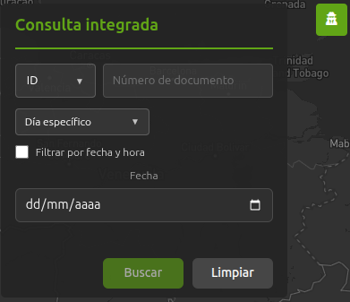
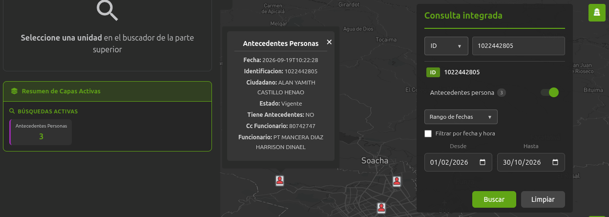
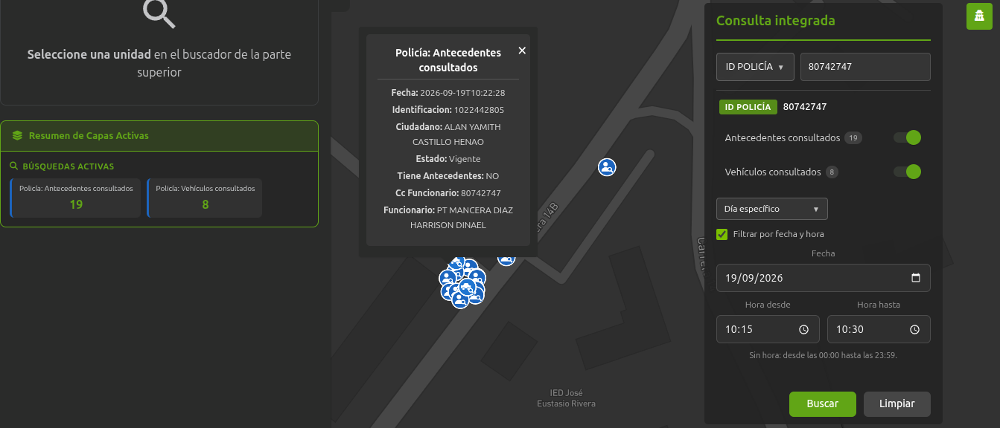

# Consulta integrada

## 1. Identificación

| Campo | Valor |
|---|---|
| ID | POL-MAPA-001 |
| Módulo | Consulta Integrada |
| Frecuencia de actualización | null |
| Hora de carga del Data Lake | null |
| Última actualización documento | 05/11/2026 |
| Responsable | Cristian Sanchez - Alan Castillo  |

## 2. Descripción

Modulo que permite visualizar las consultas de antecedentes y comparendos registrados que realizan los policia  en el territorio, sin necesidad de filtrar por unidad o sigla. Cada evento se representa sobre el mapa con un icono acorde a la cosulta por ID Persona, ID Policia, Placa, IMEI o Alias e incluye información relevane de cada registro. Cuenta con filtros por dia especifico, rango de fechas y renago de horas y se alimenta de 

## 3. Ruta de Acceso

1. Ingresar al aplicativo `IAPOL`.
2. Abrir el módulo `Anticipación a Fenómenos de Seguridad`.
3. Seleccionar el submódulo `Mapa de Anticipación a Fenómenos de Seguridad`.
4. Ingresar a `Mapa`.
5. Hacer clic en primer modulo `Consulta integrada`.

  

- Ruta resumida:

`Menú principal > Anticipación a Fenómenos de Seguridad > Mapa de Anticipación a Fenómenos de Seguridad > Modulo Consulta Integrada`

## 4. Activación de la capa

1. Seleccionar capa `Consulta integrada`
2. Seleccionar ID Persona, ID Policia, Placa, Imei o Alias
3. Aplicar los filtros requeridos por rango de fecha, dia especifico y rango de horas segun la necesidad.
4. Click boton Buscar

  

5. Se despliegan iconos en representación de los registros
6. En el panel izquierdo y en el modulo se visualizan contadores con el numero de registros
7. al hacer click sobre icono despliega card informativo

Nota: Los rangos de hora se usan principalmente al consultar por ID Policia debido al volumen de consultas que realiza un agente en un día. El ID Policia se puede tomar de las patrullas visualizadas en el mapa.

  

## 5. Parámetros y filtros de prueba

| Parámetro | Valor utilizado | Obligatorio |
|---|---|---|
| Sigla | Todos | No |
| Unidades hijas | Todos | No |

## 6. Fuente de datos

### Athena 

### Oracle (bd cliente)

## 7. Validaciones funcionales

- [ ] La capa puede activarse y desactivarse.
- [ ] El detalle del punto muestra los campos definidos.
- [ ] El nombre y la descripción son correctos.
- [ ] Los filtros modifican la información mostrada.
- [ ] Los puntos aparecen en el área geográfica esperada.
- [ ] La leyenda y los colores corresponden a la capa.
- [ ] No se presentan errores al cargar la información.

## 8. Validaciones de datos

- [ ] La cantidad total coincide.
- [ ] No existen identificadores duplicados.
- [ ] Una muestra de registros coincide entre ambas fuentes.
- [ ] La cantidad mostrada en el mapa coincide con los archivos.

## 9. Criterios de aceptación

La prueba es exitosa cuando:

1. La capa carga sin errores.
2. La información corresponde al periodo seleccionado.
3. La fuente de Policía coinciden después de aplicar las reglas
   de transformación.
4. La cantidad del mapa coincide con el resultado esperado en bds.
5. No existen diferencias sin justificación documentada.

## 10. Conclusión
La capa se actualiza en producción el 29/10/2026