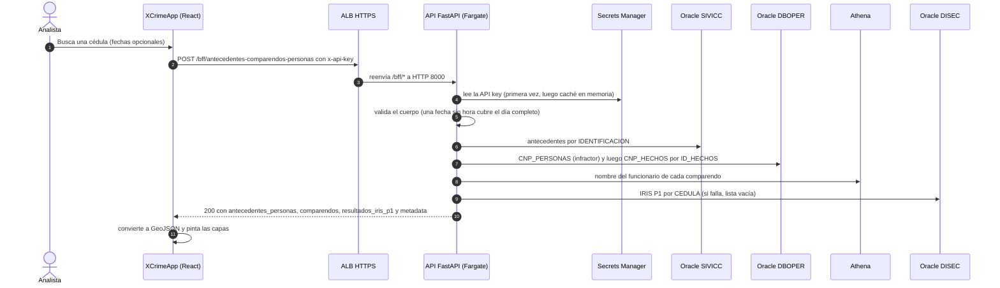

# Consulta integrada — servicio de antecedentes y comparendos de personas

Documentación técnica y operativa del servicio que responde `POST https://potenciales.ia.policia.gov.co/bff/antecedentes-comparendos-personas`, usado por la función **Consulta integrada** del mapa XCrimeApp (pestañas `ID` e `ID POLICÍA`).

## Identificación

| Campo | Valor |
|---|---|
| Servicio | `actores-potenciales-bff` (API "Capa Actores Potenciales", FastAPI) |
| Endpoint documentado | `POST /bff/antecedentes-comparendos-personas` |
| URL de producción | `https://potenciales.ia.policia.gov.co` |
| Cuenta / región AWS | PON - PROD - Policia Nacional IA (`926162397524`) · `us-east-1` |
| Código del servicio | repositorio `pon-iapol-capas` → `actores_potenciales/api/` |
| Infraestructura (CDK) | `pon-iapol-capas/cdk/lib/actores-potenciales-stack.ts` + `cdk/config/actores_potenciales.json` · stack `actores-potenciales-stack` |
| Cliente (front) | repositorio `pon-XCrimeApp` → `src/services/api/actoresPotencialesApi.js` y `src/components/ActoresPotenciales/` |
| Etiquetas AWS | `ProjectId=2009` · `Env=PROD` · `Client=PON` · `Component=actores-potenciales` · `ManagedBy=CDK` |
| Fecha de esta revisión | 2026-11-03 |

Archivos de esta carpeta:

| Archivo | Contenido |
|---|---|
| [README.md](README.md) | Este documento (los 9 puntos solicitados + anexos) |
| [arquitectura.drawio](arquitectura.drawio) | Diagrama de arquitectura end to end (abrir con draw.io / extensión de VS Code) |
| [SQL/2.Oracle.sql](SQL/2.Oracle.sql) | Consultas Oracle exactas que ejecuta el servicio (SIVICC, DBOPER, DISEC) |
| [SQL/1.Athena.sql](SQL/1.Athena.sql) | Consulta Athena de enriquecimiento (nombre del funcionario) |

## Resultado de la validación (2026-11-03)

**El servicio está operativo y responde correctamente.** La petición solicitada (`value_type: "cc"`, `value: "222"`, fechas `null`) devolvió `200` en 6,2 s con 51 registros (48 antecedentes, 3 comparendos, 0 IRIS P1). Producción coincide exactamente con el código del repositorio (mismo hash de imagen y plantilla CloudFormation sin diferencias). Detalle de las 16 pruebas en el [Anexo B](#anexo-b-detalle-de-la-validación).

Hallazgos que requieren decisión (detalle y recomendaciones en el [Anexo C](#anexo-c-hallazgos-y-riesgos-priorizados)):

1. **Alta** — La API key viaja embebida en el front y está versionada en git; el servicio es público en internet y devuelve datos personales.
2. **Alta** — Se imprimen las cédulas consultadas en los logs de CloudWatch.
3. **Media** — No hay alarmas operativas; hay 18–52 respuestas `504` por día que nadie recibe como alerta.
4. **Media** — Una sola tarea en una sola zona de disponibilidad y sin rollback automático de despliegues.
5. **Media** — El README del propio servicio está desactualizado (dice "en paralelo", es secuencial; sugiere `cdk deploy --all`, que desplegaría 15 stacks).

---

## 1. Descripción y lógica del componente

### 1.1 Qué es

**Consulta integrada** permite buscar a un "actor potencial" por cédula (`ID`), cédula de un policía (`ID POLICÍA`), placa, IMEI o alias, y pintar en el mapa los registros georreferenciados que lo mencionan. Todas las pestañas llaman al mismo servicio, un BFF (*backend for frontend*) en Python/FastAPI que **no guarda datos**: en cada petición consulta bases de datos operativas de la Policía y devuelve el resultado.

Este documento se centra en `POST /bff/antecedentes-comparendos-personas`. Los demás endpoints comparten infraestructura, autenticación y configuración (ver 1.6).

### 1.2 Qué responde según `value_type`

| `value_type` | Qué significa `value` | Qué devuelve | Fuentes |
|---|---|---|---|
| `cc` (o vacío, o cualquier valor distinto de `idpolicia`) | Cédula de un ciudadano | Consultas de antecedentes hechas sobre esa persona, comparendos RNMC donde figura como infractor y registros IRIS P1 | SIVICC, DBOPER, Athena, DISEC |
| `idpolicia` (sin importar mayúsculas ni espacios) | Cédula de un policía | Lo que ese funcionario hizo: personas y vehículos que consultó y comparendos que impuso | SIVICC, DBOPER, Athena |

El front solo envía `cc` o `idpolicia`. Cualquier otro texto se trata como búsqueda de ciudadano.

### 1.3 Flujo de una consulta por cédula (`cc`)



Paso a paso:

1. **Front** (`ActoresPotenciales.js`): valida que la fecha inicial no sea mayor que la final y arma `fecha_inicio` / `fecha_fin` (con hora solo si el usuario marcó "con hora"). Llama a `buscarActorPotencialAPI`, que hace el `POST` con axios y el header `x-api-key`.
2. **Route 53 → ALB → Target Group → tarea Fargate.** El ALB solo reenvía `/bff/*`, `/health`, `/`, `/docs` y `/redoc`; cualquier otra ruta recibe `404 {"status":404,"error":"Invalid Path"}`.
3. **`APIKeyMiddleware`** compara el header con el secreto `capa-actores-potenciales-bff-api-key` (campo `API_KEY`). La key se cachea en memoria del proceso. Sin header → `401`; key distinta → `500`.
4. **`QueryRequest`** (pydantic) valida el cuerpo: `value` es obligatorio; `value_type` y las fechas son opcionales. Una fecha sin hora (`2025-07-30`) cubre el día completo: inicio `00:00:00`, fin `23:59:59`.
5. **`CentralService.query_antecedentes_comparendos_personas`** ejecuta **en secuencia** (el tiempo total es la suma, no el máximo):
   1. **Antecedentes** — Oracle SIVICC, tabla `USR_MNVCC.AUDITORIA_CONS_PERSONA`, `IDENTIFICACION = :cédula` y filtro por `FECHA` si hay rango.
   2. **Comparendos** — Oracle DBOPER en dos consultas unidas en memoria con pandas: `USR_CNP.CNP_PERSONAS` (la persona como infractor, `ID_TIPO_PERSONA = 350`) y luego `USR_CNP.CNP_HECHOS` por bloques de 1000 `ID_HECHOS`, aplicando aquí el filtro de fecha. Es una unión interna: un comparendo cuyo hecho cae fuera del rango no aparece.
   3. **Nombre del funcionario** — Athena (`vm_personal_agrupado`) completa el campo `FUNCIONARIO` de los comparendos. Si Athena falla, el campo queda `null`.
   4. **IRIS P1** — Oracle DISEC: `IRISP_INTEGRANTE` unida a `VM_GENERAL_IRISP` por `CRIMINALIDAD_ID`, `CEDULA = :cédula`. Si falla, el error se registra y se devuelve `[]`.
6. **Respuesta** `200`: `antecedentes_personas`, `comparendos`, `resultados_iris_p1` y `metadata` (conteos y `query_time_seconds`). Contrato completo en el [Anexo A](#anexo-a-contrato-de-la-api).
7. **Front**: `toGeoJSON` convierte cada lista en una capa; descarta registros sin coordenadas válidas (nulas, `0,0` o fuera de rango) y cada lista con al menos un punto genera un interruptor en el panel.

### 1.4 Rama `idpolicia`

`CentralService.query_actividad_policia` devuelve `antecedentes_personas` (personas consultadas por el funcionario), `antecedentes_vehiculos` (vehículos consultados) y `comparendos` (los que impuso). Particularidades:

- **Vehículos** corre en un hilo aparte (pool de 4) con límite de **25 s**. Si no responde, la respuesta sale sin ese bloque y `metadata.vehiculos_error` vale `"timeout"` o `"error"`.
- **Antecedentes del policía** usa `FECHA + 0` para impedir que Oracle elija el índice de `FECHA` (con rangos cortos recorría todas las consultas del país y el ALB devolvía 504).
- **Comparendos**: un registro por infractor (`ID_TIPO_PERSONA = 350`), con teléfono, correo y domicilio traducidos con los catálogos `CNP_DOMINIOS` y `VM_LUGARES_GEOGRAFICOS` (se cargan una vez y quedan en memoria; si fallan se reintentan a los 5 minutos). Las demás personas del mismo comparendo (testigo, custodio) van en la lista `TESTIGOS`. El departamento se deduce del municipio porque `ID_DTO_RESIDE` no es confiable.
- **`value` debe ser numérico**: la cédula del policía se compara con una columna numérica; un texto como `SDS777` produce `ORA-01722` y un `500`.
- En el front, las claves de esta búsqueda se prefijan con `policia_` para convivir en el mapa con las de la búsqueda por cédula.

### 1.5 Reglas que conviene recordar

| Regla | Efecto |
|---|---|
| Fecha del filtro | Antecedentes: `FECHA` de la consulta. Comparendos: `FECHA` del hecho (no la de creación). IRIS: `FECHA_INICIO_EXISTENCIA`. |
| Fecha sin hora | Cubre el día completo (inicio `00:00:00`, fin `23:59:59`). Con hora, se usa exacta. Sin fecha, no hay filtro. |
| Errores tolerados | IRIS P1 y Athena nunca rompen la respuesta (lista vacía / `FUNCIONARIO: null`). |
| Errores no tolerados | Un fallo en SIVICC o DBOPER devuelve `500` con `Error en la consulta: ...`. |
| `metadata` vs mapa | `metadata.total_records` cuenta todos los registros; el mapa solo pinta los que tienen coordenadas válidas. Una diferencia entre ambos es normal. |
| Sin persistencia | El servicio no guarda nada; cada petición abre conexiones Oracle nuevas y las cierra. |

### 1.6 Otros endpoints del mismo servicio

| Ruta | Fuente | Uso |
|---|---|---|
| `POST /bff/antecedentes-vehiculos` | SIVICC `AUDITORIA_CONS_VEHICULO` por `PLACA` | Pestaña PLACA |
| `POST /bff/antecedentes-imei` | SIVICC `AUDITORIA_CONS_IMEI` por `IMEI` | Pestaña IMEI |
| `POST /bff/investigacion-alias` | Athena (`alias_db.alias_tbl`) + IRIS P1 por alias | Pestaña ALIAS |
| `GET /health` y `GET /` | — | Health check del Target Group (no requiere key) |
| `GET /docs`, `/redoc` | — | Swagger (hoy públicos, ver Anexo C) |
| `POST /auth/refresh-key` | — | Limpia la caché de la API key. **No está enrutado por el ALB**: solo se puede invocar dentro de la VPC o en local. |

---

## 2. Diagrama de arquitectura

Archivo draw.io: **[arquitectura.drawio](arquitectura.drawio)** (37 formas, 20 conexiones; flujo principal numerado 1–9 y conexiones de soporte punteadas).

Resumen de la topología:

```
Navegador (XCrimeApp) ──HTTPS──▶ Route 53 ──▶ ALB (443, 4 subnets públicas)
                                                │  /bff/*  /health  /docs
                                                ▼
                                   Target Group :8000 (health GET /health)
                                                ▼
                       ECS Fargate · subnet privada us-east-1a · 1 tarea (0,5 vCPU / 1 GB)
                         FastAPI: APIKeyMiddleware → router → CentralService
                              │             │                    │
                              │ NAT         │ NAT                │ Transit Gateway (172.0.0.0/8)
                              ▼             ▼                    ▼
                    Secrets Manager     Athena + S3      Oracle on-premise (puerto 1538)
                                                         SIVICC · DBOPER · DISEC
```

### Componentes y recursos reales

| Componente | Recurso en AWS | Función |
|---|---|---|
| DNS | Route 53, zona `ia.policia.gov.co`, registro `A` alias `potenciales` → ALB | Nombre público del servicio |
| Certificado | ACM `3c0c769d-9a01-46f2-8934-f3aa1474cc08` (validado por DNS, vence 2027-03-19) | TLS del ALB |
| Balanceador | ALB `actores-potenciales-bff-alb`, internet-facing, 4 subnets (us-east-1a-d), SG con 80/443 abiertos | Termina TLS; `:80` redirige a `:443`; idle timeout **60 s** |
| Reglas del ALB | `/bff/*` (prio 10), `/health` y `/` (20), `/docs` y `/redoc` (30); resto → `404` fijo | Enrutamiento |
| Target Group | `actores-potenciales-bff-tg`, HTTP `:8000`, health `GET /health` cada 60 s (2 buenos / 5 malos) | Entrega a la tarea |
| Cómputo | ECS Fargate, clúster `actores-potenciales-bff-cluster`, servicio `actores-potenciales-stack-ActoresPotencialesServiceBF8396CC-6Q7HKqHfR0ui`, task definition `actorespotencialesstackActoresPotencialesTaskDefAC67E9AA` (revisión **26**) | Ejecuta el contenedor (Python 3.12 + Oracle Instant Client) |
| Red de la tarea | VPC `vpc-045111e41496789d2`, subnet privada `subnet-0c1668a9307cb92e5` (us-east-1a), sin IP pública | Salida por NAT Gateway; hacia on-premise por Transit Gateway `tgw-0a5012f46c777d3f2` |
| Escalado | Target tracking 1–10 tareas: CPU 80 %, memoria 80 %, 100 peticiones/tarea (salida 75 s, entrada 300 s). Capacidad: `FARGATE` base 1 (peso 2) + `FARGATE_SPOT` (peso 8) | Elasticidad |
| Secretos | Secrets Manager: API key del servicio y credenciales SIVICC, DBOPER y DISEC (ver 4.2) | Autenticación y acceso a datos |
| Datos | Oracle on-premise (puerto 1538): SIVICC, DBOPER, DISEC. Athena/Glue (`pon-prod-raw-sivicc`) con resultados en S3 | Fuentes consultadas |
| Imagen | ECR `cdk-hnb659fds-container-assets-926162397524-us-east-1` (repositorio compartido de activos de CDK) | Imagen Docker del servicio |
| Logs | CloudWatch Logs `/ecs/actores-potenciales-bff`, retención 7 días | Trazas de la aplicación |
| IaC | CloudFormation `actores-potenciales-stack` (CDK) | Crea clúster, tarea, ALB, certificado, registro DNS, roles y autoescalado. Ya existían y solo se referencian: VPC, subnets, NAT, Transit Gateway, secretos, zona DNS y el repositorio ECR de CDK |

---

## 3. Diagnóstico de incidentes

### 3.1 Triage en 5 minutos

Requisitos: AWS CLI con el perfil `PON-PROD-Policia-Nacional-IA` (`aws sso login --profile PON-PROD-Policia-Nacional-IA` si expiró). En Git Bash anteponer `MSYS_NO_PATHCONV=1` a los comandos que reciben rutas que empiezan por `/` (como el nombre del log group).

```bash
# 1. ¿El proceso responde? (no toca bases de datos)
curl -s https://potenciales.ia.policia.gov.co/health

# 2. ¿La tarea está viva? (running = desired = 1, deployment COMPLETED)
aws ecs describe-services --cluster actores-potenciales-bff-cluster \
  --services actores-potenciales-stack-ActoresPotencialesServiceBF8396CC-6Q7HKqHfR0ui \
  --query "services[0].{running:runningCount,desired:desiredCount,eventos:events[0:5].message}"

# 3. ¿El ALB la ve sana?
aws elbv2 describe-target-health --target-group-arn \
  arn:aws:elasticloadbalancing:us-east-1:926162397524:targetgroup/actores-potenciales-bff-tg/bdf9bf0e790c1eb3

# 4. ¿Qué dicen los logs ahora?
aws logs tail /ecs/actores-potenciales-bff --since 30m --filter-pattern '?"Error" ?"ORA-" ?"DPY-"'
```

`/health` solo prueba que el proceso está vivo. **No** verifica Oracle, Athena ni Secrets Manager: un `/health` en 200 con consultas fallando apunta a las dependencias (ver filas 3(b), 4 y 6 a 10 de la tabla).

Para una prueba de humo de punta a punta (usa la key real: obtenerla de Secrets Manager, ver 9.4):

```bash
curl -s -o /dev/null -w "http=%{http_code} total=%{time_total}s\n" -X POST \
  https://potenciales.ia.policia.gov.co/bff/antecedentes-comparendos-personas \
  -H "Content-Type: application/json" -H "x-api-key: $API_KEY" \
  -d '{"value_type":"cc","value":"222","fecha_inicio":null,"fecha_fin":null}'
# Esperado: http=200, entre 3 y 8 s
```

### 3.2 Fallos comunes

| # | Síntoma | Causa probable | Cómo confirmar | Solución |
|---|---|---|---|---|
| 1 | `504 Gateway Timeout` (lo genera el ALB y no lleva cabeceras CORS, por lo que el navegador suele mostrarlo como error de CORS o de red) | La consulta superó los 60 s del ALB: SIVICC lento (sobre todo ID POLICÍA sin fechas o con rango amplio) o espera de Athena | Métrica ALB `HTTPCode_ELB_504_Count`; en logs `La consulta a Oracle tardo NN.NNs` con NN ≥ 50 | Repetir con un rango de fechas más corto. Si es sistemático, ver hallazgo H6 (alinear timeouts). Hoy hay 18–52 por día como línea base |
| 2 | `401` `No se proporciono API Key 'x-api-key'` | El cliente no envió el header (o un proxy lo quitó) | Respuesta de la petición | Enviar `x-api-key` |
| 3 | `500` `API key invalida` | (a) La key del cliente no coincide con el secreto (se rotó el secreto o el front tiene otra). (b) **La tarea no puede leer Secrets Manager** (permiso IAM/KMS, NAT caído, secreto borrado): el código captura ese error y responde igual `API key invalida`, por lo que desde fuera ambos casos son idénticos | Mirar el log de la petición: en el caso (b) aparece `Error al validar API key: Error de AWS Secrets Manager: <código>`; en el caso (a) no. Comparar `LastChangedDate` del secreto | (a) Actualizar `Actores_Potenciales_API_Key` en el front y redesplegarlo; si se rotó el secreto, reiniciar la tarea (8.1) porque la key se cachea sin vencimiento. (b) Revisar el task role `actores-potenciales-bff-task-role`, la ruta por NAT y que el secreto exista |
| 4 | Todas las consultas fallan con `500 API key invalida` aunque la key sea la correcta | Caso (b) de la fila 3, afectando a todos los usuarios | Misma verificación de logs; el `/health` sigue en 200 | Igual que la fila 3(b) |
| 5 | `500` `Error en la consulta: Error ejecutando query: ORA-01722: invalid number` | En `ID POLICÍA` se ingresó un valor no numérico (ej. `SDS777`). Ocurrió 8 veces el 2026-11-02 y se reprodujo en la validación (`idpolicia` + `ABC123` → `500` en 1,5 s) | Log con `{'key_value': '...'}` | Ingresar la cédula numérica. Mejora pendiente: validar la entrada (H8) |
| 6 | `500` `DPY-6005: cannot connect to database ... timed out`, `ORA-12170`, `ORA-12541` | Sin ruta a Oracle on-premise: Transit Gateway/enlace caído, host o puerto cambió, regla de firewall | `/health` sigue en 200; revisar el host del secreto y la ruta `172.0.0.0/8` de la subnet. (En la prueba local sin ruta, `DPY-6005` tardó ~20 s) | Escalar a redes/DBA. No requiere cambios en AWS si el host no cambió. Se recupera solo al volver el enlace (cada petición abre conexión nueva) |
| 7 | `500` `ORA-01017: invalid username/password` | Contraseña rotada o cuenta bloqueada | `LastChangedDate` del secreto SIVICC / DBOPER / DISEC | Actualizar el secreto y **reiniciar la tarea** (8.1): las credenciales se cachean sin vencimiento |
| 8 | `500` con `DPI-1067`, `DPY-4011` o `ORA-03156` | Se excedió `call_timeout` de Oracle (60 s) o la sesión se cortó | Log con la consulta y su duración | Igual que la fila 1 |
| 9 | `200` pero `FUNCIONARIO: null` en comparendos | Athena falló, no tiene permiso, o la cédula del policía no está en `vm_personal_agrupado` | Logs `Query failed with status` / `Error executing query`; historial de consultas en Athena | Revisar permisos Athena/Glue/S3 del task role y la base `pon-prod-raw-sivicc` |
| 10 | `200` pero `resultados_iris_p1` siempre vacío; log `Error en consulta iris_p1` | DISEC inaccesible o cédula no numérica (`ORA-01722`: 28 veces en 7 días, es benigno) | Logs `Error ejecutando query iris_p1` | Si es por red, ver fila 6 con el secreto `pon-prod-disec-op-rnmc` |
| 11 | `200` con datos, pero el mapa no pinta puntos | Los registros no tienen coordenadas válidas (`LATITUD`/`LONGITUD` nulas, `0,0` o fuera de rango) | Respuesta en DevTools → Network: comparar `metadata.total_records` con los puntos | Es un problema del dato fuente, no del servicio |
| 12 | El spinner termina y no pasa nada | El front no captura errores (`try/finally` sin `catch`) y axios no tiene timeout | Consola y pestaña Network del navegador | Ver el código HTTP real; mejora pendiente en el front (H15) |
| 13 | `422` `Field required` / `datetime_parsing` | Falta `value` o la fecha no es `YYYY-MM-DD` ni `YYYY-MM-DDTHH:mm:ss` | Cuerpo del `422` | Corregir el formato (ej. `31/12/2025` es inválido) |
| 14 | `404` `{"status":404,"error":"Invalid Path"}` | Ruta fuera de `/bff/*`, `/health`, `/`, `/docs`, `/redoc` | Respuesta del ALB (el ALB registra ≈3.500 respuestas 4xx propias por día; al ser público, lo más probable es tráfico de escáneres de internet) | Corregir la URL; no requiere acción si no viene del front |
| 15 | `405 Method Not Allowed` | Se usó `GET` sobre un endpoint `POST` | — | Usar `POST` |
| 16 | Todo responde `502/503` o el Target Group queda `unhealthy` | Tarea caída: memoria (1 GB; respuestas muy grandes con pandas), interrupción de Fargate Spot, despliegue fallido | Eventos del servicio ECS; `aws ecs list-tasks --desired-status STOPPED` y `stoppedReason` | Seguir 8.1–8.3 |
| 17 | `500` `Error interno del servidor` / `INTERNAL_SERVER_ERROR` | Excepción no controlada (por ejemplo, un valor que no se serializa a JSON) | Log `Error no manejado en <url>` y la traza | Corregir el código y desplegar (6) |

### 3.3 Cómo reconstruir una petición en los logs

Los logs no tienen identificador de petición ni IP del cliente (la IP que aparece es la del nodo del ALB). Una petición se reconstruye por hora: líneas `Ejecutando consulta para Personas: <cédula>` (rama ciudadano) o `Ejecutando consulta de antecedentes realizados por el policia: <cédula>` (rama policía), seguidas de las consultas SQL con sus parámetros, la duración de cada una y la línea de acceso de uvicorn con el código HTTP. Consultas listas para pegar en CloudWatch Logs Insights en el [punto 7.3](#73-consultas-de-cloudwatch-logs-insights).

---

## 4. Configuración y variables

### 4.1 Variables de entorno del contenedor

Definidas en `cdk/config/actores_potenciales.json` → `api.environment` (se inyectan en la task definition).

| Variable | Valor en producción | Para qué sirve | Si falta |
|---|---|---|---|
| `BACKEND_API_KEY_SECRET_NAME` | `capa-actores-potenciales-bff-api-key` | Secreto con la API key (campo `API_KEY`) | Usa ese mismo valor por defecto |
| `SIVICC_SECRET` | `pon-prod-sivicc-connection` | Credenciales Oracle SIVICC | Usa ese mismo valor por defecto |
| `DBOPER_SECRET` | `pon-prod-DBOPER-on-premise` | Credenciales Oracle DBOPER | Usa ese mismo valor por defecto |
| `DISEC_SECRET` | `pon-prod-disec-op-rnmc` | Credenciales Oracle DISEC (IRIS P1) | Usa ese mismo valor por defecto |
| `ATHENA_OUTPUT_LOCATION` | `s3://pon-prod-athena-query-results-capas-adicionales/capa-actores-potenciales/` | Destino de resultados de Athena | Usa ese mismo valor por defecto |
| `AWS_DEFAULT_REGION` | `us-east-1` | Región de boto3 | Usa `us-east-1` |
| `ORACLE_CALL_TIMEOUT_MS` | *(no definida)* | Límite por llamada a Oracle | `60000` (60 s) |
| `API_VERSION` | *(no definida)* | Versión que reporta `/health` | `1.0.0` |
| `VERSION` | `1.1.0` | **No la lee el código** (ver H11): no tiene efecto | — |

La aplicación **no carga archivos `.env`** (no usa `python-dotenv`): en local las variables deben exportarse en la terminal.

### 4.2 Secretos (AWS Secrets Manager, `us-east-1`)

| Secreto | Campos | Consumidor | Último cambio |
|---|---|---|---|
| `capa-actores-potenciales-bff-api-key` | `API_KEY` | `APIKeyMiddleware` | 2026-02-16 |
| `pon-prod-sivicc-connection` | `host`, `port`, `dbname`, `username`, `password`, `engine`, `connectionString` | Oracle SIVICC | 2025-08-25 |
| `pon-prod-DBOPER-on-premise` | ídem | Oracle DBOPER | 2025-10-06 |
| `pon-prod-disec-op-rnmc` | ídem | Oracle DISEC | 2025-08-13 |

Los tres secretos de base de datos apuntan a hosts en el rango `172.x.x.x`, puerto `1538`. Ningún secreto tiene rotación automática. Las credenciales y la API key se **cachean en memoria sin vencimiento**: cualquier cambio exige reiniciar la tarea (8.1).

### 4.3 Configuración de consultas (`api/app/config.json`)

Define, por consulta, `db` (`sivicc`, `dboper` o `disec`), `schema`, `table`, columna clave, campo de fecha, lista de campos y filtros fijos. Claves relevantes para este endpoint:

| Clave | Tabla | Notas |
|---|---|---|
| `antecedentes-personas` | `USR_MNVCC.AUDITORIA_CONS_PERSONA` (SIVICC) | Clave `IDENTIFICACION`, fecha `FECHA` |
| `comparendos-personas` | `USR_CNP.CNP_PERSONAS` + `CNP_HECHOS` (DBOPER) | Filtro fijo `ID_TIPO_PERSONA = 350`; fecha sobre `CNP_HECHOS.FECHA` |
| `iris_p1` | `USR_DISEC.IRISP_INTEGRANTE` + `VM_GENERAL_IRISP` (DISEC) | Fecha `FECHA_INICIO_EXISTENCIA` |
| `antecedentes-policia`, `vehiculos-policia`, `comparendos-policia`, `catalogos-cnp` | Rama `idpolicia` | `vehiculos-policia.timeout_segundos = 25`; `antecedentes-policia.fecha_sin_indice = true` |

`config.json` va **dentro de la imagen**: agregar o quitar un campo exige reconstruir y desplegar (6). Los nombres de campo distinguen mayúsculas y aceptan alias SQL (`CAMPO AS ALIAS`).

### 4.4 Parámetros de infraestructura (`cdk/config/actores_potenciales.json`)

| Parámetro | Valor | Efecto |
|---|---|---|
| `namespace_backend` | `actores-potenciales-bff` | Prefijo de clúster, ALB, TG, rol y log group |
| `api.cpu` / `api.memory_mib` | `512` / `1024` | Tamaño de la tarea |
| `api.desired_count` / `min_capacity` / `max_capacity` | `1` / `1` / `10` | Tareas iniciales y límites de autoescalado |
| `domain.hosted_zone` / `subdomain` | `ia.policia.gov.co` / `potenciales` | URL pública |
| `infrastructure.vpc_id` | `vpc-045111e41496789d2` | VPC existente |
| `infrastructure.alb_subnets` | 4 subnets públicas (`subnet-04d84f8bc241687af`, `subnet-04c384d50fb421777`, `subnet-036714425ec3c05bd`, `subnet-00bbda4a00c68d883`) | Ubicación del ALB |
| `infrastructure.api_bff_subnets` | `subnet-0c1668a9307cb92e5` | Subnet privada de la tarea (una sola zona) |
| `api.s3_buckets` | `pon-prod-athena-query-results-capas-adicionales`, `pon-prod-raw-sivicc`, `test-trigger-sivicc` | Buckets con permiso del task role |
| `api.resources.*_secret_arn` | ARN de los 4 secretos | Permiso de lectura del task role |

### 4.5 Valores fijos en el código

| Valor | Dónde | Efecto |
|---|---|---|
| Pool de 4 hilos para consultas secundarias | `central_service.py` | Máximo 4 consultas de vehículos simultáneas |
| Bloques de 1000 en `IN (...)` | `oracle_service.py` | Evita `ORA-01795` |
| Athena: sondeo cada 2 s, máximo 60 intentos | `athena_service.py` | Espera hasta 120 s (el ALB corta a los 60 s) |
| Reintento de catálogos a los 5 min | `central_service.py` | Si fallan, los nombres quedan `null` |
| CORS `allow_origins=["*"]` con credenciales | `main.py` | Cualquier origen puede invocar desde un navegador |

### 4.6 Permisos IAM (task role `actores-potenciales-bff-task-role`)

`secretsmanager:GetSecretValue/DescribeSecret` sobre los 4 secretos · `kms:Decrypt` sobre `*` · `athena:Start/Get/StopQueryExecution`, `athena:GetQueryResults`, `glue:GetDatabase/GetTable/GetPartitions` sobre `*` · `s3:GetObject/PutObject/ListBucket/HeadObject/GetBucketLocation` sobre los 3 buckets. El rol de ejecución usa la política administrada `AmazonECSTaskExecutionRolePolicy`.

### 4.7 Configuración del cliente

En `pon-XCrimeApp/src/file.config.js`: `Actores_Potenciales_API_URL = 'https://potenciales.ia.policia.gov.co/bff'` y `Actores_Potenciales_API_Key` (valor fijo en el código, no variable de entorno; ver H1). En desarrollo (`yarn start`) el front usa la misma URL de producción.

---

## 5. Dependencias e integraciones

### 5.1 Servicios con los que se comunica

| Dependencia | Tipo | Uso | Si falla |
|---|---|---|---|
| **Oracle SIVICC** (`USR_MNVCC`) | On-premise, puerto 1538 | Antecedentes de personas, vehículos e IMEI | **Crítica**: `500` en este endpoint |
| **Oracle DBOPER** (`USR_CNP`) | On-premise, puerto 1538 | Comparendos RNMC y catálogos | **Crítica**: `500` en este endpoint |
| **Oracle DISEC** (`USR_DISEC`) | On-premise, puerto 1538 | IRIS P1 | Tolerada: lista vacía |
| **Athena + Glue** (`pon-prod-raw-sivicc`) | AWS | Nombre del funcionario | Tolerada: `FUNCIONARIO: null` |
| **S3** `pon-prod-athena-query-results-capas-adicionales` | AWS | Resultados de Athena | Athena falla → tolerada |
| **Secrets Manager** | AWS | API key y credenciales | **Crítica**: sin key no hay autenticación; sin credenciales no hay datos |
| **Transit Gateway** `tgw-0a5012f46c777d3f2` | AWS (red) | Ruta `172.0.0.0/8` hacia los Oracle | **Crítica**: equivale a perder las 3 bases |
| **NAT Gateway** | AWS (red) | Salida a Secrets Manager, Athena, ECR, CloudWatch | **Crítica** |
| **Route 53 / ACM / ALB** | AWS | Entrada pública con TLS | Sin ellos el servicio es inalcanzable |
| **ECR / ECS / CloudWatch Logs** | AWS | Imagen, ejecución, logs | Una tarea sin imagen no arranca |

### 5.2 Quién consume el servicio

Solo el front **XCrimeApp** (React 17, `pon-XCrimeApp`), módulo "Anticipación a Fenómenos de Seguridad" → Mapa → "Consulta integrada". El usuario se autentica en el front con Keycloak; **el servicio no valida al usuario**, solo la API key compartida. Los resultados se convierten a GeoJSON y se muestran como capas con sus ventanas emergentes.

### 5.3 Dependencias de software

`pyproject.toml`: Python `>=3.11,<4.0` (la imagen usa 3.12), `fastapi 0.104.1`, `uvicorn 0.24.0`, `pydantic 2.5.0`, `boto3 1.40.34`, `oracledb ^2.0.0`, `pandas ^2.0.0`, `python-multipart`, `python-json-logger`. Imagen base `public.ecr.aws/docker/library/python:3.12-slim-bookworm`, AWS Lambda Web Adapter 0.7.0 (no se usa en Fargate) y Oracle Instant Client Basic Light (se descarga la versión "latest" al construir).

---

## 6. Despliegue y actualización

### 6.1 Cómo se despliega hoy

**Manualmente**, desde un equipo con Docker y AWS CDK. No se encontró ningún pipeline asociado a este servicio (se buscó por nombre en CodePipeline y CodeBuild; sí existen para el front, `xcrimeapp-prod-front-CodePipeLine`, y para otros servicios). Quien despliega construye la imagen en su máquina, CDK la sube a ECR y CloudFormation actualiza el servicio ECS.

Requisitos: Docker Desktop encendido · Node.js y `npm install` en `pon-iapol-capas/cdk` · sesión SSO del perfil `PON-PROD-Policia-Nacional-IA`.

### 6.2 Publicar un cambio

```bash
# 1. Autenticarse y exportar credenciales (PowerShell: ver 9.3)
aws sso login --profile PON-PROD-Policia-Nacional-IA
eval "$(aws configure export-credentials --profile PON-PROD-Policia-Nacional-IA --format env)"; unset AWS_PROFILE
export AWS_DEFAULT_REGION=us-east-1

# 2. Revisar qué cambiaría (solo lectura)
cd pon-iapol-capas/cdk
npx cdk diff actores-potenciales-stack --exclusively

# 3. Desplegar SOLO este stack
npx cdk deploy actores-potenciales-stack --exclusively --require-approval never
```

**Atención:** no usar `cdk deploy --all` (el README del servicio lo sugiere). La aplicación CDK define **15 stacks** (`cdk list`); `--all` los desplegaría todos.

Qué ocurre durante el despliegue:

1. Se construye la imagen Docker del directorio `actores_potenciales/api` (el Dockerfile ejecuta `poetry lock` e instala Instant Client; tarda varios minutos). La etiqueta de la imagen es el hash del contenido del directorio.
2. CDK sube la imagen a ECR y CloudFormation registra una **nueva revisión** de la task definition.
3. ECS hace un despliegue **rolling** (mínimo 100 %, máximo 200 %): levanta la tarea nueva y solo retira la vieja cuando la nueva pasa el health check (2 chequeos buenos a 60 s: mínimo ~2 min). No hay corte, pero la caché en memoria se reinicia.
4. **No hay circuit breaker** (`deploymentCircuitBreaker.enable = false`): si la tarea nueva nunca queda sana, ECS conserva la vieja pero CloudFormation espera hasta agotar su tiempo. Cancelar la actualización de la pila desde la consola o con `aws cloudformation cancel-update-stack --stack-name actores-potenciales-stack` si pasan más de ~15 minutos.

Verificación posterior (obligatoria):

```bash
aws ecs describe-services --cluster actores-potenciales-bff-cluster \
  --services actores-potenciales-stack-ActoresPotencialesServiceBF8396CC-6Q7HKqHfR0ui \
  --query "services[0].deployments[*].{estado:rolloutState,taskDef:taskDefinition}"   # un solo despliegue COMPLETED
curl -s https://potenciales.ia.policia.gov.co/health                                   # 200
# prueba de humo con la consulta del punto 3.1  → 200
```

Después, hacer commit del cambio en `pon-iapol-capas` (no hay etiquetas de versión; el campo `VERSION` no tiene efecto, ver H11).

### 6.3 Cambios frecuentes

| Cambio | Dónde | Notas |
|---|---|---|
| Agregar/quitar columnas o cambiar filtros fijos | `api/app/config.json` | Requiere desplegar |
| Cambiar lógica o validaciones | `api/app/services/*.py`, `routers/capas.py`, `models/schemas.py` | Requiere desplegar |
| Cambiar tamaño, límites de escalado, subnets | `cdk/config/actores_potenciales.json` | Requiere desplegar; cambiar CPU/memoria reemplaza la tarea |
| Rotar la API key | Secrets Manager + front | 1) Actualizar el secreto. 2) Actualizar `Actores_Potenciales_API_Key` en `file.config.js` y desplegar el front. 3) Reiniciar la tarea (8.1). Entre 1 y 2 el front recibe `500 API key invalida`: coordinar la ventana |
| Rotar credenciales de Oracle | Secrets Manager | Actualizar el secreto y reiniciar la tarea (8.1) |
| Cambiar la URL o la key en el cliente | `pon-XCrimeApp/src/file.config.js` | El front se publica con su pipeline (CodeBuild → S3 `XCrimeAppCapa/`) |

### 6.4 Rollback

El servicio no guarda estado, por lo que volver atrás es seguro. Hay dos caminos.

**Opción A — rápida (minutos, sin Docker):** registrar una revisión de la task definition con la imagen anterior y apuntar el servicio a ella. Las revisiones viejas de la task definition quedan inactivas (hoy solo existe la 26), pero **las imágenes siguen en ECR**.

Imagen de la revisión anterior (25, registrada el 2026-10-28 15:16 y verificada en ECR): `9707830e69b7b5369d4a6d077756ad862b9fc54fedfea070eddded3a2e9fe2f5`. La actual (26) es `a9d478823c9f9712ac37601f0f1ebe59a4c037fa4e3d5b59810f1dd689500e1d`. Para rollbacks futuros, las imágenes anteriores se identifican con CloudTrail:

```bash
aws cloudtrail lookup-events --lookup-attributes AttributeKey=EventName,AttributeValue=RegisterTaskDefinition \
  --max-results 50 --query "Events[*].CloudTrailEvent" --output json
# Buscar los eventos con "family": "actorespotencialesstackActoresPotencialesTaskDefAC67E9AA" y leer la imagen
```

Script que arma la nueva revisión (`rollback_td.py`; probado en esta revisión solo hasta generar el JSON, sin registrarlo):

```python
import json, sys
actual, skeleton, tag, salida = sys.argv[1:5]
td = json.load(open(actual, encoding="utf-8"))
permitidas = set(json.load(open(skeleton, encoding="utf-8")))
td = {k: v for k, v in td.items() if k in permitidas}          # quita campos de solo lectura
for c in td["containerDefinitions"]:
    c["image"] = c["image"].rsplit(":", 1)[0] + ":" + tag
json.dump(td, open(salida, "w", encoding="utf-8"), indent=2)
```

```bash
FAMILIA=actorespotencialesstackActoresPotencialesTaskDefAC67E9AA
aws ecs describe-task-definition --task-definition $FAMILIA --query taskDefinition > td_actual.json
aws ecs register-task-definition --generate-cli-skeleton > td_skeleton.json
python -I rollback_td.py td_actual.json td_skeleton.json <TAG_IMAGEN_ANTERIOR> td_rollback.json
aws ecs register-task-definition --cli-input-json file://td_rollback.json        # anotar la nueva revisión
aws ecs update-service --cluster actores-potenciales-bff-cluster \
  --service actores-potenciales-stack-ActoresPotencialesServiceBF8396CC-6Q7HKqHfR0ui \
  --task-definition $FAMILIA:<NUEVA_REVISION>
```

Esta opción deja **CloudFormation desalineado** con lo que corre. El siguiente `cdk deploy` volverá a imponer la imagen del código del repositorio; por eso, tras estabilizar, hay que revertir también el código (opción B).

**Opción B — limpia (requiere Docker; el tiempo lo domina el build de la imagen):** volver el código al commit bueno y redesplegar.

```bash
git revert <commit_malo>      # o: git checkout <commit_bueno> -- actores_potenciales/api
cd cdk && npx cdk deploy actores-potenciales-stack --exclusively --require-approval never
```

Rollback del **front** (si el problema es la key o la URL): volver a ejecutar en `xcrimeapp-prod-front-CodePipeLine` el commit anterior.

---

## 7. Monitoreo y alertas

### 7.1 Qué existe hoy

| Elemento | Estado |
|---|---|
| Logs de aplicación | CloudWatch `/ecs/actores-potenciales-bff`, retención **7 días** (≈12 MB almacenados) |
| Métricas de ALB, Target Group y ECS | Disponibles en CloudWatch (sin configuración adicional) |
| Health check | Target Group sobre `GET /health` cada 60 s |
| Alarmas | **Solo las 6 de autoescalado** (`TargetTracking-...`). Las `AlarmLow` en estado `ALARM` son normales: indican que el servicio está en su capacidad mínima |
| Alarmas de negocio, SNS, tablero | **No existen** |
| Access logs del ALB | Desactivados |

### 7.2 Valores de referencia (últimos 7 días, medidos el 2026-11-03)

| Señal | Namespace / métrica | Valor normal |
|---|---|---|
| Peticiones | `AWS/ApplicationELB` `RequestCount` | ≈ 8.200 en 7 días (incluye los preflight `OPTIONS` del navegador) |
| Respuestas del servicio 2xx / 4xx / 5xx | `HTTPCode_Target_2XX/4XX/5XX_Count` | 7.344 / 595 / 9 |
| Errores del ALB | `HTTPCode_ELB_504_Count` | 211 en 7 días (18–52 por día) |
| Respuestas 4xx generadas por el propio ALB | `HTTPCode_ELB_4XX_Count` | ≈ 24.500 en 7 días (≈3.500 por día; probablemente escáneres sobre rutas no enrutadas) |
| Latencia | `TargetResponseTime` | p50 ≈ 2 ms (preflight), p90 4,3 s, p99 13,2 s, máximo 58 s |
| Instancias no sanas | `UnHealthyHostCount` | 0 |
| CPU de la tarea | `AWS/ECS` `CPUUtilization` | media 0,2 %, máximo 77 % |
| Memoria de la tarea | `AWS/ECS` `MemoryUtilization` | media 18 %, máximo 23 % |
| Uso diario | Logs (`API key válida ...`, todos los endpoints) | ≈330–560 peticiones autenticadas por día, también en fin de semana |

### 7.3 Consultas de CloudWatch Logs Insights

Grupo de logs: `/ecs/actores-potenciales-bff`. Las horas se muestran en UTC.

```
# Errores por tipo
filter @message like /Error|Traceback|ORA-|DPY-|timeout|Timeout/
| parse @message /(?<tipo>Error[^:]{0,60}|ORA-[0-9]+|DPY-[0-9]+|Traceback|[Tt]imeout)/
| stats count() as n by tipo | sort n desc | limit 15

# Respuestas 500 del servicio
filter @message like / 500 Internal Server Error/
| fields @timestamp, @message | sort @timestamp desc | limit 50

# Consultas Oracle lentas (≥ 10 s)
filter @message like /tardo [0-9]{2,}\./
| fields @timestamp, @message | sort @timestamp desc | limit 50

# Consultas autenticadas por día
filter @message like /API key v/
| stats count() as consultas by datefloor(@timestamp, 1d) as dia | sort dia asc

# Errores de IRIS P1
filter @message like /Error en consulta iris_p1/
| fields @timestamp, @message | sort @timestamp desc | limit 50
```

### 7.4 Alarmas recomendadas (no implementadas)

| Alarma | Métrica | Umbral sugerido | Acción |
|---|---|---|---|
| Servicio sin tareas sanas | `UnHealthyHostCount` ≥ 1, o `HealthyHostCount` < 1 | 5 min seguidos | Avisar y aplicar 8.1 |
| Errores del servicio | `HTTPCode_Target_5XX_Count` | ≥ 5 en 5 min | Revisar logs (punto 7.3) |
| Timeouts | `HTTPCode_ELB_504_Count` | > 30 en 1 hora (la línea base es 18–52 por día) | Revisar consultas lentas |
| Latencia | `TargetResponseTime` p95 | > 30 s | Revisar SIVICC |
| Tareas en ejecución | `RunningTaskCount` | < 1 | Aplicar 8.1 / 8.2 |
| Memoria | `MemoryUtilization` | > 80 % por 10 min | Subir `memory_mib` o revisar respuestas grandes |
| Certificado | ACM `DaysToExpiry` | < 30 días | Revisar la validación DNS (8.5) |

Las alarmas deberían notificar a un tema SNS y declararse en el stack de CDK para quedar versionadas. Además, `GET /health` no consulta las bases: conviene una prueba sintética (un `POST` real con una cédula de prueba cada 5 minutos) para detectar caídas de Oracle, que hoy solo se ven cuando un usuario lo reporta.

### 7.5 Privacidad en logs

La aplicación imprime las consultas SQL **con sus parámetros**, incluida la cédula buscada. Quien tenga acceso al log group puede ver cédulas consultadas durante los últimos 7 días (H2).

---

## 8. Recuperación del servicio

El servicio **no tiene estado**: no hay datos que restaurar (RPO no aplica). El código está en git, la infraestructura en CDK y los secretos en Secrets Manager (que el stack **no** administra, por lo que sobreviven si el stack se destruye). El tiempo de recuperación depende del escenario.

Variables usadas abajo:

```bash
CLUSTER=actores-potenciales-bff-cluster
SERVICE=actores-potenciales-stack-ActoresPotencialesServiceBF8396CC-6Q7HKqHfR0ui
```

### 8.1 Reiniciar la tarea (primera acción ante casi cualquier falla)

```bash
aws ecs update-service --cluster $CLUSTER --service $SERVICE --force-new-deployment
```

Levanta una tarea nueva y retira la vieja cuando esté sana (rolling, sin corte). También **vacía las cachés** de API key, credenciales y catálogos. Verificar con el punto 3.1. Usar siempre tras cambiar un secreto.

### 8.2 La tarea no arranca o queda `unhealthy`

```bash
aws ecs list-tasks --cluster $CLUSTER --service-name $SERVICE --desired-status STOPPED
aws ecs describe-tasks --cluster $CLUSTER --tasks <ARN> --query "tasks[0].{motivo:stoppedReason,contenedor:containers[0].reason}"
```

| `stoppedReason` / síntoma | Qué hacer |
|---|---|
| `CannotPullContainerError` | La imagen no está en ECR o falta permiso: verificar la etiqueta en la task definition; si es necesario, rollback (6.4) |
| `OutOfMemoryError` / contenedor terminado por memoria | Subir `api.memory_mib` en el JSON de CDK y desplegar; revisar si hubo una consulta con respuesta enorme |
| Falla de health check tras un despliegue | Revisar los logs de la tarea nueva; si es un error de código, rollback (6.4) |
| `Essential container in task exited` | Ver el log de arranque (`/ecs/actores-potenciales-bff`): suele ser un error de importación o de `config.json` |

### 8.3 Interrupción de Fargate Spot

Con carga baja la tarea corre en `FARGATE` (base 1), por lo que no se ve afectada. Las tareas adicionales del autoescalado sí pueden ser Spot; ECS las reemplaza solo. Si la única tarea se pierde por cualquier causa, ECS lanza otra; con `desired_count = 1` hay unos minutos de indisponibilidad mientras la nueva pasa el health check.

### 8.4 Oracle on-premise no responde

El servicio sigue sano (`/health` en 200) pero devuelve `500`. No hay nada que reparar en AWS salvo confirmar que el host del secreto no cambió. Escalar a redes/DBA indicando: puerto `1538`, ruta `172.0.0.0/8` por Transit Gateway `tgw-0a5012f46c777d3f2` y el síntoma `DPY-6005`/`ORA-12170`. Al volver el enlace el servicio se recupera solo.

### 8.5 DNS, certificado o balanceador

| Problema | Acción |
|---|---|
| El dominio no resuelve | Verificar en Route 53 (zona `ia.policia.gov.co`) el registro `A` alias `potenciales` → `dualstack.actores-potenciales-bff-alb-897251666.us-east-1.elb.amazonaws.com` |
| Error de certificado | Verificar en ACM el certificado `potenciales.ia.policia.gov.co` (renovación automática); **no borrar** el registro `CNAME` de validación `_06eb0138652326e6ac111424016bef03.potenciales...` |
| El ALB devuelve `404` en rutas válidas | Revisar las reglas del listener `:443` (deben existir las de prioridad 10, 20 y 30) |

### 8.6 Pérdida total del servicio (stack eliminado o dañado)

Toda la infraestructura está en CDK. Con los secretos y la VPC intactos:

```bash
cd pon-iapol-capas/cdk
npx cdk deploy actores-potenciales-stack --exclusively --require-approval never
```

Recrea clúster, tarea, ALB, certificado (validación DNS automática en Route 53), registro DNS y autoescalado, y reconstruye la imagen. Si la VPC, las subnets, la zona DNS o los secretos también se perdieron, deben restaurarse primero (no son parte de este stack). El front no requiere cambios mientras el dominio y la API key sean los mismos.

### 8.7 Verificación posterior a cualquier recuperación

- [ ] `GET /health` → `200`.
- [ ] Servicio ECS con `running = desired = 1` y un solo despliegue `COMPLETED`.
- [ ] Target Group con el destino `healthy`.
- [ ] Prueba de humo del punto 3.1 → `200` en menos de 10 s y con las tres listas esperadas.
- [ ] Desde el front: una búsqueda por ID y otra por ID POLICÍA pintan puntos en el mapa.
- [ ] Sin errores nuevos en los logs (consulta "Errores por tipo" del punto 7.3).

---

## 9. Configuración y ejecución local

> Verificado el 2026-11-03 en Windows 11 con un entorno virtual (Python 3.10, `pip`, `pydantic 2.5.0`, `fastapi 0.104.1`): la API arranca, `/health` responde `200`, la autenticación contra Secrets Manager funciona y `401` se comporta igual que en producción. Los comandos de PowerShell de 9.3 y 9.4 (exportar credenciales, leer la API key y llamar con `Invoke-RestMethod`) se ejecutaron contra producción para validar su sintaxis. **No se verificó** el camino con Poetry ni Docker, ni las consultas a Oracle en local: esa máquina no tenía ruta a on-premise (ver 9.5).

### 9.1 Requisitos

| Requisito | Detalle |
|---|---|
| Python | `>=3.11` para `poetry install` (producción usa 3.12). También funciona con 3.10 instalando con `pip` |
| AWS CLI v2 | Perfil SSO `PON-PROD-Policia-Nacional-IA` con permiso de lectura sobre los 4 secretos y uso de Athena |
| Oracle Instant Client (opcional) | Producción usa modo *thick*. Sin él, `oracledb` imprime `Advertencia: No se pudo inicializar Oracle Client en modo thick` y la aplicación continúa en modo *thin* (comprobado que arranca; no se pudo comprobar contra estas bases por falta de conectividad). Si las consultas fallan en *thin* con errores de protocolo o de verificador de contraseña, instalar Instant Client Basic Light y agregarlo al `PATH` |
| Red | Acceso al rango `172.x.x.x:1538` (red corporativa o VPN). **Sin esto, las consultas a Oracle fallan** |

### 9.2 Instalación

```powershell
cd pon-iapol-capas\actores_potenciales\api
pip install poetry
poetry install                      # instala las dependencias de pyproject.toml
```

Alternativa sin Poetry:

```powershell
python -m venv .venv ; .\.venv\Scripts\Activate.ps1
pip install fastapi==0.104.1 "uvicorn[standard]==0.24.0" pydantic==2.5.0 boto3==1.40.34 python-multipart==0.0.6 "oracledb>=2,<3" "pandas>=2,<3"
```

### 9.3 Credenciales y arranque

```powershell
aws sso login --profile PON-PROD-Policia-Nacional-IA
# Exporta las credenciales temporales a esta sesión de PowerShell
aws configure export-credentials --profile PON-PROD-Policia-Nacional-IA --format powershell | Invoke-Expression
$env:AWS_DEFAULT_REGION = "us-east-1"

# Desde la carpeta api (para que "app.main:app" se resuelva)
poetry run uvicorn app.main:app --host 127.0.0.1 --port 8000 --reload
# Con el entorno virtual de la alternativa pip: python -m uvicorn app.main:app --host 127.0.0.1 --port 8000
```

En Git Bash/Linux: `eval "$(aws configure export-credentials --profile PON-PROD-Policia-Nacional-IA --format env)"`.

Los valores por defecto del código ya coinciden con producción (nombres de secretos y de bucket de Athena, ver 4.1). Solo hay que exportar variables si se quiere cambiar alguno, por ejemplo `$env:ORACLE_CALL_TIMEOUT_MS = "20000"`.

`Ctrl+C` detiene el servidor. Las credenciales exportadas viven solo en esa sesión de terminal.

### 9.4 Probar

```powershell
# Salud
Invoke-RestMethod http://127.0.0.1:8000/health

# Obtener la API key (no la pegues en tickets ni chats)
$API_KEY = (aws secretsmanager get-secret-value --secret-id capa-actores-potenciales-bff-api-key `
  --query SecretString --output text | ConvertFrom-Json).API_KEY

# Consulta (necesita acceso a Oracle, ver 9.5)
$body = @{ value_type = "cc"; value = "222" } | ConvertTo-Json
Invoke-RestMethod -Method Post -Uri http://127.0.0.1:8000/bff/antecedentes-comparendos-personas `
  -Headers @{ "x-api-key" = $API_KEY } -ContentType "application/json" -Body $body
```

Sin el header `x-api-key` se debe obtener `401`; sin `value`, `422` (esta última se comprobó en producción, es la misma validación). Ninguna de las dos necesita Oracle. El Swagger local está en `http://127.0.0.1:8000/docs`.

### 9.5 Lo que sí y lo que no funciona en local

| Parte | ¿Funciona en local? |
|---|---|
| Arranque, `/health`, validación (`422`), autenticación (`401`/`500`) | Sí, con credenciales AWS |
| Lectura de la API key desde Secrets Manager | Sí |
| Consultas a Oracle (SIVICC, DBOPER, DISEC) | Solo con ruta de red a on-premise. Sin ella: `500 ... DPY-6005: cannot connect to database ... timed out` a los ~20 s |
| Athena | Sí, con permisos del perfil |

Las ejecuciones locales usan **secretos y bases de datos reales de producción** (solo lecturas `SELECT`) y también imprimen las cédulas en la consola.

### 9.6 Docker local (equivalente a producción)

```powershell
cd pon-iapol-capas\actores_potenciales\api
docker build -t actores-potenciales-api .
docker run --rm -p 8000:8000 -e AWS_ACCESS_KEY_ID -e AWS_SECRET_ACCESS_KEY -e AWS_SESSION_TOKEN -e AWS_DEFAULT_REGION=us-east-1 actores-potenciales-api
```

La imagen incluye Instant Client (modo *thick*). No se ejecutó en esta revisión.

### 9.7 Apuntar el front a la API local

En `pon-XCrimeApp/src/file.config.js`, cambiar temporalmente `Actores_Potenciales_API_URL` a `'http://127.0.0.1:8000/bff'` y `Actores_Potenciales_API_Key` a la key local; luego `yarn start` (puerto 3000). El CORS del servicio acepta cualquier origen. **No subir ese cambio al repositorio.**

### 9.8 Pruebas automatizadas

- API: **no hay pruebas** (aunque `pyproject.toml` declara `pytest` y `httpx` como dependencias de desarrollo).
- Front: `src/components/ActoresPotenciales/ActoresPotenciales.test.js` (Jest, con la API simulada). Se ejecuta con `yarn test`.

---

## Anexo A. Contrato de la API

### Petición

`POST /bff/antecedentes-comparendos-personas` · `Content-Type: application/json` · header `x-api-key`.

| Campo | Tipo | Obligatorio | Descripción |
|---|---|---|---|
| `value` | texto | Sí | Cédula (ciudadano o policía) |
| `value_type` | texto | No | `idpolicia` activa la rama policía; cualquier otro valor (o ausente) es ciudadano. El front envía `cc` |
| `fecha_inicio` | fecha | No | `YYYY-MM-DD` (desde `00:00:00`) o `YYYY-MM-DDTHH:mm:ss` |
| `fecha_fin` | fecha | No | `YYYY-MM-DD` (hasta `23:59:59`) o `YYYY-MM-DDTHH:mm:ss` |

```json
{ "value_type": "cc", "value": "222", "fecha_inicio": null, "fecha_fin": null }
```

### Respuesta `200` (rama ciudadano)

Estructura observada en la validación (valores omitidos por tratarse de datos personales):

```json
{
  "antecedentes_personas": [ { "FECHA": "texto", "IDENTIFICACION": "texto", "CIUDADANO": "texto", "GENERO": "texto|null", "ESTADO": "texto", "TIENE_ANTECEDENTES": 0, "TIENE_DETENCION": 0, "CC_FUNCIONARIO": 0, "FUNCIONARIO": "texto", "LATITUD": "texto", "LONGITUD": "texto" } ],
  "comparendos": [ { "FECHA_CREACION": "texto", "IDENTIFICACION": "texto", "NOMBRES": "texto", "APELLIDOS": "texto", "EDAD": 0.0, "ID_HECHOS": 0, "FECHA_HECHO": "texto", "LOCALIDAD": "texto", "DIRECCION_HECHOS": "texto", "ID_COMPORTAMIENTO": 0, "APELACION": "texto", "ATIENDE_APELACION": "texto", "APLICA_MEDIDA": "texto", "VIGENTE": 0, "RELATO_HECHOS": "texto", "OBSERVACIONES_PONAL": "texto", "CC_FUNCIONARIO": 0, "FUNCIONARIO": "texto", "LATITUD": 0.0, "LONGITUD": 0.0 } ],
  "resultados_iris_p1": [],
  "metadata": { "total_records": 51, "antecedentes_count": 48, "comparendos_count": 3, "iris_count": 0, "found_data": true, "query_time_seconds": 5.768 }
}
```

- Las coordenadas de `antecedentes_personas` llegan como **texto**; las de `comparendos`, como número (el front acepta ambas).
- `resultados_iris_p1` no tuvo registros en la prueba; sus campos, según `config.json`, son `ALIAS, NOMBRE, APELLIDO, CEDULA, CRIMINALIDAD_ID, ESTADO, ESTADO_EXISTENCIA, CODIGO_IRISP, DELITO_PRINCIPAL, DELITO_SECUNDARIO, SIGLA_UNIDAD, UNIDAD, MUNICIPIO, ZONA, NOMBRE_CLASE, FECHA_INICIO_EXISTENCIA, CANTIDAD_INTEGRANTE, CARACTERISTICAS_GENERALES, DESCRIPCION_TRAMITE, LATITUD, LONGITUD, BARRIO`.

### Respuesta `200` (rama `idpolicia`)

`{ "antecedentes_personas": [...], "antecedentes_vehiculos": [...], "comparendos": [...], "metadata": { "value_type": "idpolicia", "total_records", "antecedentes_count", "vehiculos_count", "vehiculos_error": null | "timeout" | "error", "comparendos_count", "found_data", "query_time_seconds" } }`. Cada comparendo trae los datos del infractor (contacto, domicilio traducido) y `TESTIGOS`.

### Códigos de error

| Código | Cuándo | Cuerpo |
|---|---|---|
| `401` | Falta `x-api-key` | `{"message":"No se proporciono API Key 'x-api-key'","error_code":"UNAUTHORIZED",...}` |
| `500` | Key inválida, **o** fallo al leer la key en Secrets Manager (el código no distingue ambos casos) | `{"message":"API key invalida","error_code":"INTERNAL_SERVER_ERROR",...}` (debería ser 401/403, H7) |
| `500` | Falla de base de datos | `{"detail":"Error en la consulta: Error ejecutando query: <detalle de Oracle>"}` |
| `422` | Cuerpo inválido (falta `value`, fecha mal formada) | Detalle de pydantic |
| `405` | Método distinto de `POST` | `{"detail":"Method Not Allowed"}` |
| `404` | Ruta no enrutada por el ALB | `{"status":404,"error":"Invalid Path"}` |
| `504` | La consulta superó 60 s (lo genera el ALB, sin cabeceras CORS) | Cuerpo HTML del ALB |

---

## Anexo B. Detalle de la validación

Ejecutada el 2026-11-03 contra producción, con la API key del front y la cédula `222` indicada. Los tiempos incluyen el establecimiento de TLS (~0,25 s).

| # | Prueba | Resultado |
|---|---|---|
| 1 | `GET /health` sin key | `200` en 0,43 s · `{"status":"healthy","service":"capa-actores-potenciales-api","version":"1.0.0"}` |
| 2 | `POST` sin `x-api-key` | `401` en 0,32 s |
| 3 | `POST` con key inválida | `500` `API key invalida` en 0,33 s (debería ser 401/403) |
| 4 | **`POST` solicitado**: `cc`, `222`, fechas `null` | **`200` en 6,16 s · 15,4 KB** · 48 antecedentes, 3 comparendos, 0 IRIS P1 (51) · `query_time_seconds` 5,77 |
| 5 | Rango `2025-01-01` a `2025-12-31` (fechas sin hora) | `200` en 3,8 s · 46 antecedentes, 0 comparendos |
| 6 | Rango con hora `2026-01-01T00:00:00` a `2026-06-30T23:59:59`, sin `value_type` | `200` · 2 antecedentes (confirma que `value_type` es opcional) |
| 7 | Un solo día (`fecha_inicio = fecha_fin = 2025-02-21`) con un registro de esa fecha | `200` · 1 registro (confirma que una fecha sin hora cubre el día completo) |
| 8 | Sin `value` | `422` `Field required` |
| 9 | `fecha_inicio: "31/12/2025"` | `422` `datetime_parsing` |
| 10 | `GET` sobre el endpoint `POST` | `405` |
| 11 | Ruta inexistente `/otra` | `404` `{"status":404,"error":"Invalid Path"}` (lo responde el ALB) |
| 12 | `GET /docs` y `/openapi.json` | `/docs` `200` (HTML público); `/openapi.json` `404` (el ALB no lo enruta, el Swagger no carga el esquema) |
| 13 | Preflight `OPTIONS` con `Origin: https://evil.example` | `200` y la API **refleja ese origen** con `access-control-allow-credentials: true` |
| 14 | Estado de AWS | ECS `1/1` en ejecución, despliegue `COMPLETED`; Target Group `healthy`; ALB `active`; certificado `ISSUED`; stack `UPDATE_COMPLETE`; **0 diferencias** entre la plantilla de CDK del repo y la desplegada; **hash de imagen idéntico** (`a9d478823c9f…`) |
| 15 | Ejecución local (venv, Python 3.10) | Arranca; `/health` `200`; `401` sin key; con key real `500 DPY-6005` por falta de ruta a Oracle on-premise |
| 16 | `idpolicia` con valor no numérico (`ABC123`, un solo día) | `500` en 1,5 s: `Error en la consulta: Error ejecutando query: ORA-01722: invalid number` (reproduce los 500 vistos el 2026-11-02) |

Observaciones adicionales de la validación:

- El comportamiento "fecha sin hora cubre el día" ya estaba en producción desde el despliegue del 2026-10-28; el commit `e6da6a0` (2026-11-03) solo lo versionó.
- Latencia con el rango de 2025 (3,8 s) similar a la consulta sin fechas (6,2 s): el costo está en las consultas a SIVICC/DBOPER, no en el volumen devuelto.
- Las pruebas generaron entradas en los logs de producción (cédula `222` y el valor `ABC123`).
- No se probó en producción la rama `idpolicia` con una cédula real: sus consultas pueden tardar (los comentarios del código documentan `504` en esa rama con rangos de fecha cortos y los logs muestran consultas Oracle de hasta 53 s). Su lógica se documentó a partir del código y de los logs.
- No se ejecutó ningún cambio en AWS: todas las operaciones sobre la cuenta fueron de lectura (el rollback y el reinicio descritos no se ejecutaron; la transformación de la task definition solo se generó y se validó contra el esquema de la CLI, sin registrarla).

---

## Anexo C. Hallazgos y riesgos priorizados

| ID | Prioridad | Hallazgo | Recomendación |
|---|---|---|---|
| H1 | **Alta** | La API key está escrita en `pon-XCrimeApp/src/file.config.js`, **versionada en git** y empaquetada en el JavaScript del navegador. El ALB es público (`0.0.0.0/0`) y el servicio devuelve datos personales y de inteligencia (antecedentes, comparendos, IRIS P1). Cualquiera con acceso al repositorio o a la aplicación puede obtener la key. El mismo patrón se repite con las demás APIs del archivo | Validar un token de usuario (Keycloak/JWT) en el servicio o delante (API Gateway o WAF con lista de IP); no versionar keys; rotar la actual cuando se cambie el esquema |
| H2 | **Alta** | El servicio imprime consultas SQL **con parámetros** (cédulas buscadas) en CloudWatch (retención 7 días) | Eliminar `print(params)` / `print(query)` o enmascarar la cédula |
| H3 | Media | CORS acepta cualquier origen **con credenciales** (refleja el `Origin`) | Restringir `allow_origins` al dominio del front |
| H4 | Media | No hay alarmas operativas, ni tablero, ni access logs del ALB. Hay 18–52 respuestas `504` por día sin notificación | Implementar las alarmas del punto 7.4 en el stack de CDK |
| H5 | Media | Una sola tarea en una sola subnet y zona (`us-east-1a`). Una caída de zona o de la tarea deja el servicio sin respuesta | `desired_count = 2` y una segunda subnet privada en otra zona |
| H6 | Media | El tiempo máximo de Oracle (60 s) coincide con el del ALB (60 s) y Athena puede esperar 120 s: el cliente recibe `504` (sin CORS, parece un error de red) mientras la consulta sigue corriendo | Bajar `ORACLE_CALL_TIMEOUT_MS` a ~50 s, acotar la espera de Athena y devolver un error controlado; exigir rango de fechas en `ID POLICÍA` |
| H7 | Media | Una key inválida responde `500` (debe ser `401`/`403`); la comparación usa `==` (no constante); `/auth/refresh-key` no tiene autenticación (hoy no es alcanzable desde el ALB) | Devolver `401`, usar `hmac.compare_digest`, proteger o retirar el endpoint |
| H8 | Media | Valores no numéricos en `ID POLICÍA` producen `500 ORA-01722`; en IRIS generan errores silenciados (28 en 7 días) | Validar `value` (numérico) y responder `422` |
| H9 | Media | Sin *circuit breaker* de despliegue: un despliegue fallido no revierte solo | Activar `circuitBreaker: { rollback: true }` en el servicio ECS |
| H10 | Media | El README del servicio (`actores_potenciales/api/README.md`) está desactualizado: dice "en paralelo" (es secuencial), no menciona `idpolicia`, IRIS P1 ni el secreto DISEC, sugiere `cdk deploy --all` (15 stacks) y afirma que `/docs` es solo de desarrollo | Reemplazar su contenido por este documento o corregirlo |
| H11 | Baja | `VERSION=1.1.0` (CDK) no tiene efecto: el código lee `API_VERSION`, por eso `/health` siempre dice `1.0.0` | Alinear el nombre de la variable |
| H12 | Baja | La política TLS del ALB es `ELBSecurityPolicy-2016-08` (acepta TLS 1.0/1.1) | Usar `ELBSecurityPolicy-TLS13-1-2-2021-06` |
| H13 | Baja | `/docs` y `/redoc` son públicos y `/openapi.json` no está enrutado: el Swagger no funciona y solo revela la existencia de la API | Retirar la regla de prioridad 30 del ALB |
| H14 | Baja | El Dockerfile ejecuta `poetry lock` al construir (builds no reproducibles) y descarga Instant Client "latest" sin fijar versión (`LD_LIBRARY_PATH` apunta a `instantclient_21_13`) | Versionar `poetry.lock` y fijar la versión del cliente |
| H15 | Baja | El front no tiene timeout de axios ni `catch`: ante un error el usuario no ve ningún mensaje | Capturar el error y mostrar un aviso |
| H16 | Baja | `investigacion-alias` concatena el alias en la consulta de Athena (`LIKE '%alias%'`): riesgo de inyección SQL. Es otro endpoint del mismo servicio | Validar/escapar el alias o parametrizar |
| H17 | Baja | Las credenciales y la API key se cachean sin vencimiento: cualquier rotación exige reinicio | Agregar un TTL a la caché |
| H18 | Baja | El task role tiene `kms:Decrypt`, Athena y Glue sobre `*`, y `PutObject` en buckets que no escribe (incluido `test-trigger-sivicc`) | Acotar recursos y acciones al mínimo |
