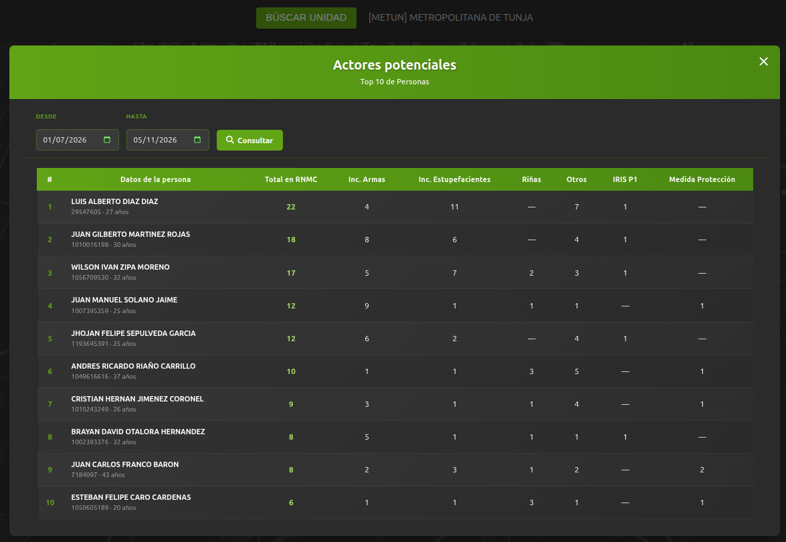
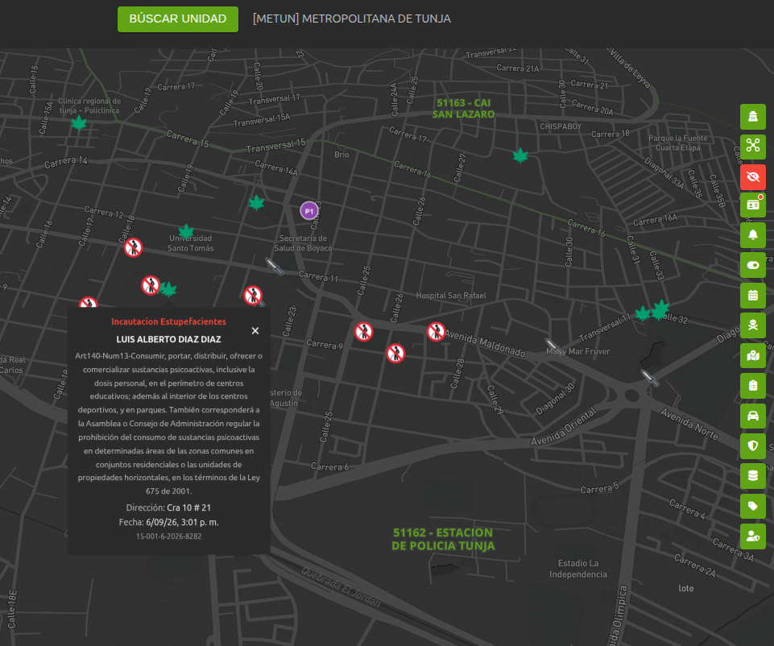

# Actores Potenciales

## 1. Identificación

| Campo | Valor |
|---|---|
| ID | POL-MAPA-003 |
| Módulo | Actores Potenciales |
| Frecuencia de actualización | null |
| Hora de carga del Data Lake | null |
| Última actualización documento | 25/09/2026 |
| Responsable | Cristian Sanchez - Alan Castillo  |

## 2. Descripción

Módulo que permite consultar las diez personas con mayor cantidad de registros en el RNMC, desglosados por incautaciones de armas y estupefacientes, riñas y otros comportamientos, con información complementaria de IRIS P1 y medidas de protección. Funciona únicamente a nivel de sigla y sus unidades hijas; no está disponible a nivel nacional. Permite filtrar por rango de fechas, consultar el detalle de cada persona y visualizar sus registros georreferenciados sobre el mapa.

## 3. Ruta de Acceso

1. Ingresar al aplicativo `IAPOL`.
2. Abrir el módulo `Anticipación a Fenómenos de Seguridad`.
3. Seleccionar el submódulo `Mapa de Anticipación a Fenómenos de Seguridad`.
4. Ingresar a `Mapa`.
5. Hacer clic en modulo `Actores Potenciales`.

  

- Ruta resumida:

`Menú principal > Anticipación a Fenómenos de Seguridad > Mapa de Anticipación a Fenómenos de Seguridad > Modulo Actores Potenciales`

## 4. Activación de la capa

1. Seleccionar capa `Actores Potenciales` en la unidad requerida como Sigla, Estación, Subestación o CAI.
2. Aplicar los filtros requeridos por rango de fecha, dia especifico y rango de horas segun la necesidad.
3. Click boton Consultar

  

4. Se despliega listado de actores potenciales
5. al hacer click sobre uno de los actores se visualizan los registros sobre  el mapa
6. Al hacer click sobre un icono despliega card informativo
7. Al hacer clic en el boton rojo superior al modulo se ocultan los iconos visualizados

  

## 5. Parámetros y filtros de prueba

| Parámetro | Valor utilizado | Obligatorio |
|---|---|---|
| Sigla | Todos | SI |
| Unidades hijas | Todos | No |

## 6. Fuente de datos

### Athena 

### Oracle (bd cliente)

## 7. Validaciones funcionales

- [ ] La capa puede activarse y desactivarse.
- [ ] El detalle del punto muestra los campos definidos.
- [ ] El nombre y la descripción son correctos.
- [ ] Los filtros modifican la información mostrada.
- [ ] Los puntos aparecen en el área geográfica esperada.
- [ ] La leyenda y los colores corresponden a la capa.
- [ ] No se presentan errores al cargar la información.

## 8. Validaciones de datos

- [ ] La cantidad total coincide.
- [ ] No existen identificadores duplicados.
- [ ] Una muestra de registros coincide entre ambas fuentes.
- [ ] La cantidad mostrada en el mapa coincide con los archivos.

## 9. Criterios de aceptación

La prueba es exitosa cuando:

1. La capa carga sin errores.
2. La información corresponde al periodo seleccionado.
3. La fuente de Policía coinciden después de aplicar las reglas
   de transformación.
4. La cantidad del mapa coincide con el resultado esperado en bds.
5. No existen diferencias sin justificación documentada.

## 10. Conclusión
La capa se actualiza en producción el 29/10/2026