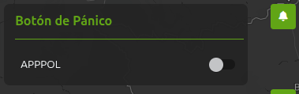
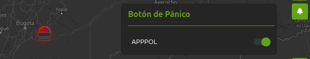

# Consulta integrada

## 1. Identificación

| Campo | Valor |
|---|---|
| ID | POL-MAPA-004 |
| Módulo | Botón de Pánico |
| Frecuencia de actualización | null |
| Hora de carga del Data Lake | null |
| Última actualización documento | null |
| Responsable | null  |

## 2. Descripción

Módulo que permite visualizar a nivel nacional las alertas generadas mediante el botón de pánico de APPPOL, sin necesidad de seleccionar una sigla o unidad. Cada alerta se representa sobre el mapa con un icono de sirena y permite consultar el funcionario, la dirección, la fecha y hora, el estado y el cuadrante asociado. Cuenta con un control para activar o desactivar su visualización.

## 3. Ruta de Acceso

1. Ingresar al aplicativo `IAPOL`.
2. Abrir el módulo `Anticipación a Fenómenos de Seguridad`.
3. Seleccionar el submódulo `Mapa de Anticipación a Fenómenos de Seguridad`.
4. Ingresar a `Mapa`.
5. Hacer clic en primer modulo `Botón de Pánico`.

  

- Ruta resumida:

`Menú principal > Anticipación a Fenómenos de Seguridad > Mapa de Anticipación a Fenómenos de Seguridad > Modulo Botón de Pánico`

## 4. Activación de la capa

1. Seleccionar y habilitar capa `Botón de Pánico`
2. Se despliega botón de pánico activo a nivel nacional proviniente de aplicativo extterno APPPOL de la policia

  

## 5. Parámetros y filtros de prueba

| Parámetro | Valor utilizado | Obligatorio |
|---|---|---|
| Sigla | Todos | No |
| Unidades hijas | Todos | No |

## 6. Fuente de datos

### Athena 

### Oracle (bd cliente)

## 7. Validaciones funcionales

- [ ] La capa puede activarse y desactivarse.
- [ ] El detalle del punto muestra los campos definidos.
- [ ] El nombre y la descripción son correctos.
- [ ] Los filtros modifican la información mostrada.
- [ ] Los puntos aparecen en el área geográfica esperada.
- [ ] La leyenda y los colores corresponden a la capa.
- [ ] No se presentan errores al cargar la información.

## 8. Validaciones de datos

- [ ] La cantidad total coincide.
- [ ] No existen identificadores duplicados.
- [ ] Una muestra de registros coincide entre ambas fuentes.
- [ ] La cantidad mostrada en el mapa coincide con los archivos.

## 9. Criterios de aceptación

La prueba es exitosa cuando:

1. La capa carga sin errores.
2. La información corresponde al periodo seleccionado.
3. La fuente de Policía coinciden después de aplicar las reglas
   de transformación.
4. La cantidad del mapa coincide con el resultado esperado en bds.
5. No existen diferencias sin justificación documentada.

## 10. Conclusión
La capa se actualiza en producción el 29/10/2026