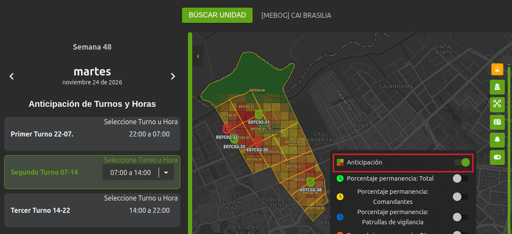
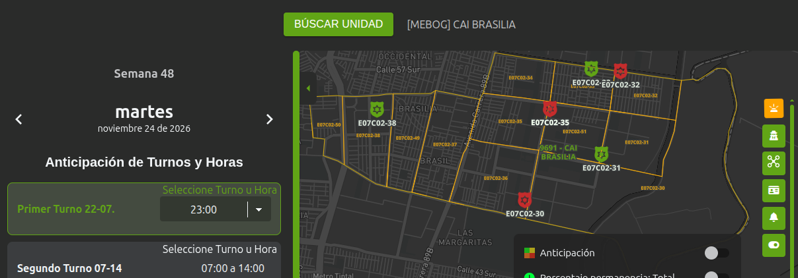
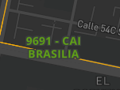

# Consulta integrada

## 1. Identificación

| Campo | Valor |
|---|---|
| ID | POL-MAPA-005 |
| Filtros | Anticapación |
| Frecuencia de actualización | null |
| Hora de carga del Data Lake | null |
| Última actualización documento | 24/11/2026 |
| Responsable | null |

## 2. Descripción

Filtro que permite visualizar las predicciones generadas semanalmente y representadas en un mapa de calor.

## 3. Ruta de Acceso y activación de la capa

1. Ingresar al aplicativo `IAPOL`.
2. Abrir el módulo `Anticipación a Fenómenos de Seguridad`.
3. Seleccionar el submódulo `Mapa de Anticipación a Fenómenos de Seguridad`.
4. Ingresar a `Mapa`.
5. Seleccionar una unidad padre o hija
6. seleccionar un turno u hora especifica
7. activar o desactivar filtro 'anticipación'

  

  

Nota: Se requiere seleccionar una unidad, el filtro esta activo por defecto, este filtro permite visualizar las predicciones que se generan semanalmente (mapa de calor).

`Menú principal > Anticipación a Fenómenos de Seguridad > Mapa de Anticipación a Fenómenos de Seguridad > Modulo Filtros`

## 4. Parámetros y filtros de prueba

| Parámetro | Valor utilizado | Obligatorio |
|---|---|---|
| Sigla | Todos | SI |
| Unidades hijas | Todos | No |

## 5. Fuente de datos

### S3
En caso de no visualizarse el mapa de calor aun cuando esta seleccionada una unidad, turno y filtro habilitado se debe validar que la predicción exista en el bucket con ruta:

'Amazon S3 -> Buckets -> pon-prod-ml-iapol -> PrediccionMdP/'

En este bucket se debe seleccionar el año y semana de predicción que no se visualiza, posteriormente la sigla y el codigo de la unidad hija si se requiere (el codigo de la unidad se visualiza sobre el mapa) y finalmente el repositorio 'Prediccion/', en este repositorio se debe validar la existencia de un archivo .geojson con la fecha y hora especifica que no se visualiza sobre el mapa.

Codigo unidad:

  

## 6. Validaciones funcionales

- [ ] El filtro puede activarse y desactivarse.
- [ ] Se visualiza mapa de calor.
- [ ] No se presentan errores al cargar las predicciones.
