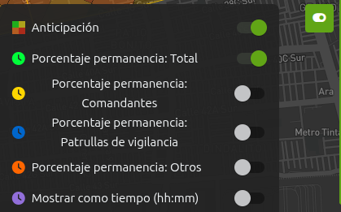

# Consulta integrada

## 1. Identificación

| Campo | Valor |
|---|---|
| ID | POL-MAPA-005 |
| Filtros | Porcentaje de Permanencia |
| Frecuencia de actualización | diaria |
| Hora de carga del Data Lake | null |
| Última actualización documento | 24/11/2026 |
| Responsable | null |

## 2. Descripción

Filtro que permite visualizar los porcentajes de permanencia de comandantes, patrullas de vigilancia y demas policias asignados a una zona de atención, este porcentaje tambien es posible visualizarlo en formato de horas y minutos.

## 3. Ruta de Acceso y activación de la capa

1. Ingresar al aplicativo `IAPOL`.
2. Abrir el módulo `Anticipación a Fenómenos de Seguridad`.
3. Seleccionar el submódulo `Mapa de Anticipación a Fenómenos de Seguridad`.
4. Ingresar a `Mapa`.
5. Seleccionar una unidad hija (Estación, sub estación o CAI)
6. seleccionar un turno especifico finalizado (minimo dia anterior)
7. activar o desactivar filtros por total, comandantes, patrullas u otros:

  

8. Seleccionar visualización por porcentaje o por horas  minutos.
9. Validar la distribución de permanencia por porcentaje o por tiempo sobre el mapa.

`Menú principal > Anticipación a Fenómenos de Seguridad > Mapa de Anticipación a Fenómenos de Seguridad > Modulo Filtros`

## 4. Parámetros y filtros de prueba

| Parámetro | Valor utilizado | Obligatorio |
|---|---|---|
| Sigla | Todos | SI |
| Unidades hijas | Todos | SI |

## 5. Fuente de datos

### 

## 6. Validaciones funcionales

- [ ] El filtro puede activarse y desactivarse.
- [ ] Se visualiza la permanencia de policia sobre el mapa.
- [ ] No se presentan errores al cargar los datos.
- [ ] El porcentaje total debe sumar el 100%
