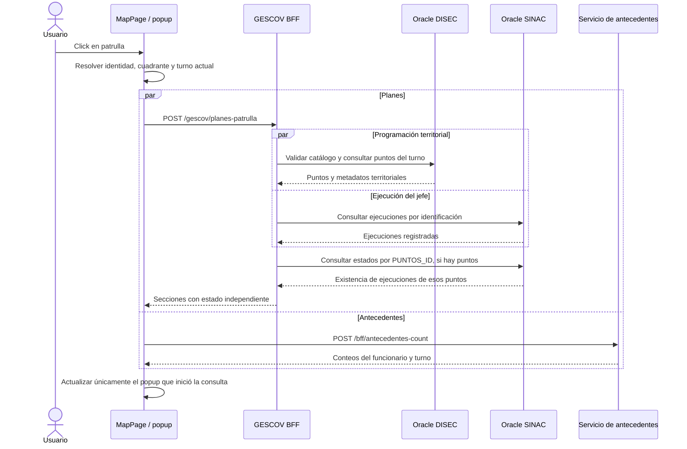

# Planes GESCOV en el popup de patrullas

- Fecha de documentación: 23 de noviembre de 2026.
- Repositorio backend e infraestructura: `pon-iapol-capas`.
- Repositorio frontend: `pon-XCrimeApp`.
- Módulo backend: `gescov_backend`.
- Stack de infraestructura: `gescov-query-bff`.
- Zona horaria operativa: `America/Bogota`.

## 1. Estado inicial

- El mapa ya mostraba patrullas, planes GESCOV programados y planes en ejecución como elementos consultables.
- El popup de patrulla incluía información operativa y una sección de antecedentes, consultada mediante el servicio existente `POST /bff/antecedentes-count`.
- Las capas operativas de GESCOV se obtenían mediante `GET /gescov/planes-programados` y `GET /gescov/puntos-gescov`.
- No existía un endpoint dedicado a reunir programación territorial y ejecuciones del funcionario representado por una patrulla.
- La ventana de la capa de programados, de una hora antes a una hora después del instante de consulta, no cubría necesariamente todo el turno de servicio.
- Los popups presentaban referencias territoriales diferentes: código completo de cuadrante en patrullas y descripción abreviada en planes.
- El campo histórico `estacion` de la programación correspondía a `VM_CUADRANTES.DEPENDENCIA`, que puede ser un CAI. Se necesitaba distinguirlo de la estación real.

## 2. Ajustes implementados

### 2.1. Alcance funcional

Al abrir una patrulla, el contenido presenta este orden:

1. Información operativa de la patrulla, incluida su zona de atención y estación.
2. Planes GESCOV en ejecución.
3. Planes GESCOV programados.
4. Antecedentes.

La consulta de antecedentes conserva su servicio independiente. El nuevo endpoint entrega exclusivamente el detalle de planes y los metadatos territoriales asociados.

El alcance es la consulta operativa actual. No se implementaron creación de planes, reasignaciones, cambios en Oracle ni una consulta histórica de planes por patrulla.

### 2.2. Arquitectura y flujo de consulta



- El frontend utiliza `Promise.all` para consultar planes y antecedentes de forma concurrente.
- El backend utiliza `asyncio.gather` y `asyncio.to_thread` para consultar DISEC y SINAC sin bloquear directamente el bucle asíncrono.
- Cada lectura del nuevo detalle utiliza su propia conexión Oracle en una transacción de solo lectura.
- La conciliación por `PUNTOS_ID` se realiza después de obtener la programación.
- No existe una transacción distribuida entre DISEC y SINAC. La respuesta incluye marcas temporales por sección y de verificación de ejecución.

### 2.3. Fuentes de datos

| Información | Fuente utilizada | Relación principal |
| --- | --- | --- |
| Patrullas y propiedades del marcador | Servicios existentes del mapa, consumidos por `mapaPatrullaApi.js` | Identificación del funcionario y código de cuadrante de la patrulla |
| Programación por patrulla | `USR_DISEC.GESCOV_PUNTO` y `USR_DISEC.EVOS_PLAN` | `PLAN_ID`, código completo de cuadrante y fechas del turno |
| Catálogo territorial activo | `USR_DISEC.VM_CUADRANTES` | `CODIGO_CUADRANTE`, `CUADRANTE_ID`, estado activo `PRM_ESTADO_CUADRANTE = 16` |
| Descripciones de programación | `V_SINAC_DOMINIO` y `EVOS_CTRL_DOMINIO` en DISEC | Descripciones del plan, tipo y estado |
| Ejecuciones | `USR_SINAC.PLANES_PREVENTIVOS` | Identificación del funcionario contra `IDENTIFICACION_JEFE` |
| Descripción de ejecución | `USR_SINAC.CTR_DOMINIOS` | `ID_TIPO_PLAN` contra `ID_DOMINIO` |
| Conciliación de puntos | `USR_SINAC.PLANES_PREVENTIVOS` | `PUNTOS_ID` |
| Territorio de ejecuciones | `VM_CUADRANTES`, accesible desde la conexión SINAC | Coincidencia de identificador y código completo de cuadrante |
| Antecedentes del popup de patrulla | Servicio existente `antecedentes-count` | Identificación del funcionario y límites del turno |

Las patrullas no se reconstruyen a partir de los planes. El frontend mantiene las fuentes existentes, entre ellas `/RO/obtener_cuadrantes_hash`, `/RO/obtener_cuadrantes_completos_hash`, `/RO/obtener_cuadrantes_completos_hash_y_minuta` y `/RO/obtener_patrullas_retrasadas`, según el escenario del mapa. Esta implementación toma las propiedades del marcador; no modifica ni acredita la implementación interna de esos servicios.

### 2.4. Regla de asociación de planes programados

La asociación implementada es **territorial por cuadrante y turno**:

- El cliente envía el código completo presente en la patrulla: `codigo_cuadrante` o su alias `codigoCuadrante`.
- Los códigos se normalizan a mayúsculas y se eliminan duplicados.
- Cada código debe resolverse a un único identificador en el catálogo activo.
- Se seleccionan puntos y planes vigentes, con `EVOS_PLAN.ID_ESTADO IN (61, 62, 63, 70)`.
- El punto debe corresponder al código territorial consultado y coincidir temporalmente con el turno.
- Si el punto trae un `ID_CUADRANTE` incompatible con el catálogo, se descarta y se contabiliza como inconsistente. Si no lo trae, se completa con el identificador validado por código.
- Los puntos sin clave, con fechas inválidas o con inconsistencias territoriales se controlan mediante indicadores de calidad.
- Los duplicados se eliminan por `PUNTOS_ID`; los puntos distintos de un mismo plan padre permanecen separados.

La regla temporal utiliza intervalos semiabiertos:

```text
Turno: [inicio_turno, fin_turno)
Punto con duración: fecha_inicio < fin_turno AND fecha_fin > inicio_turno
Punto sin fin o con inicio = fin: inicio_turno <= fecha_inicio < fin_turno
```

Un punto sin fecha de finalización se trata como un evento puntual; no se inventa una duración. Los puntos sin fecha de inicio se contabilizan como una limitación de calidad y no se presentan con un horario supuesto.

La lista corresponde a la programación del turno que no tiene inicio de ejecución registrado tras la conciliación. No se limita a puntos cuya hora de inicio sea futura.

El contrato expone explícitamente:

```json
{
  "tipo_asociacion": "territorial_cuadrante_turno",
  "asignacion_individual_confirmada": false,
  "alcance_zonas": "codigos_suministrados_validados_en_catalogo"
}
```

Esta asociación satisface la regla acordada para la visualización. No afirma que Oracle haya asignado individualmente cada punto a esa patrulla desde la creación del plan ni determina el momento de una eventual asignación individual. Por la misma regla, dos patrullas del mismo cuadrante y turno pueden ver la misma programación territorial.

### 2.5. Regla de asociación de ejecuciones

- La identificación del funcionario representado por la patrulla se compara directamente con `PLANES_PREVENTIVOS.IDENTIFICACION_JEFE`.
- Una ejecución confirmada debe tener `VIGENTE = 1`, `FECHA_FIN IS NULL` y `FECHA_INICIO <= instante_consulta`.
- La identificación debe corresponder al funcionario solicitado y el registro debe tener `ID_PLAN`.
- Las ejecuciones se deduplican por `ID_PLAN` y se ordenan por inicio descendente.
- La duración se calcula en minutos desde el inicio hasta el instante de consulta del servidor.
- Una ejecución todavía activa puede haber comenzado en un turno anterior. No se elimina por ese motivo.
- La ejecución no se amplía por coincidencia de cuadrante, minuta ni cercanía geográfica.
- La ausencia de `PUNTOS_ID` o de minuta no elimina una ejecución válida del jefe.

El alcance se declara como `alcance_asociacion = "jefe_servicio_consultado"`. No implica que se estén consultando las ejecuciones de todos los integrantes de la patrulla.

### 2.6. Conciliación entre programación y ejecución

La clave de conciliación es `PUNTOS_ID`, no el nombre del plan ni su identificador padre:

1. Se obtienen los puntos programados del cuadrante y turno.
2. Se consultan sus registros en `USR_SINAC.PLANES_PREVENTIVOS`, incluyendo ejecuciones de otros funcionarios y registros finalizados.
3. Se excluye de pendientes cualquier punto con una ejecución registrada, además de los puntos identificados en la ejecución propia ya obtenida.
4. La consulta de estados se divide en lotes de hasta 900 claves para evitar superar el límite de expresiones de Oracle por lista `IN`.

Si falla la verificación de estados:

- Se conservan los puntos cuya ejecución no pudo verificarse, con `estado_ejecucion = "no_verificado"`.
- Los puntos conocidos por la ejecución propia siguen excluyéndose.
- La programación queda parcial cuando existen puntos afectados y expone `verificacion_ejecucion = "no_disponible"`.
- El frontend informa que la programación está disponible, pero no fue posible verificar su ejecución.

La consulta completa usa `estado_ejecucion = "sin_inicio_registrado"` para los puntos restantes. La mera ausencia de un registro en la fuente consultada no constituye una confirmación de asignación individual.

### 2.7. Contrato HTTP

**Ruta:** `POST /gescov/planes-patrulla`.

**Autenticación:** header `x-api-key`, validado por el middleware existente del servicio.

| Campo de entrada | Tipo | Validación |
| --- | --- | --- |
| `identificacion` | Cadena decimal; también admite entero de entrada | Positiva, entre 1 y 20 dígitos ASCII; se normaliza sin ceros iniciales |
| `codigos_cuadrante` | Lista de cadenas | Hasta 900 elementos, cada uno de 1 a 128 caracteres; se normalizan y deduplican |
| `inicio_turno` | Fecha y hora ISO 8601 con offset | Inicio inclusivo, convertido a hora de Colombia |
| `fin_turno` | Fecha y hora ISO 8601 con offset | Fin exclusivo; duración positiva de hasta 24 horas |

El servidor determina `consulta_en` y exige `inicio_turno <= consulta_en < fin_turno`. No admite un instante de consulta suministrado por el cliente ni campos adicionales al contrato. Una lista territorial vacía permite consultar ejecución, pero deja programación sin contexto.

Solicitud ilustrativa, con identificación y territorio de prueba:

```json
{
  "identificacion": "123",
  "codigos_cuadrante": ["TESTAMNVCCD01E01000000001"],
  "inicio_turno": "2026-11-23T07:00:00-05:00",
  "fin_turno": "2026-11-23T14:00:00-05:00"
}
```

Las fechas del ejemplo no deben reutilizarse fuera de ese turno. En una consulta real deben enviarse los límites del turno vigente y un código existente en el catálogo.

Ejemplo de respuesta exitosa sin planes; valores territoriales ficticios:

```json
{
  "consulta_en": "2026-11-23T11:00:00-05:00",
  "inicio_turno": "2026-11-23T07:00:00-05:00",
  "fin_turno": "2026-11-23T14:00:00-05:00",
  "zona_horaria": "America/Bogota",
  "en_ejecucion": {
    "estado": "disponible",
    "datos": [],
    "total": 0,
    "actualizado_en": "2026-11-23T11:00:01-05:00",
    "calidad": {"ejecuciones_inconsistentes": 0},
    "alcance_asociacion": "jefe_servicio_consultado"
  },
  "programados": {
    "estado": "disponible",
    "datos": [],
    "total": 0,
    "actualizado_en": "2026-11-23T11:00:01-05:00",
    "calidad": {
      "puntos_sin_inicio_en_zonas": 0,
      "fechas_invalidas": 0,
      "puntos_sin_clave": 0,
      "cuadrantes_inconsistentes": 0,
      "duplicados": 0,
      "estados_ejecucion_inconsistentes": 0
    },
    "tipo_asociacion": "territorial_cuadrante_turno",
    "asignacion_individual_confirmada": false,
    "alcance_zonas": "codigos_suministrados_validados_en_catalogo",
    "verificacion_ejecucion": "completa",
    "verificacion_ejecucion_en": null,
    "cuadrantes": [{
      "codigo_cuadrante": "TESTAMNVCCD01E01000000001",
      "id_cuadrante": 10,
      "zona_atencion": "TESTA - 001",
      "estacion_nombre": "ESTACION DE PRUEBA"
    }]
  }
}
```

Cuando no hay puntos, no se ejecuta una consulta de estados vacía; por eso la fecha de verificación puede ser `null` aunque la verificación se reporte completa.

Campos principales de cada elemento:

| Sección | Identidad y contenido |
| --- | --- |
| `en_ejecucion.datos[]` | `id_plan`, `puntos_id`, `id_minuta`, `id_tipo_plan`, `plan_desc`, `vigente`, fechas, territorio, `id_unidad`, coordenadas y `duracion_minutos` |
| `programados.datos[]` | `puntos_id`, `plan_id`, `plan_desc`, `tipo_plan`, estado, fechas, territorio, dirección, coordenadas, `id_unidad`, `intervalo_puntual` y `estado_ejecucion` |
| `programados.cuadrantes[]` | Código completo, identificador de catálogo, zona abreviada y estación; se conserva aunque no existan puntos programados |

En el contrato tipado, `puntos_id` y el `plan_id` de programación son cadenas; el `id_plan` de ejecución es entero. El modelo de salida no expone la identificación del jefe ni campos internos adicionales de las filas Oracle.

### 2.8. Estados, errores y tiempos

| Estado de sección | Significado | `total` |
| --- | --- | --- |
| `disponible` | Consulta completada con los controles aplicables | Número de elementos; puede ser cero |
| `parcial` | Existen limitaciones de calidad o verificación | Número de elementos devueltos; no garantiza cobertura completa |
| `sin_contexto` | Falta el territorio o no se resuelve inequívocamente en el catálogo | `null` |
| `no_disponible` | No fue posible consultar la fuente | `null` |

- Una solicitud válida puede responder HTTP 200 aunque una o ambas fuentes fallen. El consumidor debe inspeccionar cada sección.
- HTTP 422 identifica errores de entrada o un turno que no contiene el instante actual.
- La falta de API key produce HTTP 401. El middleware existente responde HTTP 500 ante una clave inválida o un error interno de autenticación; este comportamiento no se modificó en esta implementación.
- Un fallo inesperado al construir la respuesta produce HTTP 500 con un mensaje genérico.
- Las conexiones del detalle configuran un timeout de conexión de 10 segundos y un timeout de llamada Oracle de 25 segundos. Estos límites son por operación y no constituyen un timeout total del endpoint.
- El cliente Axios configura 45 segundos para la consulta de planes.
- Las fechas Oracle sin zona se interpretan como hora de Colombia. Las fechas de entrada deben incluir offset explícito.
- El detalle no utiliza la caché global de las capas. Las capas existentes conservan sus actualizaciones periódicas de 1.200 segundos.

### 2.9. Integración del frontend y resolución del turno

`MapPage.js` conecta los eventos de click con `createPatrullaPopupHTML` y `cargarDetallesPatrulla`. Se cubren los seis escenarios existentes mediante cinco plantillas: patrulla completa, sin medio de policía, retrasada, fuera de cuadrante y atendiendo/en camino.

`turnoActualPatrulla.js`:

- Resuelve el turno del instante actual en Colombia, independientemente de la hora seleccionada para otras consultas del mapa.
- Utiliza los turnos configurados disponibles para hoy y ayer, considerando cruces de medianoche.
- Si no hay configuración aplicable, utiliza las franjas `22:00–07:00`, `07:00–14:00` y `14:00–22:00`, e informa el uso del horario por defecto.
- No sustituye silenciosamente una configuración presente pero inválida o superpuesta; devuelve ausencia de turno válido.

El controlador compartido:

- Valida identidad y turno antes de solicitar el detalle.
- Utiliza el mismo intervalo operativo para consultar antecedentes.
- Presenta carga, conteos, ausencia confirmada de planes, información parcial y errores.
- Mantiene cada respuesta vinculada al elemento DOM que originó la solicitud.
- Evita actualizar un popup cerrado o retirado del documento. Esto impide mezclar datos al abrir patrullas sucesivamente, sin implicar cancelación de la petición de red ya iniciada.

### 2.10. Etiqueta uniforme de zona y estación

El helper `zonaAtencion.js` genera el mismo bloque territorial para patrullas, planes programados operativos, planes en ejecución y tarjetas de planes dentro de la patrulla:

```text
Zona de atención: MEVAL - 003
Estación: ESTACION DE POLICIA LA CANDELARIA
▸ Código completo
```

- `zona_atencion` se construye en Oracle con `TRIM(SIGLA_FISICA) || ' - ' || SUBSTR(CODIGO_CUADRANTE, 23, 25)`, siguiendo la convención existente de la fuente.
- `estacion_nombre` proviene de `VM_CUADRANTES.ESTACION`.
- El campo histórico `estacion`, cuando contiene `DEPENDENCIA`, se conserva para compatibilidad, pero no se utiliza como estación real en la etiqueta nueva.
- La etiqueta abreviada es descriptiva y puede repetirse. El código completo sigue siendo la identidad del territorio; no se reemplaza por el número corto ni por el nombre de estación.
- La estación de la patrulla se completa desde `programados.cuadrantes`, mediante coincidencia exacta del código completo, incluso si no hay puntos programados.
- No se toma la estación de una ejecución en otro cuadrante para completar la zona principal de la patrulla.
- Sin metadatos suficientes, se muestra el código completo o la referencia anterior disponible; la estación se presenta como `No disponible`.
- El código completo se ofrece en un elemento desplegable cuando difiere de la etiqueta principal.
- Los textos y atributos del nuevo bloque se escapan antes de insertarlos en HTML.

El cruce territorial es por claves de catálogo; no se implementó un cálculo de cercanía, una intersección espacial ni un cambio de asignación basado en la posición GPS. La relación visual ayuda a comparar territorios, sin alterar las reglas de consulta.

La plantilla histórica `createPlanesProgramadosHistoricoPopup` conserva su presentación anterior. La unificación de este requerimiento se aplicó a los planes operativos actuales.

### 2.11. Compatibilidad de las capas

| Endpoint | Implementación resultante |
| --- | --- |
| `GET /gescov/planes-programados` | Consulta directa de `EVOS_PLAN` y `GESCOV_PUNTO` con los joins de catálogo; conserva campos y filtros operativos de `V_PLANESPROGRAMADOS`, incluida la ventana de ±60 minutos, y añade claves estables y metadatos territoriales |
| `GET /gescov/puntos-gescov` | Conserva `V_PUNTOSGESCOPLANES` como base y la enriquece con `PLANES_PREVENTIVOS` y el catálogo territorial |
| `POST /gescov/planes-patrulla` | Consulta el turno completo y la ejecución actual del jefe; independiente de la disponibilidad y caché de las capas |

La capa de programados conserva `idplan` basado en `ROWNUM` para compatibilidad. Las relaciones nuevas utilizan claves de fuente como `puntos_id` y `plan_id`; no se utiliza ese número de fila como identidad estable.

`MapPage.js` propaga `codigo_cuadrante`, `zona_atencion` y `estacion_nombre` desde las respuestas de las capas hasta sus marcadores y popups.

### 2.12. Módulos involucrados

Rutas del repositorio `pon-iapol-capas`, relativas a su raíz:

| Archivo | Responsabilidad |
| --- | --- |
| `gescov_backend/app/routers/consultas.py` | Ruta HTTP, validación del turno vigente y respuesta tipada |
| `gescov_backend/app/models/planes_patrulla.py` | Contratos de entrada, salida, estados y metadatos territoriales |
| `gescov_backend/app/services/planes_patrulla_service.py` | Orquestación, filtrado de ejecuciones, conciliación y fallos independientes |
| `gescov_backend/app/services/planes_queries.py` | SQL, conexiones de solo lectura y utilidades temporales y territoriales |
| `gescov_backend/app/services/disec_service.py` | Catálogo, programación del turno y capa de programados |
| `gescov_backend/app/services/sivicc_service.py` | Ejecuciones SINAC, estados de puntos y enriquecimiento de su capa |
| `cdk/lib/gescov-query-stack.ts` | Recursos ECS, accesos a secretos y conexión de la imagen al despliegue |
| `cdk/config/gescov_service_config.json` | Configuración de infraestructura, fuentes y rama `main` |
| `cdk/config/build_spec_files/buildspec_gescov_back.yml` | Construcción y publicación de imagen Docker |
| `cdk/config/build_spec_files/buildspec_gescov_deploy.yml` | Despliegue CDK con parámetro `IMAGETAG` |
| `gescov_backend/version.txt` | Etiqueta de imagen usada por el pipeline |

Rutas del repositorio `pon-XCrimeApp`, relativas a su raíz:

| Archivo | Responsabilidad |
| --- | --- |
| `src/services/api/gescovApi.js` | Cliente del endpoint y timeout de planes |
| `src/services/api/mapaPatrullaApi.js` | Servicios existentes de patrullas y antecedentes |
| `src/utils/turnoActualPatrulla.js` | Resolución del turno de servicio actual |
| `src/pages/MapPage.js` | Integración de clicks y propagación de propiedades de capas |
| `src/pages/MapPage.css` | Estilos de secciones y etiqueta territorial |
| `src/pages/MapPagePopups/patrullaDetails.js` | Composición del popup y control de respuestas asíncronas |
| `src/pages/MapPagePopups/planesPatrullaSection.js` | Presentación de planes, conteos y estados |
| `src/pages/MapPagePopups/zonaAtencion.js` | Bloque uniforme y actualización territorial de la patrulla |
| `src/pages/MapPagePopups/patrullaCompletaPopup.js` | Plantilla de patrulla completa |
| `src/pages/MapPagePopups/patrullaNoMdPPopup.js` | Plantilla de patrulla sin medio de policía |
| `src/pages/MapPagePopups/PatrullasEnSitio.js` | Plantilla de patrulla retrasada |
| `src/pages/MapPagePopups/PatrullaAfueraCuadrantePopup.js` | Plantilla de patrulla fuera de cuadrante |
| `src/pages/MapPagePopups/PatrullaAtendiendoMdPPopup.js` | Plantilla compartida para atendiendo/en camino |
| `src/pages/MapPagePopups/GescovPopup.js` | Popup de ejecución de la capa |
| `src/pages/MapPagePopups/PlanesProgramadosHistoricoPopup.js` | Contiene el popup operativo actualizado y el histórico existente |

### 2.13. Configuración de fuentes y autenticación

| Variable | Secreto configurado | Uso |
| --- | --- | --- |
| `DISEC_DB_CREDENTIALS_SECRET_NAME` | `pon-prod-disec-op-rnmc` | Programación y catálogo DISEC |
| `SIVICC_DB_CREDENTIALS_SECRET_NAME` | `pon-prod-sinac-connection` | Planes y ejecuciones SINAC |
| `MNVCC_DB_CREDENTIALS_SECRET_NAME` | `pon-prod-sivicc-connection` | Consultas MNVCC existentes del servicio |
| `BACKEND_API_KEY_SECRET_NAME` | `capas-adicionales-bff-api-key` | Autenticación de GESCOV BFF |

El nombre de la clase `SiviccService` se conserva por compatibilidad: sus consultas de planes utilizan la conexión SINAC. La conexión MNVCC permanece diferenciada. Los valores de credenciales y claves de API no forman parte de esta documentación.

El frontend utiliza `Gescov_API_URL` y `Capas_API_Key` de su configuración existente para el nuevo endpoint. El servicio externo de antecedentes del popup conserva su integración independiente.

## 3. Resultado y validación

### 3.1. Comportamiento resultante

- Desde la patrulla se puede consultar programación de su territorio y turno, además de ejecuciones registradas al funcionario como jefe del servicio.
- Los fallos de una fuente no ocultan automáticamente los resultados válidos de la otra.
- La interfaz distingue ausencia confirmada de planes, falta de contexto y falta de disponibilidad.
- Los puntos con ejecución registrada no se presentan como pendientes tras una conciliación completa.
- La referencia visual compartida permite comparar zona y estación entre patrulla y plan; el código completo resuelve ambigüedades de etiquetas abreviadas.
- La estación de la patrulla puede completarse aunque no tenga planes programados, siempre que su contexto territorial y la consulta de catálogo sean válidos.

### 3.2. Verificaciones realizadas durante la implementación

- Backend: **89 pruebas aprobadas** en las suites de planes, contrato HTTP, referencias de fuentes y consultas territoriales de capas.
- Frontend: **33 pruebas aprobadas** en las tres suites del bloque de planes, controlador de popup y etiqueta territorial.
- Compilación optimizada de frontend completada con advertencias existentes del proyecto.
- Revisión visual local de los popups de patrulla, programado y ejecución, usando datos de ejemplo.
- Consultas de solo lectura en Oracle DISEC y SINAC para verificar la disponibilidad de código completo, etiqueta territorial y estación real.
- Comparación de los campos históricos de la nueva consulta de capa DISEC frente a `V_PLANESPROGRAMADOS`: en la lectura realizada ambas devolvieron **1.461 filas**, con cero diferencias en ambos sentidos para los campos comparados, excluyendo la identidad derivada de `ROWNUM`.
- Validación de casos donde una misma etiqueta abreviada corresponde a estaciones diferentes.

Estos resultados corresponden a las ejecuciones realizadas en este chat; la redacción de este documento no volvió a ejecutar las pruebas ni realizó un nuevo despliegue.

### 3.3. Reproducción de pruebas

Backend: ejecutar desde la raíz de `pon-iapol-capas`, en un entorno Python con las dependencias de aplicación y desarrollo de `gescov_backend/pyproject.toml` instaladas:

```bash
python -m pytest -q \
  tests/test_gescov_planes_patrulla.py \
  tests/test_gescov_planes_patrulla_api.py \
  tests/test_sivicc_secret_references.py \
  tests/test_gescov_territorial_layer_queries.py
```

Frontend: ejecutar desde la raíz de `pon-XCrimeApp`, con las dependencias del proyecto instaladas:

```bash
CI=true npm test -- --runInBand --watchAll=false --runTestsByPath \
  src/pages/MapPagePopups/planesPatrullaSection.test.js \
  src/pages/MapPagePopups/patrullaDetails.test.js \
  src/pages/MapPagePopups/zonaAtencion.test.js
```

Para verificar también la resolución del turno y el cliente HTTP, están disponibles `src/utils/turnoActualPatrulla.test.js` y `src/services/api/gescovApi.test.js`. El conteo de 33 indicado arriba corresponde únicamente a las tres suites de popups.

```bash
npm run build
```

### 3.4. Despliegue: recursos y procedimiento

| Recurso | Nombre |
| --- | --- |
| Stack CloudFormation/CDK | `gescov-query-bff` |
| Pipeline backend | `gescov-query-bff-pipeline` |
| Proyecto de construcción | `gescov-query-bff-build` |
| Proyecto de despliegue | `gescov-query-bff-deploy` |
| Cluster ECS | `gescov-query-bff-cluster` |
| Servicio ECS | `gescov-query-bff-service` |
| Repositorio ECR | `gescov-query-bff-repo` |
| Familia de tarea | `gescov-query-bff-ECSTaskDefinition` |
| Región | `us-east-1` |
| Rama de código e infraestructura del pipeline | `main` |

Flujo de publicación backend:

1. Verificar que los cambios funcionales y las pruebas estén incluidos en la rama que se integrará.
2. Incrementar `gescov_backend/version.txt` y registrar el cambio en Git. Al redactar este documento el archivo indica `1.0.5`.
3. Integrar los cambios en `main`, según el flujo de revisión del repositorio.
4. Comprobar el inicio de `gescov-query-bff-pipeline`. La configuración tiene detección de cambios activada; si es necesario iniciarlo manualmente, hacerlo después de que el código esté en `main`.
5. Verificar que ambas acciones de origen, aplicación e infraestructura, utilicen la revisión esperada.
6. La construcción lee `version.txt`, publica la imagen con esa etiqueta y también con el número de build y `latest`.
7. El despliegue pasa el tag exportado como parámetro CDK `IMAGETAG`; una etiqueta nueva debe producir una actualización de la imagen de la tarea y el reemplazo de tareas ECS.
8. Confirmar que el servicio se estabilice, que la tarea use la imagen esperada y que su digest corresponda al de ECR.
9. Publicar el frontend por su propio flujo, incluyendo los cambios del cliente, popups y estilos. El despliegue del backend no publica `pon-XCrimeApp`.

El buildspec del frontend compila React y publica el contenido estático en su destino S3 configurado. Debe verificarse además que el navegador reciba esa nueva compilación.

**Un force new deployment de ECS no compila el código ni lo obtiene de Git.** Reinicia tareas usando la definición e imagen referenciada por el servicio. Si la etiqueta sigue apuntando al mismo digest, ejecuta el mismo código. Reejecutar el pipeline antes de integrar la implementación en `main` tampoco incorpora una rama funcional pendiente.

Reutilizar una etiqueta puede publicar otra imagen sin que cambie la definición declarada en CDK. Para esta publicación se recomienda una versión nueva y trazable en lugar de depender de la combinación de etiqueta reutilizada y reinicio manual.

### 3.5. Estado observado y alcance de la validación de producción

En la última inspección de AWS realizada en este chat el 23 de noviembre de 2026:

- La tarea creada por el force deployment iniciado a las 11:41, hora de Colombia, utilizaba la revisión de tarea `7` y la imagen `1.0.4`.
- Esa imagen había sido publicada el 20 de noviembre de 2026 y coincidía con la tarea anterior en el digest:

```text
sha256:3d312134e9bed8a31095b7dd4e63962be063f56b8d6bbae57799c90774336a24
```

- La última ejecución registrada del pipeline era la del 20 de noviembre, basada en el commit `851b5d2` de `main`.
- El commit backend de las etiquetas, `f1e0762`, estaba publicado en la rama funcional y no en `main` en el momento de esa inspección.
- Los cambios nuevos de etiqueta del frontend estaban locales en la última revisión de ese repositorio.

El cambio posterior del archivo de versión a `1.0.5` no constituye por sí mismo evidencia de publicación. Este documento no confirma un despliegue posterior a la inspección descrita. Los commits, ramas, digest y revisión anteriores son un registro de diagnóstico, no valores a reutilizar para futuras publicaciones.

El endpoint `/gescov/health` responde con una versión genérica y las rutas raíz de la aplicación utilizan otra versión interna. Por ello, un health check exitoso no demuestra qué commit ni qué imagen están ejecutándose; esa verificación debe hacerse con el pipeline, la tarea ECS y el digest ECR.

### 3.6. Comprobación posterior al despliegue

Consultas de solo lectura para el servicio y las últimas ejecuciones del pipeline:

```bash
aws ecs describe-services \
  --cluster gescov-query-bff-cluster \
  --services gescov-query-bff-service \
  --profile iapol-prod --region us-east-1 \
  --query 'services[0].{taskDefinition:taskDefinition,desired:desiredCount,running:runningCount,deployments:deployments}'

aws codepipeline list-pipeline-executions \
  --pipeline-name gescov-query-bff-pipeline \
  --max-results 3 \
  --profile iapol-prod --region us-east-1
```

Con la revisión y las tareas obtenidas, consultar `describe-task-definition`, `describe-tasks` y `ecr describe-images` para comparar etiqueta y digest. Durante un reemplazo pueden coexistir tareas antiguas y nuevas; no basta con comprobar únicamente el nombre del servicio.

Verificación funcional:

- Abrir una patrulla con identidad y cuadrante válidos, dentro del turno vigente.
- Revisar que `POST /gescov/planes-patrulla` envíe identificación, código completo e intervalo con offset y reciba las dos secciones.
- Confirmar el orden ejecución, programación y antecedentes.
- Comparar zona, estación y código completo con los popups de los planes de las capas.
- Abrir una patrulla sin planes y comprobar que la etiqueta territorial se complete si el catálogo responde.
- Abrir y cerrar patrullas sucesivamente y verificar que las respuestas no mezclen sus contenidos.
- Considerar que las capas se refrescan periódicamente y tienen una ventana distinta a la consulta por turno; sus cantidades no tienen por qué coincidir con las del detalle.

### 3.7. Límites conocidos

- La programación territorial no demuestra asignación individual desde la creación del plan.
- La ejecución representa al funcionario consultado como jefe, no a todos los posibles integrantes de la patrulla.
- Un código faltante, inactivo, ambiguo o inconsistente impide confirmar la programación territorial.
- La estación depende de los metadatos de catálogo disponibles. Si la consulta de programación falla o no hay contexto válido, la patrulla puede conservar una referencia incompleta y mostrar `No disponible`.
- No hay una captura transaccional simultánea de todas las fuentes; los cambios operativos durante las lecturas pueden afectar la conciliación.
- El detalle se actualiza al abrir el popup; esta implementación no incorpora refresco periódico del popup ya abierto.
- Las capas conservan caché y ventana temporal propias; el detalle puede mostrar un punto sin coordenadas aunque no pueda representarse como marcador en el mapa.
- Se necesitan publicaciones de backend y frontend para disponer de la experiencia completa de etiquetas uniformes.
