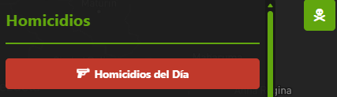
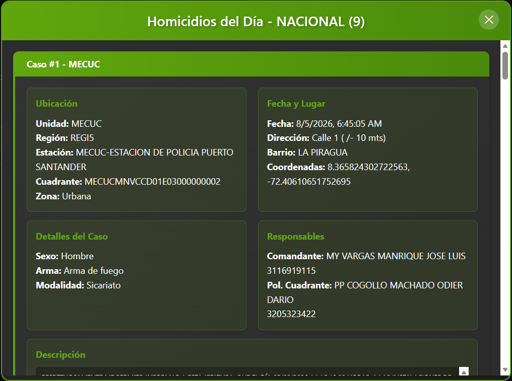
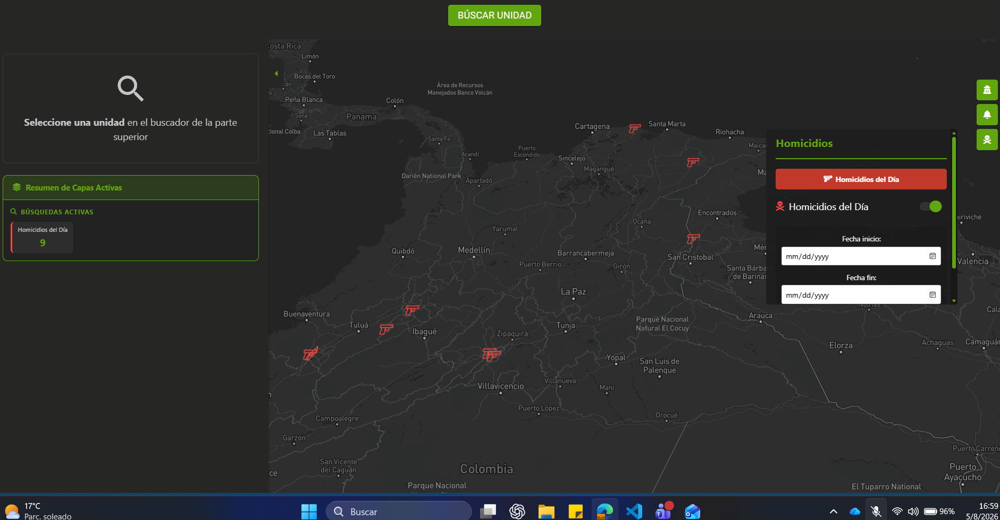
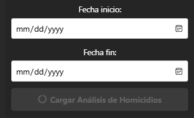
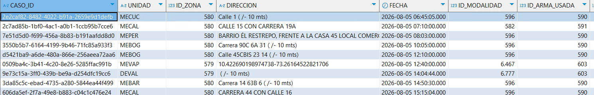

# Homicidios del dia

## 1. Identificación

| Campo | Valor |
|---|---|
| ID | POL-MAPA-007 |
| Módulo | Homicidios |
| Módulo padre | Anticipación a Fenómenos de Seguridad |
| Submódulo | Mapa de Anticipación a Fenómenos de Seguridad |
| Frecuencia de actualización | Pendiente por confirmar |
| Hora de carga del Data Lake | Pendiente por confirmar |
| Última actualización modulo | 2026-09-08 |
| Responsable | Pendiente por confirmar |

## 2. Descripción

Módulo que permite consultar el listado de homicidios registrados durante el día y visualizar su ubicación sobre el mapa mediante iconos asociados al tipo de arma. También permite analizar homicidios por rango de fechas, consultar el detalle de cada evento y revisar la primera patrulla que respondió, su recorrido posterior y la presencia previa de otras unidades, cuando esa información esté disponible. La validación del listado del día utiliza la vista `USR_PMU.V_HOMICIDIO_2024` de GEOPOL.

## 3. Ruta de Acceso

1. Ingresar al aplicativo `IAPOL`.
2. Abrir el módulo `Anticipación a Fenómenos de Seguridad`.
3. Seleccionar el submódulo `Mapa de Anticipación a Fenómenos de Seguridad`.
4. Ingresar a `Mapa`.
5. Abrir `Homicidios del día`, identificado por el icono de calavera.

La Imagen 1, conservada en la sección 4.1, muestra el control del listado de homicidios del día.

- Ruta resumida:

`Menú principal > Anticipación a Fenómenos de Seguridad > Mapa de Anticipación a Fenómenos de Seguridad > Homicidios del día`

## 4. Activación de la capa

### Prueba funcional modulo completo:

#### 4.1. Boton detalles Homicidios del dia:
Al hacer clic sobre el botón (Imagen 1) debe desplegar el listado a detelle en tiempo real de los homicidios registados durante el día (Imagen 2). De esta manera se confirma el funcionamiento del boton.

- Imagen 1:  


- Imagen 2:


#### 4.2. Boton Iconos sobre mapa Homicidios del dia:
Al hacer clic sobre el checkbox (Imagen 4) debe visualizar mediante iconos sobre los mapas los homicidios registados en el listado de homicidios del dia (Imagen 2). De esta manera se confirma el funcionamiento del boton.

- Imagen 4:  


Se debe visualizar el checkbox en verde y el mismo numero de iconos que de homicidios, adicionalmente el icono refleja el arma del homicidio bien sea de fuego o arma blanca. De esta manera confirmamos un adecuado funcionamiento en la visualización de información sobre el mapa.

- Imagen 5: 


#### 4.3. Boton Rango fechas analisis de Homicidios:
Esta opción permite visualizar geograficamente los homicidios en un rango de fechas determinado, para esto se debe especificar el rango de fechas y se debe hacer clic sobre 'cargar Análisis de Homicidos'.

- Imagen 6:   


Al hacer clic sobre cualquier Homicido representados como puntos rojos se debe desplegar una ventana con la información del mismo.

- Imagen 7:


En la ventana desplegada se puede visualizar la información de la primera patrulla en responder al homicidio y el recorrido posterior a la atención del homicidio. Adicionalmente las unidades que hicieron presencia previa al homicidio en el lugar de los hechos.

- Imagen 8:


Recorrido Primera Patrulla en Atender Homicidio y patrullas previas en el lugar

De esta manera se confirma una correcta operación de la funcionalidad
- Imagen 9:


## 5. Parámetros y filtros de prueba

| Parámetro o control | Valor utilizado | Obligatorio |
|---|---|---|
| Homicidios del Día: listado | Consultar los registros del día de ejecución de la prueba | Sí, para validar el listado |
| Homicidios del Día: iconos | Checkbox activado para representar los registros | Sí, para validar los iconos |
| Fecha inicial del análisis | Fecha de inicio del periodo de prueba; valor pendiente por registrar | Sí, para el análisis por rango |
| Fecha final del análisis | Fecha de fin del periodo de prueba; valor pendiente por registrar | Sí, para el análisis por rango |
| Cargar Análisis de Homicidios | Ejecutar después de seleccionar el rango | Sí, para el análisis por rango |
| Sigla o unidad seleccionada | Pendiente por registrar junto con su efecto sobre los resultados | Pendiente por confirmar según la consulta |

Registrar las fechas y el contexto territorial utilizados al ejecutar la prueba. Los valores concretos no se deducen de las capturas históricas.

## 6. Fuente de datos

### Athena

La base de datos, tabla o vista, campo de fecha y reglas de carga utilizados por esta funcionalidad están pendientes por confirmar. El contenido existente identifica una consulta de validación directa sobre la base de la Policía; no acredita una fuente en Athena para todos los resultados del módulo.

### Oracle (bd cliente)

La fuente documentada a continuación corresponde a la comprobación del listado de homicidios del día. La fuente del análisis por rango y de los recorridos de patrullas está pendiente por confirmar.

Continuando con la prueba de funcionamiento se debe validar sobre la base de datos de la policia que esten registrados los homicidios de la lista.

Datos requeridos:

- DataBase: GEOPOL (bestion)
- schema: USR_PMU
- View: V_HOMICIDIO_2024 (Aunque el nombre de la tabla confunda con 2024, esa tabla solo registra los homicidios del día de hoy y cada día se limpia)
- Query: 

``` sql
SELECT * FROM  USR_PMU.V_HOMICIDIO_2024 
```

- Imagen 3: (Bastion con registros de lista de homicidios)


Al comparar que la información registrada en DB con respecto a la lista de homicidios es la misma, se confirma que el workflow es correcto desde la fuente hasta la visulización de los datos.

## 7. Validaciones funcionales

- [ ] El acceso Homicidios del día abre el panel correspondiente.
- [ ] El botón del listado despliega los homicidios registrados durante el día.
- [ ] El checkbox permite activar y desactivar los iconos del mapa.
- [ ] La cantidad de iconos coincide con la cantidad de registros del listado.
- [ ] El icono representa el tipo de arma correspondiente al registro.
- [ ] El análisis permite seleccionar fecha inicial y fecha final y cargar el periodo solicitado.
- [ ] Los puntos del análisis aparecen en las ubicaciones esperadas.
- [ ] Al seleccionar un punto se muestra la información del homicidio.
- [ ] El detalle permite consultar la primera patrulla en responder y los recorridos y presencias disponibles.
- [ ] No se presentan errores al consultar el listado, representar iconos o cargar el análisis.

## 8. Validaciones de datos

- [ ] El listado del día y la consulta de GEOPOL se comparan para la misma fecha y hora de corte.
- [ ] La cantidad total de homicidios del listado coincide con la consulta documentada de Oracle.
- [ ] Una muestra de registros del listado coincide con la información de la base de la Policía.
- [ ] No existen identificadores duplicados en los resultados consultados.
- [ ] Las coordenadas del registro corresponden a la ubicación representada en el mapa.
- [ ] Los eventos del análisis pertenecen al rango de fechas seleccionado.
- [ ] Los tipos de arma del registro y de su icono coinciden.
- [ ] La identificación de las patrullas y sus recorridos corresponde al evento seleccionado, cuando exista información.
- [ ] Las diferencias encontradas se registran con su explicación y fecha de ejecución.

## 9. Criterios de aceptación

La prueba es exitosa cuando:

1. El listado del día, los iconos y el análisis por rango cargan sin errores.
2. El listado corresponde a los homicidios del día y el análisis respeta el periodo seleccionado.
3. Las cantidades y la muestra de registros coinciden con las fuentes verificadas para el mismo corte y filtros.
4. Los iconos, ubicaciones y detalles corresponden a los registros consultados.
5. La información disponible de patrullas y recorridos está asociada al homicidio seleccionado.
6. No existen diferencias sin justificación documentada.

## 10. Conclusión

El contenido existente documenta la comprobación del listado del día, su representación mediante iconos y el análisis por rango con información de patrullas. Se conservan los textos, la consulta SQL y las nueve imágenes de esas pruebas.

| Dato de la ejecución | Resultado |
|---|---|
| Fecha de ejecución de las pruebas documentadas | Pendiente por confirmar |
| Fecha y hora de corte de los datos | Pendiente por confirmar |
| Sigla o unidad utilizada | Pendiente por confirmar |
| Cantidad de registros en Oracle | Pendiente por registrar |
| Cantidad de registros en el listado y en el mapa | Pendiente por registrar |
| Resultado final de la ejecución | Pendiente por confirmar |

Esta reorganización no incluye una nueva ejecución de las pruebas. Los resultados deben completarse al validar la funcionalidad, conservando la trazabilidad de las evidencias existentes.
