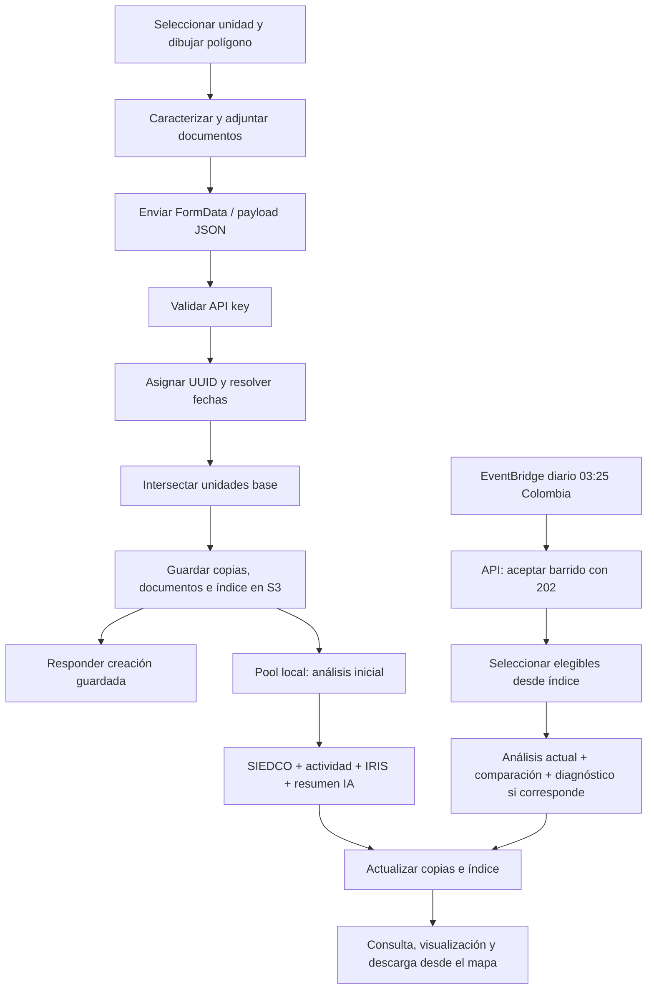
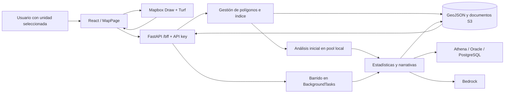
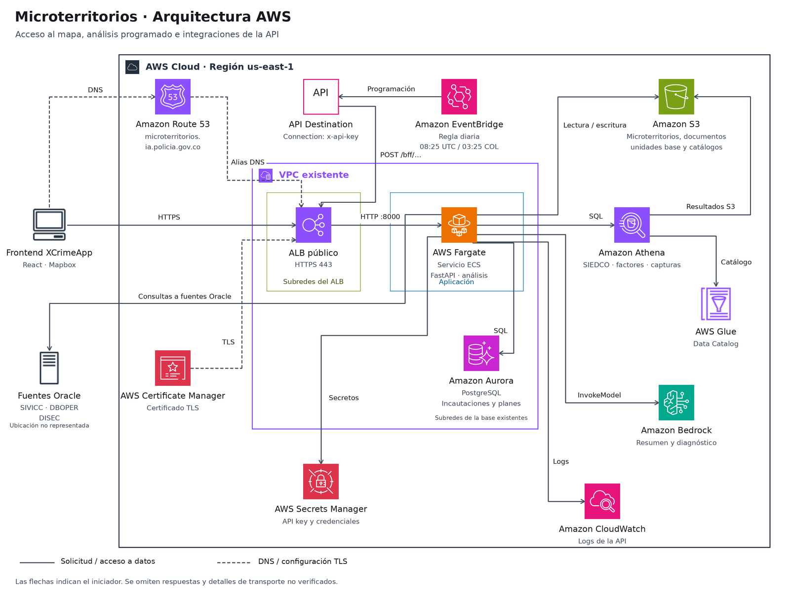
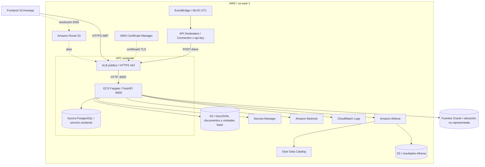
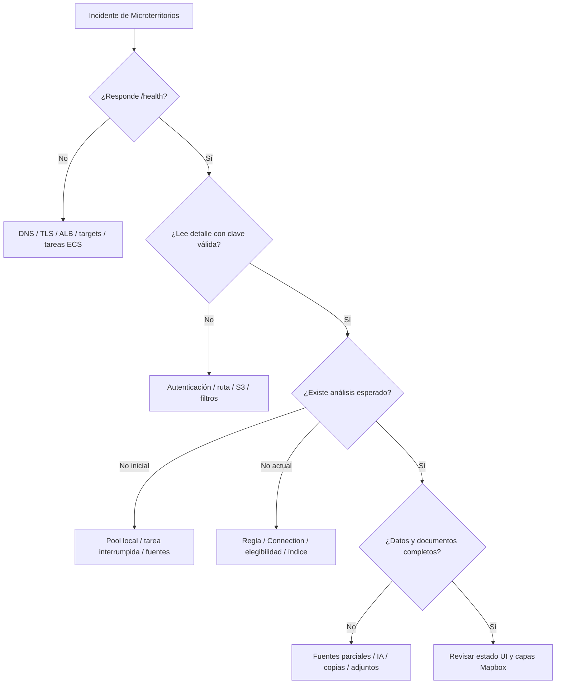

# Microterritorios — documentación técnica

> **Región AWS:** `us-east-1`  
> **Stack CDK:** `microterritorios-stack`  
> **Última revisión del documento:** 2026-11-06  
> **Verificación:** código y configuración de infraestructura; consultas funcionales pendientes.

Esta guía describe cómo se crean, almacenan y analizan los microterritorios del mapa, sus dependencias y los procedimientos para desplegar, diagnosticar y recuperar el módulo. Está dirigida a desarrollo y operación.

> **Diagrama editable:** junto a este archivo está [`arquitectura_aws.drawio`](arquitectura_aws.drawio), con servicios AWS y conexiones. Puede abrirse en draw.io o en su extensión de VS Code. La vista para consulta está en [`arquitectura_aws.png`](arquitectura_aws.png).

El frontend se mantiene en el repositorio `pon-XCrimeApp`; el backend y su infraestructura, en `pon-iapol-capas`. Las rutas de código de esta guía son relativas a esos repositorios. La lógica de aplicación se describe a partir del código. La infraestructura principal se contrastó mediante consultas de lectura a AWS el 2026-11-06; esto no acredita la versión del frontend, la integridad de datos ni el funcionamiento de cada fuente.

## Referencia

| Elemento | Valor declarado en código |
|---|---|
| URL API | `https://microterritorios.ia.policia.gov.co` |
| Prefijo funcional | `/bff` |
| Health check | `GET /health` sin API key |
| Autenticación funcional | Encabezado `x-api-key`; secreto `microterritorios-bff-api-key`, campo `API_KEY` |
| Cluster ECS | `microterritorios-bff-api-cluster` |
| ALB / target group | `microterritorios-bff-api-alb` / `microterritorios-bff-api-tg` |
| Logs | `/ecs/microterritorios-bff-api` |
| Bucket principal | `pon-prod-microterritorios` |
| Índice global | `Microterritorios/_index.json` |
| Regla diaria | `microterritorios-bff-analisis-schedule` |
| Ejecución automática | 08:25 UTC / 03:25 Colombia, todos los días |
| Destino EventBridge | `microterritorios-bff-actualizar-analisis` |
| Estado del último barrido | `GET /bff/microterritorios/actualizar-analisis/info` |

### Validación del resultado

El microterritorio se recupera por ID y sigla, la geometría y los atributos coinciden con lo guardado, sus copias por estación y el índice son consistentes y los análisis esperados están presentes para el corte aplicable. Los documentos deben descargarse si fueron adjuntados. Un `200` al guardar confirma la persistencia mínima; un `202` al actualizar análisis confirma la recepción del trabajo. Ninguno confirma por sí solo que terminó el análisis.

---

## 1. Descripción y lógica del componente

### 1.1 Qué hace

Permite dibujar polígonos, caracterizarlos con delitos/comportamientos, factores de riesgo, capacidades institucionales y fechas, y consultar, visualizar, editar, redibujar o eliminar los microterritorios guardados. Admite documentos de percepción de seguridad y calificación. El análisis integra estadísticas delictivas, actividad policial, contexto IRIS P1, comparaciones y diagnósticos narrativos.

El acceso funcional está en `Anticipación a Fenómenos de Seguridad > Mapa de Anticipación a Fenómenos de Seguridad > Microterritorios`, con unidad seleccionada. La capa dinámica llamada Microterritorios es un flujo diferente: su equivalencia con los polígonos gestionados no está acreditada.

### 1.2 Componentes

| Componente | Responsabilidad |
|---|---|
| `MapPage.js` | Coordina dibujo, creación, redibujo, selección de unidad, listado y capas. |
| `MicroterritorioForm.js` | Construye el formulario y carga catálogos. |
| `MicroterritoriosPanelList.js` | Presenta acciones sobre los microterritorios. |
| `MicroterritorioEditModal.js` | Edita caracterización, documentos y solicita redibujo. |
| `MicroterritorioAnalisisModal.js` | Presenta análisis y descarga documentos. |
| `services/api/microterritoriosApi.js` | Centraliza llamadas Axios con `x-api-key`. |
| FastAPI, router y middleware | Reciben solicitudes y validan la clave contra Secrets Manager. |
| `MicroterritoriosService` | Gestiona S3, intersecciones, índice y tareas de análisis. |
| `AnalisisService` | Consulta SIEDCO, calcula estadísticas, compara y solicita narrativas. |
| Servicios de actividad, Oracle y RDS | Consultan fuentes operativas y filtran espacialmente. |

### 1.3 Flujo funcional



**Análisis pendiente:** si el polígono se ve pero el análisis no aparece, comprobar primero si existe el registro mínimo y si la tarea de background terminó. Volver a crear el polígono produce un UUID nuevo y no recupera el trabajo del anterior.

### 1.4 Creación y almacenamiento

1. El usuario selecciona una unidad, activa el dibujo y cierra un polígono con Mapbox Draw. Turf calcula el centroide para ubicar el formulario.
2. El formulario carga delitos por sigla y factores de riesgo. Incorpora geometría, caracterización y metadatos del usuario autenticado.
3. El frontend envía `multipart/form-data`: `payload` contiene un JSON serializado; los documentos son campos opcionales separados.
4. `create_minimal` asigna un UUID. Si falta `fecha_inicio`, usa hoy en Colombia; si falta `fecha_fin`, suma nueve semanas al inicio. Calcula `vigente` comparando la fecha final con hoy.
5. Shapely determina las estaciones que intersectan el polígono con las unidades base de S3. Guarda una copia por estación; si no hay estaciones o falla su cálculo, puede guardar bajo `Sin estacion`.
6. Persiste documentos, GeoJSON e índice. La respuesta incluye `microterritorio_id` y `s3_uris`.
7. Un `ThreadPoolExecutor` del proceso ejecuta el análisis inicial y actualiza las copias y el índice. Este trabajo no usa una cola durable y puede interrumpirse al detener la tarea ECS.
8. La interfaz refresca la lista. Para confirmar el análisis se debe volver a consultar el detalle.

```text
s3://pon-prod-microterritorios/
  Microterritorios/
    _index.json
    {sigla}/{id_estacion}/{microterritorio_id}.geojson
  Documentos/
    {microterritorio_id}/percepcion_seguridad.pdf  # o .docx
    {microterritorio_id}/calificacion.pdf          # o .docx

s3://pon-prod-ml-iapol/
  UnidadesBase/{sigla}-UnidadesBase.geojson
  unidad_delitos/{SIGLA}_delitos.json
```

El índice se organiza por UUID e incluye sigla, fechas, estaciones, claves S3 y `analisis_actual_fecha`. Las copias de un UUID en distintas estaciones representan el mismo microterritorio. El listado elimina duplicados por UUID; el número de objetos S3 no equivale al número de microterritorios.

### 1.5 Edición, consulta y eliminación

El listado acepta `sigla`, estaciones, UUID y `minimal`. La visualización recupera el detalle y crea fuentes y capas de relleno y borde en Mapbox. La edición envía los campos modificados; un redibujo incorpora la geometría nueva, recalcula estaciones y puede regenerar el análisis inicial. La actualización guarda las nuevas copias y elimina las antiguas que ya no correspondan.

La eliminación busca las copias por UUID y ámbito solicitado, elimina documentos asociados y retira la entrada del índice. Se deben revisar `deleted_count`, `deleted_keys` y `errors`; una respuesta HTTP por sí sola no demuestra consistencia de todos los objetos.

La UI condiciona acciones mediante `soloVisualizar`, `puedeEditar` y comparación del correo del registro con el usuario. El middleware revisado valida una clave compartida; no valida el token Keycloak ni acredita autorización individual por propietario. Los controles de interfaz no sustituyen una validación de permisos en el backend.

### 1.6 Análisis inicial, actual y diagnósticos

El análisis SIEDCO consulta la sigla y una ventana móvil de tres semanas respecto a la ejecución; convierte coordenadas a números, descarta las inválidas y aplica `poligono.contains(Point(longitud, latitud))`. Los puntos exactamente sobre el borde no se incluyen con ese predicado. No es un reproceso histórico de la fecha de inicio: la ventana depende del momento de ejecución.

Las fuentes de actividad usan una ventana equivalente y filtros espaciales. IRIS P1 es un snapshot geográfico de estructuras, sin ventana temporal. El resultado combina `analisis_inicial`, actividad e IRIS iniciales; posteriormente incorpora `analisis_actual`, `actividad_policial_actual`, `iris_p1_actual`, comparación y diagnósticos cuando corresponda.

EventBridge llama diariamente al endpoint de actualización. Este devuelve `202` y usa `BackgroundTasks` dentro de la API. El barrido:

1. Lee el índice; si está vacío o no existe, intenta reconstruirlo recorriendo S3.
2. Selecciona registros con al menos 21 días desde `fecha_inicio`, no actualizados hoy y con claves S3. La elegibilidad revisada no filtra por `vigente`.
3. Procesa hasta cuatro microterritorios en paralelo por defecto, genera análisis actual y comparación cuando existe análisis inicial.
4. Evalúa cortes de diagnóstico cada 90 días y la fecha final. Si hay cortes pendientes, añade un diagnóstico por microterritorio en esa ejecución.
5. Actualiza todas las copias y el índice. Registra actualizados, omitidos y errores.

El estado del último barrido es un diccionario en memoria de cada proceso. Se pierde con reinicios; con varias tareas, la consulta puede llegar a otra instancia y devolver `404` o un estado diferente. No existe exclusión global documentada que impida dos barridos concurrentes.

Los errores de fuentes externas o resumen IA pueden capturarse y permitir continuar con SIEDCO. Algunas fallas pueden dejar estructuras vacías o narrativa ausente: no interpretar automáticamente un vacío como ausencia de actividad.

### 1.7 Contrato de la API

Todas las rutas de esta tabla llevan el prefijo `/bff` y `x-api-key`.

| Método y ruta | Entrada / salida principal |
|---|---|
| `POST /microterritorios/guardar-geojson` | Multipart: `payload`, `percepcion_seguridad_doc`, `calificacion_doc`; devuelve UUID y rutas. |
| `POST /microterritorios/actualizar-geojson` | Multipart con `payload` que identifica UUID y sigla; documentos opcionales. |
| `POST /microterritorios/list` | JSON: `sigla`, `id_estaciones`, `microterritorio_id`, `minimal`; devuelve `items`, `count`. |
| `POST /microterritorios/eliminar` | JSON: UUID, sigla y estaciones opcionales; devuelve detalle de eliminación. |
| `GET /unidad-delitos/{sigla}` | Catálogo desde S3. |
| `GET /factores-riesgo` | Catálogo activo desde Athena. |
| `GET /microterritorios/{id}/documentos/{tipo}` | Archivo binario PDF/DOCX; tipo `percepcion_seguridad` o `calificacion`. |
| `POST /microterritorios/actualizar-analisis` | Inicia barrido global; respuesta `202`. |
| `GET /microterritorios/actualizar-analisis/info` | Último estado local; `404` si ese proceso no tiene trabajo registrado. |

Ejemplo de lectura:

```json
{"sigla":"MEBOG","microterritorio_id":"<UUID>","minimal":false}
```

Creación y actualización **no aceptan el JSON directamente como cuerpo** en la versión revisada; el JSON debe ir dentro del campo multipart `payload`. No se debe fijar manualmente el boundary de `Content-Type` al usar FormData.

Códigos relevantes: `401` sin clave; `500` con clave incorrecta o error de autenticación (así está implementado); `400` para JSON mal formado en `payload`; `422` para validación de formularios/modelos o tipos; `404` para documento o estado de trabajo ausente. Algunas excepciones se convierten en `500` por los bloques de captura del router, por lo que se debe revisar el cuerpo y los logs.

### 1.8 Ejemplos de solicitudes y respuestas

#### Consulta por sigla y estaciones

```json
{"sigla":"MEBOG","id_estaciones":[3237],"minimal":true}
```

La estación es ilustrativa: usar un ID que exista en las unidades base del entorno.

#### Consulta de detalle por UUID

```json
{"sigla":"MEBOG","microterritorio_id":"<UUID>","minimal":false}
```

#### Creación — contenido de `payload.json`

```json
{
  "nombre": "Microterritorio de prueba",
  "sigla": "MEBOG",
  "geometry": {
    "type": "Feature",
    "properties": {},
    "geometry": {
      "type": "Polygon",
      "coordinates": [[[-74.09,4.59],[-74.08,4.59],[-74.08,4.60],[-74.09,4.60],[-74.09,4.59]]]
    }
  },
  "delitos_comportamientos": [],
  "clase_factores": [],
  "factores_riesgo": [],
  "capacidades_institucionales": [],
  "fecha_inicio": "2026-11-06",
  "fecha_fin": "2027-01-08"
}
```

Es un ejemplo sintético, no una recomendación territorial. Reemplazar geometría y fechas por los datos de la prueba. En la UI, los metadatos de usuario se obtienen de la sesión. Enviar este JSON en el campo multipart `payload`, como se muestra en 9.5.

#### Edición de caracterización — campo multipart `payload`

```json
{
  "microterritorio_id": "<UUID>",
  "sigla": "MEBOG",
  "nombre": "Microterritorio de prueba actualizado",
  "factores_riesgo": []
}
```

Enviar solo los campos que se pretende modificar. Para redibujo, incluir `geometry` con la nueva geometría y verificar después las estaciones y el análisis. No usar la actualización de geometría como mecanismo indirecto de reintento.

#### Eliminación — cuerpo JSON

```json
{"microterritorio_id":"<UUID>","sigla":"MEBOG"}
```

Este payload elimina datos y documentos; usarlo únicamente para el registro de prueba o dentro del procedimiento autorizado del ambiente. Si se restringe `id_estaciones`, comprobar el alcance sobre copias restantes, documentos e índice antes de ejecutar.

#### Actualización global — aceptación y resultado

El endpoint diario se invoca con POST sin parámetros de selección. Una respuesta de aceptación tiene esta forma:

```json
{"status":"pending","message":"Actualización de análisis iniciada en segundo plano"}
```

Ejemplo ilustrativo del estado una vez terminado:

```json
{
  "status": "done",
  "started_at": "2026-11-06T08:25:00",
  "finished_at": "2026-11-06T08:29:00",
  "result": {
    "status": "success",
    "fecha": "2026-11-06",
    "microterritorios_unicos": 3,
    "unicos_actualizados_count": 1,
    "unicos_omitidos_count": 1,
    "unicos_errores_count": 1,
    "actualizados": [{"id":"<UUID_1>"}],
    "omitidos": [{"id":"<UUID_2>","razon":"ya actualizado hoy"}],
    "errores": [{"id":"<UUID_3>","error":"<detalle>"}]
  }
}
```

Los horarios y cantidades son ficticios. El timestamp del estado usa `datetime.now()` sin zona explícita; no interpretarlo automáticamente como hora Colombia. La respuesta real puede incorporar nombre, sigla y estaciones en los elementos.

---

## 2. Diagrama de arquitectura

### 2.1 Arquitectura lógica



### 2.2 Arquitectura AWS



> **Diagrama editable:** abrir [`arquitectura_aws.drawio`](arquitectura_aws.drawio) para modificar servicios y conexiones. Los iconos oficiales están incorporados en el archivo; no requiere rutas a recursos externos.

La vista distingue el acceso HTTPS, la resolución DNS, la ejecución programada y las dependencias de la API. El backend se ejecuta en ECS Fargate dentro de una VPC; el ALB es público y reenvía al puerto 8000. Las fuentes Oracle se presentan fuera del límite de los recursos AWS representados porque su ubicación y transporte de red no se verificaron; no se presupone una VPN ni una ubicación física.

Se usan iconos del [paquete oficial AWS Architecture Icons](https://aws.amazon.com/architecture/icons/) y criterios de legibilidad y conectores de las [convenciones de diagramas del proyecto AWS Networking Best Practices](https://github.com/aws/aws-networking-best-practices/blob/main/content/community/conventions.md). Las líneas continuas representan solicitudes o acceso a datos; las discontinuas, resolución DNS y configuración TLS. Las flechas indican quién inicia la interacción; no se dibujan las respuestas.

<details>
<summary>Versión Mermaid (referencia rápida en texto)</summary>



</details>

### 2.3 Detalles relevantes de infraestructura

El contraste de lectura en AWS del 2026-11-06 confirmó el stack en `UPDATE_COMPLETE`, el ALB `internet-facing`, la VPC y subredes configuradas, una tarea ECS deseada y una en ejecución con 1 vCPU y 3072 MiB, y la regla habilitada con `cron(25 8 * * ? *)`. El clúster referenciado por la configuración de conexión es Aurora PostgreSQL y sus instancias pertenecen a la misma VPC. La cantidad de tareas es una observación puntual, no un valor garantizado.

Las subredes, VPC, buckets, fuentes de datos y secretos son dependencias existentes. CDK crea el servicio ECS, ALB, DNS/TLS, roles, logs, escalado y programación. La tarea no tiene IP pública: se debe comprobar la salida de red y conectividad a bases; la definición del stack no acredita por sí sola rutas operativas a Oracle o RDS.

| Recurso | Configuración declarada |
|---|---|
| Fargate | 1 vCPU, 3072 MiB; deseado 1, mínimo 1 y máximo 10. |
| Capacidad | Base 1 Fargate; pesos 8 Spot y 2 Fargate. |
| Actualización ECS | `minHealthyPercent=100`, `maxHealthyPercent=200`. |
| Escalado | CPU 80%, memoria 80%, 500 solicitudes por target. |
| ALB | HTTP 80 redirige a HTTPS 443; idle timeout 300 s. |
| Health del target | `/health`, cada 60 s, timeout 30 s, 2 éxitos / 5 fallos. |
| Rutas públicas reenviadas | `/bff/*`, `/health` y `/`; otras reciben 404 del ALB. |
| Logs | Una semana de retención; política `DESTROY` al eliminar el recurso. |
| EventBridge | Destino limitado a 1 solicitud/s, 2 reintentos y antigüedad máxima 2 h. |

---

## 3. Diagnóstico de incidentes

### 3.1 Identificación del incidente

Recopilar ambiente, sigla, estaciones, UUID, acción, hora Colombia/UTC, código HTTP y última respuesta correcta. Para análisis, añadir fecha de inicio, último corte y tarea ECS que atendió el trabajo. Para Athena, guardar el Query Execution ID. Evitar registrar claves o documentos personales en el reporte.

Comprobar en orden: conectividad y health, lectura funcional por UUID, objetos e índice S3, logs de la tarea, disponibilidad de fuentes y estado de EventBridge. Los siguientes comandos son de diagnóstico; requieren un perfil con acceso al ambiente.

```bash
export AWS_PROFILE='<perfil>'
export AWS_DEFAULT_REGION=us-east-1
export MICRO_API='https://microterritorios.ia.policia.gov.co'
read -rsp 'API key: ' MICRO_API_KEY
printf '\n'

curl -fsS "$MICRO_API/health"
curl -sS -w '\nHTTP %{http_code}\n' \
  "$MICRO_API/bff/microterritorios/list" \
  -H "x-api-key: $MICRO_API_KEY" -H 'Content-Type: application/json' \
  --data '{"sigla":"MEBOG","microterritorio_id":"<UUID>","minimal":false}'

aws logs tail /ecs/microterritorios-bff-api --since 2h
aws s3 ls 's3://pon-prod-microterritorios/Microterritorios/MEBOG/' --recursive
aws events describe-rule --name microterritorios-bff-analisis-schedule
aws events list-targets-by-rule --rule microterritorios-bff-analisis-schedule
```

### 3.2 Árbol de diagnóstico



### 3.3 Errores frecuentes y qué hacer

| Síntoma | Qué revisar | Acción de recuperación |
|---|---|---|
| API no responde / 502 / 503 | Eventos ECS, tareas detenidas, targets y conectividad al puerto 8000. | Corregir imagen, recursos o red; estabilizar el servicio y repetir health y lectura. |
| `/health` funciona, pero falla el listado | Clave, Secrets Manager, IAM y objetos S3. | Corregir la dependencia identificada; health no consulta estas fuentes. |
| `401` o `500` de autenticación | Presencia y vigencia de la clave, secreto y permisos. | Sincronizar clientes y programación; reemplazar tareas para limpiar el caché efectivo. |
| `422` al crear o editar | Network del navegador: multipart, campo `payload`, archivos y tipos. | Enviar FormData; no enviar JSON como cuerpo directo. |
| Guardado exitoso sin análisis | Logs `[background]`, reinicio de tarea, errores SIEDCO/IA. | Recuperar el análisis inicial según la sección 8; no recrear el UUID a ciegas. |
| Polígono no aparece | Sigla/estaciones, geometría, orden longitud/latitud, capas y fuentes Mapbox. | Consultar detalle y recargar capa; comprobar copias `Sin estacion`. |
| Datos vacíos o incompletos | Ventana de tres semanas, coordenadas inválidas/bordes, retrasos y errores de fuentes. | Comparar consulta y logs por fuente antes de interpretar los ceros. |
| Catálogos vacíos o error | Archivo `unidad_delitos`, tabla DBOPER, resultado y permisos Athena/S3. | Restablecer archivo o consulta; revisar estado y razón del Query Execution ID. |
| Análisis actual no cambia | Regla 03:25, conexión, edad mínima 21 días, marca de hoy e índice. | Resolver disparador o fuente y ejecutar un único barrido controlado. |
| `/actualizar-analisis/info` alterna entre 404 y estado | Varias tareas o reemplazo del proceso. | Correlacionar logs por stream y comprobar persistencia S3. |
| Documento 404 | Tipo, extensión y clave `Documentos/{UUID}/...`; fallos de carga. | Recuperar versión respaldada o volver a adjuntar mediante edición. |
| Diagnóstico Sonnet falla con `AccessDenied` | Modelo configurado frente a permisos efectivos del task role. | Ajustar IAM para el modelo/perfil usado; validar con el responsable de infraestructura. |
| Listado y barrido discrepan | Índice omitido/desactualizado, copias parciales y escrituras concurrentes. | Respaldar y reconciliar índice y objetos en ventana sin escritores. |

**Diferencia confirmada en código:** el stack concede explícitamente `bedrock:InvokeModel` a Haiku; el diagnóstico configura un perfil Sonnet 4.5. Revisar las políticas efectivas del ambiente antes de concluir que el despliegue tiene o no el permiso adicional.

### 3.4 Diagnóstico del índice y de las copias por estación

Para un UUID, comparar la entrada del índice con **todas** sus copias; una consulta individual puede devolver la primera coincidencia y ocultar diferencias entre estaciones.

```bash
export MICRO_ID='<UUID>'
export MICRO_SIGLA='MEBOG'
export MICRO_ESTACION='<ID_ESTACION>'

aws s3 cp s3://pon-prod-microterritorios/Microterritorios/_index.json \
  /tmp/microterritorios-index-diagnostico.json
jq --arg id "$MICRO_ID" '.[$id]' /tmp/microterritorios-index-diagnostico.json

aws s3api head-object --bucket pon-prod-microterritorios \
  --key "Microterritorios/$MICRO_SIGLA/$MICRO_ESTACION/$MICRO_ID.geojson"
aws s3 cp \
  "s3://pon-prod-microterritorios/Microterritorios/$MICRO_SIGLA/$MICRO_ESTACION/$MICRO_ID.geojson" \
  /tmp/microterritorio-diagnostico.json
jq '{microterritorio_id,sigla,id_estaciones,fecha_inicio,fecha_fin,analisis_actual_fecha}' \
  /tmp/microterritorio-diagnostico.json
```

Los comandos descargan evidencia a disco local; no modifican S3. Verificar que las claves del índice existan y que las copias tengan los mismos datos de análisis. Conservar el `LastModified`, ETag y, si existe, VersionId de cada objeto. No elegir automáticamente la copia más reciente: podría corresponder a una actualización parcial defectuosa.

### 3.5 Consulta funcional de la API

Con las variables de 3.1 y un UUID conocido:

```bash
jq -n --arg sigla "$MICRO_SIGLA" --arg id "$MICRO_ID" \
  '{sigla:$sigla,microterritorio_id:$id,minimal:false}' \
  > /tmp/microterritorio-consulta.json

curl -sS -w '\nHTTP %{http_code}\n' \
  "$MICRO_API/bff/microterritorios/list" \
  -H "x-api-key: $MICRO_API_KEY" \
  -H 'Content-Type: application/json' \
  --data-binary @/tmp/microterritorio-consulta.json

curl -sS -w '\nHTTP %{http_code}\n' \
  "$MICRO_API/bff/microterritorios/actualizar-analisis/info" \
  -H "x-api-key: $MICRO_API_KEY"
```

Comparar UUID, geometría, estaciones y fecha de análisis con S3. El listado elimina duplicados por UUID entre estaciones. Para diagnosticar copias divergentes, inspeccionar directamente todas las claves S3 del índice: la respuesta de la API puede mostrar una sola de ellas.

### 3.6 Condiciones que afectan el diagnóstico

| Área | Limitación confirmada en archivos revisados | Impacto operativo |
|---|---|---|
| Procesamiento | Pools y BackgroundTasks dentro del proceso de API. | Un reinicio puede interrumpir trabajos sin reanudación durable. |
| Estado | Último trabajo guardado en memoria por proceso. | Estado no global y perdido al reemplazar tarea. |
| Concurrencia | Índice JSON completo sin bloqueo distribuido observado. | Escrituras simultáneas pueden perder entradas o fechas. |
| Persistencia | Copias por estación e índice sin transacción conjunta. | Fallos parciales pueden dejar datos divergentes. |
| Observabilidad | No se declaran alarmas operativas específicas. | Hace falta comprobación proactiva y configurar notificaciones. |
| Logs | Retención de una semana y política DESTROY. | Preservar evidencia antes de expirar o eliminar recursos. |
| Disponibilidad de fuentes | Algunas excepciones se capturan y dejan bloques vacíos. | No interpretar vacío ni éxito global como integridad por fuente. |
| Bedrock | Permiso explícito Haiku frente a diagnóstico configurado Sonnet. | Comprobar permisos efectivos del perfil/modelo. |
| Autenticación | Clave compartida y caché por instancia; refresh no efectivo sobre el middleware. | Rotación requiere coordinación y reemplazo de tareas. |
| Autorización | Controles de UI no acreditan permisos por propietario en API. | Validar el alcance real por perfil y usuario. |
| Recuperación | No hay endpoint específico de reintento inicial ni de reparación de índice. | Se necesita procedimiento controlado con servicios internos. |
| Respaldo | Stack no garantiza versionado ni respaldo de buckets existentes. | RPO y recuperación de borrados pendientes de comprobar. |
| Reproducibilidad | Build de imagen vuelve a resolver dependencias con Poetry. | Mantener imágenes conocidas para rollback. |

---

## 4. Configuración y variables

### 4.1 API y procesamiento

`app/config.py` centraliza `settings`, carga `.env` si existe y usa valores por defecto. Los cambios de entorno requieren reiniciar el proceso. `cdk/config/microterritorios.json` sobrescribe algunos valores en ECS, incluida `VERSION=2.0.0`; el valor por defecto local de versión es `1.0.0`.

| Variables | Valor por defecto / finalidad |
|---|---|
| `AWS_DEFAULT_REGION`, `TIMEZONE` | `us-east-1`, `America/Bogota`. |
| `VERSION`, `SERVICE_NAME` | `1.0.0`, `capa-microterritorios-api`. |
| `CORS_ALLOW_ORIGINS` | `*`; lista separada por comas. |
| `BACKEND_API_KEY_SECRET_NAME` | `microterritorios-bff-api-key`; JSON con campo `API_KEY`. |
| `S3_BUCKET_MICROTERRITORIOS` | `pon-prod-microterritorios`. |
| `S3_BUCKET_UNIDADES_BASE` | `pon-prod-ml-iapol`. |
| `S3_ATHENA_OUTPUT_BUCKET`, `S3_ATHENA_OUTPUT_PREFIX` | `pon-prod-athena-query-results-capas-adicionales`, `microterritorios/`. |
| `ATHENA_DATABASE`, `ATHENA_TABLE` | `pon_prod_raw_siedco_delitos_temporal`, `raw_data_siedco_full_delitos`. |
| `FACTORES_RIESGO_DB`, `FACTORES_RIESGO_TABLE` | `pon-prod-raw-dboper`, `raw_dboper_usr_gescov_mtrs_ctrl_riesgo_social`. |
| `SIVICC_SECRET`, `DBOPER_SECRET`, `DISEC_SECRET` | `pon-prod-sivicc-connection`, `pon-prod-DBOPER-on-premise`, `pon-prod-disec-op-rnmc`. |
| `RDS_DB_CREDENTIALS_SECRET_NAME`, `RDS_DATABASE` | Nombre del secreto de conexión configurado en `Settings`; base `postgres`. Validar que corresponda al ARN autorizado en CDK. |
| `BEDROCK_RESUMEN_MODEL_ID` | `anthropic.claude-3-haiku-20240307-v1:0`. |
| `BEDROCK_DIAGNOSTICO_MODEL_ID` | `us.anthropic.claude-sonnet-4-5-20251001`. |
| `BEDROCK_ANTHROPIC_VERSION` | `bedrock-2023-05-31`. |
| `BEDROCK_RESUMEN_MAX_TOKENS`, `BEDROCK_DIAGNOSTICO_MAX_TOKENS` | `700`, `1024`. |
| `CREATE_BG_MAX_WORKERS`, `ANALISIS_GLOBAL_MAX_WORKERS`, `ACTIVIDAD_MAX_WORKERS` | `4`, `4`, `6`; concurrencia local de creación, barrido y fuentes. |
| `ANALISIS_VENTANA_SEMANAS` | `3`; ventana móvil. |
| `MICROTERRITORIO_DURACION_SEMANAS` | `9`; duración si falta fecha final. |
| `DIAGNOSTICO_CORTE_DIAS` | `90`; intervalo de cortes. |
| `ANALISIS_ACTUAL_ELEGIBILIDAD_DIAS` | `21`; edad mínima para barrido. |
| `TENDENCIA_UMBRAL_PCT` | `5.0`; umbral de estabilidad. |

### 4.2 Frontend

El frontend importa `Microterritorios_API_URL` y `Microterritorios_API_Key` desde `src/file.config.js`. En el código revisado están definidos directamente; no existe sustitución automática de estos dos valores mediante `REACT_APP_*`. La URL incluye `/bff`. Para local se debe apuntar al backend de pruebas y configurar la clave correspondiente, sin publicarla en la documentación ni en commits.

### 4.3 Infraestructura y programación

El archivo `cdk/config/microterritorios.json` contiene dominio, VPC, subredes, CPU, memoria, número de tareas, capacidad de escalado, variables ECS y ARNs de secretos y buckets autorizados. La hora del disparo, la política de reintentos y el enrutamiento del ALB se declaran en `cdk/lib/microterritorios-stack.ts`. Cambiar `.env` local no cambia ninguno de estos recursos.

### 4.4 Autenticación y seguridad operativa

La clave debe coincidir en Secrets Manager, frontend y Connection de EventBridge. El task role requiere permisos sobre los secretos y buckets usados, Athena, Glue, KMS y el modelo Bedrock correspondiente. Los permisos de administración de RDS no sustituyen las credenciales SQL ni la conectividad de red.

El health está excluido de autenticación. Los documentos y datos funcionales pasan por el middleware de clave compartida. Para incidentes de permisos individuales se debe revisar el flujo de sesión del frontend y la autorización realmente aplicada por el backend, sin deducirla de la visibilidad de un botón.

### 4.5 Fechas y límites de ventana

La zona de negocio configurable convive con llamadas a `datetime.now()` sin zona y `current_date` de Athena en análisis. Validar los límites temporales al investigar diferencias de un día.

---

## 5. Dependencias e integraciones

### 5.1 Servicios, fuentes y software

| Dependencia | Uso y evidencia |
|---|---|
| React 17, Axios, Mapbox GL, Mapbox Draw, Turf | Interfaz, transporte HTTP, polígonos y cálculo de centroides; `pon-XCrimeApp/package.json`. |
| Keycloak | Sesión del mapa; el API de Microterritorios revisado usa clave compartida. |
| Python / FastAPI / Uvicorn | API; imagen Python 3.12, manifiesto admite Python `>=3.11,<4.0`. |
| Pandas, Shapely, AWS Wrangler, boto3 | Estadística, filtrado espacial y acceso AWS. |
| Oracle Instant Client / oracledb | Acceso Oracle en modo thick; instalado en Dockerfile. |
| SQLAlchemy / psycopg2 | Conexión PostgreSQL. |
| S3 | GeoJSON, copias por estación, índice, documentos, unidades base y resultados Athena. |
| Athena / Glue | Delitos SIEDCO, factores de riesgo y capturas. |
| Oracle SIVICC | Antecedentes, `USR_MNVCC.AUDITORIA_CONS_PERSONA`. |
| Oracle DBOPER | Comparendos, `USR_CNP.CNP_HECHOS`. |
| Oracle DISEC | IRIS P1, `USR_DISEC.VM_GENERAL_IRISP`. |
| Athena `pon-prod-capas-iapol.capa_10` | Capturas por delito. |
| Aurora PostgreSQL `public.hechos_z1_v2` | Incautaciones con filtro `incautacion = '1'`. |
| Aurora PostgreSQL `public.v_planes_programados_historico` | Planes programados; no demuestra ejecución. |
| Bedrock | Resumen inicial Haiku y diagnóstico Sonnet. |
| Secrets Manager / KMS | Credenciales, clave API y descifrado según políticas. |
| EventBridge / CloudWatch | Disparo diario y observabilidad. |

Las fuentes de actividad, columnas de coordenadas, fechas y métricas se declaran en `app/fuentes_externas_config.json`. Consultar ese archivo junto con los servicios antes de cambiar una fuente. Las tablas de Athena y bases externas requieren conectividad, catálogo y permisos efectivos, además de que exista el servicio ECS.

### 5.2 Semántica de disponibilidad

| Situación | Interpretación para soporte |
|---|---|
| Objeto mínimo guardado sin análisis inicial | Persistencia confirmada; procesamiento pesado pendiente o fallido. |
| Fuentes de actividad vacías con advertencias en logs | Posible degradación; no acredita ausencia de actividad. |
| Resumen narrativo vacío | Revisar Bedrock; puede existir estadística válida sin narrativa. |
| `status=done` del barrido | Finalizó la función; comprobar errores y persistencia por UUID. |
| `analisis_actual_fecha` de hoy | Marca de ejecución; no demuestra que todas las ramas o el diagnóstico estén completos. |
| `vigente=false` | Estado temporal del microterritorio; no equivale a objeto eliminado. |

A diferencia de otros módulos, no se debe asumir que cada fuente devuelve un contrato uniforme de disponibilidad. Revisar el bloque concreto, logs y fecha de consulta antes de reportar cifras.

### 5.3 Organización del código

Las rutas se interpretan dentro del repositorio indicado. En el backend, las rutas que comienzan por `app/` son relativas a `microterritorios/api/`.

| Evidencia de implementación | Archivos de referencia |
|---|---|
| Flujo frontend y transporte | `pon-XCrimeApp/src/pages/MapPage.js`, `src/services/api/microterritoriosApi.js`, componentes citados en 1.2. |
| Contratos HTTP y estado local | `pon-iapol-capas/microterritorios/api/app/routers/router.py`. |
| Persistencia y recuperación interna | `app/services/microterritorios_service.py`. |
| Ventanas, geometría y narrativa | `app/services/analisis_service.py`, `actividad_policial_service.py`, `fuentes_externas_config.json`. |
| Autenticación y health | `app/main.py`, `app/middleware/auth_middleware.py`, `app/auth/auth_service.py`. |
| Configuración y empaquetado | `app/config.py`, `pyproject.toml`, `Dockerfile`. |
| Infraestructura y disparador | `pon-iapol-capas/cdk/lib/microterritorios-stack.ts`, `config/microterritorios.json`, `bin/cdk.ts`. |
| Publicación frontend | `pon-XCrimeApp/buildspec.yml`, `package.json`. |

---

## 6. Despliegue y actualización

### 6.1 Prerrequisitos

- Perfil AWS del ambiente y permisos de CloudFormation, CDK, ECS y publicación de assets.
- Docker para construir la imagen; Node/npm compatibles con el proyecto CDK y frontend.
- Secretos, buckets, catálogo, fuentes y conectividad previamente disponibles.
- Identificación de la imagen y configuración conocidas para rollback.

### 6.2 Validaciones previas y publicación del backend

Registrar commit, task definition e imagen vigentes, configuración, políticas y estado del servicio. Respaldar los objetos que pudieran modificarse durante una migración. Confirmar que no haya análisis pendientes antes de reemplazar tareas: los pools y el estado de trabajo son locales al proceso.

Desde `pon-iapol-capas/cdk`, con Node/npm compatibles con el proyecto, CDK y Docker disponibles:

```bash
npm ci
npm run build
npx cdk synth microterritorios-stack
npx cdk diff microterritorios-stack
# Publicación: ejecutar en la ventana aprobada del ambiente.
npx cdk deploy microterritorios-stack
```

El stack construye la imagen desde `../microterritorios/api`. Usar el stack específico evita desplegar otros componentes del repositorio. El Dockerfile instala Oracle Instant Client y dependencias con Poetry; además ejecuta `poetry lock` durante el build. Conservar el artefacto anterior, porque reconstruir un commit puede resolver versiones distintas de las dependencias con rangos.

Después del despliegue, comprobar estabilidad ECS, targets saludables, versión de `/health`, lectura por UUID, catálogos y documentos conocidos. Probar creación, edición y eliminación en el ambiente de pruebas con un registro controlado y verificar también su análisis inicial. Revisar la regla y el resultado de la siguiente ejecución diaria.

### 6.3 Publicación del frontend

`pon-XCrimeApp/buildspec.yml` instala dependencias, ejecuta `npm run build` y copia `build/` a `$BUILD_FOLDER/XCrimeAppCapa/`. La variable de destino debe verificarse en la configuración del pipeline; no se deduce un bucket de ese archivo. El buildspec declara Node 14, mientras algunas dependencias locales pueden exigir otra versión: confirmar el runtime real y resolver la compatibilidad antes de publicar.

Validar la URL con `/bff`, el envío multipart, la clave del ambiente, la sesión y las acciones del panel. Conservar el bundle previo y comprobar el mecanismo real de caché de la publicación; el buildspec no declara invalidación de CDN.

### 6.4 Validación posterior

| Validación | Resultado esperado |
|---|---|
| Despliegue ECS | Servicio estable y tareas esperadas en ejecución. |
| ALB | Targets saludables; sin incremento sostenido de 5xx. |
| Health | Versión correspondiente al release publicado. |
| Consulta por UUID | Atributos y geometría correctos con clave vigente. |
| Documento conocido | Descarga con tipo y contenido esperados. |
| Catálogos | Sigla y factores recuperables. |
| Background en pruebas | Análisis inicial persistido sin errores del UUID de prueba. |
| Barrido diario | Disparador habilitado, aceptación y resultado persistido verificables. |

Registrar versión, hora, evidencia y diferencias. Si health funciona pero falla una operación funcional, el despliegue no está validado de extremo a extremo.

### 6.5 Rollback — aplicación, infraestructura y datos

- **Código backend:** volver a la task definition e imagen conocidas mediante el procedimiento ECS del ambiente; estabilizar y verificar health y lectura. Reconciliar después CDK con esa versión para evitar que un nuevo deploy reponga el cambio fallido.
- **Infraestructura/configuración:** aplicar el commit anterior con `cdk diff` y desplegar únicamente `microterritorios-stack`. Revisar especialmente IAM, reglas y variables.
- **Frontend:** restaurar el bundle anterior en el destino verificado y aplicar la actualización de caché que corresponda.
- **Datos:** volver de versión de código no restaura GeoJSON, documentos ni índice. Recuperarlos desde versiones S3 o un respaldo comprobado, como se describe en la sección 8.

No hay evidencia en estos archivos de un respaldo automático del bucket ni de un procedimiento de rollback de datos ya probado. No destruir el stack como estrategia de rollback.

---

## 7. Monitoreo y alertas

### 7.1 Instrumentación disponible

El stack crea logs de aplicación y políticas de escalado; no declara alarmas operativas específicas, paneles ni notificaciones para Microterritorios. Las señales siguientes son una propuesta a implementar y ajustar con una línea base del ambiente.

### 7.2 Indicadores operativos

| Señal | Alerta propuesta / interpretación |
|---|---|
| ALB `HealthyHostCount` / `UnHealthyHostCount` | Alertar si no queda ningún target saludable. |
| ALB `HTTPCode_Target_5XX_Count` / `HTTPCode_ELB_5XX_Count` | Alertar por errores sostenidos; distinguir API y balanceador. |
| ALB `TargetResponseTime` | Vigilar percentiles y solicitudes que se acerquen al timeout de 300 s. |
| ECS CPU / memoria / tareas | CPU o memoria sostenida sobre 80%, tareas por debajo de deseado y reinicios repetidos. |
| EventBridge `FailedInvocations` | Fallos del disparo diario o conexión; aceptación HTTP no confirma análisis completo. |
| Logs `[background]`, `[analisis_actual]`, `[index]`, `[diagnostico]` | Detectar excepciones y persistencia parcial, no solo mensajes de finalización. |
| Frescura S3 | Después de la ejecución, verificar fecha de análisis de una muestra elegible y coherencia del índice. |
| Fuentes / Bedrock | Errores de permisos, throttling, consultas fallidas, timeout y respuestas parciales. |

Los umbrales, la hora límite de frescura y los destinatarios deben acordarse con operación. No se dispone de SLA, RTO o RPO confirmados.

### 7.3 Comprobación del trabajo diario

Consultar `/bff/microterritorios/actualizar-analisis/info`. Al terminar, el router devuelve `status=done` y un campo `result` con `unicos_actualizados_count`, `unicos_omitidos_count`, `unicos_errores_count` y sus listas. `done` no significa cero errores: revisar `result.errores`, logs y campos persistidos. Un error de comparación o diagnóstico capturado internamente puede no incrementar el contador global.

La monitorización debe correlacionar el stream de la tarea con el UUID y las fechas S3. La consulta de estado no es un registro durable ni global. Los logs duran una semana según CDK, por lo que la evidencia de incidentes debe preservarse antes de vencer ese plazo.

### 7.4 Consultas operativas útiles

```bash
aws ecs list-services --cluster microterritorios-bff-api-cluster
aws ecs list-tasks --cluster microterritorios-bff-api-cluster
aws elbv2 describe-load-balancers --names microterritorios-bff-api-alb
aws elbv2 describe-target-groups --names microterritorios-bff-api-tg
aws events describe-connection --name microterritorios-bff-scheduler-connection
aws events describe-rule --name microterritorios-bff-analisis-schedule
aws logs tail /ecs/microterritorios-bff-api --since 24h
```

Para inspeccionar salud de targets y servicio, usar los ARNs reales devueltos por las consultas anteriores:

```bash
aws elbv2 describe-target-health --target-group-arn '<ARN_TARGET_GROUP>'
aws ecs describe-services --cluster microterritorios-bff-api-cluster \
  --services '<ARN_SERVICIO>'
aws athena get-query-execution --query-execution-id '<QUERY_EXECUTION_ID>'
```

Consulta CloudWatch Logs Insights para un UUID, seleccionando el grupo del API y el rango horario del incidente:

```text
fields @timestamp, @logStream, @message
| filter @message like /UUID_A_INVESTIGAR/
| sort @timestamp asc
| limit 500
```

Para fallos de procesamiento:

```text
fields @timestamp, @logStream, @message
| filter @message like /Error|ERROR|ADVERTENCIA|AccessDenied|Throttl/
| sort @timestamp desc
| limit 200
```

### 7.5 Alarmas recomendadas

Proponer alertas para ausencia de targets saludables durante cinco minutos, 5xx sostenidos, reinicios repetidos, fallo de invocación diaria y ausencia de análisis fresco tras la hora límite acordada. Añadir detección de errores por UUID y de fuentes parciales. Estos son criterios de diseño pendientes de implementar y calibrar, no alarmas verificadas del ambiente.

---

## 8. Recuperación del servicio

### 8.1 Preparación de la recuperación

1. Identificar si falló la consulta, la persistencia o el procesamiento antes de repetir acciones.
2. Conservar UUID y respaldar datos antes de reparar; no crear duplicados para reintentar.
3. Evitar dos escritores o barridos sobre el mismo conjunto durante una reparación.
4. Verificar las copias por estación y el índice, además de la respuesta HTTP.
5. Separar rollback de aplicación de restauración de datos.

### 8.2 API caída

1. Revisar eventos del servicio y causa de detención de tareas, imagen y configuración.
2. Corregir conectividad o recursos, o restaurar la imagen conocida.
3. Esperar estabilidad y targets saludables; comprobar `/health` y una lectura funcional.
4. Revisar los trabajos interrumpidos y objetos persistidos antes de repetir escrituras.

Para ubicar el servicio físico, consultar los recursos del stack y luego sus tareas en `microterritorios-bff-api-cluster`; el nombre físico del servicio no está fijado explícitamente en CDK.

### 8.3 Análisis diario interrumpido

Corregir primero la fuente o el permiso fallido y verificar que no haya otro barrido activo en los logs de las tareas. A continuación, un operador puede iniciar **un** barrido global:

```bash
curl -sS -X POST "$MICRO_API/bff/microterritorios/actualizar-analisis" \
  -H "x-api-key: $MICRO_API_KEY"
curl -sS "$MICRO_API/bff/microterritorios/actualizar-analisis/info" \
  -H "x-api-key: $MICRO_API_KEY"
```

Este endpoint afecta a todos los elegibles y escribe resultados; no acepta filtro por UUID en la implementación revisada. Omite los marcados como actualizados hoy. Si se requiere corregir uno de ellos, preparar una reparación específica y respaldada del registro y su índice; no modificar fechas masivamente para forzar el barrido.

### 8.4 Creación guardada sin análisis inicial

Consultar todas las copias del UUID y los logs `[background]`. Si el registro mínimo existe y el trabajo se perdió, no reenviar la creación: generaría otro UUID. No hay endpoint público específico de reintento inicial. Preparar una ejecución controlada de `MicroterritoriosService.process_after_create(UUID, sigla)` con el mismo entorno y versión del backend, sin un proceso concurrente sobre ese registro. Respaldar primero las copias y verificar después análisis, estaciones e índice. El barrido diario genera análisis actual y no sustituye la recuperación del inicial.

### 8.5 Índice inconsistente o copias divergentes

El índice se modifica mediante lectura y escritura del JSON completo; no se observa bloqueo distribuido ni control condicional de versión. Las escrituras concurrentes pueden perder entradas. Una copia por estación puede quedar actualizada y otra fallar.

1. Suspender temporalmente disparos y escrituras durante la reparación.
2. Guardar índice, copias y documentos afectados en un respaldo separado.
3. Determinar la versión válida por UUID y reconciliar todas las estaciones, incluidas las antiguas o `Sin estacion`.
4. Reconstruir el índice mediante la función interna `_rebuild_index_from_s3()` en una ejecución controlada del backend; no existe ruta pública de reparación.
5. Verificar que cada clave del índice exista y que estaciones, fechas y UUID coincidan. Reanudar escritores y programación.

El barrido intenta reconstruir automáticamente cuando el índice está vacío o ausente; un índice parcialmente desactualizado y no vacío no se corrige por esa condición.

### 8.6 Recuperación de objetos eliminados

Comprobar primero si el bucket tiene versionado y qué versiones están disponibles:

```bash
aws s3api get-bucket-versioning --bucket pon-prod-microterritorios
aws s3api list-object-versions --bucket pon-prod-microterritorios \
  --prefix 'Microterritorios/MEBOG/<ESTACION>/<UUID>.geojson'
```

Si hay versiones utilizables, restaurar las seleccionadas mediante el procedimiento S3 del ambiente y recuperar también documentos e índice. Si no hay versionado, usar el respaldo externo confirmado. Sin versión ni respaldo no puede garantizarse recuperar el contenido eliminado. La restauración debe mantener el UUID y todas sus copias, y concluir con lectura y descarga de documentos.

### 8.7 Rotación de clave

Sincronizar el secreto, el frontend y la Connection de EventBridge. El API cachea la clave por instancia. Aunque existe `/auth/refresh-key`, el ALB declarado no reenvía esa ruta y su implementación crea otro `AuthService`, por lo que limpiar esa instancia no invalida el caché del middleware. Para asegurar recarga, reemplazar las tareas mediante el procedimiento ECS y comprobar las lecturas y el disparador con la clave nueva.

### 8.8 Verificación de la recuperación

Cerrar cuando se cumplan los criterios aplicables al caso:

- API estable, con targets saludables y lectura funcional por UUID.
- Geometría, atributos, estaciones y documentos recuperados correctamente.
- Índice y todas las copias S3 consistentes, sin duplicación de UUID nuevos.
- Análisis inicial o actual presente para el corte esperado; fuentes parciales identificadas.
- Diagnósticos y comparación revisados cuando eran parte del incidente.
- Regla y Connection habilitadas si se intervinieron; siguiente ejecución bajo seguimiento.
- Evidencia conservada: causa, alcance, cambio aplicado, versión y hora de validación.

Un health correcto o el mensaje de finalización del pool no reemplazan estas comprobaciones.

---

## 9. Configuración y ejecución local

### 9.1 Requisitos

Acceso a ambos repositorios, Node/npm compatibles con el frontend, Docker o Python 3.12 con Poetry, perfil AWS del ambiente de pruebas y acceso de red a las fuentes. La ejecución local usa servicios AWS reales si no se sustituyen; los valores por defecto apuntan a recursos de producción. Configurar buckets, secretos y fuentes de pruebas antes de ejecutar escrituras o barridos.

### 9.2 Backend con Poetry

Desde `pon-iapol-capas/microterritorios/api`:

```bash
python3.12 -m venv .venv
source .venv/bin/activate
python -m pip install poetry
poetry install --no-root
export AWS_PROFILE='<perfil-pruebas>'
export AWS_DEFAULT_REGION=us-east-1
export S3_BUCKET_MICROTERRITORIOS='<bucket-pruebas>'
export S3_BUCKET_UNIDADES_BASE='<bucket-unidades-pruebas>'
export S3_ATHENA_OUTPUT_BUCKET='<bucket-resultados-pruebas>'
export BACKEND_API_KEY_SECRET_NAME='<secreto-api-pruebas>'
# Configurar también las fuentes y secretos del entorno en .env o variables.
poetry run uvicorn app.main:app --host 127.0.0.1 --port 8000 --reload
```

Oracle en modo thick requiere Instant Client y librerías del sistema. Si el entorno local no dispone de ellas, usar la imagen Docker del proyecto. Algunos clientes AWS se crean al importar módulos; configurar región y credenciales antes de iniciar Uvicorn. El modo `--reload` puede interrumpir análisis: no modificar archivos durante una prueba de procesamiento.

### 9.3 Backend con Docker

Desde la misma carpeta, con `.env.local` preparado para pruebas y excluido de Git:

```bash
docker build -t microterritorios-local .
docker run --rm -p 127.0.0.1:8000:8000 \
  --env-file .env.local \
  -e AWS_PROFILE='<perfil-pruebas>' \
  -v "$HOME/.aws:/root/.aws:ro" microterritorios-local
```

El montaje permite al contenedor leer el perfil local; según el tipo de autenticación, pueden requerirse credenciales temporales u otra configuración del proveedor. La imagen necesita acceso a repositorios de paquetes y descarga del cliente Oracle durante la construcción.

### 9.4 Frontend

Desde `pon-XCrimeApp`:

```bash
npm ci
npm start
```

Antes de iniciar, ajustar en la copia local `src/file.config.js` la URL de Microterritorios a `http://localhost:8000/bff` y la clave de pruebas. Comprobar la configuración de Mapbox, sesión Keycloak y servicios de navegación del mapa; levantar esta API no reemplaza el resto de dependencias de XCrimeApp. Eliminar de los cambios a publicar cualquier credencial local.

Swagger está disponible en `http://localhost:8000/docs` según `app/main.py`. El ALB de producción no reenvía `/docs`, `/redoc` ni `/openapi.json`; la aplicación no los deshabilita por ambiente en ese archivo.

### 9.5 Comprobación funcional de extremo a extremo

1. Ejecutar `GET http://localhost:8000/health` y lectura de catálogos con la clave de pruebas.
2. Seleccionar una unidad cuyas geometrías existan en el bucket de pruebas.
3. Crear un polígono dentro de esa unidad, adjuntar un documento de prueba y registrar el UUID retornado.
4. Consultar por UUID y sigla; verificar geometría, metadatos, copias S3 e índice. Esperar y comprobar análisis inicial con sus logs.
5. Visualizar y ocultar; abrir el análisis y descargar el documento.
6. Editar atributos y redibujar; verificar que las copias antiguas se retiren si cambian las estaciones.
7. Probar el barrido solo en un conjunto aislado con registros elegibles; comprobar `result.errores`, análisis actual y fechas persistidas.
8. Eliminar el registro de prueba y verificar copias, documentos e índice.

Ejemplo de creación multipart, solo contra el backend de pruebas, usando un `payload.json` con geometría y sigla válidas:

```bash
curl -sS http://localhost:8000/bff/microterritorios/guardar-geojson \
  -H "x-api-key: $MICRO_API_KEY" \
  --form 'payload=<payload.json' \
  --form 'percepcion_seguridad_doc=@percepcion-prueba.pdf'
```

### 9.6 Archivos de prueba esperados

| Archivo | Contenido |
|---|---|
| `.env` o `.env.local` | Variables del ambiente de pruebas; mantener fuera de Git. |
| `payload.json` | Caracterización, sigla y geometría cerrada en longitud/latitud. |
| `percepcion-prueba.pdf` | Documento sintético para probar carga y descarga. |
| Respuesta de creación | UUID y rutas S3 para comparar contra detalle e índice. |
| Evidencia de ejecución | Fecha, versión, sigla, estaciones, conteos y logs sin credenciales. |

Los archivos son insumos de prueba que prepara el operador; no se afirma que existan en el repositorio. Las pruebas de escritura deben dirigirse al bucket y las fuentes del entorno configurado.

### 9.7 Registro de validación

Al ejecutar las pruebas, registrar fecha, versión, ambiente, sigla, UUID y resultados de cada operación, junto con la evidencia de S3 y logs. Quedan por comprobar el flujo funcional completo, los permisos efectivos de fuentes y modelos, las políticas de respaldo, las alertas externas al stack y los tiempos de recuperación. La consulta de infraestructura descrita en el apartado 2 no sustituye estas pruebas.

[Volver a la ficha funcional](README.md).
