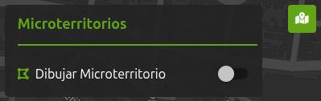
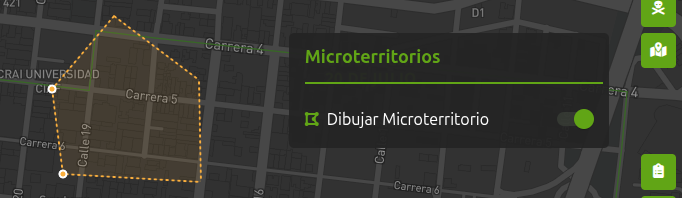
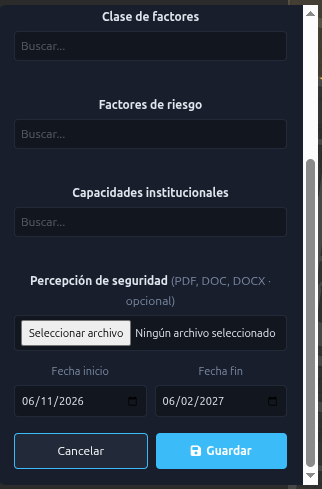
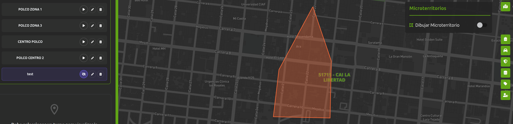
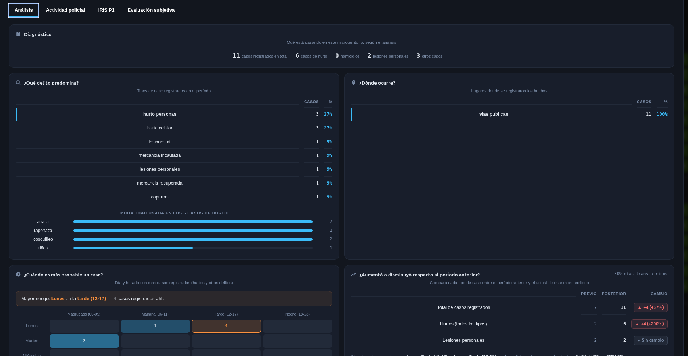
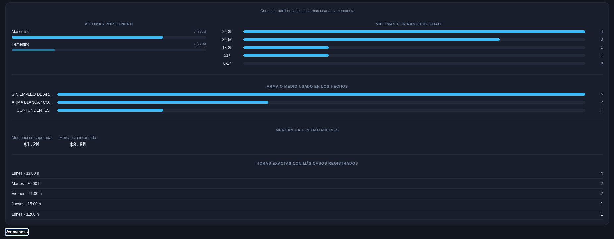
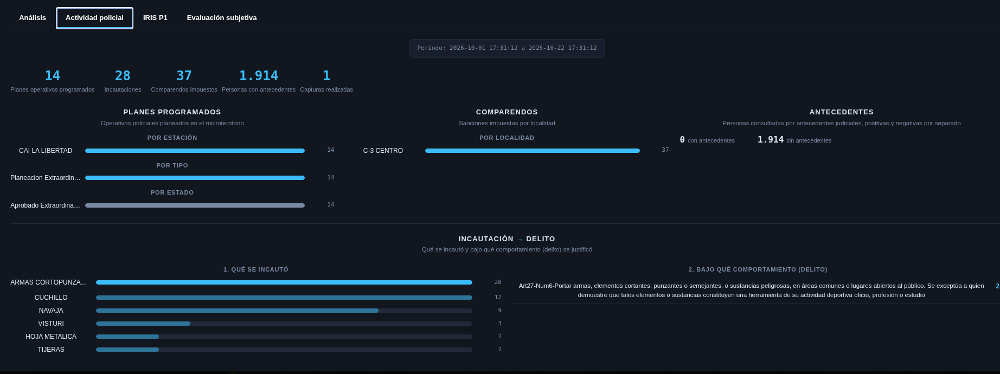
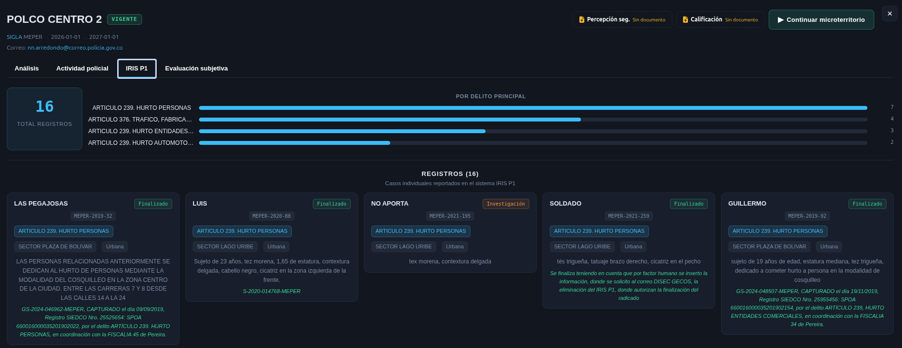
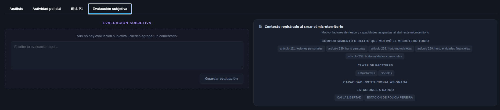

# Consulta integrada

## 1. Identificación

| Campo | Valor |
|---|---|
| ID | POL-MAPA-008 |
| Módulo | Microterritorios |
| Frecuencia de actualización | null |
| Hora de carga del Data Lake | null |
| Última actualización modulo | 05/11/2026 |
| Responsable | Null |

## 2. Descripción

Módulo que permite delimitar y gestionar microterritorios a nivel de sigla y sus unidades hijas. Cada área se dibuja sobre el mapa y se caracteriza mediante un nombre, delitos y comportamientos, clase de factores, factores de riesgo, capacidades institucionales y un periodo de análisis, con opción de adjuntar un documento de percepción de seguridad. Permite guardar, consultar, editar y eliminar los microterritorios, visualizar sus límites y revisar los análisis disponibles para apoyar la planificación y el seguimiento de las intervenciones policiales.

## 3. Ruta de Acceso

1. Ingresar al aplicativo `IAPOL`.
2. Abrir el módulo `Anticipación a Fenómenos de Seguridad`.
3. Seleccionar el submódulo `Mapa de Anticipación a Fenómenos de Seguridad`.
4. Ingresar a `Mapa`.
5. Hacer clic en el modulo `Microterritorios`.

  

- Ruta resumida:

`Menú principal > Anticipación a Fenómenos de Seguridad > Mapa de Anticipación a Fenómenos de Seguridad > Modulo Consulta Integrada`

## 4. Activación de la capa

1. Seleccionar una sigla o unidad hija.
2. Abrir el módulo Microterritorioss
3. Activar la opción Dibujar Microterritorio.
4. Dibujar y cerrar el polígono sobre el mapa para delimitar el área.

  

5. al dar enter 
6. Ingresar el nombre y seleccionar los delitos y comportamientos, clase de factores, factores de riesgo y capacidades institucionales.
7. Definir las fechas de inicio y fin del periodo de análisis.
8. Adjuntar, opcionalmente, un documento de percepción de seguridad en formato PDF, DOC o DOCX.
Hacer clic en Guardar.

  

9. Activar Ver Microterritorios Guardados.
10. Seleccionar un microterritorio del listado para visualizar sus límites y consultar su información y los 
análisis disponibles.

  

11. Hacer clic sobre un microterritorio para abrir su ventana de detalle.
12. Revisar en el encabezado el nombre, estado, sigla y periodo de análisis.
13. En la pestaña Análisis, consultar el diagnóstico, los tipos de casos, modalidades, lugares y horarios de ocurrencia, y la comparación con el periodo anterior.

  

  

14. Seleccionar Actividad policial para revisar la información operativa del microterritorio.

  

15. Ingresar a IRIS P1 para consultar la información relacionada disponible.

  

16. Abrir Evaluación subjetiva para revisar la evaluación del microterritorio.

  

17. Consultar los documentos de Percepción de seguridad y Calificación, cuando estén adjuntos.
18. Seleccionar Continuar microterritorio cuando se requiera continuar su seguimiento.
19. Cerrar la ventana mediante el botón X para regresar al mapa.

## 5. Parámetros y filtros de prueba

| Parámetro | Valor utilizado | Obligatorio |
|---|---|---|
| Sigla | Todos | SI |
| Unidades hijas | Todos | No |

## 6. Fuente de datos

### Athena 

### Oracle (bd cliente)

## 7. Validaciones funcionales

- [ ] La capa puede activarse y desactivarse.
- [ ] El detalle del punto muestra los campos definidos.
- [ ] El nombre y la descripción son correctos.
- [ ] Los filtros modifican la información mostrada.
- [ ] Los puntos aparecen en el área geográfica esperada.
- [ ] La leyenda y los colores corresponden a la capa.
- [ ] No se presentan errores al cargar la información.

## 8. Validaciones de datos

- [ ] La cantidad total coincide.
- [ ] No existen identificadores duplicados.
- [ ] Una muestra de registros coincide entre ambas fuentes.
- [ ] La cantidad mostrada en el mapa coincide con los archivos.

## 9. Criterios de aceptación

La prueba es exitosa cuando:

1. La capa carga sin errores.
2. La información corresponde al periodo seleccionado.
3. La fuente de Policía coinciden después de aplicar las reglas
   de transformación.
4. La cantidad del mapa coincide con el resultado esperado en bds.
5. No existen diferencias sin justificación documentada.

## 10. Conclusión
La capa se actualiza en producción el 29/10/2026