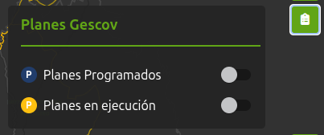
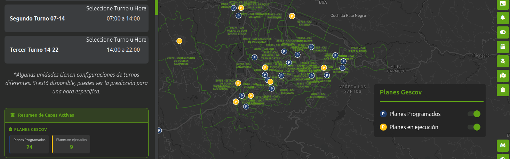
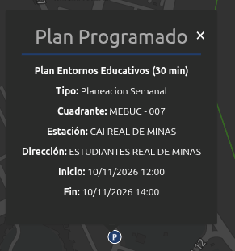

# Consulta integrada

## 1. Identificación

| Campo | Valor |
|---|---|
| ID | POL-MAPA-008 |
| Módulo | Microterritorios |
| Frecuencia de actualización | null |
| Hora de carga del Data Lake | null |
| Última actualización modulo | 05/11/2026 |
| Responsable | Null |

## 2. Descripción

Módulo que permite delimitar y gestionar microterritorios a nivel de sigla y sus unidades hijas. Cada área se dibuja sobre el mapa y se caracteriza mediante un nombre, delitos y comportamientos, clase de factores, factores de riesgo, capacidades institucionales y un periodo de análisis, con opción de adjuntar un documento de percepción de seguridad. Permite guardar, consultar, editar y eliminar los microterritorios, visualizar sus límites y revisar los análisis disponibles para apoyar la planificación y el seguimiento de las intervenciones policiales.

## 3. Ruta de Acceso

1. Ingresar al aplicativo `IAPOL`.
2. Abrir el módulo `Anticipación a Fenómenos de Seguridad`.
3. Seleccionar el submódulo `Mapa de Anticipación a Fenómenos de Seguridad`.
4. Ingresar a `Mapa`.
5. Seleccionar unidad
6. Hacer clic en el modulo `Planes Gescov`.

  

- Ruta resumida:

`Menú principal > Anticipación a Fenómenos de Seguridad > Mapa de Anticipación a Fenómenos de Seguridad > Seleccionar sigla > Modulo Planes Gescov`

## 4. Activación de la capa

1. Seleccionar una sigla o unidad hija.
2. Abrir el módulo Planes Gescov
3. Activar la opción planes programados y/o planes en ejecución.

  

5. Al activar las capas se visualizan iconos correspondientes a los planes programados y en ejecución sobre el mapa
6. Dar click en uno de los iconos despliega un pop up con la información del plan gescov, la información del plan en ejecución incluye los antecedentes consultados durante la ejecución

  

## 5. Parámetros y filtros de prueba

| Parámetro | Valor utilizado | Obligatorio |
|---|---|---|
| Sigla | Todos | SI |
| Unidades hijas | Todos | No |

## 6. Fuente de datos

### Athena 

### Oracle (bd cliente)

## 7. Validaciones funcionales

- [ ] La capa puede activarse y desactivarse.
- [ ] El detalle del punto muestra los campos definidos.
- [ ] El nombre y la descripción son correctos.
- [ ] Los filtros modifican la información mostrada.
- [ ] Los puntos aparecen en el área geográfica esperada.
- [ ] La leyenda y los colores corresponden a la capa.
- [ ] No se presentan errores al cargar la información.

## 8. Validaciones de datos

- [ ] La cantidad total coincide.
- [ ] No existen identificadores duplicados.
- [ ] Una muestra de registros coincide entre ambas fuentes.
- [ ] La cantidad mostrada en el mapa coincide con los archivos.

## 9. Criterios de aceptación

La prueba es exitosa cuando:

1. La capa carga sin errores.
2. La información corresponde al periodo seleccionado.
3. La fuente de Policía coinciden después de aplicar las reglas
   de transformación.
4. La cantidad del mapa coincide con el resultado esperado en bds.
5. No existen diferencias sin justificación documentada.

## 10. Conclusión
La capa se actualiza en producción el 29/10/2026