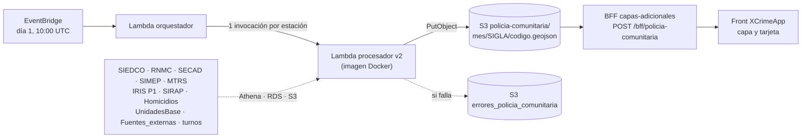

# Policía Comunitaria

## Identificación

<p align="center">

| Campo | Valor |
|---|---|
| ID | Pendiente por asignar |
| Módulo | Mapa de Anticipación a Fenómenos de Seguridad |
| Capa | Policía Comunitaria (zonas o microterritorios con la línea de participación cívica sugerida) |
| Frecuencia de actualización | Mensual: el día 1 a las 10:00 UTC (05:00 a. m. Colombia). La corrida de todo el país tarda cerca de 50 minutos |
| Mes que procesa | El mes que acaba de terminar (el 2026-11-01 procesa `2026-10`) |
| Última corrida revisada | 2026-11-01 (mes `2026-10`): 2.338 estaciones, 54 siglas, 21.487 zonas |
| Última actualización del caso | 2026-11-03 |
| Código | `pon-iapol-capas/planes_comunitarios` (motor), `pon-iapol-capas/capas_adicionales` (BFF), `pon-XCrimeApp` (front) |
| Responsable | Pendiente por confirmar |

</p>

Este documento explica de punta a punta cómo se genera, se sirve y se muestra la capa **Policía Comunitaria**: de dónde salen los datos, cómo el motor decide las zonas y la línea de participación cívica que se sugiere en cada una, cómo las consulta el front, qué se rompe con más frecuencia y cómo se arregla.

| # | Sección | Para qué sirve |
|---|---|---|
| 1 | [Descripción y lógica del componente](#1-descripción-y-lógica-del-componente) | Qué hace y cómo funciona, incluidas las reglas del motor |
| 2 | [Diagrama de arquitectura](#2-diagrama-de-arquitectura) | Cómo está construido y conectado ([arquitectura.drawio](arquitectura.drawio)) |
| 3 | [Diagnóstico de incidentes](#3-diagnóstico-de-incidentes) | Fallos comunes y soluciones |
| 4 | [Configuración y variables](#4-configuración-y-variables) | Qué necesita para funcionar |
| 5 | [Dependencias e integraciones](#5-dependencias-e-integraciones) | Con qué servicios se comunica |
| 6 | [Despliegue y actualización](#6-despliegue-y-actualización) | Cómo publicar cambios y hacer rollback |
| 7 | [Monitoreo y alertas](#7-monitoreo-y-alertas) | Cómo detectar problemas |
| 8 | [Recuperación del servicio](#8-recuperación-del-servicio) | Cómo restablecer su funcionamiento |
| 9 | [Configuración y ejecución local](#9-configuración-y-ejecución-local) | Cómo correr y validar el motor en un equipo de desarrollo |

Archivos de esta carpeta:

| Archivo | Contenido |
|---|---|
| `README.md` | Este documento |
| `arquitectura.drawio` | Diagrama de arquitectura (página 1) y flujo del procesador (página 2) |
| `SQL/1.Athena.sql` | Consultas de Athena que ejecuta el motor (SIEDCO, SECAD, SIMEP, MTRS, IRIS P1, SIRAP) |
| `SQL/2.RDS-Postgres.sql` | Consultas a la base RDS de los comparendos (RNMC) |
| `scripts/ejecutar_local.py` | Corre el motor en local para una o varias estaciones, sin escribir en producción |
| `scripts/validar_contra_mapa.py` | Compara la tarjeta de cada zona contra los puntos de las capas del mapa |
| `scripts/verificar_corrida.py` | Revisa que la corrida mensual terminó bien (cobertura, errores, fuentes caídas) |

---

## 1. Descripción y lógica del componente

### 1.1 Qué hace

Policía Comunitaria divide cada estación del país en **zonas pequeñas (microterritorios)** donde conviene hacer trabajo de participación cívica, y para cada zona sugiere **qué línea del Manual de Gestión Comunitaria ejecutar, cuándo y por qué**. Se basa en los arts. 18 a 26 del Manual (ocho líneas de participación cívica) y en los hechos de los últimos tres meses.

Cada zona trae:

- **Dónde:** el polígono de la zona y el tipo de lugar que la caracteriza (educación, vida nocturna, transporte, vía pública, etc.).
- **Qué ha pasado:** el histórico de hechos (delitos, comparendos, casos del 123, medidas de protección), los homicidios y lo que aporta cada fuente.
- **Qué hacer:** la línea principal (y hasta dos complementarias) con su actividad concreta y el artículo del Manual.
- **Cuándo:** el momento crítico (días, turno y franja de 2 horas con más hechos) y tres fechas del mes siguiente para la orden de servicio.
- **Por qué:** un texto que justifica la recomendación con cifras que se pueden ver en las capas del mapa.

El motor corre **una vez al mes**, genera **un archivo GeoJSON por estación** y lo deja en S3. El mapa no calcula nada: pide esos archivos al BFF y los dibuja.

> **Regla central de diseño: los conteos de la tarjeta son los puntos de las capas del mapa.** Si la tarjeta dice «Comparendo por consumo de drogas · 13 casos · Capa: Comportamientos contrarios a la convivencia», el usuario debe poder activar esa capa y contar 13 puntos dentro de la zona. Gran parte de la lógica de la sección 1.6.3 existe para cumplir esa regla.

### 1.2 Ruta de acceso

1. Ingresar al aplicativo `IAPOL`.
2. Abrir el módulo `Anticipación a Fenómenos de Seguridad`.
3. Seleccionar el submódulo `Mapa de Anticipación a Fenómenos de Seguridad`.
4. Ingresar a `Mapa`.

- Ruta resumida:

`Menú principal > Anticipación a Fenómenos de Seguridad > Mapa de Anticipación a Fenómenos de Seguridad`

### 1.3 Uso en el mapa

1. Elegir una unidad con `BÚSCAR UNIDAD` (estación, CAI o sigla completa). El botón de la capa solo aparece cuando hay una unidad seleccionada.
2. En el panel derecho abrir `Policía Comunitaria` (icono de escudo con usuario) y pulsar `Consultar zonas`.
3. El mapa dibuja las zonas coloreadas por tipo de lugar. El panel indica cuántas zonas se cargaron y cuántas hay de cada tipo; cada tipo se puede ocultar o mostrar.
4. Al hacer clic en una zona se abre la **tarjeta** (sección 1.8).
5. `Limpiar capa` quita las zonas del mapa.

El front pide siempre el **mes anterior al actual** según la fecha del equipo del usuario (el 3 de noviembre pide `2026-10`).

### 1.4 Componentes

| # | Componente | Dónde está | Tecnología | Qué hace |
|---|---|---|---|---|
| 1 | Disparador mensual | EventBridge `planes-comunitarios-trigger-mensual` (definido en `cdk/lib/planes-comunitarios-stack.ts`) | EventBridge | Dispara el orquestador el día 1 a las 10:00 UTC |
| 2 | Orquestador | `planes_comunitarios/lambdas/orquestador/handler.py` | Lambda Python 3.11 (zip) | Lista las estaciones de `UnidadesBase/` y lanza una invocación asíncrona del procesador por estación |
| 3 | Procesador | `planes_comunitarios/lambdas/procesador/` | Lambda en imagen Docker (Python 3.11, GeoPandas, scikit-learn) | Genera el GeoJSON de una estación |
| 3a | `handler.py` | ídem | Python | Punto de entrada. `procesar_v2` es la ruta vigente; la ruta v1 (Bedrock) es código heredado que ya no se invoca |
| 3b | `fuentes_internas.py` | ídem | Python | Lee SIMEP, MTRS, IRIS P1, SIRAP, SECAD y Análisis de homicidios con un esquema común |
| 3c | `zonificacion_v2.py` | ídem | Python | Carga hechos y sitios, zonifica, caracteriza y prioriza |
| 3d | `turnos.py` | ídem | Python | Turnos de servicio de la estación |
| 4 | Infraestructura | `cdk/lib/planes-comunitarios-stack.ts` y `cdk/config/planes_comunitarios.json` | AWS CDK (TypeScript) | Lambdas, roles IAM, grupos de logs y la regla mensual |
| 5 | BFF | `capas_adicionales/app/routers/policia_comunitaria.py` y `services/policia_comunitaria_service.py` | FastAPI en ECS Fargate detrás de un ALB | `POST /bff/policia-comunitaria`: lee los GeoJSON de S3 y los une |
| 6 | Front | `pon-XCrimeApp/src/pages/MapPage.js`, `services/api/policiaComunitariaApi.js` y `pages/MapPagePopups/PoliciaComunitariaPopup.js` | React + Mapbox GL | Botón, consulta, dibujo de las zonas, filtros y tarjeta |

> Código heredado: `zonificacion.py`, `delitos.py` y `recomendacion.py` son de la versión 1, que usaba Bedrock para redactar. El orquestador envía siempre `"version": "v2"`, así que no se ejecutan. La versión 2 no usa inteligencia artificial generativa: todos los textos salen de plantillas con las cifras de la zona.

### 1.5 Flujo de punta a punta

1. **Disparo.** El día 1 a las 10:00 UTC la regla de EventBridge invoca al orquestador sin parámetros; este calcula el mes anterior.
2. **Estaciones.** El orquestador lee los 54 archivos `UnidadesBase/{SIGLA}-UnidadesBase.geojson` y arma una invocación por cada feature con `codigo`.
3. **Invocaciones.** Lanza el procesador de forma asíncrona, en lotes de 10 por segundo. El procesador tiene concurrencia reservada de 20; Lambda reencola lo que excede.
4. **Procesamiento.** Cada invocación genera una estación (sección 1.6) y escribe `policia-comunitaria/{mes}/{SIGLA}/{codigo}.geojson` en `pon-prod-ml-iapol`.
5. **Fallo de una estación.** Si falla, deja un marcador en `utilidades/errores_policia_comunitaria/{mes}/{SIGLA}/{codigo}.json` y Lambda reintenta (sección 3).
6. **Consulta.** El usuario pulsa `Consultar zonas`; el front envía `{sigla, id_unidad[], anio_mes}` al BFF.
7. **Unión.** El BFF descarga en paralelo el archivo de cada unidad, une los `features` y responde un único GeoJSON.
8. **Dibujo.** El front pinta las zonas por `etiqueta` y abre la tarjeta al hacer clic.

### 1.6 Lógica del motor (procesador, versión 2)

Cada estación se procesa de forma independiente, en este orden (ver también la página 2 del diagrama):

1. **Polígono propio.** Se toma el polígono de la estación y se le resta el área de sus unidades dependientes (CAI, etc.) que tienen su propio archivo (`area_propia`). Así una estación y sus CAI no generan zonas repetidas sobre el mismo terreno.
2. **Sitios.** Se leen las capas de `Fuentes_externas/` de la estación (colegios, parques, comercio, transporte, bares, residencial, etc.) y cada una se clasifica en un tipo de sitio.
3. **Hechos.** Se cargan los delitos de SIEDCO y los comparendos de RNMC de la ventana.
4. **Fuentes internas.** En paralelo: SIMEP, MTRS, IRIS P1, SIRAP, SECAD y Análisis de homicidios.
5. **Turnos y antecedentes.** Turnos de la estación y hechos de los 9 meses anteriores (solo para justificar las zonas preventivas).
6. **Zonificación.** Se crean los focos de riesgo, las zonas de homicidio y las zonas preventivas.
7. **Caracterización.** Para cada zona: línea de participación cívica, etiqueta, momento crítico, programación, histórico, fuentes consultadas y justificación.
8. **Priorización y escritura.** Se eligen las zonas que se publican por estación y se escribe el archivo.

#### 1.6.1 Ventanas de tiempo

Con `mes` = el mes que se procesa (por ejemplo `2026-09`):

| Concepto | Rango | Ejemplo para `2026-09` |
|---|---|---|
| Hechos | Los 3 meses que terminan el último día de `mes` | 2026-07-01 a 2026-09-30 |
| Antecedentes (zonas preventivas) | Los 9 meses anteriores a la ventana de hechos | 2025-10-01 a 2026-06-30 |
| MTRS | 12 meses que terminan en `mes` (solo pesan los de los últimos 3) | 2025-10-01 a 2026-09-30 |
| Fechas sugeridas | Mes siguiente al procesado | octubre de 2026 |

#### 1.6.2 Fuentes y cómo se cuentan

| Fuente | Qué lee el motor | Qué cuenta | ¿Forma zonas? | Peso de la fuente |
|---|---|---|---|---|
| **SIEDCO** | Vista de Athena `vw_delitos_corregido_schema_temporal`, con la misma clasificación (categoría y subcategoría) de la capa SIEDCO del mapa. Se filtra por el rectángulo de la estación y luego por el polígono | Cada fila es un registro del mapa. Para el análisis cada **hecho** (`hechos_id`) cuenta una vez por riesgo: se conserva el registro del delito sobre el del celular o la captura. Los homicidios cuentan por víctima | Sí, salvo los registros repetidos de un hecho | 2,0 |
| **RNMC** (comparendos) | RDS `public.hechos_z1_v2` por `sigla` y `codigo_unidad` de la estación y sus dependientes | Un comparendo por fila **y por capa del mapa** (sección 1.6.3) | Sí | 1,0 |
| **SIMEP** | Athena `pon-prod-raw-disec.simep_datac` | Medidas de protección por violencia intrafamiliar | Sí | 1,5 |
| **MTRS** | Athena `pon-prod-raw-disec."usr_disec.v_mtrs_riesgo_ubicacion"` | Riesgos sociales de las mesas técnicas (12 meses) | No: da contexto | 1,5 |
| **IRIS P1** | Athena `pon-prod-raw-disec."usr_disec.v_general_irisp"` | Estructuras criminales vigentes (todas se muestran; solo pesan las reportadas en la ventana) | No | 2,0 si es reciente |
| **SIRAP** | Athena `pon-prod-raw-geopol.raw_geopol_usr_pmu_actividades` | Manifestaciones públicas | No | 1,0 |
| **SECAD** | Athena `pon-prod-capas-iapol.capa_11/12/13` por `sigla` y unidades | Casos de la línea 123: hurto violento y homicidio (11), hurto general (12) y riñas (13). **Un caso por llamada** | Sí, si el caso tiene un riesgo | 1,0 |
| **Análisis de homicidios** | `s3://pon-prod-raw-homicidios/buffer-presencia-policial/{fecha}.geojson`, un archivo por día | Un caso por `caso_id` | Sí | 2,0 |

El peso de cada evento es `peso de la fuente × peso del riesgo`. Pesos por riesgo: homicidio 3,0 · estructuras criminales 2,0 · violencia intrafamiliar y sexual 2,0 · porte de armas 1,5 · riñas y lesiones 1,5 · hurto a personas 1,2 · hurto a residencias, comercio y vehículos 1,2 · consumo de drogas 1,0 · conflictividad social 1,0 · consumo de alcohol 0,8 · desorden en espacio público 0,6 · irrespeto a la policía 0,6 · factores sociales 0,6.

**Cómo se clasifica el riesgo:**

- *SIEDCO:* estupefacientes o incautación de droga → consumo de drogas; armas → porte de armas; intrafamiliar o sexual → violencia intrafamiliar y sexual; homicidio → homicidio; lesiones → riñas y lesiones; hurto a personas, celular o bicicleta → hurto a personas; otros hurtos y extorsión → hurto patrimonial. Los accidentes de tránsito, la mercancía y los vehículos recuperados se cuentan y se muestran, pero no pesan.
- *RNMC (Ley 1801, formato `Art27-Num6`):* art. 140 num. 13 y 14 → consumo de drogas; art. 27 num. 6 → porte de armas; resto del art. 27 → riñas; art. 35 → irrespeto; art. 95 → hurto a personas (celulares con reporte de hurto); arts. 33, 92, 93, 94, 100, 101, 102, 110, 111, 124, 140, 144 y 146 → desorden en espacio público.
- *SECAD:* por el texto del motivo de la llamada (homicidio, muerto o cadáver → homicidio; violencia intrafamiliar o dificultades de pareja → violencia intrafamiliar; estupefacientes → consumo de drogas; embriaguez → consumo de alcohol; riña, lesión o disparo → riñas; hurto a personas, celular, bicicleta o atraco → hurto a personas; vehículos, residencias, comercio o abigeato → hurto patrimonial). Si el motivo no se reconoce se usa el riesgo de la capa (hurto violento → hurto a personas, hurto general → hurto patrimonial, riñas → riñas). Muerte natural, suicidio, accidente, tránsito y caso de prueba se cuentan pero no pesan.

#### 1.6.3 Los conteos son los puntos del mapa

| Fuente | Regla para que coincida con la capa |
|---|---|
| **RNMC** | El mapa tiene tres capas y cada comparendo sale en una o dos: **riñas** (artículo 27, numeral 1), **incautaciones** (`incautacion = '1'`) y **comportamientos contrarios** (`incautacion = '0'` y no es riña). Un comparendo de riña con incautación sale en las dos primeras y cuenta en las dos, como en el mapa. Además se quitan las filas con todas las columnas idénticas, como hace el mapa. Cada fila del histórico de la tarjeta indica su capa |
| **SECAD** | Una misma llamada puede quedar en varias filas que solo cambian en el motivo (por ejemplo `RIÑA` y el estado `REQUIERE PATRULLA`), el comentario o la dirección. El mapa dibuja un punto y el motor cuenta **un caso por llamada** (misma `hora_caso` y ubicación), con el motivo que describe el hecho en lugar del estado. El front aplica la misma regla en `deduplicarFeatures` (`MapPage.js`) |
| **SIEDCO** | La tarjeta muestra «N hechos (M registros en el mapa)». Los registros son los puntos de las capas SIEDCO I, II y III; los hechos son lo que usa el análisis |
| **Análisis de homicidios** | Se cuentan los puntos de la capa que caen dentro de la zona, aunque SIEDCO ya tenga el mismo hecho |
| **Zona** | Solo cuentan los hechos que caen dentro del polígono dibujado (incluido el borde) |
| **Unidades** | La estación y todas sus dependientes, como las pide el mapa (árbol `EstructuraNacionaOperativalPONAL.csv`, sin los tipos ocultos) |

**Homicidios de dos fuentes.** La capa «Análisis de homicidios» (reporte diario con la patrulla que atendió) y SIEDCO no siempre ubican el mismo homicidio en el mismo punto: cerca de 1.100 casos de la capa quedan a más de 2 km de su registro en SIEDCO. El motor cruza cada caso de la capa con los homicidios de SIEDCO de ±1 día:

| Distancia al registro de SIEDCO | Qué pasa |
|---|---|
| ≤ 100 m | Es el mismo hecho: el caso de la capa no pesa ni forma zonas (ya cuenta el de SIEDCO) |
| De 100 m a 10 km | Se cuenta donde lo muestra la capa y la tarjeta indica «En SIEDCO este caso aparece registrado a X km de este punto» |
| > 10 km o sin registro en SIEDCO | Se cuenta como homicidio nuevo y puede crear su propia zona |

Si el caso de la capa y su registro de SIEDCO caen en la misma zona, el homicidio cuenta una vez (con los datos de SIEDCO). Cada homicidio de la tarjeta dice su **fuente**.

#### 1.6.4 Zonificación

Todo se calcula en metros (EPSG:3116, MAGNA-SIRGAS Colombia Bogotá) con DBSCAN.

| Parámetro (en `zonificacion_v2.py`) | Valor | Qué controla |
|---|---|---|
| `MESES_HECHOS` | 3 | Ventana de hechos |
| `MESES_ANTECEDENTES` | 9 | Meses previos que justifican zonas preventivas |
| `FOCO_RADIO_M` | 80 m | Distancia máxima entre hechos de un mismo foco (primera pasada) |
| `FOCO_RADIO_AMPLIO_M` | 120 m | Segunda pasada, solo con los hechos que no formaron foco |
| `FOCO_MIN_HECHOS` | 20 | Hechos mínimos para que haya foco |
| `FOCO_DIAMETRO_MAX_M` | 350 m | Los focos más grandes se parten |
| `FOCO_BUFFER_M` | 40 m | Margen del polígono alrededor de los puntos |
| `HOMICIDIO_RADIO_M` | 300 m | Homicidios a menos de esta distancia forman una misma zona |
| `HOMICIDIO_BUFFER_M` | 120 m | Radio de la zona de homicidio |
| `PREV_RADIO_M` / `PREV_BUFFER_M` | 120 m / 60 m | Agrupación y margen de las zonas preventivas |
| `SITIO_RADIO_M` | 100 m | Distancia a la que un sitio se asocia a una zona |
| `MIN_FOCOS_ESTACION` / `MAX_FOCOS_ESTACION` | 12 / 30 | Focos que se publican por estación (mínimo y tope) |
| `COBERTURA_FOCOS` | 0,90 | Se agregan focos hasta cubrir este porcentaje de los hechos que están en focos |
| `MAX_PREVENTIVAS_ESTACION` | 8 | Zonas preventivas por estación |
| `HOMICIDIO_MISMO_PUNTO_M` / `HOMICIDIO_MISMO_CASO_M` | 100 m / 10 km | Cruce entre la capa de homicidios y SIEDCO |

Tres tipos de zona (`tipo_zona`):

1. **`foco_riesgo`.** Concentración de hechos que forman zonas (delitos, comparendos, medidas de protección, casos SECAD y homicidios). MTRS, IRIS P1 y SIRAP suman al riesgo pero no crean zonas.
2. **`foco_homicidio`.** Todo homicidio queda dentro de una zona (es la capa prioritaria). Los que no cayeron en un foco forman su propia zona.
3. **`preventiva`.** Alrededor de sitios (colegios, instituciones, parques, bares, comercio, transporte, residencial) que no quedaron dentro de un foco. Se justifican con los sitios que las originan y con los hechos de los 9 meses anteriores. Ríos, ciclorrutas y parques nacionales solo dan contexto.

#### 1.6.5 Línea de participación cívica

Cada zona se puntúa contra las ocho líneas del Manual:

`puntaje = 0,4 × sitio + 0,6 × riesgos × min(1, hechos / 10)`

- *sitio:* peso del mejor sitio de la línea presente cerca de la zona (a menos de 100 m).
- *riesgos:* suma de (peso del riesgo para la línea × proporción de ese riesgo en la zona).
- La línea 4 exige un colegio cerca de la zona y, si la zona tiene hechos, que los riesgos para niños, niñas y adolescentes pesen al menos 30 %. La línea 7 exige un sector residencial.
- La línea 8 (encuentros comunitarios) se activa por concurrencia de riesgos: con 4 o más riesgos relevantes (≥ 12 % cada uno) y 50 o más hechos pasa a principal; con 3 queda como complementaria.
- La principal es la de mayor puntaje; se agregan hasta 2 complementarias con al menos el 60 % del puntaje de la principal.

| Línea | Nombre | Art. del Manual | Sitio principal | Riesgos que más pesan | Días y hora de inicio de la franja de 2 h |
|---|---|---|---|---|---|
| 1 | Redes de Apoyo | 19 | Comercial | Hurto patrimonial y a personas | Lunes a sábado, entre las 08:00 y las 16:00 (horario del comercio) |
| 2 | Espacios Pedagógicos | 20 | Espacio público | Desorden, riñas, consumo | Todos los días, entre las 08:00 y las 18:00 |
| 3 | Cívica | 21 | Institucional | Irrespeto, factores sociales | Todos los días, entre las 08:00 y las 15:00 |
| 4 | Programas Escolarizados | 22 | Educativo (obligatorio) | Consumo de drogas, porte de armas, riñas | Lunes a viernes, entre las 07:00 y las 12:00 (jornada escolar) |
| 5 | Programas Específicos | 23 | Vida nocturna | Homicidio, violencia intrafamiliar, estructuras | Todos los días, entre las 06:00 y las 20:00. En zonas de vida nocturna, jueves a domingo, entre las 18:00 y las 00:00 (horario de los bares) |
| 6 | Jornadas de Prevención | 24 | Transporte | Hurto a personas | Todos los días, entre las 06:00 y las 20:00 |
| 7 | Zonas Seguras | 25 | Residencial (obligatorio) | Hurto patrimonial | Todos los días, entre las 08:00 y las 18:00 |
| 8 | Encuentros Comunitarios | 26 | Institucional | Conflictividad, homicidio | Lunes a sábado, entre las 08:00 y las 16:00 |

**Zonas con homicidio.** La línea principal la define la modalidad predominante del homicidio: sicariato, ajuste de cuentas, tortura, masacre o desaparición → línea 5; intrafamiliar, feminicidio o sexual → línea 5; riña o intolerancia → línea 2 (línea 5 si hay vida nocturna); atraco o hurto → línea 1. Con 2 o más homicidios se agrega la línea 8 (art. 26).

**Actividad.** Dentro de la línea se recomienda la sublínea con más hechos relacionados. Las sublíneas marcadas «(por validar)» no están enumeradas en el Manual y no se recomiendan.

#### 1.6.6 Etiqueta de la zona

La etiqueta define el color y el encabezado de la tarjeta. Es el sitio que justifica la línea principal; si la línea no exige sitio, el más frecuente de la zona; si no hay sitios a menos de 100 m, `via_publica`.

| Etiqueta | Texto en el mapa | Color |
|---|---|---|
| `espacio_publico` | Espacio Público | `#22c55e` |
| `vida_nocturna` | Vida Nocturna | `#a78bfa` |
| `educacion` | Educación | `#60a5fa` |
| `transporte` | Transporte | `#fbbf24` |
| `institucional` | Institucional | `#f472b6` |
| `comercial` | Comercial | `#fb923c` |
| `residencial` | Residencial | `#2dd4bf` |
| `residencial_comercial` | Residencial y Comercial | `#a3e635` |
| `rural` | Rural | `#a16207` |
| `via_publica` | Vía Pública | `#cbd5e1` |
| `otros` | Otros | `#94a3b8` |

#### 1.6.7 Programación sugerida

- **Turnos.** Los de la estación, leídos de `s3://pon-prod-ml-iapol/turnos_dinamicos/{lunes yyyyMMdd}/{SIGLA}/{estacion}/TurnoGenerado_{estacion}_{lunes}.json` (la semana del primer día del mes siguiente; si no existe, hasta 8 semanas atrás). Sin archivo se usan los tres turnos por defecto: 22:00 a 07:00, 07:00 a 14:00 y 14:00 a 22:00.
- **Momento crítico** (con 8 o más hechos con fecha): los dos días de la semana con más hechos, la franja de 2 horas con más hechos (la cuenta es circular: 23:00 a 01:00 también cuenta), su turno y qué hechos ocurren en esa franja.
- **Ejecución de la actividad:** los días del momento crítico que están dentro del horario de la línea (si alguno queda fuera, el siguiente con más hechos) y la franja de 2 horas con más hechos dentro de ese horario y de un solo turno. Con menos de 8 hechos se usa el horario típico de la línea. La tarjeta explica siempre por qué se eligieron esos días y esa franja.
- **Fechas.** Tres fechas del **mes siguiente al procesado**, una cada 10 días, alternando los días sugeridos y sin festivos de Colombia (Ley 51 de 1983). El front las muestra como «Miércoles 07 de octubre · 11:00 a 13:00».

#### 1.6.8 Priorización

Por estación se publican, en este orden de prioridad:

| Prioridad | Zonas |
|---|---|
| `alta` | Todas las zonas con homicidio; además, las 4 zonas de riesgo de mayor puntaje |
| `media` | Los demás focos publicados: mínimo 12 (o todos si hay menos), máximo 30, hasta cubrir el 90 % de los hechos que están en focos |
| `baja` | Hasta 8 zonas preventivas, alternando el tipo de sitio (colegios, parques, comercio, transporte…) |

#### 1.6.9 Privacidad

Ningún dato que identifique personas sale del motor. Por ejemplo, del reporte de homicidios solo se leen fecha, hora, ubicación, modalidad y arma; la descripción del caso, que trae nombres y cédulas, no se lee.

### 1.7 Archivo de salida

Ruta: `s3://pon-prod-ml-iapol/policia-comunitaria/{YYYY-MM}/{SIGLA}/{codigo}.geojson` (≈ 2.340 archivos y ≈ 390 MB por mes; el bucket tiene versionado).

Nivel archivo: `type`, `version` (`v2`), `codigo_estacion`, `sigla`, `mes` y `fuentes_internas` (por fuente: ventana consultada y número de eventos, o `error` si falló). Cada `feature` es un `MultiPolygon` con 38 propiedades:

| Grupo | Propiedades |
|---|---|
| Identificación | `zona_id` (`{codigo}-{n}`), `version`, `tipo_zona`, `etiqueta`, `prioridad`, `centroide_lat`, `centroide_lon`, `area_ha` |
| Lugar | `categorias`, `sitios`, `sitios_detalle` |
| Hechos | `periodo_hechos_meses`, `total_hechos`, `total_delitos`, `total_homicidios`, `hechos_homicidio`, `total_comportamientos`, `composicion_hechos`, `puntaje_riesgo`, `riesgos_sociales` |
| Histórico | `delitos_resumen`, `comparendos_resumen` (cada fila con su `capa`), `secad_resumen` (cada fila con su `capa`), `tipologia_delitos`, `delitos_ocurridos`, `comportamientos_frecuentes` |
| Homicidios | `homicidios` (fecha, hora, tipología, objeto, lugar, víctimas, `fuente` y, si aplica, `siedco_m`) |
| Otras fuentes | `fuentes_internas` (conteos por fuente), `estructuras_criminales`, `riesgos_mtrs` |
| Recomendación | `linea_principal`, `lineas_secundarias`, `sublineas`, `actividades`, `articulo_manual`, `justificacion` |
| Programación | `programacion` (turno, franja, días, fechas, momento crítico y el porqué de cada dato) |
| Preventivas | `antecedentes` (hechos del periodo anterior; solo en `tipo_zona = preventiva`) |

### 1.8 Tarjeta del front

La tarjeta (`PoliciaComunitariaPopup.js`) muestra, en este orden:

| # | Sección | Contenido |
|---|---|---|
| 1 | Histórico de hechos · últimos 3 meses | Una fila por hecho, del más frecuente al menos, con su capa del mapa. En zonas preventivas, el bloque «Antes (periodo)» con los antecedentes |
| 2 | Homicidios | Un recuadro por hecho: fecha, hora, tipología, objeto, lugar, víctimas y fuente |
| 3 | Fuentes consultadas | Lo que aporta cada fuente a la zona (SIEDCO, RNMC, SECAD, Análisis de homicidios, SIMEP, IRIS P1, SIRAP, MTRS), ordenadas por cantidad |
| 4 | Momento crítico | Días, turno y franja con más hechos y qué ocurre en ella |
| 5 | Acción recomendada | Línea principal y complementarias, actividad, justificación y artículo del Manual |
| 6 | Cuándo hacerla | Turno, franja y tres fechas para la orden de servicio, con el porqué |

Los archivos generados antes de esta versión se muestran con una tarjeta anterior (`crearCardAnterior`).

### 1.9 Servicio BFF

`POST https://addcapas.ia.policia.gov.co/bff/policia-comunitaria` con la cabecera `x-api-key`.

```json
{ "sigla": "MESOA", "id_unidad": [64685, 64689], "anio_mes": "2026-10" }
```

- Descarga en paralelo `policia-comunitaria/{anio_mes}/{SIGLA}/{id_unidad}.geojson` de cada unidad.
- Responde `status: "success"` si encontró todas, `"warning"` si faltan algunas (lista `archivos_no_encontrados`) y **404** si no encontró ninguna.
- Sin cabecera `x-api-key` responde 401. Con una clave inválida responde 500 «API key invalida» (así está implementado el middleware).
- Si se selecciona una sigla completa con más de 60 unidades (por ejemplo MEBOG), el front solo pide los hijos directos, para no cargar cientos de archivos a la vez.

---

## 2. Diagrama de arquitectura

El diagrama está en [arquitectura.drawio](arquitectura.drawio) y se abre con [diagrams.net](https://app.diagrams.net) o con draw.io Desktop. Tiene dos páginas:

| Página | Contenido |
|---|---|
| `1. Arquitectura` | Insumos, motor, salida en S3, BFF y front, con el sentido de cada conexión |
| `2. Flujo del procesador` | Los diez pasos que ejecuta el procesador por estación y la política de fallos |

Vista rápida (se muestra en GitHub, GitLab y Azure DevOps):



---

## 3. Diagnóstico de incidentes

### 3.1 Cómo diagnosticar

1. **¿Existe el archivo?** `python scripts/verificar_corrida.py --mes <mes>` dice cuántas estaciones tienen archivo, cuáles faltan y si hubo errores.
2. **¿Falló una fuente dentro de un archivo?** Con `--profundo` el mismo script lee los archivos y lista las fuentes internas caídas: ese fallo no deja marcador de error.
3. **¿La tarjeta cuadra con el mapa?** `python scripts/validar_contra_mapa.py <archivo> --sigla ... --codigo ... --mes ...` compara zona por zona contra las capas.
4. **¿Qué dice el log?** Grupo `/aws/lambda/planes-comunitarios-procesador` (solo 7 días de retención). Consultas listas en la sección 7.
5. **¿Es un dato de origen?** Las consultas de `SQL/` reproducen lo que lee el motor para una estación.

### 3.2 Catálogo de incidentes

| # | Síntoma | Causa probable | Cómo confirmarlo | Solución |
|---|---|---|---|---|
| 1 | `Consultar zonas` no pinta nada; el BFF responde 404 «Ningún id_unidad fue encontrado en S3» | No hay archivo del mes consultado para esas unidades: la corrida mensual no corrió o falló; la corrida del día 1 aún no termina; la unidad no está en `UnidadesBase` | `verificar_corrida.py --mes <mes>`; `aws s3 ls s3://pon-prod-ml-iapol/policia-comunitaria/<mes>/<SIGLA>/` | Esperar a que termine (≈ 50 min desde las 05:00); si no corrió o falló, sección 8.1 y 8.2 |
| 2 | La capa carga solo parte de las estaciones | El BFF responde `warning` con `archivos_no_encontrados`: faltan archivos de algunas unidades | Consola del navegador, respuesta de `/bff/policia-comunitaria` | Sección 8.2 |
| 3 | La capa carga y dice «0 zonas» | La estación no tiene hechos ni sitios en su polígono. Es normal: en `2026-10` fueron 239 de 2.338 estaciones | `features: []` en el archivo | Ninguna |
| 4 | Un conteo de la tarjeta no coincide con los puntos de la capa | Ver la tabla 3.3 | `validar_contra_mapa.py` | Según la causa |
| 5 | La tarjeta no tiene SECAD o RNMC en una unidad que sí los tiene en el mapa | La corrida se hizo antes de que se cargaran o corrigieran esos datos; la fuente falló durante la corrida (incidente 3.4); o los registros no tienen unidad asignada (`codigo_unidad = 0`) | `verificar_corrida.py --profundo`; consultas de `SQL/1.Athena.sql` sección 2 y de `SQL/2.RDS-Postgres.sql` sección 3 | Relanzar el mes o la sigla (sección 8.2); si no tienen unidad, ampliar los polígonos de `UnidadesBase` |
| 6 | La tarjeta muestra un homicidio que no se ve en «Análisis de homicidios» (o al revés) | Son dos fuentes. La tarjeta cuenta los de SIEDCO y los de la capa; la capa «Análisis de homicidios» solo muestra los suyos. Cada homicidio de la tarjeta dice su `Fuente`. Si es de SIEDCO se ve en las capas SIEDCO (subcategoría Homicidio) | Campo `Fuente` del recuadro del homicidio | Ninguna: es el comportamiento diseñado |
| 7 | La tarjeta muestra «En SIEDCO este caso aparece registrado a X km de este punto» | SIEDCO y el reporte diario ubican el mismo homicidio en lugares distintos | `homicidios[].siedco_m` | Ninguna; si la distancia es grande, revisar el dato en origen |
| 8 | Marcador en `utilidades/errores_policia_comunitaria/` | La estación falló. Ver la tabla 3.5 | Contenido del JSON del marcador | Según el mensaje |
| 9 | Fechas sugeridas que ya pasaron | El front pidió un mes anterior al esperado o la corrida del mes no se hizo | `anio_mes` de la petición; `mes` del archivo | Sección 8.1 |
| 10 | El BFF responde 401 o 500 «API key invalida» | Falta la cabecera `x-api-key` (401) o la clave es inválida (500) | Respuesta HTTP | Usar la clave del secreto `capas-adicionales-bff-api-key` |
| 11 | La tarjeta se ve distinta (sin secciones nuevas) | El archivo se generó con una versión anterior del motor | `version` y propiedades del archivo; `crearCardAnterior` en el front | Relanzar el mes (sección 8.1) |
| 12 | La corrida tarda más de 60 minutos o hay estaciones sin archivo pasada la hora | Athena limitando consultas simultáneas o una fuente lenta | `Throttles` y duración en CloudWatch (sección 7) | Esperar y volver a revisar; relanzar las faltantes (sección 8.2) |

### 3.3 Por qué un conteo de la tarjeta puede no coincidir con el mapa

| Causa | Qué pasa | Cómo resolverlo |
|---|---|---|
| Rango de fechas distinto | La tarjeta cuenta los 3 meses que terminan en el mes procesado; el mapa, las fechas que tenga activas | Poner en el mapa el mismo rango (para `2026-09`: 2026-07-01 a 2026-09-30) |
| Los datos cambiaron después de la corrida | SIEDCO registra con 3 o 4 días de retraso; SECAD y RNMC se recargan | Relanzar el mes (sección 8.1) |
| Un comparendo en dos capas | Una riña con incautación sale en «RNMC: Riñas» y en «RNMC: Incautaciones» y cuenta en las dos | Es el comportamiento esperado; comparar por capa |
| Llamadas SECAD repetidas | El servicio devuelve varias filas por llamada; el mapa dibuja un punto y la tarjeta cuenta uno | Verificar que el front desplegado tenga el cambio de `deduplicarFeatures` para `secad-*` |
| Hechos y registros de SIEDCO | Un hecho puede tener varios registros (varias personas o bienes): la tarjeta da «N hechos (M registros)» | Comparar los registros (M) con los puntos de las capas SIEDCO I, II y III |
| Unidades distintas | La tarjeta usa la estación y sus dependientes; si el mapa se consulta con otra selección, cambia | Seleccionar la misma unidad |
| Puntos en el borde | Cuentan los hechos que tocan el polígono, borde incluido | Contar también los del borde |
| Puntos sin coordenadas o sin unidad | No salen en el mapa ni en el motor | Consultas de `SQL/` para confirmarlos |

### 3.4 Incidente abierto: SECAD de MEVAL no se puede leer (detectado el 2026-11-03)

| Campo | Detalle |
|---|---|
| Síntoma | En la corrida del 2026-11-01 la fuente SECAD falló en **81 estaciones de MEVAL**. Esas estaciones se generaron sin casos SECAD y sin marcador de error |
| Mensaje | `HIVE_BAD_DATA: Malformed Parquet file. Field latitud's type BINARY in parquet file s3://pon-prod-raw-llamadas-unificado/homogenized/capa_11/SIGLA=MEVAL/CODIGO_UNIDAD=.../part-....parquet is incompatible with type double defined in table schema` |
| Causa | Archivos Parquet de MEVAL en `capa_11`, `capa_12` y `capa_13` guardaron `latitud` como texto (BINARY) y la tabla la define como `double`. `SELECT count(*)` funciona (no lee la columna), pero cualquier consulta que lea `latitud` falla. Origen probable: la carga de MEVAL (`secad_etl/glue/hexagon_to_capas.py`); **por confirmar** |
| Alcance | El motor (SECAD de las estaciones de MEVAL). Las capas SECAD del mapa para MEVAL consultan las mismas tablas, por lo que probablemente están afectadas (no se verificó en el mapa) |
| Confirmar | La consulta de diagnóstico al final de la sección 2 de `SQL/1.Athena.sql` falla con `HIVE_BAD_DATA` |
| Solución | Corregir el tipo de `latitud` y `longitud` (a `double`) en la carga de MEVAL y reescribir los archivos afectados; confirmar con la consulta de diagnóstico. Después relanzar las estaciones de MEVAL: `{"mes":"2026-10","siglas":["MEVAL"]}` (sección 8.2) |
| Estado | Abierto. Mientras tanto las tarjetas de MEVAL no muestran SECAD |

### 3.5 Mensajes de los marcadores de error

Los marcadores históricos (2.783 entre 2026-03-30 y 2026-10-22; ninguno desde las corridas del 26 de octubre y del 1 de noviembre) se agrupan así:

| Mensaje | Qué significa | Solución |
|---|---|---|
| `time data 'Ago-N' does not match format '%Y-%m-%d'` | Se invocó el orquestador a mano con un `mes` mal escrito. Generó 1.515 marcadores el 2026-08-19, en una carpeta `Ago` | Usar siempre `YYYY-MM` |
| `Código N no encontrado en CSV de mapeo`, `Cannot determine common CRS...`, `Can only use .str accessor with string values!` | Errores de versiones anteriores del procesador (en su mayoría de la versión 1, que ya no se ejecuta) | Ninguna: son históricos. Si reaparecen con la versión 2, tratarlos como un fallo nuevo |
| `AccessDenied ... assumed-role/planes-comunitarios-procesador-role` | El rol del procesador no puede leer un bucket nuevo | Agregar el bucket a `s3_buckets_lectura` en `cdk/config/planes_comunitarios.json` y desplegar (sección 6.2). Así se agregaron `pon-prod-raw-llamadas-unificado` y `pon-prod-raw-homicidios` |
| `TopologyException: side location conflict` | Un polígono de `UnidadesBase` se autointersecta. El motor lo repara con `make_valid` | Si reaparece, revisar el polígono de esa unidad |
| `Query Athena falló: ... internal error` | Error pasajero de Athena. El motor reintenta 2 veces | Relanzar la estación (sección 8.2) |
| `TooManyRequestsException` (Athena) | Muchas consultas simultáneas en la corrida nacional. El motor reintenta hasta 8 veces con espera creciente | Normalmente se resuelve solo |

> Un marcador viejo no significa que la estación esté mal hoy: los marcadores no se borran cuando una corrida posterior sale bien. Compare la fecha del marcador con la de la última corrida (`verificar_corrida.py` solo cuenta los escritos desde el inicio de la corrida).

### 3.6 Incidentes resueltos que explican diferencias históricas

| Fecha | Qué pasó | Cómo se resolvió |
|---|---|---|
| 2026-10 | Comparendos de la Sabana (DESAB y MESOA) sin unidad: la sigla venía de una tabla congelada y los cuadrantes nuevos quedaban con sigla vacía | La carga RNMC-to-RDS y la vista reasignan la unidad por ubicación |
| 2026-10 | SECAD no salía en Soacha ni en Zipaquirá: la sigla del caso era la del centro 123 que lo atendió, no la de la jurisdicción | El ETL de SECAD reasigna por ubicación con el servicio ETIALI (`secad_etl/README.md`) |
| 2026-10-23 | El scheduler de SECAD tenía un timeout de 3 s: duplicaba cargas y omitía `capa_16_2` | Timeout de 60 s y sin reintentos automáticos |
| 2026-10-26 | La tarjeta contaba más casos SECAD que el mapa (llamadas repetidas) | El motor cuenta un caso por llamada; el front dibuja un punto por llamada y el BFF quita las filas idénticas (`SELECT DISTINCT`, commit `5927363`) |
| 2026-10-26 | Homicidios del mapa sin zona: el motor solo leía SIEDCO | Se agregó la capa «Análisis de homicidios» como fuente |

---

## 4. Configuración y variables

### 4.1 Lambdas (verificado en AWS el 2026-11-03)

| Parámetro | Orquestador `planes-comunitarios-orquestador` | Procesador `planes-comunitarios-procesador` |
|---|---|---|
| Empaquetado | Zip, Python 3.11 | Imagen Docker (`public.ecr.aws/lambda/python:3.11`, con GDAL y GEOS) |
| Memoria | 256 MB | 3.008 MB (la última corrida usó como máximo 941 MB) |
| Tiempo máximo | 15 min | 15 min (la última corrida: promedio 22 s, p95 27 s, máximo 39 s por estación) |
| Concurrencia reservada | No | 20 |
| Variables de entorno | Ninguna | `RDS_SECRET_NAME` |
| Red | Sin VPC | Sin VPC |
| Reintentos asíncronos | Valores por defecto de Lambda | Valores por defecto (2 reintentos y 6 horas de edad máxima); **sin cola de mensajes fallidos (DLQ) ni destino de fallos** |
| Logs | `/aws/lambda/planes-comunitarios-orquestador`, 7 días | `/aws/lambda/planes-comunitarios-procesador`, 7 días |

### 4.2 Archivo de configuración del stack

`cdk/config/planes_comunitarios.json`:

| Clave | Valor | Uso |
|---|---|---|
| `namespace_backend` | `planes-comunitarios` | Prefijo de los nombres de recursos |
| `orquestador.memory_size` / `timeout_minutes` | 256 / 15 | Orquestador |
| `procesador.memory_size` / `timeout_minutes` / `reserved_concurrency` | 3008 / 15 / 20 | Procesador |
| `iam_policies.s3_buckets` | `pon-prod-ml-iapol`, `pon-prod-raw-siedco-delitos-temporal`, `aws-athena-query-results-926162397524-us-east-1` | Lectura y escritura |
| `iam_policies.s3_buckets_lectura` | `pon-prod-panorama-nacional`, `pon-prod-raw-disec`, `pon-prod-raw-geopol`, `pon-prod-raw-simep`, `pon-prod-raw-llamadas-unificado`, `pon-prod-raw-homicidios` | Solo lectura (datos de las tablas que consulta Athena y archivos de homicidios) |
| `rds.secret_name` / `secret_arn` | Secreto de las credenciales del clúster RDS | El procesador lee los comparendos |
| `account_id` / `region` | `926162397524` / `us-east-1` | Cuenta PON-PROD |

### 4.3 Permisos del rol del procesador

| Servicio | Permisos | Para qué |
|---|---|---|
| S3 | Leer, escribir y borrar en `s3_buckets`; leer en `s3_buckets_lectura` | Insumos, resultados y datos de Athena |
| Athena | `StartQueryExecution`, `GetQueryExecution`, `GetQueryResults`, `StopQueryExecution` | Consultas de SIEDCO y fuentes internas |
| Glue | `GetTable`, `GetPartitions`, `GetDatabase` | Catálogo para Athena |
| Secrets Manager | `GetSecretValue`, `DescribeSecret` sobre el secreto de RDS | Comparendos |
| Bedrock | `InvokeModel`, `ListFoundationModels` | Solo la versión 1 (heredada); la versión 2 no lo usa |

El orquestador solo tiene `s3:ListBucket` y `s3:GetObject` sobre los buckets de la lista y permiso para invocar al procesador.

### 4.4 Evento de entrada

| Función | Evento | Notas |
|---|---|---|
| Orquestador | `{}` (cron) o `{"mes": "YYYY-MM", "siglas": ["MEVAL"]}` | Sin `mes` procesa el mes anterior. `siglas` es opcional |
| Procesador | `{"codigo_estacion": 64779, "sigla": "DESAB", "mes": "2026-09", "geojson_key": "UnidadesBase/DESAB-UnidadesBase.geojson", "version": "v2"}` | Lo arma el orquestador; también sirve para relanzar una estación |

### 4.5 Rutas en S3 (bucket `pon-prod-ml-iapol`)

| Ruta | Quién la escribe | Contenido |
|---|---|---|
| `UnidadesBase/{SIGLA}-UnidadesBase.geojson` | Proceso externo a este módulo | Polígonos de las unidades. El orquestador lee de aquí las estaciones |
| `Fuentes_externas/` | Proceso externo | Capas de sitios por estación (`{tipo}_{codigo}.geojson`) |
| `EstructuraNacionaOperativalPONAL.csv` | Proceso externo | Árbol de unidades (estación → dependientes) |
| `turnos_dinamicos/{lunes}/{SIGLA}/{estacion}/TurnoGenerado_*.json` | Backend `XCrimeAppServicios` | Turnos de servicio |
| `policia-comunitaria/{YYYY-MM}/{SIGLA}/{codigo}.geojson` | **Procesador** | Resultado |
| `utilidades/errores_policia_comunitaria/{mes}/{SIGLA}/{codigo}.json` | **Procesador** | Marcador de error |
| `utilidades/respaldo_policia_comunitaria_vN/` | Manual | Copias previas a corridas nacionales (hoy existen v1 a v10) |

Athena deja los CSV de resultado de las consultas del motor en `s3://aws-athena-query-results-926162397524-us-east-1/planes-comunitarios-v2/`.

### 4.6 BFF `capas-adicionales-bff`

`cdk/config/capas_adicionales.json`: variables relevantes para esta capa.

| Variable | Valor | Uso |
|---|---|---|
| `POLICIA_COMUNITARIA_BUCKET_S3` | `pon-prod-ml-iapol` | Bucket de donde lee los GeoJSON |
| `BACKEND_API_KEY_SECRET_NAME` | `capas-adicionales-bff-api-key` | Secreto con la clave que se valida en `x-api-key` |
| `AWS_DEFAULT_REGION` | `us-east-1` | Región |
| Servicio ECS | 1 vCPU, 4 GiB, 1 tarea (mínimo 1, máximo 10) | Capacidad |
| Dominio | `addcapas.ia.policia.gov.co` | Detrás de un ALB |

### 4.7 Front

| Elemento | Dónde | Detalle |
|---|---|---|
| URL del BFF y clave | `pon-XCrimeApp/src/file.config.js` (`Capas_API_URL`, `Capas_API_Key`) | La clave va en la cabecera `x-api-key` |
| Límite de unidades | `MAX_UNIDADES_POLICIA_COMUNITARIA = 60` en `fetchPoliciaComunitaria` (`MapPage.js`) | Con más de 60 unidades se piden solo los hijos directos |
| Colores y textos | `ETIQUETA_CONFIG` en `PoliciaComunitariaPopup.js` y la expresión `match` de `addPoliciaComunitariaToMap` en `MapPage.js` | Hay que cambiar los dos lugares para agregar una etiqueta |
| Variables de entorno de la app | `.env` (Keycloak, RNMC, logs) | No hay variables propias de esta capa |

---

## 5. Dependencias e integraciones

### 5.1 Servicios de los que depende el motor

| Servicio | Qué usa el motor | Tipo | Si falla |
|---|---|---|---|
| **S3 `pon-prod-ml-iapol`** | `UnidadesBase/`, `Fuentes_externas/`, `EstructuraNacionaOperativalPONAL.csv`, `turnos_dinamicos/` y la salida | Lectura y escritura | Sin `UnidadesBase` no hay estaciones; sin sitios no hay zonas preventivas; sin turnos se usan los por defecto; sin escritura no hay resultado (error) |
| **Athena** (workgroup `primary`) | SIEDCO y las fuentes internas | Lectura | SIEDCO: falla la estación. Fuente interna: se registra y la estación sigue sin esa fuente |
| **RDS PostgreSQL** (`public.hechos_z1_v2`) | Comparendos (RNMC) | Solo lectura | Falla la estación (marcador de error) |
| **Secrets Manager** | Credenciales de RDS | Lectura | Falla la estación |
| **S3 `pon-prod-raw-homicidios`** | Reporte diario de homicidios (`buffer-presencia-policial/{fecha}.geojson`) | Solo lectura | Fuente interna: se registra y sigue; un día sin archivo se omite |
| **S3 `pon-prod-raw-llamadas-unificado`** | Datos de SECAD (a través de Athena) | Solo lectura | Fuente interna: se registra y sigue |
| **CloudWatch Logs** | Logs de las Lambdas | Escritura | Sin logs; el motor funciona |

### 5.2 De dónde llegan los datos (procesos previos)

| Dato | Proceso que lo deja disponible | Documentación |
|---|---|---|
| SIEDCO | Glue `pon-prod-full-siedco-motivospolicia-temporal` (01:00) → S3 → vista `vw_delitos_corregido_schema_temporal` | [SIEDCO](../FuentesInternas/SIEDCO/README.md) |
| RNMC | Glue `RNMC-to-RDS` (diario, 09:00 Bogotá) → `public.hechos_z1_v2`. Reasigna por ubicación los comparendos sin unidad | `SQL/2.RDS-Postgres.sql` |
| SECAD | EventBridge `pon-prod-capas-scheduler` (04:00 Colombia) → Lambda `pon-prod-scheduler-capas-secad` → Glue `pon-prod-capas-secad-etl` (reasigna la unidad con ETIALI) → S3 → crawler (04:30) | `pon-iapol-capas/secad_etl/README.md` |
| SIMEP | Athena `pon-prod-raw-disec.simep_datac` | [SIMEP](../FuentesInternas/SIMEP/README.md) |
| MTRS | Athena `pon-prod-raw-disec."usr_disec.v_mtrs_riesgo_ubicacion"` | [MTRS](../FuentesInternas/MTRS/README.md) |
| IRIS P1 | Athena `pon-prod-raw-disec."usr_disec.v_general_irisp"` | [IRIS P1](../FuentesInternas/IRISP1/README.md) |
| SIRAP | Athena `pon-prod-raw-geopol.raw_geopol_usr_pmu_actividades` | [SIRAP](../FuentesInternas/SIRAP/README.md) |
| Análisis de homicidios | Job Fargate de `capa_analisis_homicidios` (un GeoJSON por día en `buffer-presencia-policial/`) y servicio `analisis.homicidios.ia.policia.gov.co` | [Homicidios](../Homicidios/homicidios_del_dia.md) |
| Unidades, sitios y turnos | Procesos externos a este módulo | Sección 4.5 |

El motor lee las tablas de origen directamente (no los GeoJSON del mapa) con los mismos filtros que las capas del mapa, para que los conteos coincidan.

### 5.3 Servicios que dependen del motor

| Servicio | Qué usa | Impacto si falta el archivo del mes |
|---|---|---|
| BFF `capas-adicionales` | Lee `policia-comunitaria/{mes}/{SIGLA}/{codigo}.geojson` | Responde `warning` o 404 |
| Front `pon-XCrimeApp` | Consulta al BFF | La capa no se dibuja. **No hay respaldo automático al mes anterior** |

### 5.4 Capas del mapa con las que debe coincidir

| Capa | Servicio | Nota |
|---|---|---|
| RNMC: Riñas, RNMC: Incautaciones, Comportamientos contrarios a la convivencia | BFF `POST /bff/{capa}` | Cada fila del histórico de la tarjeta es de una de estas capas |
| SECAD: Riñas, SECAD: Hurto violento y homicidio, SECAD: Hurto general | BFF `POST /bff/{capa}` | Un punto por llamada |
| SIEDCO I, II y III | `XCrimeAppServicios` (`externalLayers/get/{id}`) | Ver [SIEDCO](../FuentesInternas/SIEDCO/README.md) |
| Análisis de homicidios | `analisis.homicidios.ia.policia.gov.co/bff/analisis-homicidios` | Servicio propio con otra clave |

---

## 6. Despliegue y actualización

### 6.1 Qué se despliega y cómo

| Componente | Cómo se despliega | Quién |
|---|---|---|
| Motor (Lambdas, IAM, regla) | `cdk deploy planes-comunitarios-stack` desde `pon-iapol-capas/cdk`. No hay pipeline automático | Equipo de desarrollo |
| BFF | CDK, stack `capas-adicionales-bff`. Solo cambia si cambia el servicio | Equipo de desarrollo |
| Front | Pipeline de CodePipeline descrito en `pon-XCrimeApp/Cloudformation/codePipeLine.yml`: construye con `buildspec.yml` y copia `build/` a `s3://xcrime-{rama}-bucket-build/XCrimeAppCapa/` | Equipo del front |
| Insumos (`UnidadesBase`, `Fuentes_externas`, turnos) | Procesos externos | Otros equipos |

### 6.2 Actualizar el motor

Es la actualización más frecuente. **El cambio no afecta a las tarjetas del mes vigente hasta que se relance ese mes**: los archivos ya generados conservan la lógica anterior hasta la corrida del mes siguiente.

1. **Probar en local** (sección 9): correr 2 o 3 estaciones representativas (por ejemplo `DESAB 64779`, `MESOA 64689` y `MEBOG 3253`) y pasar `validar_contra_mapa.py`.
2. **Preparar el despliegue:** Docker Desktop encendido (la imagen se construye en el equipo) y credenciales del perfil `PON-PROD-Policia-Nacional-IA`.
3. **Revisar los cambios:**

   ```bash
   cd pon-iapol-capas/cdk
   npx cdk diff planes-comunitarios-stack --exclusively
   ```

   Debe mostrar solo la imagen del procesador y, si cambió, la política IAM. Cualquier otro cambio hay que entenderlo antes de seguir.
4. **Desplegar** (entre 1 y 3 minutos):

   ```bash
   npx cdk deploy planes-comunitarios-stack --exclusively --require-approval never
   ```

   Sin `--exclusively` CDK intentaría desplegar también los stacks de los que depende.
5. **Respaldar la corrida actual** antes de cualquier corrida nacional. Usar el siguiente número libre (hoy existen v1 a v10):

   ```bash
   aws s3 sync s3://pon-prod-ml-iapol/policia-comunitaria/2026-10/ s3://pon-prod-ml-iapol/utilidades/respaldo_policia_comunitaria_v11/2026-10/
   ```

6. **Prueba de humo en producción** con dos estaciones:

   ```bash
   aws lambda invoke --function-name planes-comunitarios-procesador --cli-read-timeout 900 \
     --cli-binary-format raw-in-base64-out \
     --payload '{"codigo_estacion":64779,"sigla":"DESAB","geojson_key":"UnidadesBase/DESAB-UnidadesBase.geojson","mes":"2026-10","version":"v2"}' salida.json
   ```

   La respuesta debe ser `{"statusCode": 200, "output": "...", "zonas": N}`.
7. **Corrida nacional** (≈ 50 minutos):

   ```bash
   aws lambda invoke --function-name planes-comunitarios-orquestador --invocation-type Event \
     --cli-binary-format raw-in-base64-out --payload '{"mes":"2026-10"}' salida.json
   ```

8. **Verificar** (cuando pasen unos 50 minutos desde el lanzamiento, en UTC):

   ```bash
   python scripts/verificar_corrida.py --mes 2026-10 --desde 2026-11-03T15:00:00Z --profundo
   ```

9. **Validar en el mapa** y registrar el cambio en un commit.

> En PowerShell, el `--payload` con comillas se pasa mejor desde un archivo: `--payload file://evento.json`.

### 6.3 Actualizar el BFF

El BFF no necesita cambios cuando cambia el motor, porque solo une archivos. Si se modifica `capas_adicionales`, se despliega su stack con CDK (`npx cdk deploy capas-adicionales-bff --exclusively`, desde `pon-iapol-capas/cdk`; el nombre del stack es el `namespace_backend` de `cdk/config/capas_adicionales.json`; no se ejecutó al preparar este documento) y se prueba con una petición a `/bff/policia-comunitaria`.

### 6.4 Actualizar el front

1. Probar en local (sección 9.4).
2. Hacer el commit en la rama que dispara el pipeline.
3. El pipeline construye con `npm run build` (Node 14 en `buildspec.yml`) y copia el resultado al bucket de build.
4. Limpiar la caché del navegador y comprobar la capa con una estación conocida.

### 6.5 Rollback

| Qué | Cómo |
|---|---|
| **Código del motor** | Volver al commit anterior de `planes_comunitarios/` y `cdk/config/planes_comunitarios.json` y repetir el despliegue (6.2, pasos 3 y 4). La Lambda no tiene versiones ni alias: el rollback es un nuevo despliegue. Si el despliegue falla, CloudFormation revierte solo |
| **Datos de un mes** | Restaurar desde el respaldo manual: `aws s3 sync s3://pon-prod-ml-iapol/utilidades/respaldo_policia_comunitaria_vN/<mes>/ s3://pon-prod-ml-iapol/policia-comunitaria/<mes>/` |
| **Un archivo** | El bucket tiene versionado: `aws s3api list-object-versions --bucket pon-prod-ml-iapol --prefix policia-comunitaria/<mes>/<SIGLA>/<codigo>.geojson` y `aws s3api copy-object --bucket pon-prod-ml-iapol --key <la misma ruta> --copy-source "pon-prod-ml-iapol/<ruta>?versionId=<id>"`. Por ejemplo, `policia-comunitaria/2026-09/MESOA/64689.geojson` tiene 26 versiones |
| **BFF** | Redesplegar el commit anterior de `capas_adicionales` |
| **Front** | Volver al commit anterior y dejar que el pipeline lo publique |

El bucket no tiene reglas de ciclo de vida: las versiones antiguas se conservan.

### 6.6 Lista de verificación después de un despliegue

- [ ] `cdk diff` mostró solo lo esperado.
- [ ] Respaldo creado (`respaldo_policia_comunitaria_vN`).
- [ ] La prueba de humo de dos estaciones devolvió 200.
- [ ] La corrida nacional terminó y `verificar_corrida.py` no reporta FALLA.
- [ ] `validar_contra_mapa.py` sin diferencias en las estaciones de muestra.
- [ ] El front despliega los cambios que dependen del nuevo archivo (si los hay).
- [ ] Commit hecho.

---

## 7. Monitoreo y alertas

### 7.1 Qué existe hoy

> **No hay alarmas ni notificaciones configuradas para este componente.** El stack no crea alarmas de CloudWatch ni temas SNS, la Lambda no tiene cola de fallos y `monitoreo-datos-ponal` no incluye un monitor para Policía Comunitaria. Hoy los fallos se detectan revisando.

| Señal | Dónde | Qué dice |
|---|---|---|
| Archivos del mes | `s3://pon-prod-ml-iapol/policia-comunitaria/{mes}/` | Cuántas estaciones se generaron y cuándo |
| Marcadores de error | `utilidades/errores_policia_comunitaria/{mes}/` | Una estación falló (no se borran) |
| Fuentes caídas | Dentro de cada archivo: `fuentes_internas.{fuente}.error` | La estación se generó sin esa fuente |
| Logs | `/aws/lambda/planes-comunitarios-*` (7 días) | Detalle de cada invocación |
| Métricas de Lambda | CloudWatch `AWS/Lambda` para `planes-comunitarios-procesador` | `Invocations`, `Errors`, `Throttles`, `Duration` |

### 7.2 Valores normales de una corrida (2026-11-01, mes `2026-10`)

| Medida | Valor |
|---|---|
| Hora de inicio y fin | 10:00 a 10:49 UTC (05:00 a 05:49 Colombia) |
| Estaciones y siglas | 2.338 estaciones en 54 siglas |
| Archivos | 2.338, 388 MB en total |
| Invocaciones del procesador | 2.338 |
| Errores de la Lambda | 0 |
| Duración por estación | Promedio 22 s, p95 27 s, máximo 39 s |
| Memoria usada | Máximo 941 MB de 3.008 |
| Invocaciones limitadas (`Throttles`) | ≈ 10.400: es normal, la concurrencia reservada es 20 y Lambda las reintenta |
| Zonas | 21.487; 239 estaciones sin zonas |

### 7.3 Revisión automatizada

```bash
python scripts/verificar_corrida.py --mes 2026-10 --profundo
```

Salida de la corrida del 2026-11-01:

```text
[OK   ] las 2338 estaciones tienen archivo
[OK   ] todos los archivos se escribieron durante la corrida
[INFO ] escritura de 10:00 a 10:49 UTC (49 min), 388 MB en total
[OK   ] sin marcadores de error en utilidades/errores_policia_comunitaria/ desde el inicio de la corrida
[OK   ] 2338 invocaciones del procesador (estaciones esperadas: 2338)
[OK   ] 0 errores de la Lambda procesador
[INFO ] 10391 invocaciones limitadas por concurrencia (esperado: ...)
[INFO ] 21487 zonas en total; 239 estaciones sin zonas (normal si no hay hechos ni sitios)
[AVISO] fuente secad falló en 81 estaciones de MEVAL (ej. 51046): Query Athena falló: FAILED — HIVE_BAD_DATA: Malformed Parquet file...

TOTAL: 9 | 5 OK | 1 aviso | 0 falla
```

Usa los estados `OK`, `AVISO`, `FALLA` e `INFO` de los demás monitores del proyecto (`monitoreo-datos-ponal`). Código de salida: 0 si no hay `FALLA`, 1 si la hay.

### 7.4 Consultas de CloudWatch Logs Insights

Sobre el grupo `/aws/lambda/planes-comunitarios-procesador`, con el rango de la corrida (los logs duran 7 días):

```text
# Duración y memoria por estación
filter @type = "REPORT"
| stats count() as invocaciones, avg(@duration)/1000 as seg_prom, pct(@duration, 95)/1000 as seg_p95,
        max(@duration)/1000 as seg_max, max(@maxMemoryUsed)/1000000 as mb_max
```

```text
# Errores agrupados por mensaje
filter @message like /ERROR|Task timed out|Traceback/
| parse @message /(?<msg>(ERROR|Traceback|Task timed out).{0,160})/
| stats count() as n by msg
| sort n desc
| limit 12
```

```text
# Fuentes internas caídas (la estación se generó sin ellas)
filter @message like /no disponible/
| fields @message
| limit 200
```

En git-bash, para consultar logs desde la CLI, anteponer `MSYS_NO_PATHCONV=1` a los comandos que reciben rutas como `/aws/lambda/...`.

### 7.5 Alertas recomendadas (no implementadas)

| Alerta | Señal | Umbral sugerido |
|---|---|---|
| La corrida mensual no se disparó | `Invocations` del orquestador sin datos el día 1 | Sin invocación a las 10:30 UTC |
| Estaciones que fallan | `Errors` del procesador | Mayor que 0 en la ventana de la corrida |
| Corrida incompleta | Archivos del mes frente a estaciones esperadas | Menos del 100 % a las 11:30 UTC (se puede ejecutar la lógica de `verificar_corrida.py` en una Lambda programada) |
| Fuente caída | Texto «no disponible» en los logs | Cualquier ocurrencia (filtro de métrica) |
| Marcadores nuevos | Evento de S3 sobre `utilidades/errores_policia_comunitaria/` | Cualquier objeto nuevo |
| Fallos sin rastro | Destino de fallos o DLQ en el procesador | Cualquier mensaje |
| BFF | `HTTPCode_Target_5XX_Count` y tiempo de respuesta del ALB; CPU y memoria de ECS | 5xx mayores que 0 sostenidos |

---

## 8. Recuperación del servicio

Tiempos de referencia: una estación tarda entre 20 y 45 segundos; el país completo, unos 50 minutos; un despliegue del motor, entre 1 y 3 minutos.

### 8.1 La corrida mensual no corrió o falló por completo

1. Confirmar con `verificar_corrida.py --mes <mes>` y revisar el estado de la regla mensual, que debe estar `ENABLED` con `cron(0 10 1 * ? *)`:

   ```bash
   aws events describe-rule --name planes-comunitarios-trigger-mensual --query '{estado:State,cron:ScheduleExpression}'
   ```

2. Si hubo un cambio reciente de código, hacer primero la prueba de humo (sección 6.2, paso 6).
3. Relanzar:

   ```bash
   aws lambda invoke --function-name planes-comunitarios-orquestador --invocation-type Event \
     --cli-binary-format raw-in-base64-out --payload '{"mes":"2026-10"}' salida.json
   ```

4. Verificar con `verificar_corrida.py --mes <mes> --desde <hora del relanzamiento en UTC>`.

La corrida sobrescribe los archivos del mes y no hay que borrar nada antes.

### 8.2 Faltan estaciones, una sigla o una sola estación

- **Una sigla** (por ejemplo después de arreglar una fuente de MEVAL):

  ```bash
  aws lambda invoke --function-name planes-comunitarios-orquestador --invocation-type Event \
    --cli-binary-format raw-in-base64-out --payload '{"mes":"2026-10","siglas":["MEVAL"]}' salida.json
  ```

- **Una estación** (la invocación es síncrona y devuelve el resultado):

  ```bash
  aws lambda invoke --function-name planes-comunitarios-procesador --cli-read-timeout 900 \
    --cli-binary-format raw-in-base64-out \
    --payload '{"codigo_estacion":51046,"sigla":"MEVAL","geojson_key":"UnidadesBase/MEVAL-UnidadesBase.geojson","mes":"2026-10","version":"v2"}' salida.json
  ```

### 8.3 Una fuente de datos estaba caída durante la corrida

1. Identificar la fuente y las estaciones con `verificar_corrida.py --profundo`.
2. Arreglar el dato en origen (por ejemplo, el incidente 3.4) y confirmarlo con la consulta de `SQL/1.Athena.sql`.
3. Relanzar solo las siglas afectadas (8.2).
4. Volver a correr `verificar_corrida.py --profundo`: el aviso debe desaparecer.

### 8.4 Se publicaron datos incorrectos

1. Si ya hay un respaldo del mes, restaurarlo (sección 6.5, «Datos de un mes»).
2. Si no, restaurar los archivos afectados desde las versiones de S3 (sección 6.5, «Un archivo»).
3. Corregir la causa y relanzar el mes.

### 8.5 El BFF no responde

El BFF no guarda estado: solo lee de S3. Revisar el servicio de ECS y el ALB de `capas-adicionales-bff`; si la tarea está caída, forzar un nuevo despliegue del servicio o redesplegar el stack. Mientras tanto el resto de las capas del mapa que usan el mismo BFF (RNMC, SECAD) también fallan.

### 8.6 El front no pinta la capa

1. Abrir la consola del navegador y revisar la respuesta de `/bff/policia-comunitaria` (404, `warning`, 401 o 500).
2. Si el BFF responde bien, revisar que el despliegue del front sea el esperado y limpiar la caché.
3. Si el último despliegue del front causó el problema, volver al commit anterior (sección 6.5).

---

## 9. Configuración y ejecución local

### 9.1 Requisitos

| Requisito | Detalle |
|---|---|
| Python | 3.11 (el de la Lambda). El motor también se probó con 3.10.6 |
| Dependencias | `planes_comunitarios/lambdas/procesador/requirements.txt`: geopandas, scikit-learn, scipy, shapely, pandas, numpy, boto3, python-dateutil, pyarrow, pyproj, SQLAlchemy y psycopg2-binary |
| AWS CLI y credenciales | Perfil `PON-PROD-Policia-Nacional-IA` de la cuenta PON-PROD. El motor local solo **lee** (S3, Athena y RDS) |
| Red | Acceso al RDS de los comparendos (el host del secreto de Secrets Manager) |
| Repositorios | `pon-iapol-capas` (motor) y, para el front, `pon-XCrimeApp` |

### 9.2 Instalación

En PowerShell, desde la carpeta de `pon-iapol-capas`:

```powershell
py -3.11 -m venv .venv
.\.venv\Scripts\Activate.ps1
pip install -r planes_comunitarios\lambdas\procesador\requirements.txt
```

Versiones con las que se verificaron los scripts de esta carpeta (Python 3.10.6): geopandas 1.0.1, shapely 2.0.7, pandas 2.2.3, scikit-learn 1.7.2, pyproj 3.7.0 y SQLAlchemy 2.0.0. La Lambda usa las versiones fijadas en `requirements.txt`.

### 9.3 Credenciales

La forma verificada, en git-bash:

```bash
eval $(aws configure export-credentials --profile PON-PROD-Policia-Nacional-IA --format env)
unset AWS_PROFILE
```

Si el perfil usa inicio de sesión único, primero `aws sso login --profile PON-PROD-Policia-Nacional-IA`. Las credenciales exportadas caducan: si un script falla con `ExpiredToken`, repetir el comando.

### 9.4 Ejecutar el motor en local

El script `scripts/ejecutar_local.py` hace lo mismo que el procesador, pero guarda el resultado en una carpeta local y **no escribe en producción**:

```bash
# Una estación
python scripts/ejecutar_local.py --sigla DESAB --mes 2026-10 --codigos 64779 --repo <ruta a pon-iapol-capas>

# Todas las estaciones de una sigla
python scripts/ejecutar_local.py --sigla MESOA --mes 2026-10 --repo <ruta a pon-iapol-capas>
```

- `--repo` puede omitirse si existe la variable de entorno `PON_IAPOL_CAPAS` o si `pon-iapol-capas` es una carpeta hermana de un directorio padre del script.
- El resultado queda en `./salida_local/{SIGLA}/{codigo}.geojson` (cambiar con `--salida`).
- Una estación tarda unos 45 segundos; imprime las zonas por tipo y los eventos de cada fuente (o `ERROR` si una fuente falló).
- Se puede abrir el GeoJSON en [geojson.io](https://geojson.io) o en QGIS.

Ejemplo (Zipaquirá, mes `2026-10`):

```text
DESAB 64779: 30 zonas {'foco_riesgo': 20, 'foco_homicidio': 2, 'preventiva': 8} en 44 s | simep=41 mtrs=0 iris_p1=22 sirap=0 secad=35 analisis_homicidios=3 -> salida_local\DESAB\64779.geojson
```

Aviso conocido e inocuo en Windows: `UserWarning: Could not find the number of physical cores...`. Se silencia con la variable `LOKY_MAX_CPU_COUNT`.

### 9.5 Validar contra las capas del mapa

```bash
export CAPAS_API_KEY=<clave del secreto capas-adicionales-bff-api-key>
export HOMICIDIOS_API_KEY=<clave del servicio de análisis de homicidios>     # opcional
python scripts/validar_contra_mapa.py salida_local/DESAB/64779.geojson \
  --sigla DESAB --codigo 64779 --mes 2026-10 --repo <ruta a pon-iapol-capas>
```

Compara, por zona, los comparendos de cada capa RNMC, los casos de cada capa SECAD y (con la segunda clave) los homicidios de la capa de análisis contra los puntos que devuelven hoy los servicios, aplicando la misma limpieza de repetidos que el front. Las claves no se guardan en el repositorio.

```text
Estación 64779 (DESAB), unidades [64779, 75548], del 2026-08-01 00:00:00 al 2026-10-31 23:59:00
  RNMC: Riñas: 94 puntos del servicio, 94 que dibuja el mapa
  ...
  SECAD: Riñas: 76 puntos del servicio, 29 que dibuja el mapa
  Análisis de homicidios: 3176 casos del país en el rango

30 zonas revisadas · 0 diferencias
```

Termina con código 0 si no hay diferencias y 1 si las hay (cada una se imprime con la zona y la capa).

### 9.6 Reproducir un conteo con SQL

Los archivos `SQL/1.Athena.sql` y `SQL/2.RDS-Postgres.sql` tienen las consultas del motor con una estación de ejemplo. Se pueden ejecutar en la consola de Athena (base de datos indicada en cada una) o con cualquier cliente de PostgreSQL para RDS.

### 9.7 Verificar una corrida

```bash
python scripts/verificar_corrida.py --mes 2026-10 --profundo
```

Ver la sección 7.3.

### 9.8 Front en local

```bash
cd pon-XCrimeApp
yarn install        # o npm install
yarn start          # o npm start
```

- Requiere Node 16 o superior según el README del front (el pipeline usa Node 14) y el archivo `.env` con las variables de Keycloak, RNMC y logs.
- El front local usa los servicios de producción: `Capas_API_URL` y `Capas_API_Key` de `src/file.config.js`. Para ver la capa hay que iniciar sesión, seleccionar una unidad y pulsar `Consultar zonas`.
- Opcional, para probar un archivo generado en local sin pasar por el BFF: reemplazar temporalmente `response.data?.geojson` en `fetchPoliciaComunitaria` (`MapPage.js`) por el contenido de un GeoJSON de `salida_local` (no dejar ese cambio en el commit).

### 9.9 BFF en local

Según el README de `capas_adicionales` (no se ejecutó al preparar este documento):

```bash
cd pon-iapol-capas/capas_adicionales
pip install poetry
poetry install
# credenciales de AWS en el entorno
uvicorn app.main:app --host 0.0.0.0 --port 8000 --reload
```

Probar `POST http://localhost:8000/bff/policia-comunitaria` con la cabecera `x-api-key` (del secreto `capas-adicionales-bff-api-key`) y el cuerpo de la sección 1.9. Necesita las variables de `backend_env` de `cdk/config/capas_adicionales.json`, entre ellas `POLICIA_COMUNITARIA_BUCKET_S3` (por defecto `pon-prod-ml-iapol`).

---

## Anexo A. Glosario

| Término | Significado |
|---|---|
| Microterritorio / zona | Polígono pequeño donde se sugiere una línea de participación cívica |
| Foco de riesgo | Zona creada por una concentración de hechos |
| Zona de homicidio | Zona creada alrededor de un homicidio que no cayó en un foco |
| Zona preventiva | Zona creada alrededor de sitios de concentración de personas, sin hechos que la expliquen o con pocos |
| Etiqueta | Tipo de lugar de la zona; define el color y el encabezado de la tarjeta |
| Línea de participación cívica | Una de las ocho líneas del Manual de Gestión Comunitaria (arts. 19 a 26) |
| Momento crítico | Días, turno y franja de 2 horas con más hechos en la zona |
| Hecho y registro | En SIEDCO un hecho puede tener varios registros; el análisis cuenta hechos y el mapa dibuja registros |
| Mes procesado | Mes que termina la ventana de hechos; las fechas sugeridas caen en el mes siguiente |
| Sigla | Código de la unidad mayor (MEBOG, MESOA, DESAB…) |
| ETIALI | Servicio que asigna la unidad a un punto por su ubicación |

## Anexo B. Referencias

- [SIEDCO](../FuentesInternas/SIEDCO/README.md) · [SIMEP](../FuentesInternas/SIMEP/README.md) · [MTRS](../FuentesInternas/MTRS/README.md) · [IRIS P1](../FuentesInternas/IRISP1/README.md) · [SIRAP](../FuentesInternas/SIRAP/README.md) · [Homicidios](../Homicidios/homicidios_del_dia.md)
- `pon-iapol-capas/secad_etl/README.md`: carga diaria de las capas SECAD.
- `pon-iapol-capas/capas_adicionales/README.md`: API de capas geoespaciales.
- `monitoreo-datos-ponal/scripts/README.md`: convención de los monitores (`OK` / `AVISO` / `FALLA`).
- Manual de Gestión Comunitaria de la Policía Nacional, arts. 18 a 26.
