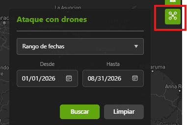
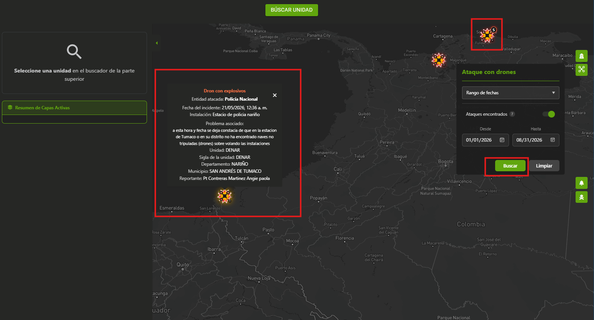

# Ataque con Drones

## 1. Identificación

| Campo | Valor |
|---|---|
| ID | POL-MAPA-001 |
| Módulo | Fuentes Externas |
| Capa | Capa Ataque con Drones |
| Frecuencia de actualización | null |
| Hora de carga del Data Lake | null |
| Última actualización del caso | 25/09/2026 |

## 2. Descripción

Capa que permite visualizar a nivel nacional los eventos de ataque con drones registrados en el territorio, sin necesidad de filtrar por unidad o sigla. Cada evento se representa sobre el mapa con un icono de dron explotado e incluye información de la entidad atacada. Cuenta con filtros de fecha por rango, día específico y comparación, y se alimenta del archivo suministrado por Poveda en excel.

## 3. Ruta de acceso

1. Ingresar al aplicativo `IAPOL`.
2. Abrir el módulo `Anticipación a Fenómenos de Seguridad`.
3. Seleccionar el submódulo `Mapa de Anticipación a Fenómenos de Seguridad`.
4. Ingresar a `Mapa`.

- Ruta resumida:

`Menú principal > Anticipación a Fenómenos de Seguridad > Mapa de Anticipación a Fenómenos de Seguridad`

## 4. Activación de la capa

1. Seleccionar capa `Ataque con Drones`
2. Aplicar los filtros requeridos por rango de fecha o dia especifico.
3. Click boton Buscar

  

4. Se despliegan iconos en representación de los registros
5. Iconos se agrupan acorde al zoom del mapa
6. al hacer click sobre icono despliega card informativo

  

## 5. Parámetros y filtros de prueba

| Parámetro | Valor utilizado | Obligatorio |
|---|---|---|
| Sigla | Todos | No |
| Unidades hijas | Todos | No |

## 6. Fuente de datos

### Archivo con registros proporcionado por la Policía

#### Fuente de datos: 
Encuesta de incidentes con drones recopilada mediante Survey123, entregada por Poveda en formato CSV y Excel (114 registros, 22 campos). Ambos archivos contienen la misma información. Incluye datos de entidad atacada, tipo de incidente, fuerza, unidad, departamento, municipio, coordenadas y fecha/hora del evento.
                                

## 7. Validaciones funcionales

- [ ] La capa puede activarse y desactivarse.
- [ ] El detalle del punto muestra los campos definidos.
- [ ] El nombre y la descripción son correctos.
- [ ] Los filtros modifican la información mostrada.
- [ ] Los puntos aparecen en el área geográfica esperada.
- [ ] La leyenda y los colores corresponden a la capa.
- [ ] No se presentan errores al cargar la información.

## 8. Validaciones de datos

- [ ] La cantidad total coincide.
- [ ] No existen identificadores duplicados.
- [ ] Una muestra de registros coincide entre ambas fuentes.
- [ ] La cantidad mostrada en el mapa coincide con los archivos.

## 9. Criterios de aceptación

La prueba es exitosa cuando:

1. La capa carga sin errores.
2. La información corresponde al periodo seleccionado.
3. La fuente de Policía coinciden después de aplicar las reglas
   de transformación.
4. La cantidad del mapa coincide con el resultado esperado en los archivos.
5. No existen diferencias sin justificación documentada.

## 10. Conclusión
La capa se despliega en producción el 25/09/2026