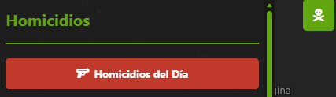
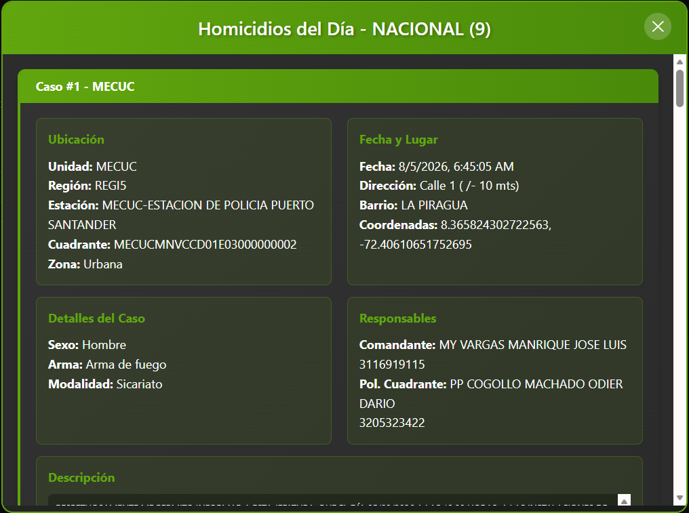
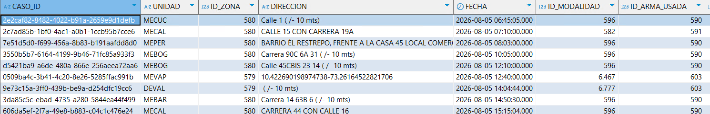
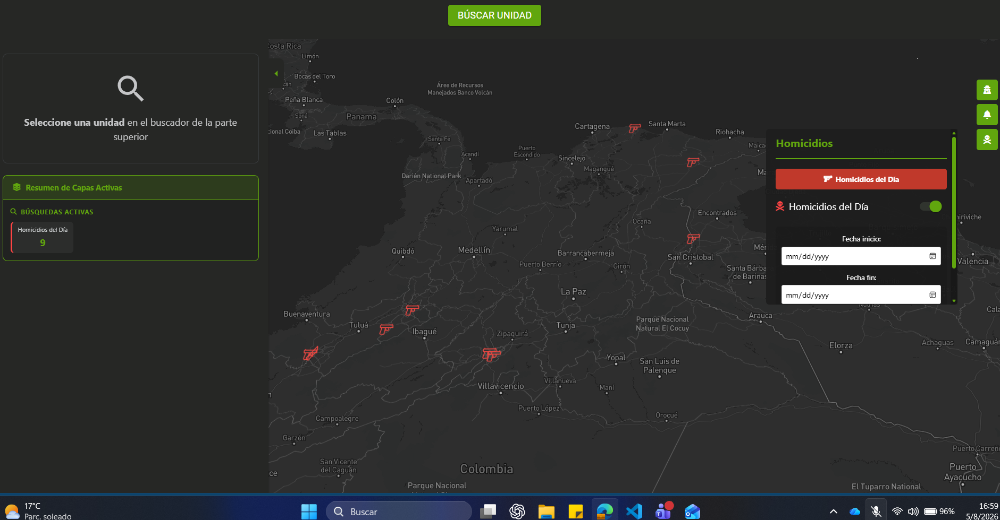
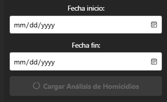

# Homicidios del dia

### Prueba funcional modulo completo:

#### 1. Boton detalles Homicidios del dia:
Al hacer clic sobre el botón (Imagen 1) debe desplegar el listado a detelle en tiempo real de los homicidios registados durante el día (Imagen 2). De esta manera se confirma el funcionamiento del boton.

- Imagen 1:  


- Imagen 2:


Continuando con la prueba de funcionamiento se debe validar sobre la base de datos de la policia que esten registrados los homicidios de la lista.

Datos requeridos:

- DataBase: GEOPOL (bestion)
- schema: USR_PMU
- View: V_HOMICIDIO_2024 (Aunque el nombre de la tabla confunda con 2024, esa tabla solo registra los homicidios del día de hoy y cada día se limpia)
- Query: 

``` sql
SELECT * FROM  USR_PMU.V_HOMICIDIO_2024 
```

- Imagen 3: (Bastion con registros de lista de homicidios)


Al comparar que la información registrada en DB con respecto a la lista de homicidios es la misma, se confirma que el workflow es correcto desde la fuente hasta la visulización de los datos.


---
#### 2. Boton Iconos sobre mapa Homicidios del dia:
Al hacer clic sobre el checkbox (Imagen 4) debe visualizar mediante iconos sobre los mapas los homicidios registados en el listado de homicidios del dia (Imagen 2). De esta manera se confirma el funcionamiento del boton.

- Imagen 4:  


Se debe visualizar el checkbox en verde y el mismo numero de iconos que de homicidios, adicionalmente el icono refleja el arma del homicidio bien sea de fuego o arma blanca. De esta manera confirmamos un adecuado funcionamiento en la visualización de información sobre el mapa.

- Imagen 5: 



---
#### 3. Boton Rango fechas analisis de Homicidios:
Esta opción permite visualizar geograficamente los homicidios en un rango de fechas determinado, para esto se debe especificar el rango de fechas y se debe hacer clic sobre 'cargar Análisis de Homicidos'.

- Imagen 6:   


Al hacer clic sobre cualquier Homicido representados como puntos rojos se debe desplegar una ventana con la información del mismo.

- Imagen 7:


En la ventana desplegada se puede visualizar la información de la primera patrulla en responder al homicidio y el recorrido posterior a la atención del homicidio. Adicionalmente las unidades que hicieron presencia previa al homicidio en el lugar de los hechos.

- Imagen 8:


Recorrido Primera Patrulla en Atender Homicidio y patrullas previas en el lugar

De esta manera se confirma una correcta operación de la funcionalidad
- Imagen 9:


