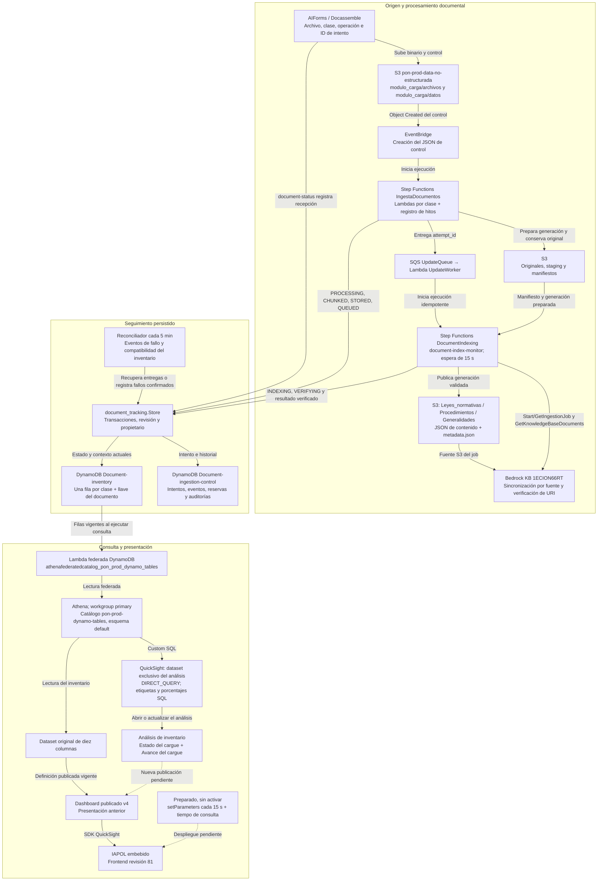

# D12 · Documentación técnica del tablero de seguimiento del cargue documental

## 1. Propósito y límites del tablero

El tablero permite conocer el estado actual de cada documento dentro del cargue: recepción, preparación, almacenamiento, incorporación a Bedrock, verificación y resultado. Su fuente de estado es **DynamoDB**; la existencia del PDF en S3, `archive_status = Ingested` o un job global `COMPLETE` no sustituyen la comprobación por documento.


## 2. Arquitectura y flujo completo de datos

[Abrir el diagrama técnico editable](estado-cargue-documental-as-is.drawio). Las flechas punteadas hacia publicación y temporizador son capacidades pendientes de activación.



Las flechas de la capa analítica indican **linaje de los datos devueltos**: QuickSight solicita una consulta a Athena y Athena invoca al conector para leer DynamoDB. No representan un envío automático de DynamoDB hacia el navegador. Bedrock no es la fuente SQL del tablero: sus resultados alimentan el estado persistido que este consulta.

## 3. Inventario técnico de recursos

Los nombres físicos son evidencia B del corte citado; las rutas de implementación corresponden a evidencia A.

| Capa | Recurso / identificador | Función |
|---|---|---|
| Formulario | Entrevista `docassemble.cargaPonal:data/questions/carga_archivos_PONAL_2.yml`, host `forms.ia.policia.gov.co` | Recibe altas, reemplazos y retiros |
| S3 | `pon-prod-data-no-estructurada` | Binarios, controles, staging, contenido publicado y auditorías |
| Inventario DynamoDB | `pon-prod-expertopol-Document-inventory` | Fuente operacional del tablero |
| Control DynamoDB | `pon-prod-expertopol-Document-ingestion-control` | Seguimiento por intento; no es el dataset visualizado |
| SFN de ingesta | `IngestaDocumentos79DD5487-shSXrPWuG6dG` | Valida y procesa; entrega a indexación |
| SQS | `pon-prod-expertopol-DataIngestion-stack-UpdateQueue71D8DE9E-WPaGpeOxNoKw` | Desacopla procesamiento e indexación |
| SFN de indexación | `DocumentIndexingD70BB6A1-nk3uo21WUbGS` | Publica, sincroniza y comprueba el resultado |
| API de seguimiento | `pon-prod-expertopol-document-status` | Registra y consulta intentos del solicitante |
| Monitor | `pon-prod-expertopol-document-index-monitor` | Consulta jobs y verifica manifiestos |
| Reconciliador | `pon-prod-expertopol-document-ingestion-reconciler` | Recuperación periódica de operaciones sin progreso |
| KB documental | `Data-no-estructurada-Expertopol`, ID `1ECION66RT` | Índice documental asociado a la ingesta |
| Catálogo Athena | `pon-prod-dynamo-tables`, tipo federado `DYNAMODB` | Expone el inventario sin copiarlo a una tabla S3 |
| Conector Lambda | `athenafederatedcatalog_pon_prod_dynamo_tables` | Funciones de metadatos y lectura del catálogo |
| Conexión Glue del catálogo | `athenafederatedcatalog_pon_prod_dynamo_tables` | Configuración de conexión federada; no es un job Glue ETL |
| Athena | Workgroup `primary`, motor observado v3 | Ejecuta el SQL del dataset |
| Data source QuickSight | `Expertopol-Document-Inventory`, ID `32d55f8d-f52a-499a-ad2d-14bf3dcaef62`, tipo `ATHENA` | Conecta QuickSight con Athena |
| Dataset del análisis | `document-inventory-ingestion-tracking-analysis` | Consulta directa con 13 columnas |
| Dataset del dashboard v4 | `0b9602ea-c968-4fc0-bc95-70a0251ac3b1` | Definición original de diez columnas |
| Análisis | `pon-prod-expertopol-document-inventory analysis`, ID `07222feb-9dff-408b-a39a-d335527fb7df` | Nuevas columnas implementadas |
| Dashboard | `e10005c5-a7d9-4097-833e-b8e6bb905413`, versión publicada 4 | Recurso embebido actual |
| Lambda de URL embebida | `pon-quicksight-embed-url` | Integración existente de acceso al dashboard |
| IAPOL | Servicio `pon-prod-ai-front-service`, revisión 81 | Presentación del dashboard publicado |

[Abrir análisis](https://us-east-1.quicksight.aws.amazon.com/sn/analyses/07222feb-9dff-408b-a39a-d335527fb7df) · [Abrir dashboard](https://us-east-1.quicksight.aws.amazon.com/sn/dashboards/e10005c5-a7d9-4097-833e-b8e6bb905413).

## 4. Fuentes, modelo de datos y transformación

### 4.1 Fuente operacional

La tabla de inventario utiliza **PK `class_name` y SK `document_key`**. Conserva el LSI `status-index`, cuya clave de ordenamiento es `archive_status`, utilizado por la selección de originales del formulario. Ese índice no convierte `Ingested` en confirmación de disponibilidad.

| Atributo | Uso |
|---|---|
| `class_name`, `document_key` | Identidad del registro; clase y llave del original |
| `archive_name`, `archive_extension`, `archive_content_type`, `archive_size` | Datos descriptivos del archivo; tamaño en bytes |
| `archive_created_at`, `archive_last_modified`, `modified_by` | Fechas y autoría del archivo; no equivalen al último avance del intento |
| `archive_status` | Estado del original: `Ingested` o `Deprecated` |
| `ingestion_status` | Estado técnico vigente, base de la etiqueta y del porcentaje |
| `ingestion_attempt_id`, `ingestion_context`, `ingestion_managed` | Correlación y propiedad del seguimiento operativo; no se proyectan todos en la tabla visual |
| `ingestion_validation` | Fotografía de validación histórica, motivos, progreso comprobado y referencias de auditoría |

La tabla de control identifica intentos mediante `ATTEMPT#<attempt_id>`, eventos mediante `EVENT#...`, reservas por documento/KB y auditorías históricas. `Store.receive()` reserva el documento y registra la recepción; `Store.save()` actualiza intento, inventario e historial en una transacción condicionada por revisión y propietario. Así se rechazan escrituras atrasadas y regresiones terminales.

### 4.2 Consulta federada y dataset

La relación consultada es:

```sql
"pon-prod-dynamo-tables"."default"."pon-prod-expertopol-document-inventory"
```

El nombre en Athena está normalizado a minúsculas; el nombre físico de DynamoDB conserva `Document-inventory`. La [consulta completa reproducible](estado-cargue-documental.sql) mantiene las diez columnas originales y agrega:

| Columna añadida | Tipo / cálculo | Presentación |
|---|---|---|
| `ingestion_status` | STRING, código de DynamoDB | Entrada técnica de los cálculos |
| `estado_cargue` | STRING, `CASE upper(coalesce(ingestion_status, 'UNKNOWN'))` | Estado del cargue |
| `avance_cargue` | DOUBLE en SQL; DECIMAL en definición QuickSight; fracción entre 0 y 1 o NULL | Avance del cargue, formato porcentaje sin decimales |

El dataset conserva `DIRECT_QUERY`: no hay importación SPICE ni un job ETL de refresco para este inventario. El SQL contiene `WHERE <<$SeguimientoActualizacion>> >= 0`; el parámetro entero se vincula entre análisis y dataset, con valor inicial cero. Los valores positivos del mecanismo preparado cambian la consulta sin filtrar documentos.

### 4.3 Configuración de presentación

- `Nombre_Archivo` se calcula desde `document_key`, considerando que `archive_extension` puede estar vacía durante la recepción.
- Estado y avance aparecen junto al nombre. `document_key` permanece como campo de agrupación oculto para no fusionar documentos de igual nombre.
- `archive_status` se muestra como **Estado del archivo**, separado del estado del cargue.
- Los controles con selección de todos los valores incluyen nulos; los filtros explícitos del usuario siguen aplicándose.
- La tabla muestra el estado por documento, sin promedio de progreso ni una fila por fragmento Bedrock.

### 4.4 Diccionario completo de estados

| Código DynamoDB | Estado visible | Avance |
|---|---|---:|
| `UPLOADED` | Archivo recibido | 10 % |
| `PROCESSING` | Leyendo y preparando el documento | 25 % |
| `CHUNKED` | Contenido preparado | 45 % |
| `STORED` | Documento guardado | 60 % |
| `QUEUED_FOR_INDEXING` | En espera de incorporación al chatbot | 65 % |
| `INDEXING` | Incorporando contenido al chatbot | 80 % |
| `INDEXED` | Contenido incorporado; pendiente de verificación | 90 % |
| `VERIFYING` | Verificando disponibilidad | 95 % |
| `AVAILABLE` | Disponible para consultas | 100 % |
| `DELETING` | Retirando documento | — |
| `DELETED` | Documento retirado | 100 % |
| `FAILED` | No se pudo completar el proceso | — |
| `HISTORICAL_REVIEW` | Contenido consultable; requiere revisión | 95 % |
| `HISTORICAL_STORED` | Original guardado; contenido por verificar | 60 % |
| `HISTORICAL_MISSING_ORIGINAL` | Archivo original no encontrado | 0 % |
| `HISTORICAL_INVALID_ORIGINAL` | Archivo original incompleto; requiere reemplazo | 0 % |
| `HISTORICAL_RETIRED` | Retirado del inventario | 100 % |
| `HISTORICAL_RETIREMENT_REVIEW` | Retiro pendiente de completar | 95 % |
| `HISTORICAL_PARTIAL_INDEX` | Contenido parcialmente indexado | 80 % |
| `HISTORICAL_PENDING_INDEX` | Contenido preparado; indexación pendiente | 65 % |

`INDEXED` es un estado de fragmento, incluido solo por compatibilidad si aparece en el inventario; no sustituye `AVAILABLE`. En operación, `AVAILABLE` exige confirmar las URI del manifiesto, la integridad y el original; los reemplazos comprueban además el retiro de la generación anterior. Las auditorías históricas añadieron consultas `Retrieve` como evidencia adicional de recuperación.

Para `UNKNOWN` o atributo ausente, el fallback es **Sin seguimiento histórico**; si además `archive_status = Deprecated`, **Retirado (sin seguimiento histórico)**. Ambos conservan porcentaje vacío. Un código no reconocido produce **Estado pendiente de confirmar**, también sin porcentaje. En el corte final de los 257 registros estos fallbacks no tienen casos.

## 5. Mecanismos y frecuencia de actualización

| Capa | Disparador / frecuencia | Qué actualiza |
|---|---|---|
| Recepción y procesamiento | Por solicitud y por hito confirmado | Intento, estado e historial en DynamoDB |
| Inventario de originales | Eventos S3 de creación/eliminación bajo `documentos_Originales/` | Atributos de archivo; preserva seguimiento gestionado |
| Entrega a indexación | Mensaje SQS por intento, con reintentos | Inicia `DocumentIndexing` idempotente |
| Sincronización Bedrock | Bajo demanda por la ingesta y por fuente; espera de reserva KB | Índice documental y contexto del job |
| Monitor Bedrock | Espera de **15 s entre comprobaciones**, más llamadas y reintentos | Estado del job y verificación por URI |
| Reconciliación | EventBridge **cada 5 min** | Detecta falta de progreso, recupera entregas o confirma fallo |
| Formulario AIForms | Consulta **cada 5 s** mientras hay intentos pendientes | Estado mostrado por archivo |
| Análisis QuickSight | Al abrir, actualizar o ejecutar una nueva consulta por interacción | Filas leídas vía Athena/conector |
| Embebido IAPOL vigente | Carga/interacciones del dashboard publicado | Vista del dashboard v4 |
| Embebido preparado | `setParameters` cada **15 s tras finalizar la consulta anterior**, más latencia | Provoca consultas nuevas; conserva filtros |
| Auditorías/correcciones históricas | Ejecuciones operativas puntuales autorizadas | Estados comprobados y evidencias |

**Tiempo real en DynamoDB** significa escritura al alcanzar el hito. **Consulta directa en QuickSight** significa leer la fuente cuando se ejecuta una consulta; no implica WebSocket ni notificación automática al navegador. El mecanismo preparado es sondeo periódico. La latencia visible suma procesamiento, sincronización, intervalo de observación y tiempo de consulta; el porcentaje no es una medición del tiempo restante.

## 6. Rutas de almacenamiento y conservación

Salvo las consultas Athena, las rutas S3 de esta tabla pertenecen a `s3://pon-prod-data-no-estructurada/`.

| Ruta / ubicación | Contenido y uso |
|---|---|
| `modulo_carga/archivos/<clase>/<attempt_id>/...` | Binario recibido por intento |
| `modulo_carga/datos/<clase>/<attempt_id>/...` | JSON de control; el contenido es JSON aunque la llave pueda conservar el nombre/extensión del archivo |
| `documentos_Originales/<clase>/<archivo>` | Original definitivo citado por los metadatos; valor de `document_key` |
| `documentos_deprecados/<attempt_id>/...` | Archivo de originales reemplazados o retirados por el flujo |
| `ingestion_staging/<attempt_id>/...` | Generación preparada, fuera de las fuentes Bedrock |
| `Leyes_normativas/`, `Procedimientos/`, `Generalidades/` | Prefijos de las fuentes; JSON de contenido y sus `.metadata.json`; incluyen estructuras heredadas |
| `<prefijo_fuente>/_ingestion/<attempt_id>/...` | Publicación de nuevas generaciones gestionadas |
| `ingestion_tracking/<attempt_id>/chunks.json` | Manifiesto exacto de fragmentos y ETags |
| `ingestion_tracking/<attempt_id>/retired.json` | Manifiesto de la generación anterior a retirar |
| `ingestion_tracking/historical-audits/<run_id>/` | Evidencia de validación inicial |
| `ingestion_tracking/metadata-repairs/<run_id>/` | Respaldos, metadatos huérfanos y verificaciones de los 120 |
| `ingestion_tracking/historical-recovery49/<run_id>/` | Respaldo, OCR, extracciones y evidencia de recuperación |
| `ingestion_tracking/historical-retirements/<run_id>/` | Respaldo y evidencia del retiro cerrado |
| `s3://aws-athena-query-results-926162397524-us-east-1/quicksight-inventory-validation/` | Resultados de las consultas de **verificación** ejecutadas; no se presenta como ruta universal de todas las consultas del dashboard |
| DynamoDB inventario | Estado actual, atributos del original y validación; no es un archivo CSV en S3 |
| DynamoDB control | Intentos, eventos, reservas, revisión y auditorías; TTL `expires_at` para registros que lo utilizan |
| QuickSight | Definiciones de análisis, datasets, dashboard y parámetros, almacenadas como recursos administrados |
| `docs/Reports/` | Evidencias fechadas JSON/CSV y resultados locales de cada intervención |
| `docs/tableros/` | Esta ficha, SQL reproducible y diagrama D12 editable |

El inventario y la tabla de control tienen política de conservación `RETAIN` en CDK; el control tiene recuperación a un momento dado. La cola principal conserva mensajes cuatro días, su DLQ catorce días y deriva después de cinco recepciones máximas. Los backups históricos quedan fuera de los prefijos de ingesta para no incorporarlos accidentalmente a la KB. No se deduce de ello una política de retención S3 no documentada.

## 7. Jobs de sincronización asociados

### 7.1 Relación de clase, fuente y almacenamiento

| Clase de inventario | Prefijo fuente S3 | Data source de la KB `1ECION66RT` |
|---|---|---|
| `Leyes y normas` | `Leyes_normativas/` | `FZZJ7G0HRA` |
| `Procedimientos` | `Procedimientos/` | `5SMLYGJAQK` |
| `Generalidades` | `Generalidades/` | `MHPRGLRZBY` |

`DocumentIndexing` utiliza `StartIngestionJob`, consulta `GetIngestionJob` y verifica cada URI mediante `GetKnowledgeBaseDocuments`. Registra KB, fuente, job, ejecuciones y manifiesto en el contexto del intento. Un job puede examinar muchos fragmentos de una fuente; sus contadores no equivalen al número de documentos originales del inventario.

### 7.2 Ejecuciones observadas relevantes

Todos los jobs de esta tabla terminaron `COMPLETE` con cero documentos fallidos, según las evidencias fechadas.

| Intervención | Fuente | Job ID |
|---|---|---|
| Corrección de metadatos de los 120 | Leyes y normas | `RUEP5GXNG0` |
| Corrección de metadatos de los 120 | Procedimientos | `ZTEHFR8ROK` |
| Corrección de metadatos de los 120 | Generalidades | `6WCHCQ29EW` |
| Recuperación de históricos | Leyes y normas | `ME50RAOFFH` |
| Recuperación de históricos | Procedimientos | `RE4DQQ2SAJ` |
| Retiro de generación antigua | Generalidades | `EPUHKPFTQN` |

La recuperación histórica utilizó sincronizaciones compartidas con los IDs asociados a los intentos; no se simularon mensajes SQS o ejecuciones SFN individuales. Estos jobs **sincronizan la KB**, no materializan ni refrescan un dataset SPICE. No existe un job Glue ETL añadido para el tablero: su lectura es federada.

## 8. Operación, diagnóstico y controles

1. **Registro mostrado:** localizar `class_name` y `document_key`. Consultar `ingestion_status`; separar el estado del archivo de la disponibilidad del contenido.
2. **Correlación:** obtener `ingestion_attempt_id` y consultar `ATTEMPT#<id>` en la tabla de control. Para históricos sin intento, consultar `ingestion_validation` y su evidencia/auditoría.
3. **Procesamiento:** revisar los ARN de ingesta/indexación y sus errores. `SUCCEEDED` en la primera máquina puede significar solo entrega a SQS.
4. **Sincronización:** comprobar el job, KB y fuente del intento. Revisar cola/DLQ y CloudWatch de los componentes implicados si falta la entrega.
5. **Disponibilidad:** verificar el manifiesto completo, original, metadatos y fragmentos retirados. Las auditorías añaden búsquedas filtradas por referencia/ID; no se debe cambiar a 100 % solo para mejorar la presentación.
6. **Presentación:** abrir/actualizar el análisis. Si DynamoDB cambió y la vista no, revisar la ejecución Athena, filtros y dataset vinculado. En IAPOL, recordar que la versión publicada aún conserva la presentación anterior.

Ejemplos de lectura, sin modificaciones:

```bash
aws dynamodb get-item --profile iapol-prod --region us-east-1 \
  --table-name pon-prod-expertopol-Document-ingestion-control \
  --key '{"id":{"S":"ATTEMPT#<attempt_id>"}}' --consistent-read

aws bedrock-agent get-ingestion-job --profile iapol-prod --region us-east-1 \
  --knowledge-base-id 1ECION66RT --data-source-id MHPRGLRZBY \
  --ingestion-job-id EPUHKPFTQN

aws quicksight describe-dashboard --profile iapol-prod --region us-east-1 \
  --aws-account-id 926162397524 \
  --dashboard-id e10005c5-a7d9-4097-833e-b8e6bb905413
```