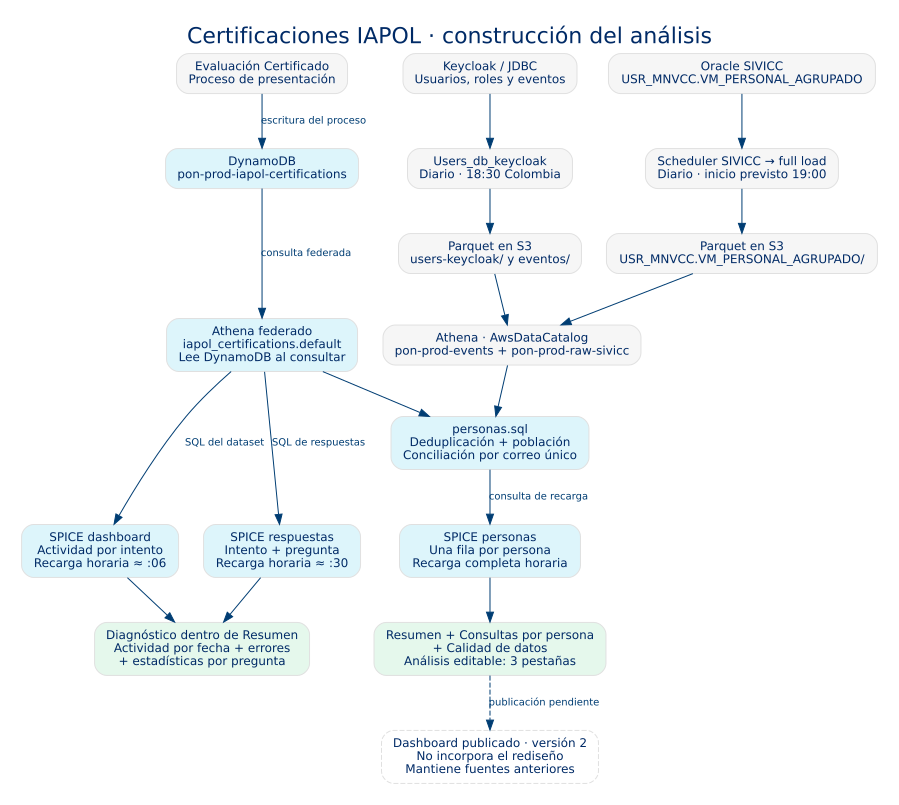
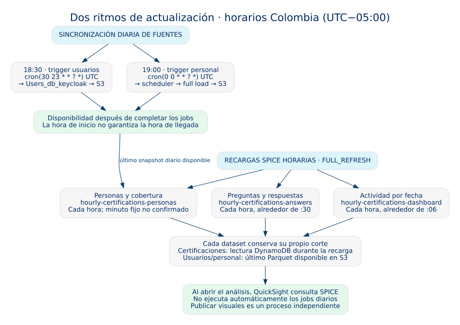

# Análisis del tablero Monitoreo Certificaciones IAPOL

## 1. Respuestas principales

- **¿Cómo se construye?** Con visualizaciones y campos calculados de QuickSight sobre datasets SPICE. Las recargas ejecutan consultas Athena: una consulta federada de certificaciones en DynamoDB y consultas de usuarios, actividad y personal almacenados como Parquet en S3. El rediseño incorpora una base de una fila por persona para contar presentación y pendientes.
- **¿Qué procesos actualizan los datos?** El proceso de evaluación escribe certificaciones en DynamoDB; Glue exporta usuarios/eventos de Keycloak y personal de Oracle hacia S3; QuickSight recarga SPICE desde Athena mediante sus schedules.
- **¿Cada cuánto se actualiza?** Usuarios y actividad se exportan diariamente a partir de las **18:30 Colombia**; la orquestación de personal comienza diariamente a las **19:00 Colombia**. Los tres datasets del análisis se recargan **cada hora**. El dataset anterior `User_Roles` tenía recarga diaria a las **23:59 Colombia**.
- **¿Contra qué fuente se actualiza?** Certificaciones: DynamoDB `pon-prod-iapol-certifications`. Usuarios y actividad: fuentes JDBC de Keycloak exportadas a S3. Personal: Oracle `USR_MNVCC.VM_PERSONAL_AGRUPADO`, también exportado a S3.
- **¿Dónde se guarda?** Certificaciones maestras en DynamoDB; usuarios/eventos/personal en rutas S3; resultados temporales de Athena en su bucket de resultados; copias de consulta de los visuales en SPICE. Las rutas completas están en la sección 6.
- **¿Qué jobs intervienen?** `Users_db_keycloak`, `pon-prod-raw-sivicc-dashboard-scheduler` y `pon-prod-raw-sivicc-dashboard-full-load-job`. Las recargas `hourly-certifications-*` son schedules de QuickSight, no jobs Glue.
- **Implicación operativa:** una recarga horaria de SPICE puede leer el mismo snapshot diario de usuarios/personal. Refrescar el dataset no vuelve a ejecutar sus jobs de extracción.

## 2. ¿Cómo se construye este tablero?

### 2.1. Recursos de visualización

- **Análisis editable:** `71539772-349a-410c-9b80-4afbbc210f38`, denominado `Monitoreo Certificaciones IAPOL - Analysis`.
- **Análisis de validación:** `monitoreo-certificaciones-iapol-v2`.
- **Dashboard publicado:** `eb26ab6d-5941-474a-83f5-db4b16c41c0a`, versión publicada **2** en el corte.
- **Diferencia entre análisis y dashboard:** editar visuales, títulos o pestañas modifica el análisis. Publicarlo crea/selecciona una versión del dashboard. Recargar los datasets actualiza sus datos de forma independiente de esa publicación.
- **Origen técnico reproducible:** [dashboard.py](../../pipelines/quicksight/certificaciones_iapol/dashboard.py) construye visuales, cálculos, filtros y distribución; [deploy.py](../../pipelines/quicksight/certificaciones_iapol/deploy.py) administra planes y aplicación de definiciones.

### 2.2. Tablero anterior y análisis rediseñado

- **Dashboard anterior/publicado:** consumía `certificaciones-iapol-dashboard`, `certificaciones-iapol-respuestas` y el dataset `User_Roles`, ID `75d9803d-1475-47cf-9c9a-de0c5b163381`.
- **Problema del diseño anterior:** algunos visuales mezclaban registros de intento, resúmenes de certificación y usuarios con distinto nivel de detalle. Un resumen sin aprobación no representa necesariamente a una persona que nunca presentó la prueba.
- **Problema del denominador:** el total de usuarios provenía de otra fuente y no definía una población común con los indicadores de certificación.
- **Problema del cruce anterior:** `User_Roles` combinaba usuarios, personal, eventos y roles antes de agregar. Su ingestión observada contenía **211.120.323 filas**; esa cantidad es volumen del dataset, no personas únicas.
- **Cambio del rediseño:** el resumen usa `certificaciones-iapol-personas`, construido con una fila por ID Keycloak. El dataset compartido `User_Roles` no se modificó.
- **Tres datasets del análisis rediseñado:** personas para cobertura/listado/calidad; dashboard para actividad por fecha; respuestas para diagnóstico de preguntas.

### 2.3. Construcción de la base por persona

- **SQL principal:** [personas.sql](../../pipelines/quicksight/certificaciones_iapol/personas.sql).
- **Selección de actividad:** reduce los eventos de 2026 a `DISTINCT user_id` antes de unirlos con usuarios y personal; evita multiplicar personas por su número de eventos.
- **Selección de población:** usuarios Keycloak que cruzan con personal activo (`estado_empleado = 'AC'`), unidad informada, correo institucional y actividad IAPOL en 2026.
- **Una fila por persona:** conserva un registro por ID Keycloak, con la información de personal más reciente y un desempate determinista.
- **Conciliación de identidad:** normaliza correos con `lower(trim(...))`; admite correo de usuario y correo de personal como alias cuando cada alias tiene un único propietario en la población.
- **Cruce con certificaciones:** asigna intentos por correo único. No asigna resultados por semejanza de nombre ni supone que `user_key` de certificaciones sea el ID Keycloak.
- **Inclusión de pendientes:** usa un `LEFT JOIN` desde la población hacia los intentos. Así permanecen en la base quienes no tienen evidencia conciliada de presentación.
- **Salidas:** estado de presentación, indicadores `presento`, `pendiente`, `aprobo`, número de intentos, fechas e incidencias de identidad.

### 2.4. Visualizaciones del análisis

- **Resumen de presentación:** población, presentaron, pendientes, porcentajes, aprobaciones, dona y barras por unidad. Incluye preguntas con más errores, actividad por fecha y estadísticas por pregunta.
- **Consultas por persona:** nombre, correo, unidad, presentación, aprobación e intentos; filtros de estado y búsquedas por nombre/correo.
- **Calidad de datos:** correos con intento fuera del cruce, personas con correo compartido, aprobaciones sin intento y fechas de lectura/actividad.
- **Filtros:** unidad compartida entre resumen y listado; búsquedas y estado limitados al listado. El diagnóstico de intentos/respuestas de la fuente completa no recibe el filtro de unidad de los KPI de cobertura.
- **Presentación visual:** banner institucional original y título centrado; azul oscuro, cian y verde sobre fondos blancos. La distribución de puntajes se reemplazó por actividad diaria.

- **Lectura del gráfico:** las ramas de identidad/personal y certificaciones convergen en la base por persona. Los datasets de intentos y respuestas mantienen su propio nivel de detalle. La flecha de publicación está punteada porque el rediseño no se publicó.
- **Diagrama arquitectónico editable del repositorio:** [D12, dos páginas](monitoreo-certificaciones-iapol-as-is.drawio). El SVG anterior es un apoyo explicativo y no sustituye ese diagrama.

## 3. ¿Qué procesos de actualización de datos tiene?

### 3.1. Registro de certificaciones

- **Entrada:** presentación de la evaluación `docassemble.formularioCertificado:data/questions/EvaluacionCertificado.yml`.
- **Persistencia:** el proceso de certificaciones registra información en DynamoDB `pon-prod-iapol-certifications`.
- **Registros relevantes:** intentos `kind = 'ATTEMPT'` y resúmenes identificados por `record_key` terminado en `#SUMMARY`.
- **Acceso analítico:** Athena consulta la tabla mediante el catálogo federado `iapol_certifications`, asociado a `926162397524:dynamodb_bi`.
- **Límite confirmado:** no se identificó un job Glue de exportación de certificaciones a S3 en esta cadena. La implementación completa del escritor de la evaluación no está versionada en este repositorio.

### 3.2. Exportación de usuarios, roles y actividad

- **Job:** `Users_db_keycloak`.
- **Conexión:** JDBC `pon-prod-keycloak-houndoc`.
- **Fuentes:** `public.vw_user_keycloak_v3`, `public.vw_users_keycloak_con_roles` y `public.event_entity`.
- **Salida:** Parquet en `users-keycloak/`, `usuarios-roles/` y `eventos/` dentro de `pon-prod-quicksight`.
- **Modo observado:** `overwrite` y `coalesce(1)`; reemplaza los archivos de exportación en sus rutas.
- **Uso en el rediseño:** usuarios y eventos seleccionan la población; los roles exportados forman parte del proceso anterior, pero no se usan para los nuevos conteos de presentación/pendientes.

### 3.3. Carga de personal institucional

- **Orquestador:** `pon-prod-raw-sivicc-dashboard-scheduler`.
- **Extractor:** `pon-prod-raw-sivicc-dashboard-full-load-job`, job genérico que procesa distintas tablas según sus argumentos.
- **Fuente de este tablero:** Oracle `USR_MNVCC.VM_PERSONAL_AGRUPADO`.
- **Carga observada:** full load sin filtro temporal de esa tabla hacia Parquet y metadatos del catálogo `pon-prod-raw-sivicc`.
- **Precaución de interpretación:** el éxito de un run de otra tabla no prueba que la carga de personal terminó; se debe revisar `--table_name`.
- **Riesgo del método observado:** la purga de la ruta y recreación de metadatos antes de escribir puede producir una ventana de indisponibilidad durante una recarga. No se afirma que haya causado una falla concreta del tablero.

### 3.4. Consultas Athena y recargas SPICE

- **Fuente de QuickSight:** data source `pon-prod-iapol-certifications-athena`.
- **Workgroup:** `pon-prod-certifications-bi`.
- **Rol observado:** `pon-prod-quicksight-role2`.
- **Base de personas:** consulta SQL que cruza los catálogos de S3 con certificaciones federadas, y carga el resultado en `certificaciones-iapol-personas`.
- **Actividad:** dataset `certificaciones-iapol-dashboard`; el gráfico usa sólo `ATTEMPT` y agrupa `submitted_timestamp` por día UTC.
- **Preguntas:** dataset `certificaciones-iapol-respuestas`, con detalle de respuestas por usuario, intento y posición de pregunta.
- **Modo de refresco:** las programaciones inspeccionadas son `FULL_REFRESH`; recargan el resultado completo de cada dataset.
- **Consulta de los visuales:** QuickSight presenta la copia cargada en SPICE, no una consulta transaccional continua de todas las fuentes.

## 4. ¿Cada cuánto se actualiza?

- **Certificaciones en DynamoDB:** se escriben durante el proceso de evaluación. No se estableció un intervalo batch ni una garantía de latencia del escritor. La visibilidad en los visuales depende de la siguiente recarga SPICE exitosa.
- **Usuarios/roles/eventos — diario:** trigger `users-db-keycloak-quicksight`, `cron(30 23 * * ? *)` UTC, equivalente a **18:30 Colombia**.
- **Personal — diario:** trigger `pon-prod-orquestador-sivicc`, `cron(0 0 * * ? *)` UTC, equivalente a **19:00 Colombia**. Es la hora prevista del scheduler; la carga de personal depende de su cola y duración.
- **Actividad — cada hora:** schedule `hourly-certifications-dashboard`, alrededor del minuto **:06** según la configuración inspeccionada.
- **Respuestas — cada hora:** schedule `hourly-certifications-answers`, alrededor del minuto **:30** según la configuración inspeccionada.
- **Personas — cada hora:** schedule `hourly-certifications-personas`. La configuración recogida muestra `TimeOfTheDay = 01:27`, pero también se observó una ingestión programada a las 13:12; por ello no se afirma un minuto fijo de ejecución.
- **`User_Roles`, dataset anterior — diario:** schedule `335f190c-f810-4474-87e2-afc58860b853`, a las **23:59 America/Bogota**. La ejecución inspeccionada comenzó el día siguiente a las 00:03; programación e inicio efectivo pueden diferir.
- **Crawler `iapol_users`:** no se encontró programación asociada; su última ejecución registrada fue el 27-01-2026. Esa fecha corresponde al crawler y no determina la fecha del Parquet que el job sigue reemplazando.
- **Publicación del análisis:** no se identificó una publicación automática recurrente. Los cambios de estructura del análisis no se trasladan solos al dashboard publicado.
- **Frescura efectiva:** se compone del tiempo de actualización del origen, extracción a S3 cuando aplica, siguiente recarga SPICE y duración de la ingestión.
- **Cortes independientes:** las recargas de personas, intentos y respuestas no constituyen un snapshot transaccional único. Los valores entre gráficos pueden corresponder a lecturas de momentos diferentes.

- **Lectura del gráfico:** las cargas diarias entregan snapshots; las recargas horarias consultan el último snapshot disponible junto con las certificaciones que obtenga Athena. Abrir el análisis no dispara esas extracciones.

## 5. ¿Contra qué fuentes se actualiza?

- **Certificaciones maestras:** DynamoDB `pon-prod-iapol-certifications`.
- **Nombre de consulta federada:** `"iapol_certifications"."default"."pon-prod-iapol-certifications"`.
- **Identidad de usuarios:** fuentes Keycloak exportadas y consultadas como `"AwsDataCatalog"."pon-prod-events"."users_keycloak"`.
- **Actividad para la cohorte:** eventos exportados, consultados como `"AwsDataCatalog"."pon-prod-events"."eventos"`.
- **Personal activo y unidad:** Oracle `USR_MNVCC.VM_PERSONAL_AGRUPADO`, publicado para Athena como `"AwsDataCatalog"."pon-prod-raw-sivicc"."usr_mnvcc.vm_personal_agrupado"`.
- **Relación de identidad:** el SQL cruza `usuario_empresarial = username`, vincula eventos mediante ID Keycloak y concilia certificaciones mediante alias de correo único.
- **Año de actividad:** 2026 determina la pertenencia a la población, no limita la fecha de los intentos de la prueba seleccionada.
- **Condición de negocio pendiente:** esta cohorte no equivale a todo el personal institucional. Su alcance debe ratificarse con el responsable funcional.

## 6. ¿Cuál es la ruta donde se guarda la información?

### 6.1. Datos de negocio y copias analíticas

- **Certificaciones maestras:** tabla DynamoDB `pon-prod-iapol-certifications`. No se identificó una ruta S3 maestra de certificaciones en el flujo analizado.
- **Usuarios:** `s3://pon-prod-quicksight/users-keycloak/`.
- **Actividad/eventos:** `s3://pon-prod-quicksight/eventos/`.
- **Roles del proceso anterior:** `s3://pon-prod-quicksight/usuarios-roles/`.
- **Personal:** `s3://pon-prod-raw-sivicc/USR_MNVCC.VM_PERSONAL_AGRUPADO/`.
- **Resultados de consultas Athena:** `s3://pon-prod-certifications-athena/athena-results/`. Es almacenamiento de resultados, no la fuente maestra de certificaciones ni personal.
- **Copias de consulta:** SPICE `certificaciones-iapol-personas`, `certificaciones-iapol-dashboard` y `certificaciones-iapol-respuestas`, administradas por QuickSight. No se identificó una ruta S3 de descarga permanente de estas copias.
- **Ubicaciones internas del conector federado:** no confirmadas en la evidencia conservada; no deben confundirse con el bucket de resultados Athena.

### 6.2. Scripts y definición del tablero

- **Script de usuarios:** `s3://aws-glue-assets-926162397524-us-east-1/scripts/Users_db_keycloak.py`.
- **Script de orquestación de personal:** `s3://pon-prod-glue-scripts/shell/job_scheduler.py`.
- **Script full load según el JSON operativo:** `s3://pon-prod-glue-scripts/etl/full_load_job.py`.
- **Discrepancia documental por confirmar:** la ficha D12 menciona `s3://pon-prod-glue-scripts/etl/oracle_full_load_to_parquet.py`. No se da por equivalente a la ruta anterior ni se afirma cuál sigue desplegada el 06-10-2026. La comprobación pendiente es `Command.ScriptLocation` del job y, si aplica, el script invocado por éste.
- **Lógica de personas:** [personas.sql](../../pipelines/quicksight/certificaciones_iapol/personas.sql).
- **Definición visual y cálculos:** [dashboard.py](../../pipelines/quicksight/certificaciones_iapol/dashboard.py).
- **Gráfico de actividad:** [actividad-base.json](../../pipelines/quicksight/certificaciones_iapol/actividad-base.json).
- **Estilo y cabecera:** [style.py](../../pipelines/quicksight/certificaciones_iapol/style.py) y [header.py](../../pipelines/quicksight/certificaciones_iapol/header.py).
- **Evidencia operativa sin datos individuales:** [evidencia-certificaciones-20261005.json](evidencia-certificaciones-20261005.json).

## 7. ¿Cuáles son los jobs relacionados con la sincronización?

### 7.1. Jobs Glue activos identificados en el corte

- **`Users_db_keycloak`:** exportación de usuarios, roles y eventos desde Keycloak. Trigger diario `users-db-keycloak-quicksight`, observado `ACTIVATED`.
- **`pon-prod-raw-sivicc-dashboard-scheduler`:** orquesta la carga de tablas SIVICC, incluyendo personal. Trigger diario `pon-prod-orquestador-sivicc`, observado `ACTIVATED`.
- **`pon-prod-raw-sivicc-dashboard-full-load-job`:** extracción genérica Oracle→Parquet. Para este tablero interesa el run cuyo `--table_name` corresponde a `USR_MNVCC.VM_PERSONAL_AGRUPADO`.
- **Cadena usuarios:** `users-db-keycloak-quicksight` → `Users_db_keycloak` → S3 usuarios/roles/eventos → Athena → recarga SPICE.
- **Cadena personal:** `pon-prod-orquestador-sivicc` → scheduler SIVICC → full-load de personal → S3/catálogo → Athena → recarga SPICE.
- **Cadena certificaciones:** evaluación → DynamoDB → Athena federado → recarga SPICE; no se confirmó un job Glue de exportación de esa tabla.

### 7.2. Automatizaciones relacionadas que no son jobs Glue

- **`hourly-certifications-personas`:** schedule QuickSight de cobertura, listado y calidad.
- **`hourly-certifications-dashboard`:** schedule QuickSight de intentos/actividad.
- **`hourly-certifications-answers`:** schedule QuickSight de respuestas.
- **`iapol_users`:** crawler Glue para esquema de usuarios; no se confirmó un horario recurrente propio.
- **`pon-prod-users_db_keycloak` y `pon-prod-events-function`:** Lambdas relacionadas con exportación/eventos. No se demostró que sean los sincronizadores recurrentes de esta cohorte, por lo que no reemplazan al job/trigger comprobado en la explicación.

### 7.3. Alternativa incremental separada del proceso activo

- **`pon-prod-raw-sivicc-dashboard-incremental-scheduler`:** alternativa de migración identificada.
- **`pon-prod-orquestador-sivicc-incremental-shadow`:** trigger observado en estado `CREATED`, sin activar.
- **Interpretación:** no se atribuye al proceso incremental desactivado la actualización diaria de personal documentada en este informe.
